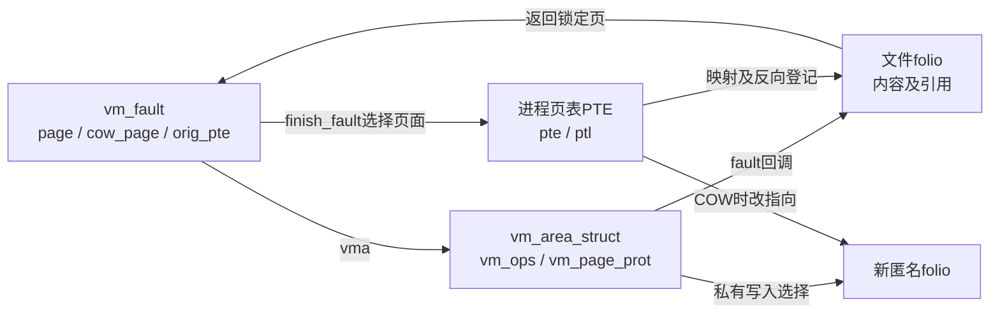
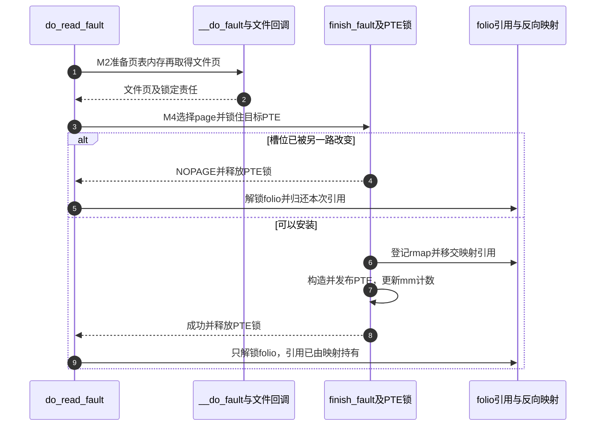

# 第47章\_文件页到进程页表的安装

M2提供文件页，M4才把它接入进程页表。本篇解释二者之间的责任交接，以及为什么页面读回以后还要重新检查PTE。固定Linux 6.12.20提交 `dfaf2136deb2af2e60b994421281ba42f1c087e0`；执行语句保留，上游长注释改为仓库中文阅读说明。

| 关联入口 | 任务 |
| --- | --- |
| [总索引](../navigation/P01_Linux_6.12_VFS源码阅读索引.md) | 版本与实现地图 |
| [映射导读](../navigation/P17_文件映射的缺页与状态交接.md#17.2_按重试与安装边界阅读实现) | M1～M4调用关系 |
| [正文](../../../../knowledge/kernel_subsystems/vfs/P18_文件mmap与page_fault.md#18.3_第一次访问为什么可能睡眠和重试) | 为何文件页存在还不能直接访问 |

## 47.1\_缺失PTE先分清读取和两种写入

`mm/memory.c::do_fault`处理普通文件缺失PTE的分支，按访问是否写入、VMA是否shared选择`do_read_fault/do_cow_fault/do_shared_fault`。已经存在但写保护的PTE由[do_wp_page](P48_私有文件映射的写时复制.md#48.2_已有只读PTE写入前先判断是否必须复制)处理，不经过同一入口。没有fault回调时仍取PTE锁重查，排除另一路临时更新造成的假缺失。

```c
/** @brief 仓库补充阅读说明：按缺失PTE的读写类型分流，最后归还未使用的预分配页表。 */
static vm_fault_t do_fault(struct vm_fault *vmf)
{
        /* 仓库补充：按缺失PTE的读写类型分流，最后归还未使用的预分配页表。 */
        struct vm_area_struct *vma = vmf->vma;
        struct mm_struct *vm_mm = vma->vm_mm;
        vm_fault_t ret;
        if (!vma->vm_ops->fault) {
                vmf->pte = pte_offset_map_lock(vmf->vma->vm_mm, vmf->pmd,
                                               vmf->address, &vmf->ptl);
                if (unlikely(!vmf->pte))
                        ret = VM_FAULT_SIGBUS;
                else {
                        if (unlikely(pte_none(ptep_get(vmf->pte))))
                                ret = VM_FAULT_SIGBUS;
                        else
                                ret = VM_FAULT_NOPAGE;
                        pte_unmap_unlock(vmf->pte, vmf->ptl);
                }
        } else if (!(vmf->flags & FAULT_FLAG_WRITE))
                ret = do_read_fault(vmf);
        else if (!(vma->vm_flags & VM_SHARED))
                ret = do_cow_fault(vmf);
        else
                ret = do_shared_fault(vmf);
        if (vmf->prealloc_pte) {
                pte_free(vm_mm, vmf->prealloc_pte);
                vmf->prealloc_pte = NULL;
        }
        return ret;
}
```

读故障先尝试fault-around：`should_fault_around/do_fault_around`利用`vm_ops->map_pages`映射附近已经就绪的缓存页，成功可以直接结束，并非每次都调用filemap_fault。该批量优化的窗口、PTE构造由MM与map_pages协作，本篇以下展开的是回退到单页fault的主线，不能据此声称所有映射都在finish_fault安装。

```c
/** @brief 仓库补充阅读说明：先尝试相邻就绪页映射，回退后取得文件页并交给MM安装。 */
static vm_fault_t do_read_fault(struct vm_fault *vmf)
{
        /* 仓库补充：先尝试相邻就绪页映射，回退后取得文件页并交给MM安装。 */
        vm_fault_t ret = 0;
        struct folio *folio;
        if (should_fault_around(vmf)) {
                ret = do_fault_around(vmf);
                if (ret)
                        return ret;
        }
        ret = vmf_can_call_fault(vmf);
        if (ret)
                return ret;
        ret = __do_fault(vmf);
        if (unlikely(ret & (VM_FAULT_ERROR | VM_FAULT_NOPAGE | VM_FAULT_RETRY)))
                return ret;
        ret |= finish_fault(vmf);
        folio = page_folio(vmf->page);
        folio_unlock(folio);
        if (unlikely(ret & (VM_FAULT_ERROR | VM_FAULT_NOPAGE | VM_FAULT_RETRY)))
                folio_put(folio);
        return ret;
}
```

| 符号及所有权 | 本次状态与配置边界 |
| --- | --- |
| `struct vm_fault`，`include/linux/mm.h` | 外层为一次故障构造，保存vma、address、pgoff、flags、orig_pte、pte/ptl、page/cow_page及prealloc_pte；不是跨次重试持久对象 |
| `vmf_can_call_fault`，同文件私有辅助 | 有map_pages或不处于VMA锁模式时可继续；否则释放VMA读锁并返回RETRY，要求使用较强的mmap锁重试 |
| `prealloc_pte` | fault前可能分配，安装时可能消费；do_fault统一释放未使用的页表，置NULL防重复释放 |
| `VM_FAULT_ERROR/NOPAGE/RETRY/DONE_COW` | 位集合用于交接，NOPAGE可以表示他人已完成或回调已自行处理，不等同ENOMEM；DONE_COW允许后端报告已完成复制 |
| `VM_FAULT_MAJOR` | 可与成功/其他非错误结果组合的统计信息，ret按位或合并，不当作负errno |
| `fault_around_pages` | `mm/memory.c`静态初值由65536字节除页大小得到，控制预映射窗口；不保证一次访问实际装满所有邻页 |



**可修改性：** 调整分流先确认缺失PTE与写保护PTE两个入口；增加新返回位必须审查所有位测试、预分配页表释放及folio引用处理。测试冷缓存、热缓存、两线程同时fault同址和回调已自行完成的路径。

## 47.2\_拿到文件页以后在PTE锁下再次确认

`__do_fault`先预分配可能需要的PTE页，再调用`vm_ops->fault`。顺序有实质原因：页表分配可能触发memcg回收并等待写回；若已经持有另一个folio锁，写回方又需要它，就可能形成等待环。因此不能把预分配随意下移到文件页锁定之后。

```c
/** @brief 仓库补充阅读说明：先预分配页表，再调用后端取页，处理毒化页并接收锁定责任。 */
static vm_fault_t __do_fault(struct vm_fault *vmf)
{
        /* 仓库补充：先预分配页表，再调用后端取页，处理毒化页并接收锁定责任。 */
        struct vm_area_struct *vma = vmf->vma;
        struct folio *folio;
        vm_fault_t ret;
        if (pmd_none(*vmf->pmd) && !vmf->prealloc_pte) {
                vmf->prealloc_pte = pte_alloc_one(vma->vm_mm);
                if (!vmf->prealloc_pte)
                        return VM_FAULT_OOM;
        }
        ret = vma->vm_ops->fault(vmf);
        if (unlikely(ret & (VM_FAULT_ERROR | VM_FAULT_NOPAGE | VM_FAULT_RETRY |
                            VM_FAULT_DONE_COW)))
                return ret;
        folio = page_folio(vmf->page);
        if (unlikely(PageHWPoison(vmf->page))) {
                vm_fault_t poisonret = VM_FAULT_HWPOISON;
                if (ret & VM_FAULT_LOCKED) {
                        if (page_mapped(vmf->page))
                                unmap_mapping_folio(folio);
                        if (mapping_evict_folio(folio->mapping, folio))
                                poisonret = VM_FAULT_NOPAGE;
                        folio_unlock(folio);
                }
                folio_put(folio);
                vmf->page = NULL;
                return poisonret;
        }
        if (unlikely(!(ret & VM_FAULT_LOCKED)))
                folio_lock(folio);
        else
                VM_BUG_ON_PAGE(!folio_test_locked(folio), vmf->page);
        return ret;
}
```

返回页面必须按LOCKED约定保持锁定。硬件毒化页分支检查`PageHWPoison`，必要时撤销其映射并尝试驱逐，随后解锁/put并清空vmf.page；这是实际错误处理。`VM_BUG_ON_PAGE`只是检查回调报告LOCKED时是否真的持锁，不能代替锁操作。

`finish_fault`声明于`include/linux/mm.h`、定义于`mm/memory.c`。私有写入选cow_page，其他选page；普通非匿名shmem文件在此使用单页安装。拿到PTE锁后必须验证槽位仍符合进入时条件；若另一线程已处理，返回NOPAGE，调用者释放这次多取得的页面引用。

```c
/** @brief 仓库补充阅读说明：在PTE锁下重新核对目标槽位，成功安装消耗页引用。 */
vm_fault_t finish_fault(struct vm_fault *vmf)
{
        /* 仓库补充：在PTE锁下重新核对目标槽位，成功安装消耗页引用。 */
        struct vm_area_struct *vma = vmf->vma;
        struct page *page;
        struct folio *folio;
        vm_fault_t ret;
        bool is_cow = (vmf->flags & FAULT_FLAG_WRITE) &&
                      !(vma->vm_flags & VM_SHARED);
        int type, nr_pages;
        unsigned long addr;
        bool needs_fallback = false;
fallback:
        addr = vmf->address;
        if (is_cow)
                page = vmf->cow_page;
        else
                page = vmf->page;
        if (!(vma->vm_flags & VM_SHARED)) {
                ret = check_stable_address_space(vma->vm_mm);
                if (ret)
                        return ret;
        }
        if (pmd_none(*vmf->pmd)) {
                if (PageTransCompound(page)) {
                        ret = do_set_pmd(vmf, page);
                        if (ret != VM_FAULT_FALLBACK)
                                return ret;
                }
                if (vmf->prealloc_pte)
                        pmd_install(vma->vm_mm, vmf->pmd, &vmf->prealloc_pte);
                else if (unlikely(pte_alloc(vma->vm_mm, vmf->pmd)))
                        return VM_FAULT_OOM;
        }
        folio = page_folio(page);
        nr_pages = folio_nr_pages(folio);
        if (!vma_is_anon_shmem(vma) || unlikely(userfaultfd_armed(vma)) ||
            unlikely(needs_fallback)) {
                nr_pages = 1;
        } else if (nr_pages > 1) {
                pgoff_t idx = folio_page_idx(folio, page);
                pgoff_t vma_off = vmf->pgoff - vmf->vma->vm_pgoff;
                pgoff_t pte_off = pte_index(vmf->address);
                if (unlikely(vma_off < idx ||
                            vma_off + (nr_pages - idx) > vma_pages(vma) ||
                            pte_off < idx ||
                            pte_off + (nr_pages - idx)  > PTRS_PER_PTE)) {
                        nr_pages = 1;
                } else {
                        addr = vmf->address - idx * PAGE_SIZE;
                        page = &folio->page;
                }
        }
        vmf->pte = pte_offset_map_lock(vma->vm_mm, vmf->pmd,
                                       addr, &vmf->ptl);
        if (!vmf->pte)
                return VM_FAULT_NOPAGE;
        if (nr_pages == 1 && unlikely(vmf_pte_changed(vmf))) {
                update_mmu_tlb(vma, addr, vmf->pte);
                ret = VM_FAULT_NOPAGE;
                goto unlock;
        } else if (nr_pages > 1 && !pte_range_none(vmf->pte, nr_pages)) {
                needs_fallback = true;
                pte_unmap_unlock(vmf->pte, vmf->ptl);
                goto fallback;
        }
        /* 仓库补充：成功安装路径把已有页引用交给PTE，并补足批量映射引用。 */
        folio_ref_add(folio, nr_pages - 1);
        set_pte_range(vmf, folio, page, nr_pages, addr);
        type = is_cow ? MM_ANONPAGES : mm_counter_file(folio);
        add_mm_counter(vma->vm_mm, type, nr_pages);
        ret = 0;
unlock:
        pte_unmap_unlock(vmf->pte, vmf->ptl);
        return ret;
}
```

| 实现簇 | 状态作用与修改约束 |
| --- | --- |
| `check_stable_address_space` | 私有映射安装前检查mm是否处于不宜再建映射的状态，失败不消费页面引用 |
| `pmd_none/pmd_install/pte_alloc/pte_offset_map_lock` | 建立并定位页表层级，取得目标PTE锁；prealloc_pte被安装后必须从临时所有权移交 |
| `PageTransCompound/do_set_pmd` | 大页候选可尝试PMD安装，FALLBACK才继续PTE路径；本次不启用透明大页，不把该分支当作运行证据 |
| `folio_nr_pages/vma_is_anon_shmem/userfaultfd_armed/needs_fallback` | 只有合适的匿名shmem批量情形进一步考虑大folio范围；UFFD及边界不满足时退回单页。普通文件不会因此自动把整个folio全部映射 |
| `vmf_pte_changed` | 有ORIG_PTE_VALID则比较原PTE，否则要求槽位仍空；`pte_range_none`检查批量槽位，失败降为单页重试 |
| `folio_ref_add`、`add_mm_counter` | 成功时补足映射引用并增加匿名/文件RSS统计；原有一份引用被安装消耗。失败路径仍由调用者put |
| `update_mmu_tlb/pte_unmap_unlock` | 处理观察到的页表状态并归还PTE锁；不能在持锁时进入文件I/O等待 |

**可修改性：** 检查后再发布必须在同一PTE锁保护内；若提前消费引用，另一个fault先安装时将泄漏或重复释放。大folio优化同时受VMA边界、PMD范围和每槽位是否为空约束，不能只扩大nr_pages。

## 47.3\_安装PTE同时建立反向关系

`set_pte_range`同样在`include/linux/mm.h`声明。它由页面及VMA保护属性构造PTE，按写入性质选择匿名或文件反向映射，再发布页表。pte_dirty是页表状态，不能把它当作所有文件系统都已完成持久化的证明。

```c
/** @brief 仓库补充阅读说明：按页面性质登记反向映射，再发布相应保护属性的PTE。 */
void set_pte_range(struct vm_fault *vmf, struct folio *folio,
                struct page *page, unsigned int nr, unsigned long addr)
{
        /* 仓库补充：按页面性质登记反向映射，再发布相应保护属性的PTE。 */
        struct vm_area_struct *vma = vmf->vma;
        bool write = vmf->flags & FAULT_FLAG_WRITE;
        bool prefault = !in_range(vmf->address, addr, nr * PAGE_SIZE);
        pte_t entry;
        flush_icache_pages(vma, page, nr);
        entry = mk_pte(page, vma->vm_page_prot);
        if (prefault && arch_wants_old_prefaulted_pte())
                entry = pte_mkold(entry);
        else
                entry = pte_sw_mkyoung(entry);
        if (write)
                entry = maybe_mkwrite(pte_mkdirty(entry), vma);
        if (unlikely(vmf_orig_pte_uffd_wp(vmf)))
                entry = pte_mkuffd_wp(entry);
        if (write && !(vma->vm_flags & VM_SHARED)) {
                VM_BUG_ON_FOLIO(nr != 1, folio);
                folio_add_new_anon_rmap(folio, vma, addr, RMAP_EXCLUSIVE);
                folio_add_lru_vma(folio, vma);
        } else {
                folio_add_file_rmap_ptes(folio, page, nr, vma);
        }
        set_ptes(vma->vm_mm, addr, vmf->pte, entry, nr);
        update_mmu_cache_range(vmf, vma, addr, vmf->pte, nr);
}
```

`flush_icache_pages`处理指令缓存的一致性入口，`mk_pte/pte_* /set_ptes/update_mmu_cache_range`是架构相关页表接口；这里只解释它们在通用流程中的职责，不在未展开ARM页表格式时杜撰具体硬件位。`maybe_mkwrite`仍受VMA写许可约束。预映射页可以按架构需求设为old；UFFD写保护位保留其额外访问约束，本次USERFAULTFD关闭。

`folio_add_new_anon_rmap`和`folio_add_file_rmap_ptes`登记“哪些进程页表映射这份页”，与page cache的文件偏移索引不同；匿名新页还加入对应LRU。底层反向映射和LRU算法不在本篇重写，本篇拥有的是M4登记先于/伴随PTE发布的调用时序。



**可修改性：** 只改PTE而漏掉rmap、RSS或引用，会在回收、截断和退出时留下错误。验证不仅看一次读值正确，还要检查并发fault后的页引用、解除映射后的回收与truncate撤销。
