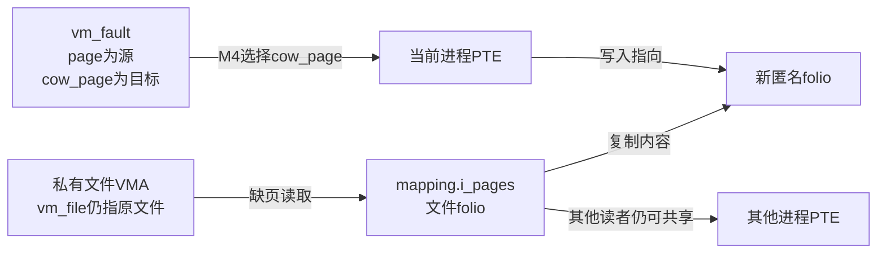

# 第48章\_私有文件映射的写时复制

MAP_PRIVATE保证自身写入不改写后备文件；这不要求创建映射时就复制全部内容。本篇沿M3～M4分别看缺失PTE的首次写和已有只读PTE的写保护故障。固定Linux 6.12.20提交 `dfaf2136deb2af2e60b994421281ba42f1c087e0`，摘录保留执行语句并替换上游注释。

| 入口 | 关系 |
| --- | --- |
| [总索引](../navigation/P01_Linux_6.12_VFS源码阅读索引.md) | 版本及所有权 |
| [映射导读](../navigation/P17_文件映射的缺页与状态交接.md#17.3_两种写入怎样接回同一周期) | 与共享写比较 |
| [正文](../../../../knowledge/kernel_subsystems/vfs/P18_文件mmap与page_fault.md#18.4_同一个文件的两种写入为什么走向不同页面) | 从写入要求推导复制 |

## 48.1\_首次写缺页先准备独立匿名页

`mm/memory.c::do_cow_fault`由[do_fault](P47_文件页到进程页表的安装.md#47.1_缺失PTE先分清读取和两种写入)在WRITE且非SHARED时调用。先准备anon_vma关系及新folio，把它放入`vmf->cow_page`，再通过`__do_fault`取原文件页；复制完成后由finish_fault选择cow_page安装。原文件页最后解锁并put，新页成功时引用交给PTE，失败时put。

```c
/** @brief 仓库补充阅读说明：为首次私有写预分配匿名页，复制文件内容后安装并分别归还源和失败目标。 */
static vm_fault_t do_cow_fault(struct vm_fault *vmf)
{
        /* 仓库补充：为首次私有写预分配匿名页，复制文件内容后安装并分别归还源和失败目标。 */
        struct vm_area_struct *vma = vmf->vma;
        struct folio *folio;
        vm_fault_t ret;
        ret = vmf_can_call_fault(vmf);
        if (!ret)
                ret = vmf_anon_prepare(vmf);
        if (ret)
                return ret;
        folio = folio_prealloc(vma->vm_mm, vma, vmf->address, false);
        if (!folio)
                return VM_FAULT_OOM;
        vmf->cow_page = &folio->page;
        ret = __do_fault(vmf);
        if (unlikely(ret & (VM_FAULT_ERROR | VM_FAULT_NOPAGE | VM_FAULT_RETRY)))
                goto uncharge_out;
        if (ret & VM_FAULT_DONE_COW)
                return ret;
        if (copy_mc_user_highpage(vmf->cow_page, vmf->page, vmf->address, vma)) {
                ret = VM_FAULT_HWPOISON;
                goto unlock;
        }
        __folio_mark_uptodate(folio);
        ret |= finish_fault(vmf);
unlock:
        unlock_page(vmf->page);
        put_page(vmf->page);
        if (unlikely(ret & (VM_FAULT_ERROR | VM_FAULT_NOPAGE | VM_FAULT_RETRY)))
                goto uncharge_out;
        return ret;
uncharge_out:
        folio_put(folio);
        return ret;
}
```

| 符号 | 初始化与消费边界 |
| --- | --- |
| `vmf_anon_prepare/__vmf_anon_prepare` | 头文件包装与同文件实现，确保匿名反向映射关系；需要更强锁而无法取得时返回RETRY，失败OOM。不是复制数据的函数 |
| `folio_prealloc` | 同文件分配并为本次匿名页建立必要记账；失败返回NULL，调用方转OOM；资源不是从文件缓存folio直接“改名”取得 |
| `cow_page/page` | 前者是新匿名目标，后者由文件fault提供源；同一vmf同时携带两者，以免把文件页错误地变为私有可写 |
| `copy_mc_user_highpage/__folio_mark_uptodate` | 复制一页内容并标记新页可用；复制遇硬件毒化返回HWPOISON，不能把未完成目标装进页表 |
| `VM_FAULT_DONE_COW` | 后端已经处理复制的特例，直接接受其完成责任；不再重复正常复制及收尾 |
| `unlock_page/put_page/folio_put` | 前两者归还源，后者释放未被PTE消费的新页；顺序不能混用两份所有权 |



**可修改性：** 复制成功前不可把目标页标为可访问；失败分支必须分别归还源与目标。测试首次访问即写、先读后写及复制分配失败，不能只覆盖其中一个入口。

## 48.2\_已有只读PTE写入前先判断是否必须复制

`do_wp_page`进入时持PTE锁，Sparse的`__releases(vmf->ptl)`是静态上下文标注，不会执行解锁。函数先处理UFFD写保护，再分共享/私有。普通文件页不是匿名独占页，因此进入复制；已经属于当前私有映射的匿名页可能直接复用，不能说每次store都复制一页。

```c
/** @brief 仓库补充阅读说明：在已有PTE的写保护入口区分共享、匿名复用与复制，并交出PTE锁。 */
static vm_fault_t do_wp_page(struct vm_fault *vmf)
        __releases(vmf->ptl)
{
        /* 仓库补充：在已有PTE的写保护入口区分共享、匿名复用与复制，并交出PTE锁。 */
        const bool unshare = vmf->flags & FAULT_FLAG_UNSHARE;
        struct vm_area_struct *vma = vmf->vma;
        struct folio *folio = NULL;
        pte_t pte;
        if (likely(!unshare)) {
                if (userfaultfd_pte_wp(vma, ptep_get(vmf->pte))) {
                        if (!userfaultfd_wp_async(vma)) {
                                pte_unmap_unlock(vmf->pte, vmf->ptl);
                                return handle_userfault(vmf, VM_UFFD_WP);
                        }
                        pte = pte_clear_uffd_wp(ptep_get(vmf->pte));
                        set_pte_at(vma->vm_mm, vmf->address, vmf->pte, pte);
                        vmf->orig_pte = pte;
                }
                if (unlikely(userfaultfd_wp(vmf->vma) &&
                             mm_tlb_flush_pending(vmf->vma->vm_mm)))
                        flush_tlb_page(vmf->vma, vmf->address);
        }
        vmf->page = vm_normal_page(vma, vmf->address, vmf->orig_pte);
        if (vmf->page)
                folio = page_folio(vmf->page);
        if (vma->vm_flags & (VM_SHARED | VM_MAYSHARE)) {
                if (!vmf->page)
                        return wp_pfn_shared(vmf);
                return wp_page_shared(vmf, folio);
        }
        if (folio && folio_test_anon(folio) &&
            (PageAnonExclusive(vmf->page) || wp_can_reuse_anon_folio(folio, vma))) {
                if (!PageAnonExclusive(vmf->page))
                        SetPageAnonExclusive(vmf->page);
                if (unlikely(unshare)) {
                        pte_unmap_unlock(vmf->pte, vmf->ptl);
                        return 0;
                }
                wp_page_reuse(vmf, folio);
                return 0;
        }
        if (folio)
                folio_get(folio);
        pte_unmap_unlock(vmf->pte, vmf->ptl);
#ifdef CONFIG_KSM
        if (folio && folio_test_ksm(folio))
                count_vm_event(COW_KSM);
#endif
        return wp_page_copy(vmf);
}
```

| 分支或辅助 | 当前角色与适用边界 |
| --- | --- |
| `userfaultfd_* /handle_userfault` | UFFD可以把故障交给用户态管理者，异步写保护只清相应位；可能需要补TLB刷新。定义/退化见`include/linux/userfaultfd_k.h`，本次配置关闭，不把该路径作为实验前提 |
| `vm_normal_page` | 把原PTE解析为普通页；设备PFN等可能没有普通page，shared特例交`wp_pfn_shared`，不属于本篇普通文件COW |
| `VM_SHARED/VM_MAYSHARE` | 共享可写对象交[共享写保护处理](P49_共享映射的写入准备与脏页登记.md#49.2_已有PTE时重新验证原槽位)，不能复制成私有数据 |
| `folio_test_anon/PageAnonExclusive/wp_can_reuse_anon_folio` | 匿名页独占/可安全复用才开放原页写权限；辅助还核对引用、swapcache等，不能仅凭一个引用计数比较就复制该优化 |
| `FAULT_FLAG_UNSHARE` | 调用者可请求解除共享但不执行用户写入；这种操作不应无条件增加可写权限 |
| `folio_get`与`pte_unmap_unlock` | 需要复制时先保住源页，再离开PTE锁执行可睡眠分配和复制 |
| `CONFIG_KSM/count_vm_event` | KSM来源页的统计分支；是否计数不能改变COW功能责任 |

**可修改性：** 不得把“当前file引用独占”误用为“某匿名页独占”，两个计数保护不同对象。共享、设备PFN、UFFD和普通私有页在本入口分流，修改一个条件必须验证其他类别仍保持原契约。

## 48.3\_复制期间PTE可能已变化所以发布前再比较

`wp_page_copy`在不持PTE锁时分配和复制，再取得锁比较`orig_pte`。比较失败就释放新页；比较成功才清除旧PTE并刷新、登记新匿名rmap、装入新PTE，最后减少旧页rmap。若先减少旧计数，其他路径可能以为旧页已独占而写入，但当前进程的旧PTE仍能访问它。

```c
/** @brief 仓库补充阅读说明：复制到新匿名页后重新检查旧PTE，只有仍相等才交换映射。 */
static vm_fault_t wp_page_copy(struct vm_fault *vmf)
{
        /* 仓库补充：复制到新匿名页后重新检查旧PTE，只有仍相等才交换映射。 */
        const bool unshare = vmf->flags & FAULT_FLAG_UNSHARE;
        struct vm_area_struct *vma = vmf->vma;
        struct mm_struct *mm = vma->vm_mm;
        struct folio *old_folio = NULL;
        struct folio *new_folio = NULL;
        pte_t entry;
        int page_copied = 0;
        struct mmu_notifier_range range;
        vm_fault_t ret;
        bool pfn_is_zero;
        delayacct_wpcopy_start();
        if (vmf->page)
                old_folio = page_folio(vmf->page);
        ret = vmf_anon_prepare(vmf);
        if (unlikely(ret))
                goto out;
        pfn_is_zero = is_zero_pfn(pte_pfn(vmf->orig_pte));
        new_folio = folio_prealloc(mm, vma, vmf->address, pfn_is_zero);
        if (!new_folio)
                goto oom;
        if (!pfn_is_zero) {
                int err;
                err = __wp_page_copy_user(&new_folio->page, vmf->page, vmf);
                if (err) {
                        folio_put(new_folio);
                        if (old_folio)
                                folio_put(old_folio);
                        delayacct_wpcopy_end();
                        return err == -EHWPOISON ? VM_FAULT_HWPOISON : 0;
                }
                kmsan_copy_page_meta(&new_folio->page, vmf->page);
        }
        __folio_mark_uptodate(new_folio);
        mmu_notifier_range_init(&range, MMU_NOTIFY_CLEAR, 0, mm,
                                vmf->address & PAGE_MASK,
                                (vmf->address & PAGE_MASK) + PAGE_SIZE);
        mmu_notifier_invalidate_range_start(&range);
        vmf->pte = pte_offset_map_lock(mm, vmf->pmd, vmf->address, &vmf->ptl);
        if (likely(vmf->pte && pte_same(ptep_get(vmf->pte), vmf->orig_pte))) {
                if (old_folio) {
                        if (!folio_test_anon(old_folio)) {
                                dec_mm_counter(mm, mm_counter_file(old_folio));
                                inc_mm_counter(mm, MM_ANONPAGES);
                        }
                } else {
                        ksm_might_unmap_zero_page(mm, vmf->orig_pte);
                        inc_mm_counter(mm, MM_ANONPAGES);
                }
                flush_cache_page(vma, vmf->address, pte_pfn(vmf->orig_pte));
                entry = mk_pte(&new_folio->page, vma->vm_page_prot);
                entry = pte_sw_mkyoung(entry);
                if (unlikely(unshare)) {
                        if (pte_soft_dirty(vmf->orig_pte))
                                entry = pte_mksoft_dirty(entry);
                        if (pte_uffd_wp(vmf->orig_pte))
                                entry = pte_mkuffd_wp(entry);
                } else {
                        entry = maybe_mkwrite(pte_mkdirty(entry), vma);
                }
                /* 仓库补充：先清旧PTE并刷新，再安装新页；旧反向映射计数在切换后减少。 */
                ptep_clear_flush(vma, vmf->address, vmf->pte);
                folio_add_new_anon_rmap(new_folio, vma, vmf->address, RMAP_EXCLUSIVE);
                folio_add_lru_vma(new_folio, vma);
                BUG_ON(unshare && pte_write(entry));
                set_pte_at(mm, vmf->address, vmf->pte, entry);
                update_mmu_cache_range(vmf, vma, vmf->address, vmf->pte, 1);
                if (old_folio) {
                        folio_remove_rmap_pte(old_folio, vmf->page, vma);
                }
                new_folio = old_folio;
                page_copied = 1;
                pte_unmap_unlock(vmf->pte, vmf->ptl);
        } else if (vmf->pte) {
                update_mmu_tlb(vma, vmf->address, vmf->pte);
                pte_unmap_unlock(vmf->pte, vmf->ptl);
        }
        mmu_notifier_invalidate_range_end(&range);
        if (new_folio)
                folio_put(new_folio);
        if (old_folio) {
                if (page_copied)
                        free_swap_cache(old_folio);
                folio_put(old_folio);
        }
        delayacct_wpcopy_end();
        return 0;
oom:
        ret = VM_FAULT_OOM;
out:
        if (old_folio)
                folio_put(old_folio);
        delayacct_wpcopy_end();
        return ret;
}
```

| 实现簇 | 状态副作用与所有权 |
| --- | --- |
| `old_folio/new_folio/page_copied` | 局部变量记录源引用、目标引用和是否完成切换；切换后new_folio被改为旧页，用末尾put归还旧PTE持有的责任，最后的old_folio put再归还进入复制前额外取得的引用 |
| `is_zero_pfn/folio_prealloc/__wp_page_copy_user` | 零页可直接清零分配，其余复制源；复制中另一路已解决故障可返回0让访问再试，HWPOISON不作为普通重试 |
| `mmu_notifier_range_init/start/end` | 以本页范围通知次级MMU映射失效，必须成对包住PTE切换；这是功能通信，不是跟踪日志 |
| `flush_cache_page/ptep_clear_flush/set_pte_at/update_mmu_cache_range` | 通过架构接口处理缓存及旧转换，安装新PTE；本文不把抽象操作伪写成通用硬件寄存器位 |
| `folio_add_new_anon_rmap/folio_remove_rmap_pte`、mm计数、LRU | 文件映射转匿名时同时切换反向登记和RSS分类；旧rmap删除晚于旧PTE失效 |
| `kmsan_copy_page_meta`、`delayacct_wpcopy_start/end` | 分别处理内存检查器元数据与延迟统计，不负责页面引用；`BUG_ON`是检查unshare不得写使能的断言 |
| `ksm_might_unmap_zero_page/free_swap_cache` | 维护零页/KSM及旧页交换缓存边界；不把普通文件页直接写回的动作混入此路径 |

```mermaid
sequenceDiagram
    autonumber
    participant W as do_wp_page
    participant C as wp_page_copy
    participant P as PTE及其锁
    participant F as 源folio与新匿名folio
    W->>F: 取得源引用
    W->>P: 释放PTE锁
    W->>C: M3请求私有副本
    C->>F: 分配并复制到新匿名页
    C->>P: M4锁定并比较orig_pte
    alt 仍是原PTE
        C->>P: 清旧PTE并刷新旧转换
        C->>F: 建立新匿名rmap
        C->>P: 发布指向新页的PTE
        C->>F: 移除旧rmap并归还旧PTE引用
    else 已经变化
        C->>F: 释放未安装的新页
    end
    C->>F: 归还额外源引用
    C-->>W: 结束本次故障处理
```



**可修改性：** 保持“取源引用→解锁复制→加锁再比较→失效旧转换→发布新转换→删除旧rmap”的顺序。验证并发写故障、截断、OOM与退出，不以一次私有修改不影响文件的演示代替全部竞态验证。
