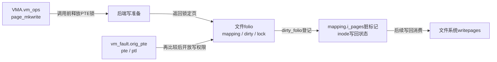
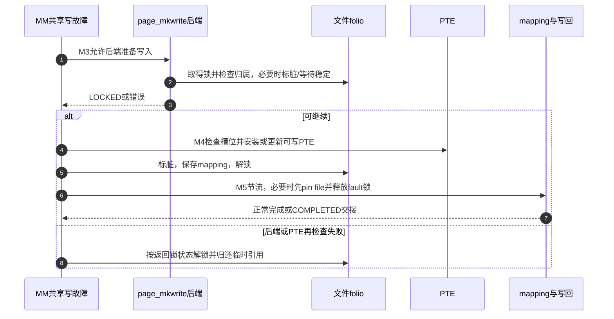

# 第49章\_共享映射的写入准备与脏页登记

共享映射的写入要进入文件内容，所以不能照私有COW路径造一份匿名页。M3先给文件系统准备写入的机会，M4建立可写PTE，再把修改接入M5写回责任。本篇固定Linux 6.12.20提交 `dfaf2136deb2af2e60b994421281ba42f1c087e0`，摘录保留执行语句并加入仓库中文说明。

| 入口 | 任务 |
| --- | --- |
| [总索引](../navigation/P01_Linux_6.12_VFS源码阅读索引.md) | 固定版本及已有标脏实现 |
| [映射导读](../navigation/P17_文件映射的缺页与状态交接.md#17.3_两种写入怎样接回同一周期) | M3～M5交接 |
| [知识正文](../../../../knowledge/kernel_subsystems/vfs/P18_文件mmap与page_fault.md#18.4_同一个文件的两种写入为什么走向不同页面) | 为什么需要写准备回调 |

原件：[mm/filemap.c](../../linux/mm/filemap.c)、[mm/memory.c](../../linux/mm/memory.c)、[include/linux/mm.h](../../linux/include/linux/mm.h)；身份与对象摘要见 [源码基线](../../linux/SOURCE_BASELINE.md#1.297_文件映射的缺页与状态交接)。

## 49.1\_让文件系统先准备可写页面

普通缺失PTE的共享写入由`mm/memory.c::do_shared_fault`进入。先用`__do_fault`取得文件页；若有page_mkwrite，先释放folio锁再调用包装，以便后端自己按协议取得锁和完成准备。返回后finish_fault安装PTE，最后fault_dirty_shared_page归还folio锁并登记脏状态。

```c
/** @brief 仓库补充阅读说明：取得文件页后先通知后端准备写入，再安装PTE和登记脏状态。 */
static vm_fault_t do_shared_fault(struct vm_fault *vmf)
{
        /* 仓库补充：取得文件页后先通知后端准备写入，再安装PTE和登记脏状态。 */
        struct vm_area_struct *vma = vmf->vma;
        vm_fault_t ret, tmp;
        struct folio *folio;
        ret = vmf_can_call_fault(vmf);
        if (ret)
                return ret;
        ret = __do_fault(vmf);
        if (unlikely(ret & (VM_FAULT_ERROR | VM_FAULT_NOPAGE | VM_FAULT_RETRY)))
                return ret;
        folio = page_folio(vmf->page);
        if (vma->vm_ops->page_mkwrite) {
                folio_unlock(folio);
                tmp = do_page_mkwrite(vmf, folio);
                if (unlikely(!tmp ||
                                (tmp & (VM_FAULT_ERROR | VM_FAULT_NOPAGE)))) {
                        folio_put(folio);
                        return tmp;
                }
        }
        ret |= finish_fault(vmf);
        if (unlikely(ret & (VM_FAULT_ERROR | VM_FAULT_NOPAGE |
                                        VM_FAULT_RETRY))) {
                folio_unlock(folio);
                folio_put(folio);
                return ret;
        }
        ret |= fault_dirty_shared_page(vmf);
        return ret;
}
```

`do_page_mkwrite`临时把vmf.flags改为WRITE|MKWRITE，禁止对交换文件这样写入，再调用后端。正常回调返回后恢复原flags；若未报告LOCKED，包装自己锁folio并确认mapping尚在。注意提前拒绝swapfile发生在回调前，不能笼统说每个出口都执行了恢复语句。

```c
/** @brief 仓库补充阅读说明：暂设写准备标志调用后端，必要时补锁并检查页面仍有mapping。 */
static vm_fault_t do_page_mkwrite(struct vm_fault *vmf, struct folio *folio)
{
        /* 仓库补充：暂设写准备标志调用后端，必要时补锁并检查页面仍有mapping。 */
        vm_fault_t ret;
        unsigned int old_flags = vmf->flags;
        vmf->flags = FAULT_FLAG_WRITE|FAULT_FLAG_MKWRITE;
        if (vmf->vma->vm_file &&
            IS_SWAPFILE(vmf->vma->vm_file->f_mapping->host))
                return VM_FAULT_SIGBUS;
        ret = vmf->vma->vm_ops->page_mkwrite(vmf);
        vmf->flags = old_flags;
        if (unlikely(ret & (VM_FAULT_ERROR | VM_FAULT_NOPAGE)))
                return ret;
        if (unlikely(!(ret & VM_FAULT_LOCKED))) {
                folio_lock(folio);
                if (!folio->mapping) {
                        folio_unlock(folio);
                        return 0;
                }
                ret |= VM_FAULT_LOCKED;
        } else
                VM_BUG_ON_FOLIO(!folio_test_locked(folio), folio);
        return ret;
}
```

通用`filemap_page_mkwrite`位于`mm/filemap.c`、声明于`include/linux/mm.h`。它以sb_start_pagefault/end配对进入文件系统冻结协议，更新时间，锁住folio重查mapping。先标脏再等稳定写回条件，使冻结/写回能够追踪到随后可能发生的用户修改；正常返回LOCKED，由MM继续持有锁。截断已使mapping不匹配则返回NOPAGE并归还锁。

```c
/** @brief 仓库补充阅读说明：进入冻结协议，锁页复查归属，标脏并等待必要的稳定条件。 */
vm_fault_t filemap_page_mkwrite(struct vm_fault *vmf)
{
        /* 仓库补充：进入冻结协议，锁页复查归属，标脏并等待必要的稳定条件。 */
        struct address_space *mapping = vmf->vma->vm_file->f_mapping;
        struct folio *folio = page_folio(vmf->page);
        vm_fault_t ret = VM_FAULT_LOCKED;
        sb_start_pagefault(mapping->host->i_sb);
        file_update_time(vmf->vma->vm_file);
        folio_lock(folio);
        if (folio->mapping != mapping) {
                folio_unlock(folio);
                ret = VM_FAULT_NOPAGE;
                goto out;
        }
        folio_mark_dirty(folio);
        folio_wait_stable(folio);
out:
        sb_end_pagefault(mapping->host->i_sb);
        return ret;
}
```

| 实现簇 | 当前角色与配置边界 |
| --- | --- |
| `sb_start_pagefault/sb_end_pagefault` | 配对登记页故障写活动，使冻结可等待写入者，不是普通互斥锁或日志 |
| `file_update_time` | 修改文件时间等元数据，不能替代内容标脏或同步完成 |
| `folio_mark_dirty` | 通过mapping的dirty_folio协议登记，复用[唯一实现](P36_缓冲写的准备接纳与标脏.md#36.3_标脏按mapping的后端协议执行) |
| `folio_wait_stable` | 在后端要求稳定页时协调仍在进行的写回，不能从名字推成所有文件都必然睡眠 |
| `VM_FAULT_LOCKED/NOPAGE/ERROR` | 描述folio锁、重试/已处理及错误的交接，包装和调用者据此选择unlock/put，不能当作普通布尔成功值 |
| `ext4_page_mkwrite` | [ext4操作表](P45_文件映射的发布与引用归还.md#45.2_操作表决定以后由谁接住缺页)选用自己的写准备；本节通用函数不替代ext4日志和块分配实现 |
| `CONFIG_MMU` | 本节filemap实现处于MMU分支；无MMU的同名page_mkwrite返回SIGBUS，不能沿用页表流程 |

**可修改性：** 不能在开放写权限之后才首次通知后端准备。更换page_mkwrite必须检查返回时folio是否锁定、截断时如何放弃、冻结计数是否配对；测试文件系统冻结、写回与截断同时出现时的退出责任。

## 49.2\_已有PTE时重新验证原槽位

共享文件页已经映射为只读时，`do_wp_page`分流到`wp_page_shared`。它在释放PTE锁前额外持有folio引用，调用page_mkwrite后重锁并确认PTE没有变化；无法继续就解锁put，不能把准备好的旧页覆盖进已经变化的槽位。

```c
/** @brief 仓库补充阅读说明：额外持有文件页，离开PTE锁进行后端准备，再验证槽位并收尾。 */
static vm_fault_t wp_page_shared(struct vm_fault *vmf, struct folio *folio)
        __releases(vmf->ptl)
{
        /* 仓库补充：额外持有文件页，离开PTE锁进行后端准备，再验证槽位并收尾。 */
        struct vm_area_struct *vma = vmf->vma;
        vm_fault_t ret = 0;
        folio_get(folio);
        if (vma->vm_ops && vma->vm_ops->page_mkwrite) {
                vm_fault_t tmp;
                pte_unmap_unlock(vmf->pte, vmf->ptl);
                tmp = vmf_can_call_fault(vmf);
                if (tmp) {
                        folio_put(folio);
                        return tmp;
                }
                tmp = do_page_mkwrite(vmf, folio);
                if (unlikely(!tmp || (tmp &
                                      (VM_FAULT_ERROR | VM_FAULT_NOPAGE)))) {
                        folio_put(folio);
                        return tmp;
                }
                tmp = finish_mkwrite_fault(vmf, folio);
                if (unlikely(tmp & (VM_FAULT_ERROR | VM_FAULT_NOPAGE))) {
                        folio_unlock(folio);
                        folio_put(folio);
                        return tmp;
                }
        } else {
                wp_page_reuse(vmf, folio);
                folio_lock(folio);
        }
        ret |= fault_dirty_shared_page(vmf);
        folio_put(folio);
        return ret;
}
```

```c
/** @brief 仓库补充阅读说明：重锁并比较原PTE，确认未被替换后才开放原页写权限。 */
static vm_fault_t finish_mkwrite_fault(struct vm_fault *vmf, struct folio *folio)
{
        /* 仓库补充：重锁并比较原PTE，确认未被替换后才开放原页写权限。 */
        WARN_ON_ONCE(!(vmf->vma->vm_flags & VM_SHARED));
        vmf->pte = pte_offset_map_lock(vmf->vma->vm_mm, vmf->pmd, vmf->address,
                                       &vmf->ptl);
        if (!vmf->pte)
                return VM_FAULT_NOPAGE;
        if (!pte_same(ptep_get(vmf->pte), vmf->orig_pte)) {
                update_mmu_tlb(vmf->vma, vmf->address, vmf->pte);
                pte_unmap_unlock(vmf->pte, vmf->ptl);
                return VM_FAULT_NOPAGE;
        }
        wp_page_reuse(vmf, folio);
        return 0;
}
```

`wp_page_reuse`由共享路径及可复用匿名页路径使用，保留原PTE指向的页，只更新访问/脏/可写属性。进入时持PTE锁，函数负责归还。folio的last_cpupid被重置，避免沿用已经不相干的访问者提示；PGREUSE只是统计。

```c
/** @brief 仓库补充阅读说明：保留原页，更新PTE访问与写属性并释放PTE锁。 */
static inline void wp_page_reuse(struct vm_fault *vmf, struct folio *folio)
        __releases(vmf->ptl)
{
        /* 仓库补充：保留原页，更新PTE访问与写属性并释放PTE锁。 */
        struct vm_area_struct *vma = vmf->vma;
        pte_t entry;
        VM_BUG_ON(!(vmf->flags & FAULT_FLAG_WRITE));
        VM_WARN_ON(is_zero_pfn(pte_pfn(vmf->orig_pte)));
        if (folio) {
                VM_BUG_ON(folio_test_anon(folio) &&
                          !PageAnonExclusive(vmf->page));
                folio_xchg_last_cpupid(folio, (1 << LAST_CPUPID_SHIFT) - 1);
        }
        flush_cache_page(vma, vmf->address, pte_pfn(vmf->orig_pte));
        entry = pte_mkyoung(vmf->orig_pte);
        entry = maybe_mkwrite(pte_mkdirty(entry), vma);
        if (ptep_set_access_flags(vma, vmf->address, vmf->pte, entry, 1))
                update_mmu_cache_range(vmf, vma, vmf->address, vmf->pte, 1);
        pte_unmap_unlock(vmf->pte, vmf->ptl);
        count_vm_event(PGREUSE);
}
```

`pte_offset_map_lock/pte_same`建立本次原PTE的再验证；`ptep_set_access_flags/update_mmu_cache_range`兑现架构页表更新。`__releases`属于Sparse静态标记，`VM_BUG_ON/VM_WARN_ON/WARN_ON_ONCE`检查预期，不负责锁定或权限。不能因为检查在某构建里关闭就取消真实锁与分支。



**可修改性：** 不得把已有PTE路径的临时folio引用当作新的页表引用；它在末尾put，原PTE自己的映射责任一直存在。修改共享与匿名复用共同调用的wp_page_reuse时，必须同时检查匿名独占条件与共享写准备条件。

## 49.3\_标脏之后可能释放fault锁并节流

`fault_dirty_shared_page`要求folio锁定并负责解锁。它先保存mapping再解锁：truncate可能随后把folio->mapping清空，但VMA或临时fpin仍持file，所以保存的address_space可用于节流。后端有page_mkwrite时视为已负责时间更新；没有时才补file_update_time。

```c
/** @brief 仓库补充阅读说明：保存mapping后解锁folio，必要时退出fault锁再执行脏页节流。 */
static vm_fault_t fault_dirty_shared_page(struct vm_fault *vmf)
{
        /* 仓库补充：保存mapping后解锁folio，必要时退出fault锁再执行脏页节流。 */
        struct vm_area_struct *vma = vmf->vma;
        struct address_space *mapping;
        struct folio *folio = page_folio(vmf->page);
        bool dirtied;
        bool page_mkwrite = vma->vm_ops && vma->vm_ops->page_mkwrite;
        dirtied = folio_mark_dirty(folio);
        VM_BUG_ON_FOLIO(folio_test_anon(folio), folio);
        /* 仓库补充：必须在解锁前保存；随后truncate可能清除folio上的mapping指针。 */
        mapping = folio_raw_mapping(folio);
        folio_unlock(folio);
        if (!page_mkwrite)
                file_update_time(vma->vm_file);
        if ((dirtied || page_mkwrite) && mapping) {
                struct file *fpin;
                fpin = maybe_unlock_mmap_for_io(vmf, NULL);
                balance_dirty_pages_ratelimited(mapping);
                if (fpin) {
                        fput(fpin);
                        return VM_FAULT_COMPLETED;
                }
        }
        return 0;
}
```

`balance_dirty_pages_ratelimited`将脏页生成速率与写回能力协调，本篇只接入其调用位置，写回登记与调度见[脏状态实现](P37_脏状态登记与写回调度.md#37.1_从folio脏位汇聚到inode待处理状态)。若节流前通过[maybe_unlock_mmap_for_io](P46_文件缺页的缓存验证与重试.md#46.1_等待文件页之前先决定保留哪种生命期)释放了fault锁，函数在fput后返回COMPLETED；此时PTE已处理完，不要求重新查VMA。外层不能再解一次锁。



**可修改性：** 不可把保存mapping移到folio解锁之后，也不能将COMPLETED机械改成RETRY。验证须覆盖首次脏化、已经脏的页面、无page_mkwrite的后端以及节流期间并发munmap。用户store完成、页变脏和fsync返回分别是不同事件。
