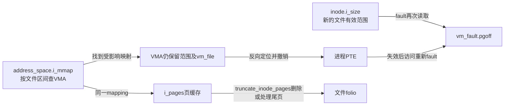
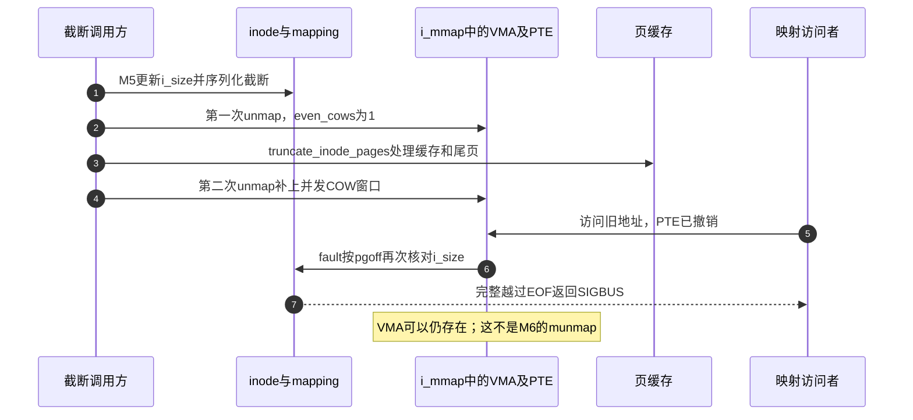

# 第50章\_映射同步与截断撤销

M5包含两种不同目标：同步把共享修改交给持久化协议；截断则撤销已经不再有文件内容支持的访问。二者都从VMA与mapping的关系出发，但不能互相替代。固定Linux 6.12.20提交 `dfaf2136deb2af2e60b994421281ba42f1c087e0`，摘录保留执行语句并替换上游注释。

| 入口 | 任务 |
| --- | --- |
| [总索引](../navigation/P01_Linux_6.12_VFS源码阅读索引.md) | 版本与已有fsync实现 |
| [映射导读](../navigation/P17_文件映射的缺页与状态交接.md#17.4_从同步和失效回看对象生命期) | M5与M6差别 |
| [正文](../../../../knowledge/kernel_subsystems/vfs/P18_文件mmap与page_fault.md#18.5_同步修改和撤销失效页面分别解决什么) | 截断后的访问边界 |

原件：[mm/msync.c](../../linux/mm/msync.c)、[mm/truncate.c](../../linux/mm/truncate.c)、[mm/memory.c](../../linux/mm/memory.c)、[include/linux/mm.h](../../linux/include/linux/mm.h)；身份与对象摘要见 [源码基线](../../linux/SOURCE_BASELINE.md#1.297_文件映射的缺页与状态交接)。

## 50.1\_msync把虚拟地址范围翻译回文件范围

`mm/msync.c::SYSCALL_DEFINE3(msync,...)`是系统调用定义；宏负责生成体系结构使用的入口，本篇不复制其框架展开。start与len是用户虚拟区间，真正传入文件同步的是`fstart/fend`。计算式将VMA内位移加上`vm_pgoff << PAGE_SHIFT`，末尾使用包含式文件偏移。

```c
/** @brief 仓库补充阅读说明：将虚拟范围转换为文件范围，持file引用退出mmap锁后同步。 */
SYSCALL_DEFINE3(msync, unsigned long, start, size_t, len, int, flags)
{
        /* 仓库补充：将虚拟范围转换为文件范围，持file引用退出mmap锁后同步。 */
        unsigned long end;
        struct mm_struct *mm = current->mm;
        struct vm_area_struct *vma;
        int unmapped_error = 0;
        int error = -EINVAL;
        start = untagged_addr(start);
        if (flags & ~(MS_ASYNC | MS_INVALIDATE | MS_SYNC))
                goto out;
        if (offset_in_page(start))
                goto out;
        if ((flags & MS_ASYNC) && (flags & MS_SYNC))
                goto out;
        error = -ENOMEM;
        len = (len + ~PAGE_MASK) & PAGE_MASK;
        end = start + len;
        if (end < start)
                goto out;
        error = 0;
        if (end == start)
                goto out;
        mmap_read_lock(mm);
        vma = find_vma(mm, start);
        for (;;) {
                struct file *file;
                loff_t fstart, fend;
                error = -ENOMEM;
                if (!vma)
                        goto out_unlock;
                if (start < vma->vm_start) {
                        if (flags == MS_ASYNC)
                                goto out_unlock;
                        start = vma->vm_start;
                        if (start >= end)
                                goto out_unlock;
                        unmapped_error = -ENOMEM;
                }
                if ((flags & MS_INVALIDATE) &&
                                (vma->vm_flags & VM_LOCKED)) {
                        error = -EBUSY;
                        goto out_unlock;
                }
                file = vma->vm_file;
                fstart = (start - vma->vm_start) +
                         ((loff_t)vma->vm_pgoff << PAGE_SHIFT);
                fend = fstart + (min(end, vma->vm_end) - start) - 1;
                start = vma->vm_end;
                if ((flags & MS_SYNC) && file &&
                                (vma->vm_flags & VM_SHARED)) {
                        get_file(file);
                        mmap_read_unlock(mm);
                        error = vfs_fsync_range(file, fstart, fend, 1);
                        fput(file);
                        if (error || start >= end)
                                goto out;
                        mmap_read_lock(mm);
                        vma = find_vma(mm, start);
                } else {
                        if (start >= end) {
                                error = 0;
                                goto out_unlock;
                        }
                        vma = find_vma(mm, vma->vm_end);
                }
        }
out_unlock:
        mmap_read_unlock(mm);
out:
        return error ? : unmapped_error;
}
```

MS_SYNC且VMA是共享文件映射时，先get_file再释放mmap读锁，调用`vfs_fsync_range(...,1)`，最后fput；还要继续处理后续区间则重锁并重新find_vma。等待文件同步时不依赖旧VMA仍存在。`datasync=1`的意义及后端完成协议复用[同步实现](P39_同步入口与文件系统持久化.md#39.1_系统调用先取得file再交给其同步方法)。

| 符号/分支 | 作用与结果 |
| --- | --- |
| `untagged_addr/offset_in_page/PAGE_MASK` | 规范化起址、要求页对齐并将长度向页边界取整；检查加法回绕 |
| `MS_ASYNC/MS_SYNC/MS_INVALIDATE` | 前两者不可同时设置；MS_ASYNC在此版本不主动发起I/O，不能当作已开始写回的凭证；INVALIDATE遇VM_LOCKED返回EBUSY，不等于无条件清空所有映射 |
| `find_vma` | 按虚拟地址找包含或后继VMA，调用方另检查空洞；通用查询见[Maple Tree的find_vma](../../maple_tree/source_explanations/mm/mmap.c.md#1.2_find_vma与上界) |
| `unmapped_error/error` | 空洞可以记录ENOMEM并继续处理其他有效区间；最终优先返回实际错误，否则返回空洞错误。一次失败不保证此前没有同步任何范围 |
| `file && VM_SHARED` | 仅该类映射在MS_SYNC下调用文件同步；私有匿名副本不会因msync而写回后备文件 |
| `get_file/fput` | 保护同步时的file及mapping；与保护VMA拓扑的mmap锁是两种责任 |

**可修改性：** 改范围算法必须检查跨VMA、空洞、页对齐和末尾包含性；改锁顺序须保持释放mmap锁以前取得file引用。验证包括一个区间横跨两个文件映射以及中间有空洞，不能只测单页成功。

## 50.2\_截断在缓存删除前后各撤销一次页表

`mm/truncate.c::truncate_setsize`在调用方序列化写入和截断的条件下更新i_size；通常由inode锁承担，但不能推广为所有后端只需要同一把锁。增长时`pagecache_isize_extended`处理旧EOF部分页的写保护/脏状态交接，然后调用truncate_pagecache。

```c
/** @brief 仓库补充阅读说明：更新文件大小，处理增长边界后协调缓存与用户页表。 */
void truncate_setsize(struct inode *inode, loff_t newsize)
{
        /* 仓库补充：更新文件大小，处理增长边界后协调缓存与用户页表。 */
        loff_t oldsize = inode->i_size;
        i_size_write(inode, newsize);
        if (newsize > oldsize)
                pagecache_isize_extended(inode, oldsize, newsize);
        truncate_pagecache(inode, newsize);
}
```

`truncate_pagecache`把新大小向上取整，保留最后一个仍包含有效字节的部分页，先对其后范围撤销页表，再删缓存，最后再次撤销。第二次用于补上第一次撤销与缓存删除之间的并发私有COW映射；even_cows=1要求连相应私有副本也撤销。

```c
/** @brief 仓库补充阅读说明：两次撤销页表夹住缓存截断，补上并发COW留下的映射。 */
void truncate_pagecache(struct inode *inode, loff_t newsize)
{
        /* 仓库补充：两次撤销页表夹住缓存截断，补上并发COW留下的映射。 */
        struct address_space *mapping = inode->i_mapping;
        loff_t holebegin = round_up(newsize, PAGE_SIZE);
        unmap_mapping_range(mapping, holebegin, 0, 1);
        truncate_inode_pages(mapping, newsize);
        unmap_mapping_range(mapping, holebegin, 0, 1);
}
```

`truncate_inode_pages`负责缓存及部分页内容处理，不是VMA删除；VMA仍能覆盖旧虚拟范围。下一次访问完整落在新EOF之后的页，文件fault重新核对大小后返回SIGBUS。部分EOF页的尾部与完整越界页不同，正文实验直接截断到0以消除这一区别。打洞也不应与缩小i_size混称：保留文件范围的洞通常可读为零，不能一概说洞都触发SIGBUS。



**可修改性：** 不能因“第一次已经unmap”删除第二次；也不能把round_up改为round_down后连仍有效的部分页全部抛弃。验证先读后truncate、并发私有COW、非整页EOF以及再增长，区分页面撤销与VMA消失。

## 50.3\_文件反向索引把失效传播到所有映射者

`unmap_mapping_range`和`unmap_mapping_pages`定义于`mm/memory.c`、声明于`include/linux/mm.h`。前者将字节范围转换为页索引并处理表示范围溢出；后者以mapping的i_mmap读锁遍历VMA区间树。nr为0通过末页下溢处理为到ULONG_MAX，表达从起点直到后续所有页。

```c
/** @brief 仓库补充阅读说明：把字节范围转换为页范围并检查溢出，再交给反向索引撤销。 */
void unmap_mapping_range(struct address_space *mapping,
                loff_t const holebegin, loff_t const holelen, int even_cows)
{
        /* 仓库补充：把字节范围转换为页范围并检查溢出，再交给反向索引撤销。 */
        pgoff_t hba = (pgoff_t)(holebegin) >> PAGE_SHIFT;
        pgoff_t hlen = ((pgoff_t)(holelen) + PAGE_SIZE - 1) >> PAGE_SHIFT;
        if (sizeof(holelen) > sizeof(hlen)) {
                long long holeend =
                        (holebegin + holelen + PAGE_SIZE - 1) >> PAGE_SHIFT;
                if (holeend & ~(long long)ULONG_MAX)
                        hlen = ULONG_MAX - hba + 1;
        }
        unmap_mapping_pages(mapping, hba, hlen, even_cows);
}
```

```c
/** @brief 仓库补充阅读说明：在文件区间树读锁下按页范围撤销映射，保留是否包含私有副本的条件。 */
void unmap_mapping_pages(struct address_space *mapping, pgoff_t start,
                pgoff_t nr, bool even_cows)
{
        /* 仓库补充：在文件区间树读锁下按页范围撤销映射，保留是否包含私有副本的条件。 */
        struct zap_details details = { };
        pgoff_t first_index = start;
        pgoff_t last_index = start + nr - 1;
        details.even_cows = even_cows;
        if (last_index < first_index)
                last_index = ULONG_MAX;
        i_mmap_lock_read(mapping);
        if (unlikely(!RB_EMPTY_ROOT(&mapping->i_mmap.rb_root)))
                unmap_mapping_range_tree(&mapping->i_mmap, first_index,
                                         last_index, &details);
        i_mmap_unlock_read(mapping);
}
```

`zap_details`是本次撤销的栈上条件，`even_cows`决定是否连私有副本一起撤销。`unmap_mapping_range_tree`按相交文件页区间遍历，每个VMA换算虚拟范围并执行zap；这里的树按文件偏移组织，不是mm的虚拟地址Maple Tree。i_mmap_rwsem稳定这一组登记；具体PTE拆除还由MM页表锁和TLB失效协议完成，不能认为一把mapping锁替代所有页表锁。



**可修改性：** 更改even_cows影响用户私有数据是否被撤销，截断与普通缓存失效不能交换参数。修改区间换算要同时测试页内起点、跨页末端、零长度直到末尾以及多个进程映射同一文件的情况。
