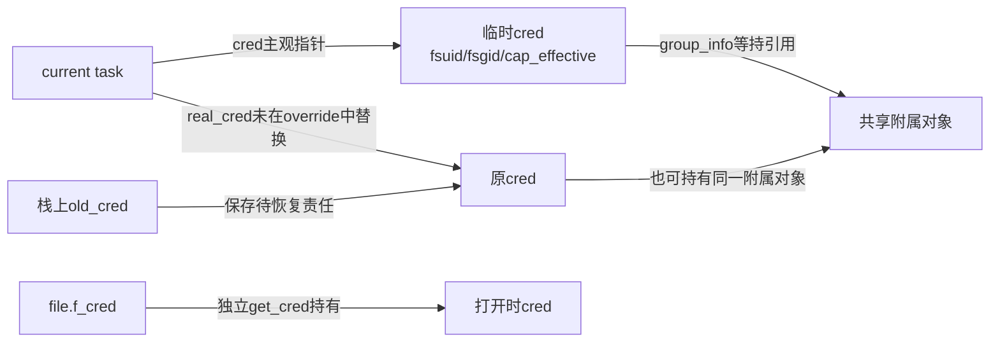
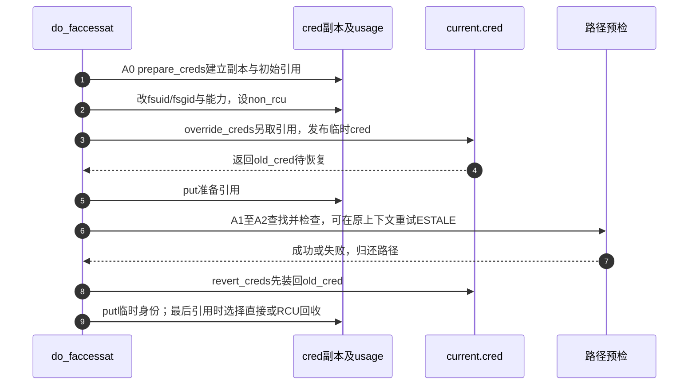

# 第51章\_当前身份与access临时凭据

access的判断不是“把open做一遍但不返回fd”。它有自己的身份语义，还要保证失败和重试后恢复调用任务的主观凭据。本篇沿A0～A2追踪这个临时身份周期，并与file持有的打开身份分开。固定Linux 6.12.20提交 `dfaf2136deb2af2e60b994421281ba42f1c087e0`；代码保留执行语句，以仓库中文说明替换上游长注释。

| 阅读入口 | 职责 |
| --- | --- |
| [总索引](../navigation/P01_Linux_6.12_VFS源码阅读索引.md) | 固定来源与相关实现 |
| [权限导读](../navigation/P18_访问身份与权限检查的时间边界.md#18.1_先找本次使用的身份与对象) | A0～A5的阅读顺序 |
| [权限正文](../../../../knowledge/kernel_subsystems/vfs/P19_权限凭据与安全钩子.md#19.6_为什么access不能替下一次open作保证) | 预检与使用为何分开 |
| 原件 | [fs/open.c](../../linux/fs/open.c)、[cred.h](../../linux/include/linux/cred.h)、[kernel/cred.c](../../linux/kernel/cred.c)、[credentials.rst](../../linux/Documentation/security/credentials.rst) |

原件对象摘要及本次配置核对见 [权限源码基线](../../linux/SOURCE_BASELINE.md#1.298_访问身份与权限检查的时间边界)。

## 51.1\_当前主观身份与打开身份分别由谁持有

`struct cred`在`include/linux/cred.h`声明，task的cred/real_cred指针分别表示实施操作的主观身份与被其他任务观察的客观身份。`current_cred`只读当前主观指针，不增加引用，也不要求调用者随后put；需要保存到当前调用以外时才使用get_cred之类的持有接口。

```c
/** @brief 仓库补充阅读说明：只读取得当前任务的主观凭据，不在此增加引用。 */
/* 仓库补充：只读取得当前任务的主观凭据，不在此增加引用。 */
#define current_cred() \
        rcu_dereference_protected(current->cred, 1)
```

| 字段或对象 | 来源、写入与读取 |
| --- | --- |
| `uid/gid/euid/egid/fsuid/fsgid` | 在新cred副本中准备；VFS普通比较使用current_fsuid/current_fsgid，access覆盖副本时把fsuid/fsgid换为真实uid/gid |
| `group_info` | 附加组集合的持有指针；组查询读取它，不在每次权限检查时重新从用户数据库加载 |
| `cap_effective/cap_permitted/securebits/user_ns` | 有效与允许能力、身份切换规则及其命名空间；临时预检可按规则选择另一套有效能力 |
| `usage/non_rcu` | 生命周期状态；usage计数持有者，non_rcu仅在保证任务同步使用时允许直接回收，不是“该身份不需要保护” |
| `file->f_cred` | [init_file](P26_file初始化与打开后失败清理.md#26.1_分配成功只建立最初的凭据锁与引用)取得打开凭据引用，file生命期内指针不变；后续实现按自己的授权契约使用 |
| `cred_jar/init_cred/init_groups` | `kernel/cred.c`的全局初始凭据、初始组与分配缓存；cred_init在启动时创建slab，prepare_creds从中分配当前身份副本 |
| `user/ucounts`、keyring、LSM字段 | 副本持有相应用户记账、keyring或安全数据；CONFIG_KEYS控制keyring成员，CONFIG_SECURITY控制LSM成员，本次前者开启、后者关闭 |

已公开cred中的身份不能原地任意改写，应准备副本后替换指针；引用计数等生命周期信息以及所引用keyring的内容有各自变化规则。`rcu_dereference_protected(...,1)`在这里利用“当前任务只能由自己切换主观凭据”的条件，不可复制成任意任务指针都能无条件读取。

下图选择覆盖前cred与real_cred指向同一份身份的普通任务。嵌套覆盖时两者可以不同，恢复只回到本次保存的old_cred，不强行把主观身份改成real_cred。



**可修改性：** 读取当前身份和取得长期引用是两种操作；把cred指针存进异步对象必须建立明确持有，不能只调用current_cred。修改临时身份流程时要分别核查cred、real_cred和f_cred，不能一起替换。

## 51.2\_预检按自己的身份语义临时覆盖

`fs/open.c::do_faccessat`是access、faccessat和faccessat2系统调用的共同内部实现。`access_need_override_creds`先判断是否能复用当前身份：AT_EACCESS不做真实ID覆盖，其他情况下比较fsuid/fsgid与真实ID，并考虑能力集合是否需要转换。

```c
/** @brief 仓库补充阅读说明：按预检标志、身份和能力集合决定是否需要临时覆盖。 */
static bool access_need_override_creds(int flags)
{
        /* 仓库补充：按预检标志、身份和能力集合决定是否需要临时覆盖。 */
        const struct cred *cred;
        /* 仓库补充：请求有效身份语义时不建立真实ID覆盖。 */
        if (flags & AT_EACCESS)
                return false;
        cred = current_cred();
        if (!uid_eq(cred->fsuid, cred->uid) ||
            !gid_eq(cred->fsgid, cred->gid))
                return true;
        /* 仓库补充：能力修正规则也参与是否可省略覆盖的判断。 */
        if (!issecure(SECURE_NO_SETUID_FIXUP)) {
                kuid_t root_uid = make_kuid(cred->user_ns, 0);
                if (!uid_eq(cred->uid, root_uid)) {
                        if (!cap_isclear(cred->cap_effective))
                                return true;
                } else {
                        if (!cap_isidentical(cred->cap_effective,
                            cred->cap_permitted))
                                return true;
                }
        }
        return false;
}
```

`access_override_creds`用prepare_creds复制当前身份，将fsuid/fsgid改为uid/gid。未设置SECURE_NO_SETUID_FIXUP时，非该user namespace的root清空有效能力，root使用permitted集合。它把此副本标为任务同步的non_rcu，安装后立即归还准备阶段那份引用；override_creds另持有一份。

```c
/** @brief 仓库补充阅读说明：复制身份并按真实用户语义修改，安装主观凭据后归还准备引用。 */
static const struct cred *access_override_creds(void)
{
        /* 仓库补充：复制身份并按真实用户语义修改，安装主观凭据后归还准备引用。 */
        const struct cred *old_cred;
        struct cred *override_cred;
        override_cred = prepare_creds();
        if (!override_cred)
                return NULL;
        /* 仓库补充：只改尚未公开的副本，不原地修改当前cred。 */
        override_cred->fsuid = override_cred->uid;
        override_cred->fsgid = override_cred->gid;
        if (!issecure(SECURE_NO_SETUID_FIXUP)) {
                kuid_t root_uid = make_kuid(override_cred->user_ns, 0);
                if (!uid_eq(override_cred->uid, root_uid))
                        cap_clear(override_cred->cap_effective);
                else
                        override_cred->cap_effective =
                                override_cred->cap_permitted;
        }
        override_cred->non_rcu = 1;
        /* 仓库补充：安装方另取引用；下面归还prepare阶段的初始引用。 */
        old_cred = override_creds(override_cred);
        put_cred(override_cred);
        return old_cred;
}
```

```c
/** @brief 仓库补充阅读说明：使用本次预检身份解析和检查路径，所有最终出口恢复临时凭据。 */
static long do_faccessat(int dfd, const char __user *filename, int mode, int flags)
{
        /* 仓库补充：使用本次预检身份解析和检查路径，所有最终出口恢复临时凭据。 */
        struct path path;
        struct inode *inode;
        int res;
        unsigned int lookup_flags = LOOKUP_FOLLOW;
        const struct cred *old_cred = NULL;
        if (mode & ~S_IRWXO)
                return -EINVAL;
        if (flags & ~(AT_EACCESS | AT_SYMLINK_NOFOLLOW | AT_EMPTY_PATH))
                return -EINVAL;
        if (flags & AT_SYMLINK_NOFOLLOW)
                lookup_flags &= ~LOOKUP_FOLLOW;
        if (flags & AT_EMPTY_PATH)
                lookup_flags |= LOOKUP_EMPTY;
        if (access_need_override_creds(flags)) {
                old_cred = access_override_creds();
                if (!old_cred)
                        return -ENOMEM;
        }
/* 仓库补充：ESTALE重查仍处于同一份临时身份下。 */
retry:
        res = user_path_at(dfd, filename, lookup_flags, &path);
        if (res)
                goto out;
        inode = d_backing_inode(path.dentry);
        if ((mode & MAY_EXEC) && S_ISREG(inode->i_mode)) {
                res = -EACCES;
                if (path_noexec(&path))
                        goto out_path_release;
        }
        res = inode_permission(mnt_idmap(path.mnt), inode, mode | MAY_ACCESS);
        if (res || !(mode & S_IWOTH) || special_file(inode->i_mode))
                goto out_path_release;
        if (__mnt_is_readonly(path.mnt))
                res = -EROFS;
out_path_release:
        path_put(&path);
        if (retry_estale(res, lookup_flags)) {
                lookup_flags |= LOOKUP_REVAL;
                goto retry;
        }
/* 仓库补充：所有覆盖后的最终退出在此恢复旧身份。 */
out:
        if (old_cred)
                revert_creds(old_cred);
        return res;
}
```

| 符号簇 | 当前责任与失败边界 |
| --- | --- |
| `prepare_creds/put_cred` | 复制身份并取得组、用户、user_ns、keys、ucounts等引用；分配或安全准备失败清理副本。这里使用其“未公开可修改副本”契约，不展开通用exec/commit凭据生命周期 |
| `issecure/make_kuid/cap_clear` | 读取身份切换策略、把user namespace内的0构造为内核UID、调整有效能力；不能把数值0与全局无限权限等同 |
| `user_path_at/lookup_flags/path_put` | 取得一次实际路径引用并归还；NOFOLLOW和EMPTY按请求改变查找语义，预检结束不留下file句柄 |
| `path_noexec/inode_permission` | 普通文件EXEC先受挂载noexec约束，再检查本次mode与MAY_ACCESS；[inode分派](P52_inode权限的基本检查与分派.md#52.1_先检查写入限制再选择权限实现)解释后续顺序 |
| `__mnt_is_readonly` | 仅写访问预检、非特殊文件时检查；此处没有真正写入，因此不取得mnt_want_write责任，结果仍会随挂载变化而过时 |
| `retry_estale/LOOKUP_REVAL` | 过期路径允许重新查找，仍在本次临时身份内；所有最终出口在out恢复旧身份 |
| `AT_EACCESS` | 对应faccessat2等支持flags的入口；原始faccessat系统调用没有flags参数，不能把libc包装和系统调用签名混为一谈 |

**可修改性：** `access_need_override_creds`的省略判断必须与access_override_creds的实际修改保持一致。添加早退出口时检查它是否发生在覆盖之后；若是，必须经过恢复。并发名称替换不由临时凭据协议解决，调用者仍不能把返回0用作以后open的保证。

## 51.3\_恢复旧指针以后才能归还临时身份

override_creds/revert_creds在cred.h声明、kernel/cred.c定义。前者使用get_new_cred增加临时引用，保留non_rcu，然后只发布current->cred；旧指针及其原有责任返回给调用者。后者先把旧指针装回，再put临时凭据，避免当前任务仍指向已经释放的对象。

```c
/** @brief 仓库补充阅读说明：取得新身份引用，只替换当前任务主观身份，把旧身份交给恢复方。 */
const struct cred *override_creds(const struct cred *new)
{
        /* 仓库补充：取得新身份引用，只替换当前任务主观身份，把旧身份交给恢复方。 */
        const struct cred *old = current->cred;
        kdebug("override_creds(%p{%ld})", new,
               atomic_long_read(&new->usage));
        /* 仓库补充：发布前取得新主观指针所需的引用。 */
        get_new_cred((struct cred *)new);
        rcu_assign_pointer(current->cred, new);
        kdebug("override_creds() = %p{%ld}", old,
               atomic_long_read(&old->usage));
        return old;
}
```

```c
/** @brief 仓库补充阅读说明：先恢复旧主观身份，再归还临时身份引用。 */
void revert_creds(const struct cred *old)
{
        /* 仓库补充：先恢复旧主观身份，再归还临时身份引用。 */
        const struct cred *override = current->cred;
        kdebug("revert_creds(%p{%ld})", old,
               atomic_long_read(&old->usage));
        /* 仓库补充：先恢复，再释放临时凭据，不能反转。 */
        rcu_assign_pointer(current->cred, old);
        put_cred(override);
}
```

如果其他持有者通过get_cred取得临时身份，get_cred_many会清non_rcu，表示不能再假定只有这个任务同步使用。文件对象保存凭据也遵循这一接口。

```c
/** @brief 仓库补充阅读说明：外部持有者取得引用时清除仅同步使用的non_rcu假设。 */
static inline const struct cred *get_cred_many(const struct cred *cred, int nr)
{
        /* 仓库补充：外部持有者取得引用时清除仅同步使用的non_rcu假设。 */
        struct cred *nonconst_cred = (struct cred *) cred;
        if (!cred)
                return cred;
        /* 仓库补充：外部持有使同步直接回收的假设失效。 */
        nonconst_cred->non_rcu = 0;
        return get_new_cred_many(nonconst_cred, nr);
}
```

```c
/** @brief 仓库补充阅读说明：确认没有引用和当前任务使用后，按non_rcu选择立即或延后释放。 */
void __put_cred(struct cred *cred)
{
        /* 仓库补充：确认没有引用和当前任务使用后，按non_rcu选择立即或延后释放。 */
        kdebug("__put_cred(%p{%ld})", cred,
               atomic_long_read(&cred->usage));
        BUG_ON(atomic_long_read(&cred->usage) != 0);
        BUG_ON(cred == current->cred);
        BUG_ON(cred == current->real_cred);
        /* 仓库补充：最后引用归还后才选择直接或RCU延迟回收。 */
        if (cred->non_rcu)
                put_cred_rcu(&cred->rcu);
        else
                call_rcu(&cred->rcu, put_cred_rcu);
}
```

`get_new_cred_many`只增加usage；get_cred是get_cred_many的一份引用包装。put_cred/put_cred_many减少usage，最后一份才进入__put_cred。`put_cred_rcu`实际归还安全数据、keyring、组、用户及命名空间引用，再释放slab对象；non_rcu为0时由call_rcu延后调用。`kdebug`是诊断输出，BUG_ON核对usage为0且对象不是当前两份身份指针，均不代替真实引用配对。



**可修改性：** 保留“发布新指针前取引用、恢复旧指针后归还新引用”的顺序。测试覆盖分配失败、路径失败、权限失败和ESTALE重试；另测外部get_cred使non_rcu清零的情形。不能通过删掉RCU或把non_rcu永久设1来简化回收。
