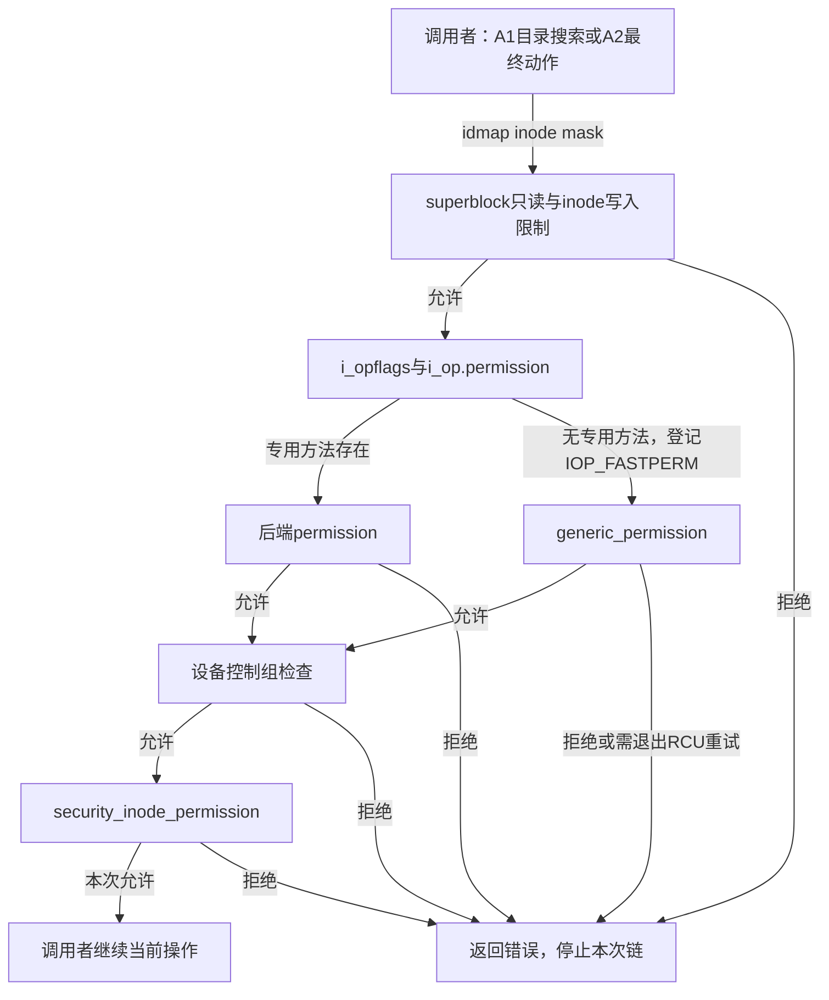
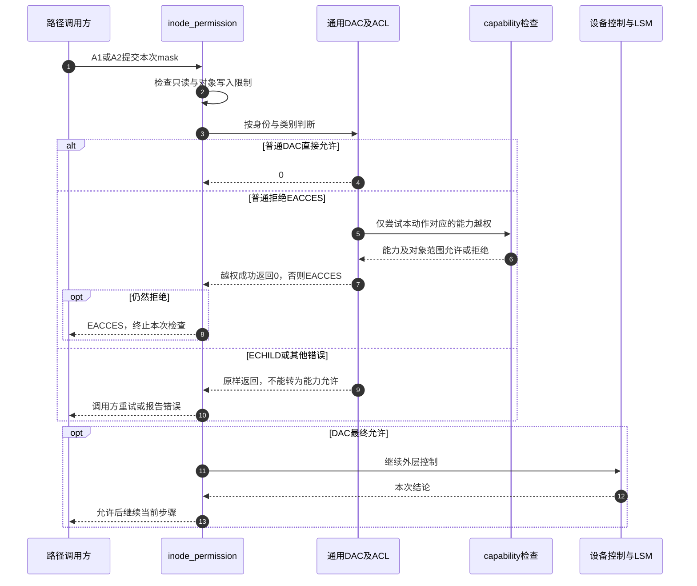

# 第52章\_inode权限的基本检查与分派

拿到inode还不能回答“允许做什么”：目录查找需要搜索许可，最终对象可能需要读写许可，写操作还受文件系统只读状态约束。本篇放大权限周期A1、A2中的一次inode_permission调用。它不是整次open的唯一检查，也不把检查结果永久保存在inode上。

来源固定为Linux 6.12.20提交 `dfaf2136deb2af2e60b994421281ba42f1c087e0`；实现原件为 [fs/namei.c](../../linux/fs/namei.c)，声明与对象字段见 [fs.h](../../linux/include/linux/fs.h)，设备控制辅助接口见 [device_cgroup.h](../../linux/include/linux/device_cgroup.h)。代码保留执行语句，中文注释为仓库补充。阅读顺序见 [权限导读](../navigation/P18_访问身份与权限检查的时间边界.md#18.1_先找本次使用的身份与对象)，全局来源见 [总索引](../navigation/P01_Linux_6.12_VFS源码阅读索引.md)。

原件对象摘要及本次配置核对见 [权限源码基线](../../linux/SOURCE_BASELINE.md#1.298_访问身份与权限检查的时间边界)。

## 52.1\_先检查写入限制再选择权限实现

先假设应用已经有写权限，但管理员把文件系统变成只读。若直接跳到mode位并返回允许，权限判断就遗漏了比用户身份更外层的限制。因此inode_permission先检查superblock，再处理不可变文件和无法表示的身份，之后才让后端或通用DAC实现判断主体对对象的权限。这里的DAC指依据文件所有者、组和访问规则进行的自主访问控制。

```c
/** @brief 仓库补充阅读说明：针对修改请求先拒绝只读文件系统上的普通文件目录与链接。 */
static int sb_permission(struct super_block *sb, struct inode *inode, int mask)
{
        /* 仓库补充：针对修改请求先拒绝只读文件系统上的普通文件目录与链接。 */
        if (unlikely(mask & MAY_WRITE)) {
                umode_t mode = inode->i_mode;
                if (sb_rdonly(sb) && (S_ISREG(mode) || S_ISDIR(mode) || S_ISLNK(mode)))
                        return -EROFS;
        }
        return 0;
}
```

```c
/** @brief 仓库补充阅读说明：按文件系统状态、对象权限、设备控制和安全钩子的顺序检查。 */
int inode_permission(struct mnt_idmap *idmap,
                     struct inode *inode, int mask)
{
        /* 仓库补充：按文件系统状态、对象权限、设备控制和安全钩子的顺序检查。 */
        int retval;
        retval = sb_permission(inode->i_sb, inode, mask);
        if (retval)
                return retval;
        if (unlikely(mask & MAY_WRITE)) {
                if (IS_IMMUTABLE(inode))
                        return -EPERM;
                if (HAS_UNMAPPED_ID(idmap, inode))
                        return -EACCES;
        }
        /* 仓库补充：先完成写入限制，再进入对象权限分派。 */
        retval = do_inode_permission(idmap, inode, mask);
        if (retval)
                return retval;
        /* 仓库补充：DAC通过也不能跳过设备和安全限制。 */
        retval = devcgroup_inode_permission(inode, mask);
        if (retval)
                return retval;
        return security_inode_permission(inode, mask);
}
```

`sb_permission`只在MAY_WRITE时处理普通文件、目录和符号链接的只读文件系统拒绝；它不等价于“所有挂载策略都在这里检查”。每挂载只读、noexec、nodev及nosuid有不同调用位置。[打开资格](P26_file初始化与打开后失败清理.md#26.4_打开许可与后置检查保持不同时间点)和 [access预检](P51_当前身份与access临时凭据.md#51.2_预检按自己的身份语义临时覆盖)承担当前相关的另外两处边界。

| 状态或参数 | 由谁提供、谁读取、拒绝意味着什么 |
| --- | --- |
| `mask` | 调用路径传入MAY_READ/WRITE/EXEC等动作位；MAY_NOT_BLOCK另约束执行上下文，不是文件mode权限位 |
| `inode->i_sb`与只读状态 | 文件系统挂载与重配置维护；sb_permission读取，写普通对象时可返回EROFS |
| `i_mode/i_flags/i_uid/i_gid` | inode保存类型、权限、属性和身份；加载及合法属性修改路径维护；IS_IMMUTABLE写拒绝为EPERM |
| `idmap` | 当前挂载提供身份映射；HAS_UNMAPPED_ID检查身份是否可安全表示，不能把不认识的身份写回错误数值 |
| `i_op->permission` | 文件系统给inode设置的操作方法；有专用方法时优先由它作判断 |
| `i_opflags & IOP_FASTPERM` | 首次确认没有专用方法后在i_lock下设置，后续跳过方法存在性分支；不是“上次允许”的缓存 |
| `devcgroup_inode_permission` | 普通非设备inode很快返回；设备对象还受设备控制组规则约束，本基线CONFIG_CGROUP_DEVICE开启，不据此推断已配置具体策略 |
| `security_inode_permission` | 前面的检查均允许后，仍进入 [安全钩子](P55_VFS安全钩子的登记与调用.md#55.3_打开与使用阶段调用不同的钩子)；它不是mode检查的替代品 |

```c
/** @brief 仓库补充阅读说明：优先调用后端permission；缓存的是没有专用回调的事实。 */
static inline int do_inode_permission(struct mnt_idmap *idmap,
                                      struct inode *inode, int mask)
{
        /* 仓库补充：优先调用后端permission；缓存的是没有专用回调的事实。 */
        if (unlikely(!(inode->i_opflags & IOP_FASTPERM))) {
                if (likely(inode->i_op->permission))
                        return inode->i_op->permission(idmap, inode, mask);
                spin_lock(&inode->i_lock);
                /* 仓库补充：只缓存没有专用permission方法，不缓存访问结论。 */
                inode->i_opflags |= IOP_FASTPERM;
                spin_unlock(&inode->i_lock);
        }
        return generic_permission(idmap, inode, mask);
}
```

`inode_permission`与generic_permission在fs.h声明，另外三个本篇辅助函数在namei.c内部使用。`inode_operations::permission`的签名同时接收idmap、inode和mask；后端若要求服务器授权或自己的访问规则，可实现该方法。`IOP_FASTPERM`依赖同一个inode生命期中操作方法的稳定性。i_lock只保护设置标志的更新，不把整条权限链锁成一次不可变化的事务。



**可修改性：** 不能把IOP_FASTPERM改为缓存某用户的允许结果，也不能在capability成功后跳过外层安全钩子。调整检查顺序会改变错误优先级和安全边界，必须说明为什么允许越过原来先检查的限制。

## 52.2\_类别选择与拒绝结果不能混用

普通mode检查先选类别，再判断该类别是否覆盖本次需求。例如所有者权限为0、other可读时，所有者不能因为自己的位不够而退到other。这样的回退会让“限制所有者”失去意义。代码先比较经过挂载映射的owner，匹配即返回；非owner才考虑ACL和组类别。

```c
/** @brief 仓库补充阅读说明：先按所有者选择类别，再考虑ACL或组与其他权限。 */
static int acl_permission_check(struct mnt_idmap *idmap,
                                struct inode *inode, int mask)
{
        /* 仓库补充：先按所有者选择类别，再考虑ACL或组与其他权限。 */
        unsigned int mode = inode->i_mode;
        vfsuid_t vfsuid;
        vfsuid = i_uid_into_vfsuid(idmap, inode);
        if (likely(vfsuid_eq_kuid(vfsuid, current_fsuid()))) {
                /* 仓库补充：owner已匹配，失败也不回退到组或other。 */
                mask &= 7;
                mode >>= 6;
                return (mask & ~mode) ? -EACCES : 0;
        }
        if (IS_POSIXACL(inode) && (mode & S_IRWXG)) {
                int error = check_acl(idmap, inode, mask);
                /* 仓库补充：只有明确无ACL的回退码才继续普通mode。 */
                if (error != -EAGAIN)
                        return error;
        }
        mask &= 7;
        if (mask & (mode ^ (mode >> 3))) {
                vfsgid_t vfsgid = i_gid_into_vfsgid(idmap, inode);
                if (vfsgid_in_group_p(vfsgid))
                        mode >>= 3;
        }
        return (mask & ~mode) ? -EACCES : 0;
}
```

`mask &= 7`留下读写执行三位。`mode >>= 6`把owner三位移到低位，组匹配时右移3位。`mask & ~mode`检查是否有任何请求位不被允许。组与other在本次请求涉及的位上相同时，比较组身份不会改变结果，因此可以省略；这并非所有组检查都可跳过。

ACL调用只在支持POSIX ACL且group权限区非零时进入。这里的group权限区与扩展ACL的mask表示有关，并非只代表一个拥有组。check_acl返回EAGAIN表示没有ACL可用于本次判断，才能继续普通mode；ECHILD表示RCU上下文不足，需要调用路径退出快速观察再重试；EACCES才是一次明确的权限拒绝。[ACL读取与匹配](P53_挂载身份换算与ACL判断.md#53.2_读取ACL时区分不存在与尚未缓存)展开这些返回值。

```c
/** @brief 仓库补充阅读说明：仅把普通权限拒绝交给相应capability越权判断。 */
int generic_permission(struct mnt_idmap *idmap, struct inode *inode,
                       int mask)
{
        /* 仓库补充：仅把普通权限拒绝交给相应capability越权判断。 */
        int ret;
        ret = acl_permission_check(idmap, inode, mask);
        /* 仓库补充：缺材料或后端错误不能交给capability越权。 */
        if (ret != -EACCES)
                return ret;
        if (S_ISDIR(inode->i_mode)) {
                if (!(mask & MAY_WRITE))
                        if (capable_wrt_inode_uidgid(idmap, inode,
                                                     CAP_DAC_READ_SEARCH))
                                return 0;
                if (capable_wrt_inode_uidgid(idmap, inode,
                                             CAP_DAC_OVERRIDE))
                        return 0;
                return -EACCES;
        }
        mask &= MAY_READ | MAY_WRITE | MAY_EXEC;
        if (mask == MAY_READ)
                if (capable_wrt_inode_uidgid(idmap, inode,
                                             CAP_DAC_READ_SEARCH))
                        return 0;
        /* 仓库补充：普通文件执行越权仍要求至少一个执行位。 */
        if (!(mask & MAY_EXEC) || (inode->i_mode & S_IXUGO))
                if (capable_wrt_inode_uidgid(idmap, inode,
                                             CAP_DAC_OVERRIDE))
                        return 0;
        return -EACCES;
}
```

generic_permission只把EACCES交给能力检查。若把条件误改为“任何错误都试capability”，就可能把尚未取得ACL或后端I/O失败误解释成可越权的DAC拒绝。目录允许CAP_DAC_READ_SEARCH处理不含写的需求；普通文件仅纯读需求使用这一能力。CAP_DAC_OVERRIDE处理更广的DAC越权，但普通文件请求执行时仍要求至少一个执行位存在。对象身份范围另由 [capability实现](P54_capability的命名空间与对象边界.md#54.1_DAC越权也要确认能力作用范围)约束。



这张图表达一次检查的分支，P19的A1可能对多个目录重复发生。[may_lookup](P16_候选读取与快速路径验证.md)的完整路径负责处理RCU转慢路径；inode_permission本身不解析名称、不打开file，也不替未来操作保留授权。

**可修改性：** 保持owner不回退、组类别不拼凑other权限、错误类型不混用三条不变量。若新增mask位，分别核对外层语义与低三位DAC语义，不能随意纳入mode按位比较。返回0只证明本次检查允许，后续仍须执行创建、打开或实际读写协议。
