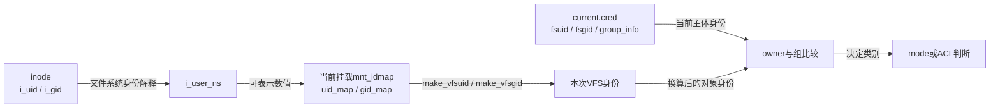
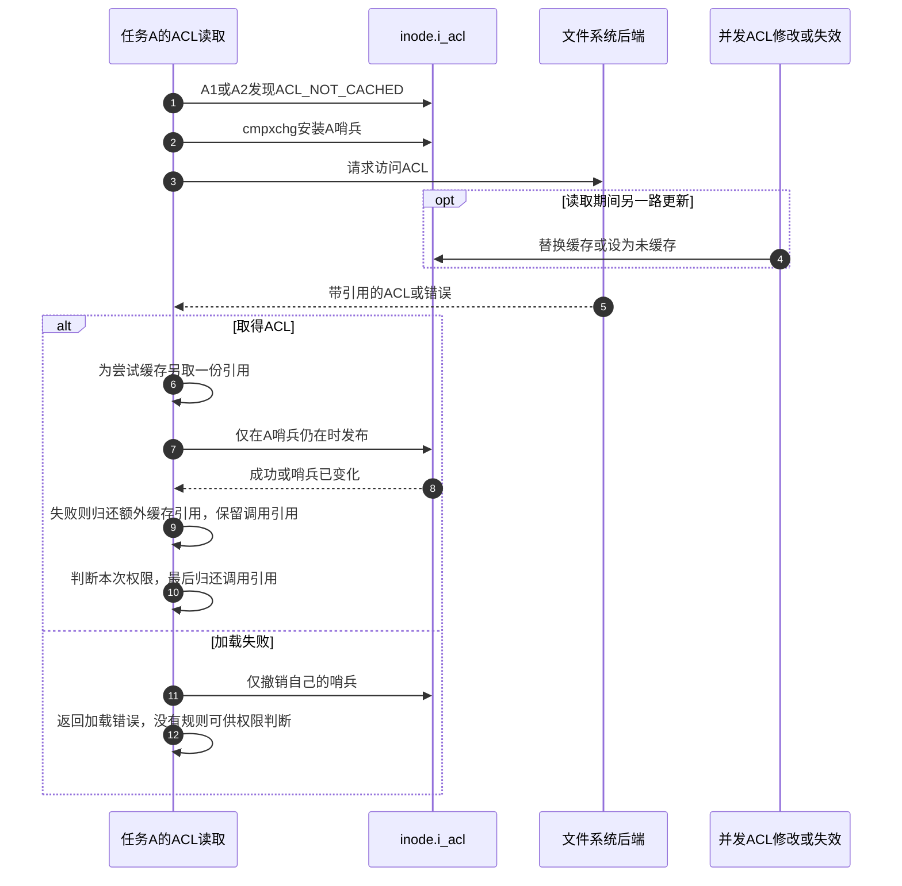

# 第53章\_挂载身份换算与ACL判断

普通mode检查已经回答“选哪一类权限”。若文件身份经过挂载映射，直接比较inode内的UID数值仍会选错类别；若权限来自ACL，快速查找也不能把没有读过的ACL当成不存在。本篇分别闭合身份换算、规则取得和条目判断，三者都发生在 [A1目录搜索或A2最终检查](../navigation/P18_访问身份与权限检查的时间边界.md#18.1_先找本次使用的身份与对象)，不是三个彼此替代的安全机制。

固定Linux 6.12.20提交 `dfaf2136deb2af2e60b994421281ba42f1c087e0`。原件：[mnt_idmapping.c](../../linux/fs/mnt_idmapping.c)、[mnt_idmapping.h](../../linux/include/linux/mnt_idmapping.h)、[namei.c](../../linux/fs/namei.c)、[posix_acl.c](../../linux/fs/posix_acl.c)、[posix_acl.h](../../linux/include/linux/posix_acl.h)、[groups.c](../../linux/kernel/groups.c)、[cred.h](../../linux/include/linux/cred.h)。源码保留执行语句，中文注释为仓库补充；来源总入口为 [源码索引](../navigation/P01_Linux_6.12_VFS源码阅读索引.md)。

原件对象摘要及本次配置核对见 [权限源码基线](../../linux/SOURCE_BASELINE.md#1.298_访问身份与权限检查的时间边界)。

## 53.1\_先把文件身份放到当前挂载视图

同一文件系统可以在不同挂载视图下呈现不同所有者关系。这个要求不需要把磁盘上每个inode的所有者重写一遍：保留文件本来的身份，在权限比较时根据当前挂载换算即可。因而必须区分三处信息：cred中的当前身份、inode所属文件系统的user namespace，以及本次路径挂载的mnt_idmap。

`i_uid_into_vfsuid`由fs.h提供，以inode的用户身份和i_user_ns作为输入调用make_vfsuid；组身份有对应的i_gid_into_vfsgid。make函数在mnt_idmapping.h声明、mnt_idmapping.c定义。

```c
/** @brief 仓库补充阅读说明：按文件系统命名空间与挂载映射把inode用户身份转换为VFS身份。 */
vfsuid_t make_vfsuid(struct mnt_idmap *idmap,
                     struct user_namespace *fs_userns,
                     kuid_t kuid)
{
        /* 仓库补充：按文件系统命名空间与挂载映射把inode用户身份转换为VFS身份。 */
        uid_t uid;
        if (idmap == &nop_mnt_idmap)
                return VFSUIDT_INIT(kuid);
        if (idmap == &invalid_mnt_idmap)
                return INVALID_VFSUID;
        if (initial_idmapping(fs_userns))
                uid = __kuid_val(kuid);
        else
                uid = from_kuid(fs_userns, kuid);
        /* 仓库补充：文件系统身份不可表示时保留无效结果。 */
        if (uid == (uid_t)-1)
                return INVALID_VFSUID;
        return VFSUIDT_INIT_RAW(map_id_down(&idmap->uid_map, uid));
}
```

```c
/** @brief 仓库补充阅读说明：执行与用户身份对应的组身份换算，保留无映射失败。 */
vfsgid_t make_vfsgid(struct mnt_idmap *idmap,
                     struct user_namespace *fs_userns, kgid_t kgid)
{
        /* 仓库补充：执行与用户身份对应的组身份换算，保留无映射失败。 */
        gid_t gid;
        if (idmap == &nop_mnt_idmap)
                return VFSGIDT_INIT(kgid);
        if (idmap == &invalid_mnt_idmap)
                return INVALID_VFSGID;
        if (initial_idmapping(fs_userns))
                gid = __kgid_val(kgid);
        else
                gid = from_kgid(fs_userns, kgid);
        /* 仓库补充：组身份与用户身份遵守同样的失败传播。 */
        if (gid == (gid_t)-1)
                return INVALID_VFSGID;
        return VFSGIDT_INIT_RAW(map_id_down(&idmap->gid_map, gid));
}
```

无映射的nop对象直接保留内核身份；invalid对象明确产生无效结果。普通映射先从文件系统身份空间取得可表示数值，再通过挂载映射转为VFS身份。如果中间不可表示，后续不能靠强制类型转换把它变成有效所有者。`VFSUIDT_INIT`与RAW包装、`AS_KGIDT`以及vfsuid_eq_kuid等比较器保持类型边界，不能把它们理解成再次查询用户数据库。

| 对象与辅助接口 | 初始化、拥有者与当前读取规则 |
| --- | --- |
| `struct mnt_idmap` | 在mnt_idmapping.c内定义，含uid_map、gid_map和引用计数；挂载持有它，权限调用借用当前路径的映射 |
| `nop_mnt_idmap/invalid_mnt_idmap` | 全局特殊对象，以地址身份识别；初始计数为1，不能把其空映射数组解释成普通恒等映射表 |
| `alloc_mnt_idmap` | 分配对象并复制来源namespace的UID/GID映射；小表内嵌，大表分配正反向数组，部分失败释放已取得资源 |
| 映射复制 | 先READ_ONCE读取区间数量，再用读屏障配对发布；来源映射建立后不再任意原地改写。零区间拒绝，不能发布半张表 |
| `mnt_idmap_get/mnt_idmap_put` | 普通对象按引用管理，最后释放映射数组和对象；两个全局特殊对象不按普通分配对象释放 |
| `current_fsuid/current_fsgid/group_info` | 当前主观凭据提供，见 [身份持有](P51_当前身份与access临时凭据.md#51.1_当前主观身份与打开身份分别由谁持有)；映射文件身份后再与它们比较 |
| `map_id_down/from_kuid/from_kgid` | 分别执行映射表向下转换、把内核身份表示为指定namespace内数值；失败值必须继续保留 |



```c
/** @brief 仓库补充阅读说明：在多用户构建中把映射后的组身份交给当前组检查。 */
int vfsgid_in_group_p(vfsgid_t vfsgid)
{
        /* 仓库补充：在多用户构建中把映射后的组身份交给当前组检查。 */
        return in_group_p(AS_KGIDT(vfsgid));
}
```

```c
/** @brief 仓库补充阅读说明：先比较文件系统组，再搜索附加组集合。 */
int in_group_p(kgid_t grp)
{
        /* 仓库补充：先比较文件系统组，再搜索附加组集合。 */
        const struct cred *cred = current_cred();
        int retval = 1;
        if (!gid_eq(grp, cred->fsgid))
                retval = groups_search(cred->group_info, grp);
        return retval;
}
```

这里展示CONFIG_MULTIUSER开启的vfsgid_in_group_p；关闭时同名分支直接返回1。in_group_p先比较fsgid，不同才通过groups_search查找已排序的附加组数组；它不会读`/etc/group`。本基线MULTIUSER与USER_NS均开启。idmap不自动授予能力，也不改变cred中的主体身份。

**可修改性：** 身份换算必须随实际挂载传递，不能在同一inode上缓存一份对所有挂载通用的owner比较结果。扩展映射时保留无效身份、映射初始化完成后才发布以及引用持有三项约束；改变磁盘身份是另一种需要文件系统修改协议的操作。

## 53.2\_读取ACL时区分不存在与尚未缓存

ACL是附着在inode上的访问规则集合，可以指定额外用户或组。目录的默认ACL用于新对象继承，与本次检查的ACL_TYPE_ACCESS不是同一种用途。inode中的i_acl和i_default_acl由acl_by_type选择；权限路径只请求访问ACL。

```c
/** @brief 仓库补充阅读说明：区分RCU观察和可阻塞读取，保持未缓存与无ACL的不同返回。 */
static int check_acl(struct mnt_idmap *idmap,
                     struct inode *inode, int mask)
{
        /* 仓库补充：区分RCU观察和可阻塞读取，保持未缓存与无ACL的不同返回。 */
#ifdef CONFIG_FS_POSIX_ACL
        struct posix_acl *acl;
        if (mask & MAY_NOT_BLOCK) {
                acl = get_cached_acl_rcu(inode, ACL_TYPE_ACCESS);
                if (!acl)
                        return -EAGAIN;
                /* 仓库补充：未缓存必须退出RCU快速观察，不能按无ACL处理。 */
                if (is_uncached_acl(acl))
                        return -ECHILD;
                return posix_acl_permission(idmap, inode, acl, mask);
        }
        acl = get_inode_acl(inode, ACL_TYPE_ACCESS);
        if (IS_ERR(acl))
                return PTR_ERR(acl);
        if (acl) {
                int error = posix_acl_permission(idmap, inode, acl, mask);
                /* 仓库补充：可阻塞取得的规则有引用，比较后必须归还。 */
                posix_acl_release(acl);
                return error;
        }
#endif
        return -EAGAIN;
}
```

```c
/** @brief 仓库补充阅读说明：RCU读取缓存，DONT_CACHE后端可接收LOOKUP_RCU查询。 */
struct posix_acl *get_cached_acl_rcu(struct inode *inode, int type)
{
        /* 仓库补充：RCU读取缓存，DONT_CACHE后端可接收LOOKUP_RCU查询。 */
        struct posix_acl *acl = rcu_dereference(*acl_by_type(inode, type));
        /* 仓库补充：这个后端例外可接收LOOKUP_RCU，但仍不能任意阻塞。 */
        if (acl == ACL_DONT_CACHE) {
                struct posix_acl *ret;
                ret = inode->i_op->get_inode_acl(inode, type, LOOKUP_RCU);
                if (!IS_ERR(ret))
                        acl = ret;
        }
        return acl;
}
```

| 读到的内容 | 含义与后续动作 |
| --- | --- |
| `NULL` | 已知没有该ACL；check_acl返回EAGAIN，让调用方继续mode判断 |
| 有效ACL指针 | RCU路径在其保护期内直接比较；可阻塞路径取得引用，比较后release |
| `ACL_NOT_CACHED`或加载哨兵 | 尚不能给出规则；RCU路径返回ECHILD，由查找调用方转到允许取得完整证据的路径 |
| `ACL_DONT_CACHE` | 后端不采用普通缓存；get_cached_acl_rcu调用get_inode_acl并传LOOKUP_RCU。成功可返回规则或NULL，错误则保留哨兵，随后退出RCU快速路径 |
| `ERR_PTR` | 可阻塞加载的实际错误，转换为对应错误码；不是“没有ACL” |

因此，check_acl附近上游“RCU模式不调用get_inode_acl”的简短注释不能单独作为结论：实际辅助函数有DONT_CACHE例外。这个例外仍要求后端遵守LOOKUP_RCU上下文，不能在快速路径里任意睡眠。CONFIG_FS_POSIX_ACL关闭时check_acl直接返回EAGAIN；本基线FS_POSIX_ACL和EXT4_FS_POSIX_ACL开启。

```c
/** @brief 仓库补充阅读说明：在RCU内把缓存观察转换为有效引用，引用竞争失败则重试。 */
struct posix_acl *get_cached_acl(struct inode *inode, int type)
{
        /* 仓库补充：在RCU内把缓存观察转换为有效引用，引用竞争失败则重试。 */
        struct posix_acl **p = acl_by_type(inode, type);
        struct posix_acl *acl;
        for (;;) {
                rcu_read_lock();
                acl = rcu_dereference(*p);
                /* 仓库补充：真实对象必须成功增加非零引用；否则退出RCU后重试。 */
                if (!acl || is_uncached_acl(acl) ||
                    refcount_inc_not_zero(&acl->a_refcount))
                        break;
                rcu_read_unlock();
                cpu_relax();
        }
        rcu_read_unlock();
        return acl;
}
```

普通读取需要把“看见指针”转换为“持有有效对象”。get_cached_acl在RCU内读取，NULL与哨兵直接返回；真实对象用refcount_inc_not_zero取得引用。若计数已归零，退出RCU并重试，而不是复活正在释放的对象。`cpu_relax`只服务于重试等待，不是保证对象存活的锁。

**可修改性：** 不可把ECHILD统一换成EAGAIN；那会把“缺少规则证据”变成“按无ACL处理”。也不可在RCU观察结束后继续使用没有引用的ACL。这里的回退由上层查找协议完成，不在check_acl内自行重启整个open。

## 53.3\_加载者只能发布仍属于自己的缓存结果

离开RCU快速路径后，另一个任务仍可能同时设置或失效ACL。若加载者读完旧规则就无条件写入i_acl，它可能覆盖刚发布的新规则。因此缓存加载使用一个属于本任务的哨兵，只有结束时哨兵仍在，才安装自己的结果。

```c
/** @brief 仓库补充阅读说明：以inode和访问ACL类型进入通用加载路径。 */
struct posix_acl *get_inode_acl(struct inode *inode, int type)
{
        /* 仓库补充：以inode和访问ACL类型进入通用加载路径。 */
        return __get_acl(&nop_mnt_idmap, NULL, inode, type);
}
```

```c
/** @brief 仓库补充阅读说明：用本任务哨兵标识一次加载，只有哨兵仍在才发布缓存。 */
static struct posix_acl *__get_acl(struct mnt_idmap *idmap,
                                   struct dentry *dentry, struct inode *inode,
                                   int type)
{
        /* 仓库补充：用本任务哨兵标识一次加载，只有哨兵仍在才发布缓存。 */
        struct posix_acl *sentinel;
        struct posix_acl **p;
        struct posix_acl *acl;
        acl = get_cached_acl(inode, type);
        if (!is_uncached_acl(acl))
                return acl;
        if (!IS_POSIXACL(inode))
                return NULL;
        sentinel = uncached_acl_sentinel(current);
        p = acl_by_type(inode, type);
        /* 仓库补充：安装失败仍可自行读后端，不等待竞争加载者。 */
        cmpxchg(p, ACL_NOT_CACHED, sentinel);
        if (dentry && inode->i_op->get_acl) {
                acl = inode->i_op->get_acl(idmap, dentry, type);
        } else if (inode->i_op->get_inode_acl) {
                acl = inode->i_op->get_inode_acl(inode, type, false);
        } else {
                set_cached_acl(inode, type, NULL);
                return NULL;
        }
        if (IS_ERR(acl)) {
                cmpxchg(p, sentinel, ACL_NOT_CACHED);
                return acl;
        }
        /* 仓库补充：为缓存多取一份，发布失败只释放这一份。 */
        posix_acl_dup(acl);
        if (unlikely(!try_cmpxchg(p, &sentinel, acl)))
                posix_acl_release(acl);
        return acl;
}
```

`uncached_acl_sentinel(current)`把任务地址加1形成可识别为未缓存的奇数标记；它是比较交换使用的身份标签，不是可解引用的ACL。cmpxchg只在原值为ACL_NOT_CACHED时安装标记。若其他任务已开始加载，本任务仍可以独立读取后端，不等待对方；所以这套机制避免覆盖竞争结果，却不保证一次只发生一个后端读取。



`posix_acl_dup`为非NULL规则增加引用，`posix_acl_release`最后一份使用kfree_rcu回收。set_cached_acl负责替换缓存并归还旧缓存责任，forget_cached_acl使规则需要重读；后端也能在读取中主动阻止普通缓存安装。`try_cmpxchg`失败会改写期望值变量，但此时调用方只需释放自己额外增加的引用，不得释放别人的缓存对象。

**可修改性：** 保留“比较哨兵再发布”和“返回引用、缓存引用分别计数”。把两份引用合成一份会让调用方release后缓存指向已释放规则；无条件缓存则可能覆盖并发修改。这个协议维护缓存所有权，不承诺access结束后权限永不改变。

## 53.4\_条目匹配以后仍要应用所属类别的限制

规则到手后才进入posix_acl_permission。`struct posix_acl`在posix_acl.h保存a_refcount、a_count、RCU回收字段和条目数组；每个posix_acl_entry有e_tag、e_perm，以及具名用户或组所需的身份。FOREACH_ACL_ENTRY遍历数组，pa为当前条目，pe是末尾，mask_obj用于向后寻找类别限制。

```c
/** @brief 仓库补充阅读说明：按条目类别和mask判断本次所需全部权限位。 */
int
posix_acl_permission(struct mnt_idmap *idmap, struct inode *inode,
                     const struct posix_acl *acl, int want)
{
        /* 仓库补充：按条目类别和mask判断本次所需全部权限位。 */
        const struct posix_acl_entry *pa, *pe, *mask_obj;
        struct user_namespace *fs_userns = i_user_ns(inode);
        int found = 0;
        vfsuid_t vfsuid;
        vfsgid_t vfsgid;
        want &= MAY_READ | MAY_WRITE | MAY_EXEC;
        FOREACH_ACL_ENTRY(pa, acl, pe) {
                switch(pa->e_tag) {
                        case ACL_USER_OBJ:
                                vfsuid = i_uid_into_vfsuid(idmap, inode);
                                if (vfsuid_eq_kuid(vfsuid, current_fsuid()))
                                        goto check_perm;
                                break;
                        case ACL_USER:
                                vfsuid = make_vfsuid(idmap, fs_userns,
                                                     pa->e_uid);
                                if (vfsuid_eq_kuid(vfsuid, current_fsuid()))
                                        goto mask;
                                break;
                        case ACL_GROUP_OBJ:
                                vfsgid = i_gid_into_vfsgid(idmap, inode);
                                if (vfsgid_in_group_p(vfsgid)) {
                                        found = 1;
                                        if ((pa->e_perm & want) == want)
                                                goto mask;
                                }
                                break;
                        case ACL_GROUP:
                                vfsgid = make_vfsgid(idmap, fs_userns,
                                                     pa->e_gid);
                                if (vfsgid_in_group_p(vfsgid)) {
                                        found = 1;
                                        if ((pa->e_perm & want) == want)
                                                goto mask;
                                }
                                break;
                        case ACL_MASK:
                                break;
                        /* 仓库补充：已有匹配组但权限不足时，不准借用other。 */
                        case ACL_OTHER:
                                if (found)
                                        return -EACCES;
                                else
                                        goto check_perm;
                        default:
                                return -EIO;
                }
        }
        return -EIO;
/* 仓库补充：具名用户和组条目还受mask限制。 */
mask:
        for (mask_obj = pa+1; mask_obj != pe; mask_obj++) {
                if (mask_obj->e_tag == ACL_MASK) {
                        if ((pa->e_perm & mask_obj->e_perm & want) == want)
                                return 0;
                        return -EACCES;
                }
        }
check_perm:
        if ((pa->e_perm & want) == want)
                return 0;
        return -EACCES;
}
```

| 匹配类别 | 允许条件与不允许的回退 |
| --- | --- |
| `ACL_USER_OBJ` | 映射后owner匹配，直接检查该条目的权限；不受ACL_MASK约束，也不退到other |
| `ACL_USER` | 具名用户匹配，权限还要与ACL_MASK相交；失败不继续寻找other |
| `ACL_GROUP_OBJ/ACL_GROUP` | 对匹配组逐项尝试，某一条目必须覆盖本次全部want，再应用mask；不能把两个各自只满足一部分的组权限拼起来 |
| `ACL_MASK` | 限制具名用户和组类别的有效权限，本身不选择主体 |
| `ACL_OTHER` | 只有没有匹配组时才使用；已经匹配组但都不能满足请求则拒绝 |
| 未知标签或缺少应有结果 | 返回EIO；不是普通EACCES，不能被generic_permission当作可越权的普通拒绝 |

例如请求读写，用户同时属于只读组与只写组，该实现并不把两条权限做按位或后放行；需要某个匹配条目足以覆盖读写，再看mask是否也允许。若只请求读，则只读组满足条目条件，但mask仍可能清掉读位。这个例子同时说明“属于某组”“条目足够”“类别mask允许”是三个不同问题。

**可修改性：** 不可为了简化循环把found删掉，否则匹配组被拒绝后会错误落入other；不可把ACL_MASK扩展到owner/other；不可跳过身份映射。规则语法校验与创建接口在本篇范围外，当前函数依赖有效条目布局，但保留EIO处理不应被正常权限拒绝吞掉。
