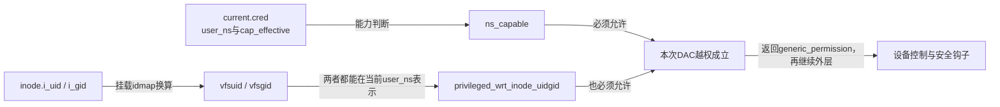
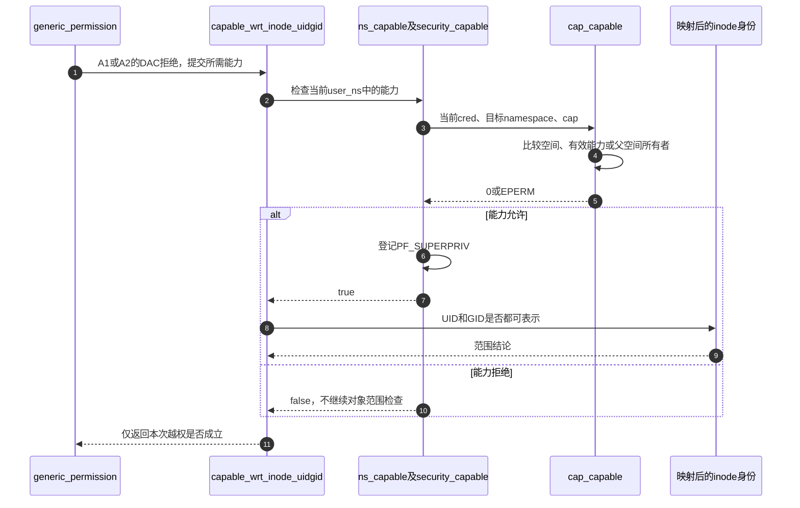

# 第54章\_capability的命名空间与对象边界

mode或ACL拒绝以后，管理员维护操作仍可能需要有条件越权。若只检查“进程有某个能力位”，容器内的能力就可能被错误用于容器外对象。VFS因此同时询问：能力在哪个user namespace成立，以及本次挂载视图下的文件身份是否处于这个namespace可表示的范围。

本篇放大 [权限周期A1/A2](../navigation/P18_访问身份与权限检查的时间边界.md#18.1_先找本次使用的身份与对象)中的DAC越权分支；不是所有系统调用的capability总教程。来源固定Linux 6.12.20提交 `dfaf2136deb2af2e60b994421281ba42f1c087e0`，原件为 [kernel/capability.c](../../linux/kernel/capability.c)、[security/commoncap.c](../../linux/security/commoncap.c)、[capability.h](../../linux/include/linux/capability.h)、[security.h](../../linux/include/linux/security.h)、[user_namespace.h](../../linux/include/linux/user_namespace.h)。中文说明替换原注释，执行语句保留；其他实现见 [总索引](../navigation/P01_Linux_6.12_VFS源码阅读索引.md)。

原件对象摘要及本次配置核对见 [权限源码基线](../../linux/SOURCE_BASELINE.md#1.298_访问身份与权限检查的时间边界)。

## 54.1\_DAC越权也要确认能力作用范围

先接回调用点：[generic_permission](P52_inode权限的基本检查与分派.md#52.2_类别选择与拒绝结果不能混用)已经根据对象类型和所需动作选择CAP_DAC_READ_SEARCH或CAP_DAC_OVERRIDE。这里不重新选择能力，而是判断选中的能力能否用于这个inode。

```c
/** @brief 仓库补充阅读说明：能力本身和对象身份范围必须同时满足。 */
bool capable_wrt_inode_uidgid(struct mnt_idmap *idmap,
                              const struct inode *inode, int cap)
{
        /* 仓库补充：能力本身和对象身份范围必须同时满足。 */
        struct user_namespace *ns = current_user_ns();
        return ns_capable(ns, cap) &&
               privileged_wrt_inode_uidgid(ns, idmap, inode);
}
```

```c
/** @brief 仓库补充阅读说明：确认映射后的用户与组身份都落在指定命名空间的表示范围。 */
bool privileged_wrt_inode_uidgid(struct user_namespace *ns,
                                 struct mnt_idmap *idmap,
                                 const struct inode *inode)
{
        /* 仓库补充：确认映射后的用户与组身份都落在指定命名空间的表示范围。 */
        return vfsuid_has_mapping(ns, i_uid_into_vfsuid(idmap, inode)) &&
               vfsgid_has_mapping(ns, i_gid_into_vfsgid(idmap, inode));
}
```

这两个函数在capability.h声明。前者从当前主观cred取user_ns；先调用ns_capable确认能力，再检查经当前挂载换算的UID和GID都能在该namespace表示。`vfsuid_has_mapping/vfsgid_has_mapping`是身份表示范围检查，不检查文件mode。挂载映射的输入输出见 [身份换算](P53_挂载身份换算与ACL判断.md#53.1_先把文件身份放到当前挂载视图)。



不要从图中推导“能力足够就能写只读文件系统”。只读、不可变等拒绝发生在更外层；generic_permission允许后也仍有后续安全检查。这一分支只回答能否越过此次普通DAC拒绝。

```c
/** @brief 仓库补充阅读说明：以通常审计选项进入指定命名空间的能力检查。 */
bool ns_capable(struct user_namespace *ns, int cap)
{
        /* 仓库补充：以通常审计选项进入指定命名空间的能力检查。 */
        return ns_capable_common(ns, cap, CAP_OPT_NONE);
}
```

```c
/** @brief 仓库补充阅读说明：验证能力编号并执行安全能力检查，成功登记特权使用标志。 */
static bool ns_capable_common(struct user_namespace *ns,
                              int cap,
                              unsigned int opts)
{
        /* 仓库补充：验证能力编号并执行安全能力检查，成功登记特权使用标志。 */
        int capable;
        if (unlikely(!cap_valid(cap))) {
                pr_crit("capable() called with invalid cap=%u\n", cap);
                BUG();
        }
        capable = security_capable(current_cred(), ns, cap, opts);
        if (capable == 0) {
                /* 仓库补充：记录能力检查成功；整体对象范围检查可能仍会失败。 */
                current->flags |= PF_SUPERPRIV;
                return true;
        }
        return false;
}
```

| 符号或状态 | 当前行为与边界 |
| --- | --- |
| `cap`与`cap_valid` | 能力是内核定义的编号；无效编号属于内核调用错误，pr_crit后BUG，不按普通用户拒绝处理 |
| `CAP_OPT_NONE` | ns_capable选择通常的检查选项，传给安全能力接口；其他审计选项不能随意混为“允许/拒绝位” |
| `security_capable` | 接收明确的cred、目标namespace、能力及选项；CONFIG_SECURITY关闭仍调用cap_capable，不是直接允许 |
| `current->flags & PF_SUPERPRIV` | 能力检查成功后由ns_capable_common设置，记录使用了特权检查；它不是随后所有权限判断的通行证 |
| `CONFIG_MULTIUSER` | 本基线开启；关闭构建中capability.h的若干能力接口使用简化实现，不能直接套用本篇运行路径 |

由于`&&`从左到右求值，能力检查成功而对象身份范围失败时，整体仍拒绝，但PF_SUPERPRIV可能已经设置。这也说明诊断或记账标志不能当作“完整对象授权已成功”的证据。

**可修改性：** 不能删掉UID/GID任一范围条件，也不能只比较用户空间显示的数字。重排检查时要理解PF_SUPERPRIV等副作用；不能用该标志短路后续权限检查。能力编号错误和正常权限不足须保留不同处理。

## 54.2\_沿目标命名空间判断能力能否到达

对象范围成立还需要可靠的能力判断。user namespace形成父子关系，`cred->user_ns`是主体所在位置，targ_ns是本次能力所要控制的位置。子空间内的root不能据此反向控制父空间；父空间的相应能力却可作用于后代空间，父空间中的创建所有者还有明确的子空间所有权规则。

```c
/** @brief 仓库补充阅读说明：沿目标命名空间关系判断有效能力及父空间所有者特权。 */
int cap_capable(const struct cred *cred, struct user_namespace *targ_ns,
                int cap, unsigned int opts)
{
        /* 仓库补充：沿目标命名空间关系判断有效能力及父空间所有者特权。 */
        struct user_namespace *ns = targ_ns;
        for (;;) {
                if (ns == cred->user_ns)
                        return cap_raised(cred->cap_effective, cap) ? 0 : -EPERM;
                /* 仓库补充：层级用于判定已越过搜索范围，不代替空间身份比较。 */
                if (ns->level <= cred->user_ns->level)
                        return -EPERM;
                if ((ns->parent == cred->user_ns) && uid_eq(ns->owner, cred->euid))
                        return 0;
                /* 仓库补充：只沿目标的父链查找，不向兄弟空间授予权限。 */
                ns = ns->parent;
        }
}
```

`struct user_namespace`在user_namespace.h声明，parent、level、owner在创建时建立空间关系，引用持有保证查询期间对象存活；本函数不创建或修改空间。owner是该空间在父空间中的所有者身份，代码用cred的euid比较；这与普通文件DAC使用fsuid不同，因为两处回答的问题不同。

| 遍历条件 | 结论 |
| --- | --- |
| 当前目标层与cred->user_ns相同 | 直接检查cap_effective对应位，存在返回0，否则EPERM |
| 已到不深于cred所在层、但还不是同一空间 | 不可能再沿父链找到合法祖先关系，拒绝；不是只比较level就认为是同一空间 |
| 目标层的parent是cred所在空间，且owner等于cred->euid | 主体是该子空间的所有者，允许；从更深目标向上遍历时也可命中此规则 |
| 其他情况 | 沿parent继续检查，没有向兄弟空间横跳或向父空间反向授权的通道 |



这条VFS调用使用当前user_ns作为目标；cap_capable本身也服务其他明确指定目标空间的调用，因此函数中保留完整祖先遍历。`opts`在这个基础实现中不改变上述能力关系，但上层安全接口可使用它组织审计；不得据此删除接口参数。

**可修改性：** level只用于判定已越过可能范围，身份仍由空间指针与parent链确认。把“目标level更大”直接当作后代会错授兄弟分支；把容器UID 0直接当作全局能力也会越界。验证至少区分同空间有/无能力、父子所有者、非所有者及兄弟空间，再结合映射UID/GID分别缺失的情况检查VFS结果。
