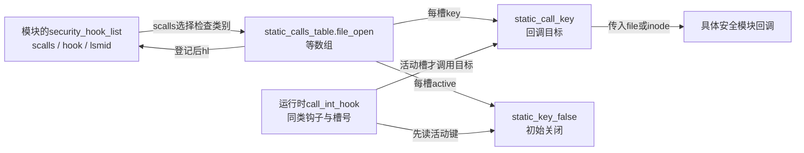
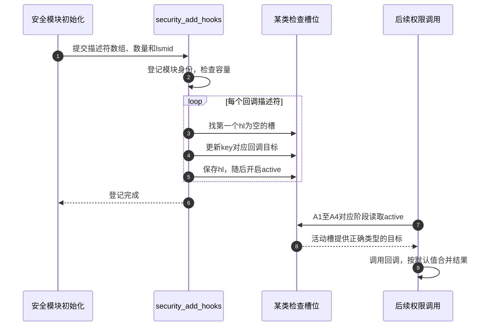

# 第55章\_VFS安全钩子的登记与调用

VFS能根据所有者、组和ACL作判断，却不应把每种安全策略写进通用路径。Linux Security Module（LSM）接口在规定阶段把对象交给已登记的策略实现。要理解“进入安全钩子”究竟执行了什么，必须先找到回调地址保存在哪、何时变为可调用，以及多个结果怎样合并。

本篇固定Linux 6.12.20提交 `dfaf2136deb2af2e60b994421281ba42f1c087e0`。该版本使用静态调用槽，不能沿用旧版本链表遍历图。原件：[security.c](../../linux/security/security.c)、[lsm_hooks.h](../../linux/include/linux/lsm_hooks.h)、[lsm_hook_defs.h](../../linux/include/linux/lsm_hook_defs.h)、[lsm_count.h](../../linux/include/linux/lsm_count.h)、[security.h](../../linux/include/linux/security.h)、[static_call.h](../../linux/include/linux/static_call.h)、[static_call_types.h](../../linux/include/linux/static_call_types.h)、[jump_label.h](../../linux/include/linux/jump_label.h)、[unroll.h](../../linux/include/linux/unroll.h)。执行语句保留，中文注释为仓库补充。

[权限导读](../navigation/P18_访问身份与权限检查的时间边界.md#18.1_先找本次使用的身份与对象)给出A0～A5运行阶段，[总索引](../navigation/P01_Linux_6.12_VFS源码阅读索引.md)给出版本来源。本次配置CONFIG_SECURITY关闭，下面登记和调用槽解释的是该源码提供的可选实现；实际配置使用security.h的对应桩函数。CONFIG_SECURITYFS开启也不能推翻这个区别。

原件对象摘要及本次配置核对见 [权限源码基线](../../linux/SOURCE_BASELINE.md#1.298_访问身份与权限检查的时间边界)。

## 55.1\_先为每类检查建立可登记的回调槽

同一个file_open阶段可以有多个安全模块参加，但每个模块仍需保存自己的回调地址。`static_calls_table.file_open`为这类检查准备MAX_LSM_COUNT个槽，inode_permission等其他检查各有自己的数组。MAX_LSM_COUNT由编译配置生成，提供容量上界，不表示每个槽都已登记。

```c
/** @brief 仓库补充阅读说明：为每类钩子的每个槽位建立空目标和初始关闭的活动键。 */
/* 仓库补充：为每类钩子的每个槽位建立空目标和初始关闭的活动键。 */
#define DEFINE_LSM_STATIC_CALL(NUM, NAME, RET, ...)                     \
        DEFINE_STATIC_CALL_NULL(LSM_STATIC_CALL(NAME, NUM),             \
                                *((RET(*)(__VA_ARGS__))NULL));          \
        DEFINE_STATIC_KEY_FALSE(SECURITY_HOOK_ACTIVE_KEY(NAME, NUM));
```

该宏被lsm_hook_defs.h的每条钩子描述驱动，再由LSM_DEFINE_UNROLL按槽号展开。以file_open的0号槽为例，LSM_STATIC_CALL拼出`lsm_static_call_file_open_0`，SECURITY_HOOK_ACTIVE_KEY拼出`security_hook_active_file_open_0`。前者关联调用目标，后者表示该槽是否启用；初始目标为空、活动键关闭。

```c
/** @brief 仓库补充阅读说明：把每个槽位连接到自己的调用键、跳板与活动键；回调身份初始为空。 */
/* 仓库补充：把每个槽位连接到自己的调用键、跳板与活动键；回调身份初始为空。 */
struct lsm_static_calls_table
        static_calls_table __ro_after_init __aligned(sizeof(u64)) = {
#define INIT_LSM_STATIC_CALL(NUM, NAME)                                 \
        (struct lsm_static_call) {                                      \
                .key = &STATIC_CALL_KEY(LSM_STATIC_CALL(NAME, NUM)),    \
                .trampoline = LSM_HOOK_TRAMP(NAME, NUM),                \
                .active = &SECURITY_HOOK_ACTIVE_KEY(NAME, NUM),         \
        },
#define LSM_HOOK(RET, DEFAULT, NAME, ...)                               \
        .NAME = {                                                       \
                LSM_DEFINE_UNROLL(INIT_LSM_STATIC_CALL, NAME)           \
        },
#include <linux/lsm_hook_defs.h>
#undef LSM_HOOK
#undef INIT_LSM_STATIC_CALL
        };
```

| 声明与状态 | 具体存放处及写读关系 |
| --- | --- |
| `struct lsm_static_call` | lsm_hooks.h声明key、trampoline、hl、active；每槽连接自己的调用键、可选跳板、登记描述符和活动键 |
| `static_calls_table` | security.c全局实例；初始化器连接key/trampoline/active，未指定的hl为NULL；登记方写hl，调用路径使用相同槽编号选择目标与活动键 |
| `struct security_hook_list` | 安全模块提供的描述符，含scalls、hook联合体和lsmid；名称虽含list，本版本这里不依赖链表节点串接 |
| `union security_list_options` | 根据lsm_hook_defs.h生成各类型的函数指针成员；lsm_func_addr供登记时统一取得地址，调用时仍按该钩子的签名使用 |
| `LSM_HOOK_TRAMP` | 有CONFIG_HAVE_STATIC_CALL时取架构跳板，无此能力为NULL；通用调用实现仍能保存函数目标 |
| `__ro_after_init/__init` | 分别表达初始化后只读数据和初始化代码的生命周期属性，不是锁，也不承担并发发布屏障 |
| `__aligned(sizeof(u64))` | 为早期初始化访问提供明确对齐，不能把packed结构等同于可在所有架构任意非对齐访问 |

```c
/** @brief 仓库补充阅读说明：静态描述符选择所属钩子数组，并保存具体回调地址。 */
/* 仓库补充：静态描述符选择所属钩子数组，并保存具体回调地址。 */
#define LSM_HOOK_INIT(NAME, HOOK)                       \
        {                                               \
                .scalls = static_calls_table.NAME,      \
                .hook = { .NAME = HOOK }                \
        }
```

模块用LSM_HOOK_INIT把某个回调与正确的数组绑定。例如概念上登记file_open回调时，scalls指向file_open数组，hook.file_open保存对应签名的函数地址；此时仍未占用具体槽号。真正安装在下一节完成，不能只写初始化器就认为回调已经会被调用。



**可修改性：** 类别、槽号、目标签名和活动键必须成套一致。增加钩子应通过同一份定义表生成对应成员与默认值，不能手工新增一个脱离容量和声明体系的裸函数指针。整个静态调用框架的架构补丁算法不在本篇展开；这里依赖其“更新目标、按相同键调用”的接口契约。

## 55.2\_安装目标以后才让运行路径看见活动槽

初始化时安全模块逐个登记。若先启用活动键再写回调地址，运行路径可能走进尚无目标的槽；因此安装顺序是先更新目标、登记描述符，再开启活动键。此处LSM初始化串行执行，不要凭函数中没有互斥锁就推导它支持运行时任意并发热插拔。

```c
/** @brief 仓库补充阅读说明：先写回调目标和槽位身份，再开启该槽位的活动开关。 */
static void __init lsm_static_call_init(struct security_hook_list *hl)
{
        /* 仓库补充：先写回调目标和槽位身份，再开启该槽位的活动开关。 */
        struct lsm_static_call *scall = hl->scalls;
        int i;
        for (i = 0; i < MAX_LSM_COUNT; i++) {
                if (!scall->hl) {
                        __static_call_update(scall->key, scall->trampoline,
                                             hl->hook.lsm_func_addr);
                        scall->hl = hl;
                        /* 仓库补充：目标与槽占用已经建立后才允许调用。 */
                        static_branch_enable(scall->active);
                        return;
                }
                scall++;
        }
        panic("%s - Ran out of static slots.\n", __func__);
}
```

```c
/** @brief 仓库补充阅读说明：启动阶段登记模块身份并填充其钩子槽位。 */
void __init security_add_hooks(struct security_hook_list *hooks, int count,
                               const struct lsm_id *lsmid)
{
        /* 仓库补充：启动阶段登记模块身份并填充其钩子槽位。 */
        int i;
        if (lsm_active_cnt == 0 || lsm_idlist[lsm_active_cnt - 1] != lsmid) {
                if (lsm_active_cnt >= MAX_LSM_COUNT)
                        panic("%s Too many LSMs registered.\n", __func__);
                lsm_idlist[lsm_active_cnt++] = lsmid;
        }
        for (i = 0; i < count; i++) {
                /* 仓库补充：初始化串行登记；不是运行期并发热插拔协议。 */
                hooks[i].lsmid = lsmid;
                lsm_static_call_init(&hooks[i]);
        }
        if (slab_is_available()) {
                if (lsm_append(lsmid->name, &lsm_names) < 0)
                        panic("%s - Cannot get early memory.\n", __func__);
        }
}
```

`security_add_hooks`在lsm_hooks.h声明，lsm_static_call_init只在security.c内部使用。后者从数组首项向后找第一个hl为空的槽。不要用头文件中“从后向前填”的旧注释覆盖这段实际循环。

| 状态与辅助调用 | 正确性或诊断责任 |
| --- | --- |
| `__static_call_update` | 安装回调目标；按架构能力更新调用入口或保存函数指针，必须在活动键开启前完成 |
| `scall->hl/static_branch_enable` | 记录槽已被占用，再激活调用；hl防止后续登记覆盖同一个槽，active决定运行时是否调用 |
| `lsm_idlist/lsm_active_cnt` | 全局模块身份表与已登记数，初始化后只读；允许同一模块连续多次登记时不重复增加身份项 |
| `hooks[i].lsmid` | 将描述符绑定模块身份；实际回调目标来自hook联合体，不能把模块名称当作调用地址 |
| `lsm_names/lsm_append` | 建立可报告的模块名称串；早期slab未可用时暂缓，分配失败按该实现panic，不能因为主要用于展示就静默忽略失败 |
| 容量耗尽 | 无空槽或模块数超MAX_LSM_COUNT时panic；它是初始化不能成立，不是某次文件访问普通拒绝 |



在没有CONFIG_HAVE_STATIC_CALL的实现中，static_call键保存函数指针，更新侧WRITE_ONCE，调用侧READ_ONCE；没有CONFIG_JUMP_LABEL时活动键也有普通状态读取实现。缺少指令补丁优化不会取消权限判断。本次ARM配置这两个优化均未开启，且CONFIG_SECURITY本身关闭，所以不能把上图登记过程写成已经在本机观察到的运行事实。

**可修改性：** 保持目标先于active建立，保持容量检查和每槽唯一占用。若要支持运行时卸载，还需要另外设计停止新调用、等待在途回调和对象回收协议；不能直接清hl或释放描述符，把启动期协议当作卸载协议使用。

## 55.3\_打开与使用阶段调用不同的钩子

回调已经登记，还需规定多个结果如何组合。当前三个VFS钩子在lsm_hook_defs.h中的默认值都是0：没有模块拒绝时继续；任何活动槽返回非0即停止，不以“后一个模块允许”覆盖先前拒绝。

```c
/** @brief 仓库补充阅读说明：仅调用活动槽位，遇到非默认结果立即结束本次检查链。 */
/* 仓库补充：仅调用活动槽位，遇到非默认结果立即结束本次检查链。 */
#define __CALL_STATIC_INT(NUM, R, HOOK, LABEL, ...)                          \
do {                                                                         \
        if (static_branch_unlikely(&SECURITY_HOOK_ACTIVE_KEY(HOOK, NUM))) {  \
                R = static_call(LSM_STATIC_CALL(HOOK, NUM))(__VA_ARGS__);    \
                if (R != LSM_RET_DEFAULT(HOOK))                              \
                        goto LABEL;                                          \
        }                                                                    \
} while (0);
```

```c
/** @brief 仓库补充阅读说明：从钩子默认值开始，按配置槽位展开调用并返回首个非默认结果。 */
/* 仓库补充：从钩子默认值开始，按配置槽位展开调用并返回首个非默认结果。 */
#define call_int_hook(HOOK, ...)                                        \
({                                                                      \
        __label__ OUT;                                                  \
        int RC = LSM_RET_DEFAULT(HOOK);                                 \
                                                                        \
        LSM_LOOP_UNROLL(__CALL_STATIC_INT, RC, HOOK, OUT, __VA_ARGS__); \
OUT:                                                                    \
        RC;                                                             \
})
```

LSM_RET_DEFAULT由钩子定义表生成对应常量。LSM_LOOP_UNROLL通过UNROLL把每个槽的活动检查展开，避免运行时按普通链表追逐节点；这不意味着所有槽都执行回调。GNU C语句表达式保存局部RC并返回它，局部标签OUT使首次非默认结果退出当前宏调用。参数只在实际活动槽调用时传入；调用者不应传入依赖“仅求值一次”的有副作用表达式。

```c
/** @brief 仓库补充阅读说明：普通inode交给对应安全钩子，内部私有inode走明确的豁免分支。 */
int security_inode_permission(struct inode *inode, int mask)
{
        /* 仓库补充：普通inode交给对应安全钩子，内部私有inode走明确的豁免分支。 */
        if (unlikely(IS_PRIVATE(inode)))
                return 0;
        return call_int_hook(inode_permission, inode, mask);
}
```

```c
/** @brief 仓库补充阅读说明：安全打开钩子允许后，再进入打开权限事件检查。 */
int security_file_open(struct file *file)
{
        /* 仓库补充：安全打开钩子允许后，再进入打开权限事件检查。 */
        int ret;
        ret = call_int_hook(file_open, file);
        if (ret)
                return ret;
        /* 仓库补充：仅在安全打开钩子允许后请求打开权限事件。 */
        return fsnotify_open_perm(file);
}
```

```c
/** @brief 仓库补充阅读说明：在文件使用时执行已登记的file_permission钩子。 */
int security_file_permission(struct file *file, int mask)
{
        /* 仓库补充：在文件使用时执行已登记的file_permission钩子。 */
        return call_int_hook(file_permission, file, mask);
}
```

| 周期位置 | 对象与调用结果 |
| --- | --- |
| A1/A2：inode_permission之后 | security_inode_permission把inode和mask交给策略；IS_PRIVATE内部私有inode直接返回0，这是明确的特例 |
| A3：打开过程 | [do_dentry_open](P26_file初始化与打开后失败清理.md#26.3_具体打开前取得自己的持有与操作表)调用security_file_open，策略可记录打开状态或再判断变化；允许后该包装再调用fsnotify_open_perm |
| A4：读写准备 | [rw_verify_area](P32_读写资格检查与文件操作分派.md#32.1_范围检查与访问许可发生在数据方法之前)调用security_file_permission；该包装自身只调用LSM钩子，fsnotify_file_area_perm由rw_verify_area另行调用 |
| A5：权限或策略后来改变 | 未来钩子按具体策略处理；已打开file的mode资格与策略重新判断不是同一维度。内存映射后的每次load/store也不会逐条走file_permission |

三个接口在security.h声明；CONFIG_SECURITY关闭时，对应inline桩直接返回0，包括file_open桩也不调用fsnotify_open_perm。本次FANOTIFY同样关闭，不能从源码中存在权限事件接口推导实际有用户空间审批。另一方面security_capable的关闭配置仍执行基础能力检查，见 [能力边界](P54_capability的命名空间与对象边界.md#54.1_DAC越权也要确认能力作用范围)。

file中的f_cred和可能存在的安全数据是策略可用输入，当前任务身份也是部分策略的输入；框架没有规定所有模块都只看其中一份。故“打开后chmod不撤销普通fd读资格”不能扩展为“以后所有安全判断必然允许”。

**可修改性：** 保持三个阶段的对象和职责分别明确，不能用一次inode许可代替file_open或file_permission。调整默认值会改变空钩子链的含义，移除首次非默认退出会改变策略组合。验证要分别覆盖没有活动回调、全部允许、首个拒绝与后续拒绝，并区分配置桩行为；仅观察某次read成功不足以证明某安全模块执行过。
