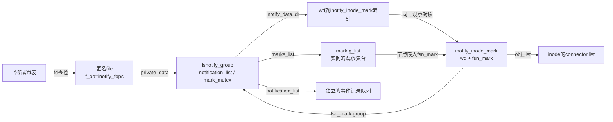
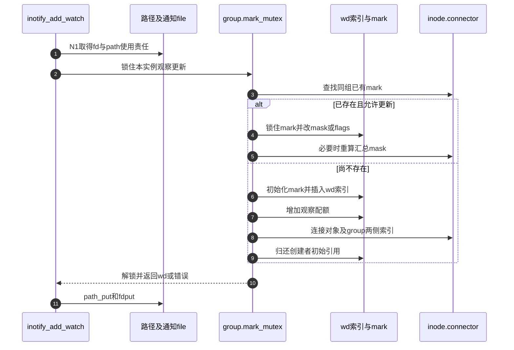

# 第56章\_inotify实例与观察编号的建立

用户调用inotify_init1取得一个fd以后，还没有观察任何文件。这个fd首先代表一个监听实例；随后inotify_add_watch才把该实例的兴趣连接到解析出的inode。区分这两步，才能解释为什么一个fd能包含多个wd，以及两个监听者观察同一个目录仍各有自己的队列。

**讲解层次：实现层，Linux 6.12.20。** 固定提交 `dfaf2136deb2af2e60b994421281ba42f1c087e0`，原件为 [inotify_user.c](../../linux/fs/notify/inotify/inotify_user.c)、[inotify.h](../../linux/fs/notify/inotify/inotify.h)、[group.c](../../linux/fs/notify/group.c)、[fsnotify_backend.h](../../linux/include/linux/fsnotify_backend.h)。代码保留执行语句，中文注释是仓库补充，省去上游长注释。

[通知导读](../navigation/P19_事件观察与许可响应的交接.md#19.1_沿通知周期定位状态与执行者)把这里定位为N0建立实例、N1登记观察；[总索引](../navigation/P01_Linux_6.12_VFS源码阅读索引.md)给出完整来源与配置边界。本次配置启用INOTIFY_USER和FSNOTIFY。

原件摘要与配置见 [通知源码基线](../../linux/SOURCE_BASELINE.md#1.299_事件观察与许可响应的交接)，应用场景见 [正文通知周期](../../../../knowledge/kernel_subsystems/vfs/P20_fsnotify_inotify与fanotify.md#20.3_从登记到读取追踪同一次变化)。

## 56.1\_通知fd先绑定独立group

内核要保留监听者自己的事件队列、观察集合和后端方法，因此先分配fsnotify_group。通用初始化建立空队列、等待队列、锁和引用；inotify再补上wd索引及专用溢出记录。这些状态属于实例，不属于某个被观察inode。

```c
/** @brief 仓库补充阅读说明：建立空group及锁、等待队列和初始引用，尚未连接任何观察对象。 */
static struct fsnotify_group *__fsnotify_alloc_group(
                                const struct fsnotify_ops *ops,
                                int flags, gfp_t gfp)
{
        /* 仓库补充：建立空group及锁、等待队列和初始引用，尚未连接任何观察对象。 */
        struct fsnotify_group *group;
        group = kzalloc(sizeof(struct fsnotify_group), gfp);
        if (!group)
                return ERR_PTR(-ENOMEM);
        /* 仓库补充：初始引用属于创建者；后续mark会另外持有group。 */
        refcount_set(&group->refcnt, 1);
        atomic_set(&group->user_waits, 0);
        spin_lock_init(&group->notification_lock);
        INIT_LIST_HEAD(&group->notification_list);
        init_waitqueue_head(&group->notification_waitq);
        group->max_events = UINT_MAX;
        mutex_init(&group->mark_mutex);
        INIT_LIST_HEAD(&group->marks_list);
        group->ops = ops;
        group->flags = flags;
        return group;
}
```

`fsnotify_alloc_group`是group.c中的分配包装：USER实例选GFP_KERNEL_ACCOUNT，普通内核实例选GFP_KERNEL。__fsnotify_alloc_group中的refcnt初始1、user_waits初始0，后者用于许可事件的退出交接，不是待读事件数。max_events先取UINT_MAX，后端可以覆盖。

```c
/** @brief 仓库补充阅读说明：预先准备溢出事件和wd索引，取得实例配额，再返回可绑定fd的监听实例。 */
static struct fsnotify_group *inotify_new_group(unsigned int max_events)
{
        /* 仓库补充：预先准备溢出事件和wd索引，取得实例配额，再返回可绑定fd的监听实例。 */
        struct fsnotify_group *group;
        struct inotify_event_info *oevent;
        group = fsnotify_alloc_group(&inotify_fsnotify_ops,
                                     FSNOTIFY_GROUP_USER);
        if (IS_ERR(group))
                return group;
        oevent = kmalloc(sizeof(struct inotify_event_info), GFP_KERNEL_ACCOUNT);
        if (unlikely(!oevent)) {
                fsnotify_destroy_group(group);
                return ERR_PTR(-ENOMEM);
        }
        /* 仓库补充：该预分配记录由实例共用，不按普通事件逐次释放。 */
        group->overflow_event = &oevent->fse;
        fsnotify_init_event(group->overflow_event);
        oevent->mask = FS_Q_OVERFLOW;
        oevent->wd = -1;
        oevent->sync_cookie = 0;
        oevent->name_len = 0;
        group->max_events = max_events;
        group->memcg = get_mem_cgroup_from_mm(current->mm);
        spin_lock_init(&group->inotify_data.idr_lock);
        idr_init(&group->inotify_data.idr);
        group->inotify_data.ucounts = inc_ucount(current_user_ns(),
                                                 current_euid(),
                                                 UCOUNT_INOTIFY_INSTANCES);
        if (!group->inotify_data.ucounts) {
                fsnotify_destroy_group(group);
                return ERR_PTR(-EMFILE);
        }
        return group;
}
```

溢出记录在实例建立时分配，所以普通事件分配失败以后仍有一个可用的告警对象。其wd为-1、name_len为0；同一实例反复使用这一个记录，不在每次读出后释放。max_events取建立时传入的限制值，不是每次入队都重新读取系统设置。

```c
/** @brief 仓库补充阅读说明：验证实例标志，把group交给匿名通知文件，fd建立失败则销毁group。 */
static int do_inotify_init(int flags)
{
        /* 仓库补充：验证实例标志，把group交给匿名通知文件，fd建立失败则销毁group。 */
        struct fsnotify_group *group;
        int ret;
        BUILD_BUG_ON(IN_CLOEXEC != O_CLOEXEC);
        BUILD_BUG_ON(IN_NONBLOCK != O_NONBLOCK);
        if (flags & ~(IN_CLOEXEC | IN_NONBLOCK))
                return -EINVAL;
        group = inotify_new_group(inotify_max_queued_events);
        if (IS_ERR(group))
                return PTR_ERR(group);
        ret = anon_inode_getfd("inotify", &inotify_fops, group,
                                  O_RDONLY | flags);
        /* 仓库补充：匿名fd创建失败，group尚未交付用户。 */
        if (ret < 0)
                fsnotify_destroy_group(group);
        return ret;
}
```

anon_inode_getfd创建的匿名file使用inotify_fops，private_data保存group。这里的匿名inode是通知接口载体，与之后被观察的目标inode无关。inotify_fops的read、poll、release分别负责取记录、等待可读和最终关闭；fd创建失败还没有用户拥有该file，必须由当前路径销毁group。BUILD_BUG_ON检查IN_CLOEXEC/IN_NONBLOCK与相应O标志的编译期数值一致性，不是运行时为用户设置标志。



图中的两条观察索引都指向mark：wd索引用于用户按编号更新或删除，group链用于成批撤销。事件记录只是某一时刻的消息，不能拿事件队列代替观察集合。

## 56.2\_把路径解析结果变成实例内的观察编号

添加观察仍然是一次需要权限的路径操作。系统调用先确认fd确实使用inotify_fops，再根据DONT_FOLLOW、ONLYDIR形成查找条件；路径引用在更新期间保持inode有效，fdget取得的使用责任保持group所属file有效。

```c
/** @brief 仓库补充阅读说明：解析路径并检查读取与安全通知许可，失败时归还已取得的路径引用。 */
static int inotify_find_inode(const char __user *dirname, struct path *path,
                                                unsigned int flags, __u64 mask)
{
        /* 仓库补充：解析路径并检查读取与安全通知许可，失败时归还已取得的路径引用。 */
        int error;
        error = user_path_at(AT_FDCWD, dirname, flags, path);
        if (error)
                return error;
        /* 仓库补充：路径仍受引用保护，检查的是登记观察的读取资格。 */
        error = path_permission(path, MAY_READ);
        if (error) {
                path_put(path);
                return error;
        }
        error = security_path_notify(path, mask,
                                FSNOTIFY_OBJ_TYPE_INODE);
        if (error)
                path_put(path);
        return error;
}
```

```c
/** @brief 仓库补充阅读说明：验证标志和通知fd，再将受路径引用保护的inode交给观察更新路径。 */
SYSCALL_DEFINE3(inotify_add_watch, int, fd, const char __user *, pathname,
                u32, mask)
{
        /* 仓库补充：验证标志和通知fd，再将受路径引用保护的inode交给观察更新路径。 */
        struct fsnotify_group *group;
        struct inode *inode;
        struct path path;
        struct fd f;
        int ret;
        unsigned flags = 0;
        if (unlikely(mask & ~ALL_INOTIFY_BITS))
                return -EINVAL;
        if (unlikely(!(mask & ALL_INOTIFY_BITS)))
                return -EINVAL;
        f = fdget(fd);
        if (unlikely(!fd_file(f)))
                return -EBADF;
        if (unlikely((mask & IN_MASK_ADD) && (mask & IN_MASK_CREATE))) {
                ret = -EINVAL;
                goto fput_and_out;
        }
        if (unlikely(fd_file(f)->f_op != &inotify_fops)) {
                ret = -EINVAL;
                goto fput_and_out;
        }
        if (!(mask & IN_DONT_FOLLOW))
                flags |= LOOKUP_FOLLOW;
        if (mask & IN_ONLYDIR)
                flags |= LOOKUP_DIRECTORY;
        ret = inotify_find_inode(pathname, &path, flags,
                        (mask & IN_ALL_EVENTS));
        if (ret)
                goto fput_and_out;
        /* 仓库补充：path和通知file分别维持inode及group的本次使用责任。 */
        inode = path.dentry->d_inode;
        group = fd_file(f)->private_data;
        ret = inotify_update_watch(group, inode, mask);
        path_put(&path);
fput_and_out:
        fdput(f);
        return ret;
}
```

这里的path_permission检查MAY_READ，security_path_notify再检查通知用途；它们不会因为最终只保存一个wd就自动消失。权限判断的通用实现见 [inode检查](P52_inode权限的基本检查与分派.md)，路径解析沿用前面已建立的namei流程。本篇不再次展开这些函数体。

真正建立wd时，需要让索引和对象引用同时成立。IDR只提供编号到指针的映射，不会替调用者管理mark引用；因此成功插入后显式fsnotify_get_mark。

```c
/** @brief 仓库补充阅读说明：预备IDR分配资源，在索引锁下分配编号，并为索引保存一份mark引用。 */
static int inotify_add_to_idr(struct idr *idr, spinlock_t *idr_lock,
                              struct inotify_inode_mark *i_mark)
{
        /* 仓库补充：预备IDR分配资源，在索引锁下分配编号，并为索引保存一份mark引用。 */
        int ret;
        idr_preload(GFP_KERNEL);
        spin_lock(idr_lock);
        ret = idr_alloc_cyclic(idr, i_mark, 1, 0, GFP_NOWAIT);
        /* 仓库补充：编号映射与这份显式mark引用必须一起建立。 */
        if (ret >= 0) {
                i_mark->wd = ret;
                fsnotify_get_mark(&i_mark->fsn_mark);
        }
        spin_unlock(idr_lock);
        idr_preload_end();
        return ret < 0 ? ret : 0;
}
```

idr_preload把可能睡眠的分配前移，idr_lock保护随后编号分配与字段发布，idr_alloc_cyclic从1开始寻找可用编号。wd是有范围且可复用的实例内编号，不是全局永久对象ID。IDR内部的编号与引用边界见 [IDR实现](../../kref/source_explanations/lib/idr.c.md#1.1_返回编号与对象字段初始化)。

```c
/** @brief 仓库补充阅读说明：建立mark和wd，取得观察配额后连接inode；保留固定版本的实际失败回退。 */
static int inotify_new_watch(struct fsnotify_group *group,
                             struct inode *inode,
                             u32 arg)
{
        /* 仓库补充：建立mark和wd，取得观察配额后连接inode；保留固定版本的实际失败回退。 */
        struct inotify_inode_mark *tmp_i_mark;
        int ret;
        struct idr *idr = &group->inotify_data.idr;
        spinlock_t *idr_lock = &group->inotify_data.idr_lock;
        tmp_i_mark = kmem_cache_alloc(inotify_inode_mark_cachep, GFP_KERNEL);
        if (unlikely(!tmp_i_mark))
                return -ENOMEM;
        fsnotify_init_mark(&tmp_i_mark->fsn_mark, group);
        tmp_i_mark->fsn_mark.mask = inotify_arg_to_mask(inode, arg);
        tmp_i_mark->fsn_mark.flags = inotify_arg_to_flags(arg);
        tmp_i_mark->wd = -1;
        ret = inotify_add_to_idr(idr, idr_lock, tmp_i_mark);
        if (ret)
                goto out_err;
        if (!inc_inotify_watches(group->inotify_data.ucounts)) {
                inotify_remove_from_idr(group, tmp_i_mark);
                ret = -ENOSPC;
                goto out_err;
        }
        /* 仓库补充：此时配额已经增加；下方失败分支在固定版本中没有递减配额。 */
        ret = fsnotify_add_inode_mark_locked(&tmp_i_mark->fsn_mark, inode, 0);
        if (ret) {
                inotify_remove_from_idr(group, tmp_i_mark);
                goto out_err;
        }
        ret = tmp_i_mark->wd;
out_err:
        fsnotify_put_mark(&tmp_i_mark->fsn_mark);
        return ret;
}
```

fsnotify_init_mark给创建者一份初始引用并持有group；IDR插入增加一份，成功加入group观察链还增加一份。函数末尾始终归还创建者的初始引用。inotify_arg_to_mask保留请求的普通事件，补入UNMOUNT；目录还加EVENT_ON_CHILD。EXCL_UNLINK和ONESHOT保存在mark.flags，不是普通事件位。

**此版本有一处不能省略的失败边界：** inc_inotify_watches成功后，如果fsnotify_add_inode_mark_locked失败，分支删除了IDR映射并归还mark引用，却没有dec_inotify_watches。最终free_mark只归还slab对象，不能补偿这个配额。因此不能从“对象最终释放”推出“观察配额也平衡”。作者后续提交的 [修复补丁及评审](https://patchew.org/linux/20260224093442.3076294-1-chiamingc@synology.com/)在该分支补上配额递减，解释了重复失败可导致剩余观察数不足的问题。这里保留固定原件，不把修复后的行为混写为本版本已有保证。

## 56.3\_已有观察的更新必须与新建串行

同一group和inode通常只需要一个inotify观察。两个线程同时add_watch时，不能各自查到“尚不存在”后插入两个；group.mark_mutex把查找、修改和必要的新建连成一个操作。

```c
/** @brief 仓库补充阅读说明：查找同组inode观察，在mark锁下替换或追加兴趣，再按需要重算对象汇总mask。 */
static int inotify_update_existing_watch(struct fsnotify_group *group,
                                         struct inode *inode,
                                         u32 arg)
{
        /* 仓库补充：查找同组inode观察，在mark锁下替换或追加兴趣，再按需要重算对象汇总mask。 */
        struct fsnotify_mark *fsn_mark;
        struct inotify_inode_mark *i_mark;
        __u32 old_mask, new_mask;
        int replace = !(arg & IN_MASK_ADD);
        int create = (arg & IN_MASK_CREATE);
        int ret;
        fsn_mark = fsnotify_find_inode_mark(inode, group);
        if (!fsn_mark)
                return -ENOENT;
        else if (create) {
                ret = -EEXIST;
                goto out;
        }
        i_mark = container_of(fsn_mark, struct inotify_inode_mark, fsn_mark);
        spin_lock(&fsn_mark->lock);
        old_mask = fsn_mark->mask;
        if (replace) {
                fsn_mark->mask = 0;
                fsn_mark->flags &= ~INOTIFY_MARK_FLAGS;
        }
        fsn_mark->mask |= inotify_arg_to_mask(inode, arg);
        fsn_mark->flags |= inotify_arg_to_flags(arg);
        new_mask = fsn_mark->mask;
        spin_unlock(&fsn_mark->lock);
        /* 仓库补充：改变单个mark以后，必要时更新对象快速筛选使用的汇总mask。 */
        if (old_mask != new_mask) {
                int dropped = (old_mask & ~new_mask);
                int do_inode = (new_mask & ~READ_ONCE(inode->i_fsnotify_mask));
                if (dropped || do_inode)
                        fsnotify_recalc_mask(inode->i_fsnotify_marks);
        }
        ret = i_mark->wd;
out:
        fsnotify_put_mark(fsn_mark);
        return ret;
}
```

IN_MASK_CREATE要求“必须是新观察”，已有对象返回EEXIST；IN_MASK_ADD追加兴趣，否则替换已有事件与相关flags。只改变mark自身还不够：inode.i_fsnotify_mask是快速筛选用的汇总，删除兴趣位或增加汇总尚无的位都需要重算。

```c
/** @brief 仓库补充阅读说明：在group锁内先尝试更新，只有确实未找到观察才创建新mark。 */
static int inotify_update_watch(struct fsnotify_group *group, struct inode *inode, u32 arg)
{
        /* 仓库补充：在group锁内先尝试更新，只有确实未找到观察才创建新mark。 */
        int ret = 0;
        fsnotify_group_lock(group);
        ret = inotify_update_existing_watch(group, inode, arg);
        /* 仓库补充：只有真正不存在才新建，不把其他失败误当作缺少观察。 */
        if (ret == -ENOENT)
                ret = inotify_new_watch(group, inode, arg);
        fsnotify_group_unlock(group);
        return ret;
}
```



步骤6～9是逐项取得资源，必须逐项检查失败出口，不能只看步骤10最终返回。特别是上一节的配额缺陷正发生在“配额已取得、对象尚未连接”的窗口。步骤4～5则更新同一个wd，不意味着每次add_watch都分配新编号。

## 56.4\_沿声明与失败出口检查可修改范围

| 符号或状态 | 定义、写入及读取责任 |
| --- | --- |
| fsnotify_group / fsnotify_mark | fsnotify_backend.h声明；通用group与mark初始化，后端通过ops处理事件和释放 |
| inotify_inode_mark | inotify.h把wd与fsn_mark嵌入同一对象；IDR和对象链共用这个对象，container_of恢复外层地址 |
| inotify_fsnotify_ops | inotify_fsnotify.c静态方法表；handle_inode_event、freeing_mark、free_event、free_mark和free_group_priv分别承担不同阶段，不能互换 |
| idr_lock / mark_mutex / mark.lock | 分别保护编号映射、实例内增删串行、单个mark字段；不是一个锁的三种名称 |
| ucounts | 创建实例取得UCOUNT_INOTIFY_INSTANCES，新增观察取得观察配额；正常撤销和最终释放分别归还，失败分支需独立核对 |
| memcg | 实例建立从当前mm取得内存记账归属，事件分配按该归属计费；销毁归还持有，不是事件传递通道 |
| inotify_user_setup | 启动时建立mark slab并初始化限制；本版本初始队列上限16384、实例上限128，观察限制按内存预算取值，不能写成所有机器永不改变的常数 |
| IS_ERR/PTR_ERR、unlikely、WARN/BUILD_BUG | 错误指针转换、分支提示和诊断各有职责；unlikely不改变真假，编译断言不代替运行时输入验证 |

修改登记算法时，最小检查面包含inotify_user.c的创建、更新、IDR移除和inotify_fsnotify.c的freeing_mark；若改了对象连接语义，还必须检查 [mark连接与回收](P57_观察标记的连接撤销与延后回收.md#57.1_对象侧与group侧分别建立索引)。应验证已有观察替换/追加/CREATE冲突、并发登记、配额耗尽以及对象连接失败；只测成功返回wd不足以证明引用与配额平衡。

本篇的功能保证是建立一个能被分派方发现、能被用户按wd管理的观察关系。它尚不保证每个操作各占一个队列记录；合并与溢出交给后面的队列实现解释。
