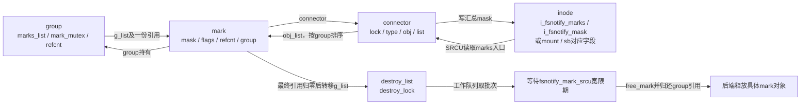
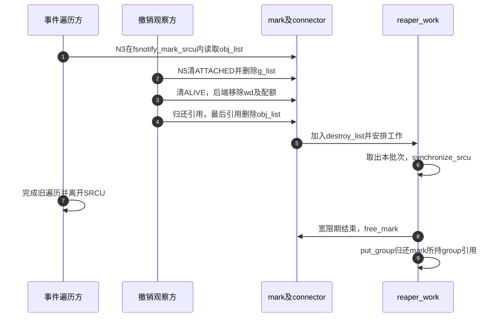

# 第57章\_观察标记的连接撤销与延后回收

登记方按监听实例增删观察，事件方却从发生变化的inode、mount或superblock出发找监听者。一个mark因此要同时进入group侧和对象侧索引。退出时，事件方可能仍拿着从旧链中读到的指针；删除编号、停止观察和释放内存就不能合成一次kfree。

**讲解层次：实现层，Linux 6.12.20。** 固定提交 `dfaf2136deb2af2e60b994421281ba42f1c087e0`，原件：[mark.c](../../linux/fs/notify/mark.c)、[fsnotify_backend.h](../../linux/include/linux/fsnotify_backend.h)、[内部fsnotify.h](../../linux/fs/notify/fsnotify.h)。执行语句保留，中文注释为仓库补充。[通知导读](../navigation/P19_事件观察与许可响应的交接.md#19.1_沿通知周期定位状态与执行者)将本篇放在N1连接及N5退出；来源总入口见 [总索引](../navigation/P01_Linux_6.12_VFS源码阅读索引.md)。

原件摘要与配置见 [通知源码基线](../../linux/SOURCE_BASELINE.md#1.299_事件观察与许可响应的交接)，应用场景见 [正文通知周期](../../../../knowledge/kernel_subsystems/vfs/P20_fsnotify_inotify与fanotify.md#20.3_从登记到读取追踪同一次变化)。

## 57.1\_对象侧与group侧分别建立索引

fsnotify_mark包含两个链节点。g_list用于group.marks_list，便于监听实例关闭时找到全部观察；obj_list用于connector.list，便于事件产生时找到关心该对象的group。connector保存对象类型与对象地址，并负责该对象的汇总兴趣。

```c
/** @brief 仓库补充阅读说明：先建立引用与所属group，connector为空表示尚未发布到对象索引。 */
void fsnotify_init_mark(struct fsnotify_mark *mark,
                        struct fsnotify_group *group)
{
        /* 仓库补充：先建立引用与所属group，connector为空表示尚未发布到对象索引。 */
        memset(mark, 0, sizeof(*mark));
        spin_lock_init(&mark->lock);
        refcount_set(&mark->refcnt, 1);
        fsnotify_get_group(group);
        mark->group = group;
        WRITE_ONCE(mark->connector, NULL);
}
```

```c
/** @brief 仓库补充阅读说明：在已持有group锁的条件下建立观察资格和group链引用，再连接对象侧。 */
int fsnotify_add_mark_locked(struct fsnotify_mark *mark,
                             void *obj, unsigned int obj_type,
                             int add_flags)
{
        /* 仓库补充：在已持有group锁的条件下建立观察资格和group链引用，再连接对象侧。 */
        struct fsnotify_group *group = mark->group;
        int ret = 0;
        fsnotify_group_assert_locked(group);
        spin_lock(&mark->lock);
        /* 仓库补充：先在group锁范围内建立观察状态，失败要撤销对应链引用。 */
        mark->flags |= FSNOTIFY_MARK_FLAG_ALIVE | FSNOTIFY_MARK_FLAG_ATTACHED;
        list_add(&mark->g_list, &group->marks_list);
        fsnotify_get_mark(mark);
        spin_unlock(&mark->lock);
        ret = fsnotify_add_mark_list(mark, obj, obj_type, add_flags);
        if (ret)
                goto err;
        fsnotify_recalc_mask(mark->connector);
        return ret;
err:
        spin_lock(&mark->lock);
        mark->flags &= ~(FSNOTIFY_MARK_FLAG_ALIVE |
                         FSNOTIFY_MARK_FLAG_ATTACHED);
        list_del_init(&mark->g_list);
        spin_unlock(&mark->lock);
        fsnotify_put_mark(mark);
        return ret;
}
```

ALIVE表示该观察尚未执行freeing_mark通知，ATTACHED表示它仍属于有效观察集合。两个位的撤销时点不同：撤销group链后仍可能需要调用后端清理编号，不能用单个“已释放”布尔量替代。

```c
/** @brief 仓库补充阅读说明：取得或发布对象connector，按group次序插入mark并更新观察者统计。 */
static int fsnotify_add_mark_list(struct fsnotify_mark *mark, void *obj,
                                  unsigned int obj_type, int add_flags)
{
        /* 仓库补充：取得或发布对象connector，按group次序插入mark并更新观察者统计。 */
        struct super_block *sb = fsnotify_object_sb(obj, obj_type);
        struct fsnotify_mark *lmark, *last = NULL;
        struct fsnotify_mark_connector *conn;
        fsnotify_connp_t *connp;
        int cmp;
        int err = 0;
        if (WARN_ON(!fsnotify_valid_obj_type(obj_type)))
                return -EINVAL;
        if (!fsnotify_sb_info(sb)) {
                err = fsnotify_attach_info_to_sb(sb);
                if (err)
                        return err;
        }
        connp = fsnotify_object_connp(obj, obj_type);
restart:
        spin_lock(&mark->lock);
        conn = fsnotify_grab_connector(connp);
        /* 仓库补充：释放mark自旋锁后才分配connector，再重新查找竞争结果。 */
        if (!conn) {
                spin_unlock(&mark->lock);
                err = fsnotify_attach_connector_to_object(connp, obj, obj_type);
                if (err)
                        return err;
                goto restart;
        }
        if (hlist_empty(&conn->list)) {
                hlist_add_head_rcu(&mark->obj_list, &conn->list);
                goto added;
        }
        hlist_for_each_entry(lmark, &conn->list, obj_list) {
                last = lmark;
                if ((lmark->group == mark->group) &&
                    (lmark->flags & FSNOTIFY_MARK_FLAG_ATTACHED) &&
                    !(mark->group->flags & FSNOTIFY_GROUP_DUPS)) {
                        err = -EEXIST;
                        goto out_err;
                }
                cmp = fsnotify_compare_groups(lmark->group, mark->group);
                if (cmp >= 0) {
                        hlist_add_before_rcu(&mark->obj_list, &lmark->obj_list);
                        goto added;
                }
        }
        BUG_ON(last == NULL);
        hlist_add_behind_rcu(&mark->obj_list, &last->obj_list);
added:
        fsnotify_update_sb_watchers(sb, conn);
        WRITE_ONCE(mark->connector, conn);
out_err:
        spin_unlock(&conn->lock);
        spin_unlock(&mark->lock);
        return err;
}
```

fsnotify_attach_info_to_sb先建立sb.s_fsnotify_info，fsnotify_attach_connector_to_object再初始化connector并用cmpxchg发布；竞争失败方释放自己的候选，重试使用已经发布的对象。fsnotify_grab_connector在SRCU保护下取得指针并锁connector，遇到已分离类型则放弃。mark锁在等待分配前释放，不能在自旋锁内执行可能睡眠的分配。

对象链按group优先级及group地址形成一致次序，使后续事件分派能合并不同对象的同组观察。普通组拒绝重复连接同组mark，明确设置DUPS的组才采用另一契约。WARN_ON无效对象类型之后直接返回EINVAL；这里诊断分支确实改变控制流。



锁的主要嵌套方向是group.mark_mutex、mark.lock、connector.lock。SRCU保护无锁遍历时的地址有效性，不能代替这几个锁对可修改字段的保护，也不能代替显式引用跨越任意后续操作。

## 57.2\_汇总兴趣与对象持有必须一起更新

每次事件都遍历所有观察者代价很高，对象因此保存汇总mask作为快速排除依据。它是所有仍ATTACHED的mark兴趣的组合，真正投递仍需检查各个mark；某个位存在只表示“可能有人关心”。

```c
/** @brief 仓库补充阅读说明：在connector锁下汇总有效mark的兴趣，并协调观察所需的inode持有。 */
static void *__fsnotify_recalc_mask(struct fsnotify_mark_connector *conn)
{
        /* 仓库补充：在connector锁下汇总有效mark的兴趣，并协调观察所需的inode持有。 */
        u32 new_mask = 0;
        bool want_iref = false;
        struct fsnotify_mark *mark;
        assert_spin_locked(&conn->lock);
        if (!fsnotify_valid_obj_type(conn->type))
                return NULL;
        hlist_for_each_entry(mark, &conn->list, obj_list) {
                if (!(mark->flags & FSNOTIFY_MARK_FLAG_ATTACHED))
                        continue;
                new_mask |= fsnotify_calc_mask(mark);
                if (conn->type == FSNOTIFY_OBJ_TYPE_INODE &&
                    !(mark->flags & FSNOTIFY_MARK_FLAG_NO_IREF))
                        want_iref = true;
        }
        /* 仓库补充：发布汇总只服务快速筛选，实际接收仍按具体mark判断。 */
        WRITE_ONCE(*fsnotify_conn_mask_p(conn), new_mask);
        return fsnotify_update_iref(conn, want_iref);
}
```

```c
/** @brief 仓库补充阅读说明：重算汇总并处理开始观察子项时的dentry标志，出锁后归还对象引用。 */
void fsnotify_recalc_mask(struct fsnotify_mark_connector *conn)
{
        /* 仓库补充：重算汇总并处理开始观察子项时的dentry标志，出锁后归还对象引用。 */
        bool update_children;
        if (!conn)
                return;
        spin_lock(&conn->lock);
        update_children = !fsnotify_conn_watches_children(conn);
        __fsnotify_recalc_mask(conn);
        update_children &= fsnotify_conn_watches_children(conn);
        /* 仓库补充：对象引用释放安排在自旋锁外。 */
        spin_unlock(&conn->lock);
        if (update_children)
                fsnotify_conn_set_children_dentry_flags(conn);
}
```

fsnotify_calc_mask把ignore规则对事件筛选的要求计入；不能只机械OR用户传入mask而漏掉为维护ignore状态必须观察的MODIFY。fsnotify_conn_mask_p按对象类型选inode.i_fsnotify_mask、mount.mnt_fsnotify_mask或sb.s_fsnotify_mask的实际地址。

如果任何inode mark要求持有inode引用，fsnotify_update_iref建立一次connector级持有，并设置HAS_IREF；最后一个这样的mark离开时先清标志并返回待归还inode，调用者在自旋锁外iput。NO_IREF观察不要求这份持有，所以不能声称所有观察都永久钉住inode。superblock的watched_objects按优先级统计被观察对象，供快速判断和退出等待；它不是事件数或mark总数。

开始观察目录子项时需要设置子dentry的PARENT_WATCHED标志。停止观察后，旧提示可以由后续__fsnotify_parent懒清理；一个残留快速提示不等于仍有有效监听者，最终仍以实际mark与mask判断。

**可修改性：** 汇总mask允许帮助快速排除，却不能漏掉后端维持状态所需的事件。修改ignore、子目录提示或NO_IREF时，应同时检查calc_mask、重算、对象引用增减和事件分派；只修改一个缓存字段可能导致后端永远收不到更新它所需的事件。

## 57.3\_撤销观察资格以后再归还引用

用户撤销wd或group批量退出时，先阻止该mark继续代表有效观察，再通知后端处理自己的编号与配额。这里的free_mark函数名称容易误导：它执行的是ALIVE状态转换与freeing_mark回调，不是最终内存释放。

```c
/** @brief 仓库补充阅读说明：在group锁内撤销ATTACHED并移出group链，再归还这条链持有的引用。 */
void fsnotify_detach_mark(struct fsnotify_mark *mark)
{
        /* 仓库补充：在group锁内撤销ATTACHED并移出group链，再归还这条链持有的引用。 */
        fsnotify_group_assert_locked(mark->group);
        WARN_ON_ONCE(!srcu_read_lock_held(&fsnotify_mark_srcu) &&
                     refcount_read(&mark->refcnt) < 1 +
                        !!(mark->flags & FSNOTIFY_MARK_FLAG_ATTACHED));
        spin_lock(&mark->lock);
        if (!(mark->flags & FSNOTIFY_MARK_FLAG_ATTACHED)) {
                spin_unlock(&mark->lock);
                return;
        }
        /* 仓库补充：先撤销观察资格和group链，再归还该链持有的引用。 */
        mark->flags &= ~FSNOTIFY_MARK_FLAG_ATTACHED;
        list_del_init(&mark->g_list);
        spin_unlock(&mark->lock);
        fsnotify_put_mark(mark);
}
```

```c
/** @brief 仓库补充阅读说明：仅第一次撤销ALIVE时调用后端freeing_mark，内存可能仍被其他路径持有。 */
void fsnotify_free_mark(struct fsnotify_mark *mark)
{
        /* 仓库补充：仅第一次撤销ALIVE时调用后端freeing_mark，内存可能仍被其他路径持有。 */
        struct fsnotify_group *group = mark->group;
        spin_lock(&mark->lock);
        if (!(mark->flags & FSNOTIFY_MARK_FLAG_ALIVE)) {
                spin_unlock(&mark->lock);
                return;
        }
        /* 仓库补充：只触发一次后端退出通知；此处并未释放mark内存。 */
        mark->flags &= ~FSNOTIFY_MARK_FLAG_ALIVE;
        spin_unlock(&mark->lock);
        if (group->ops->freeing_mark)
                group->ops->freeing_mark(mark, group);
}
```

```c
/** @brief 仓库补充阅读说明：串接group侧撤销与后端退出通知，不在此强制释放仍被引用的mark。 */
void fsnotify_destroy_mark(struct fsnotify_mark *mark,
                           struct fsnotify_group *group)
{
        /* 仓库补充：串接group侧撤销与后端退出通知，不在此强制释放仍被引用的mark。 */
        fsnotify_group_lock(group);
        fsnotify_detach_mark(mark);
        fsnotify_group_unlock(group);
        fsnotify_free_mark(mark);
}
```

detach要求调用者已有mark引用或SRCU保护；开头WARN检查此前提，但不会替违规调用者取得引用。重复detach或free通过相应状态位避免重复归还链引用或重复回调。obj_list此时还可以存在，直到最后一个显式引用归还；遍历方必须按有效性协议判断，不能把“链中可见”直接当作仍可投递。

## 57.4\_最后一个引用消失后仍要等待旧遍历

显式引用归零只说明没有持有者承诺继续使用，不说明此前的SRCU读者没有读到地址。对象链采用RCU形式删除，回收者随后必须等待fsnotify_mark_srcu域中的旧读者离开。

```c
/** @brief 仓库补充阅读说明：最后一个引用归还时移出对象链，更新对象状态，并把已发布对象交给延后回收。 */
void fsnotify_put_mark(struct fsnotify_mark *mark)
{
        /* 仓库补充：最后一个引用归还时移出对象链，更新对象状态，并把已发布对象交给延后回收。 */
        struct fsnotify_mark_connector *conn = READ_ONCE(mark->connector);
        void *objp = NULL;
        unsigned int type = FSNOTIFY_OBJ_TYPE_DETACHED;
        bool free_conn = false;
        if (!conn) {
                if (refcount_dec_and_test(&mark->refcnt))
                        fsnotify_final_mark_destroy(mark);
                return;
        }
        if (!refcount_dec_and_lock(&mark->refcnt, &conn->lock))
                return;
        /* 仓库补充：显式引用归零后移除对象链，但旧SRCU读者仍可能看到地址。 */
        hlist_del_init_rcu(&mark->obj_list);
        if (hlist_empty(&conn->list)) {
                objp = fsnotify_detach_connector_from_object(conn, &type);
                free_conn = true;
        } else {
                struct super_block *sb = fsnotify_connector_sb(conn);
                if (sb)
                        fsnotify_update_sb_watchers(sb, conn);
                objp = __fsnotify_recalc_mask(conn);
                type = conn->type;
        }
        WRITE_ONCE(mark->connector, NULL);
        spin_unlock(&conn->lock);
        fsnotify_drop_object(type, objp);
        if (free_conn) {
                spin_lock(&destroy_lock);
                conn->destroy_next = connector_destroy_list;
                connector_destroy_list = conn;
                spin_unlock(&destroy_lock);
                queue_work(system_unbound_wq, &connector_reaper_work);
        }
        spin_lock(&destroy_lock);
        list_add(&mark->g_list, &destroy_list);
        spin_unlock(&destroy_lock);
        queue_delayed_work(system_unbound_wq, &reaper_work,
                           FSNOTIFY_REAPER_DELAY);
}
```

如果mark从未连接对象、connector为NULL，最后引用可以直接final_mark_destroy；它没有经对象链发布给SRCU读者。已连接的mark则在connector锁下完成最后引用与链删除的交接。空connector从对象入口分离后进入独立connector_destroy_list；非空connector重新计算剩余观察状态。

```c
/** @brief 仓库补充阅读说明：取走待销毁批次，等待同一SRCU域宽限期，然后逐个执行最终释放。 */
static void fsnotify_mark_destroy_workfn(struct work_struct *work)
{
        /* 仓库补充：取走待销毁批次，等待同一SRCU域宽限期，然后逐个执行最终释放。 */
        struct fsnotify_mark *mark, *next;
        struct list_head private_destroy_list;
        spin_lock(&destroy_lock);
        list_replace_init(&destroy_list, &private_destroy_list);
        spin_unlock(&destroy_lock);
        /* 仓库补充：真正的安全回收依据是此域宽限期，不是工作调度延时。 */
        synchronize_srcu(&fsnotify_mark_srcu);
        list_for_each_entry_safe(mark, next, &private_destroy_list, g_list) {
                list_del_init(&mark->g_list);
                fsnotify_final_mark_destroy(mark);
        }
}
```

```c
/** @brief 仓库补充阅读说明：调用后端归还实际mark内存，再释放该mark持有的group引用。 */
static void fsnotify_final_mark_destroy(struct fsnotify_mark *mark)
{
        /* 仓库补充：调用后端归还实际mark内存，再释放该mark持有的group引用。 */
        struct fsnotify_group *group = mark->group;
        if (WARN_ON_ONCE(!group))
                return;
        group->ops->free_mark(mark);
        fsnotify_put_group(group);
}
```



步骤4以最后引用为前提；若还有许可等待方持有mark，它会更晚发生。步骤5中的FSNOTIFY_REAPER_DELAY为1 jiffy，用于安排批处理，不是“等一个时钟就一定没有读者”。步骤6～8的synchronize_srcu才建立旧读者结束的证明。connector回收工作也等待同一个SRCU域，然后释放connector slab。

本篇依赖SRCU指定域内“旧读者结束后才能释放”的接口契约，不把不同域或普通RCU互换。当前配置实际选择CONFIG_TINY_SRCU；其内部算法不在本篇展开。若继续研究另一配置下的可扩展实现，可读 [Tree SRCU读取协议](../../rcu/source_explanations/P11_Linux_6.12_Tree_SRCU源码实现.md#11.4_reader进入退出写的是累计账本)与 [Tree SRCU同步等待](../../rcu/source_explanations/P11_Linux_6.12_Tree_SRCU源码实现.md#11.9_synchronize_srcu怎样把异步callback变成同步等待)，不能把那里的每CPU账本和树结构移画成本次Tiny SRCU的实际结构。

## 57.5\_修改生命周期前先列出成对责任

| 声明、初始化与辅助符号 | 当前责任及检查边界 |
| --- | --- |
| fsnotify_mark_srcu | mark.c定义，内部头文件声明；fsnotify_init初始化，事件遍历和两类reaper使用同一域 |
| destroy_list / connector_destroy_list | mark.c全局待回收集合，由destroy_lock串行；工作线程取出私有批次后出锁等待，不持自旋锁等待宽限期 |
| reaper_work / connector_reaper_work | DECLARE_DELAYED_WORK和DECLARE_WORK绑定不同回收函数；flush_delayed_work等待mark工作完成，不是关闭所有fsnotify来源 |
| connector.obj/type/flags/prio | 初始化先于cmpxchg发布；分离清对象关系并更改类型，HAS_IREF和IS_WATCHED分别记录对象引用与观察统计责任 |
| fsnotify_update_sb_watchers | 更新最高观察优先级及各层计数；最后总计数归零可wake_up_var，供文件系统退出方继续 |
| fsnotify_drop_object | 在锁外释放inode持有；不支持的对象类型触发WARN并返回，不能把它看成任意对象通用析构器 |
| 后端freeing_mark与free_mark | 前者撤销用户可见观察和配额，后者归还具体内存；顺序及各自只执行一次是核心不变量 |

若改变mark嵌入方式，必须同步container_of恢复、free_mark方法和所有索引；若改变释放时点，必须证明group链、IDR、对象链、SRCU读者及许可等待持有均已交接。验证路径至少覆盖重复撤销、事件与撤销并发、最后观察退出、NO_IREF以及许可等待期间关闭group。具体等待持有转移见 [许可等待](P61_fanotify许可等待与观察持有.md#61.2_等待用户以前先转移观察责任)。不能用一次rm_watch成功或未出现WARN替代这些证明。
