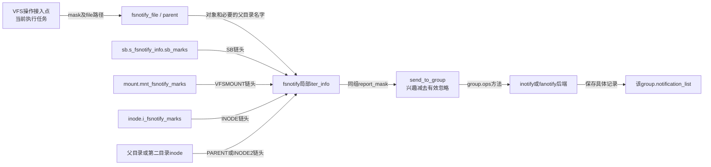
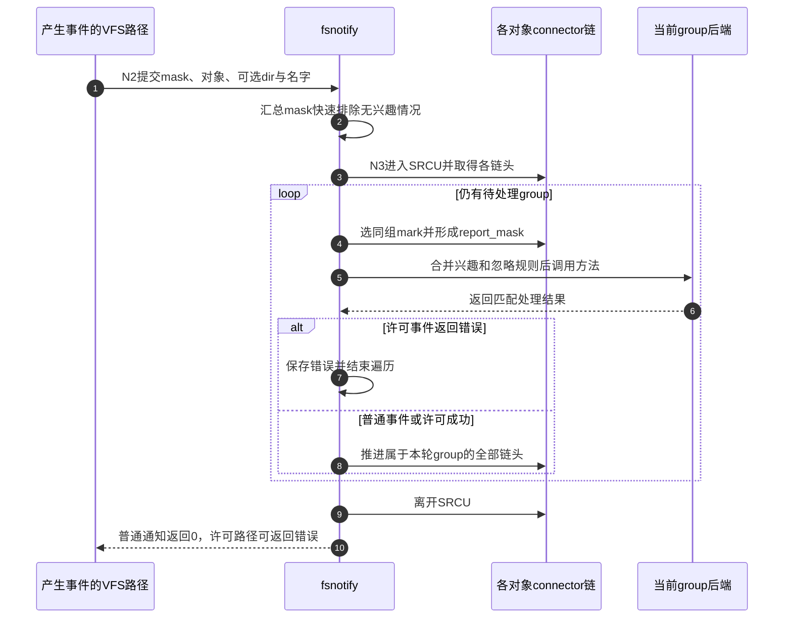

# 第58章\_fsnotify事件匹配与分派

观察登记完成以后，写入路径并不知道有哪些用户程序正在监听。它只报告“什么对象发生了什么事件”，fsnotify再从对象的mark链选择接收group。同一group还可能同时观察inode、所在挂载和整个文件系统，分派不能简单地分别遍历三条链就各发一次消息，否则忽略规则与组优先级会失去一致含义。

**讲解层次：实现层，Linux 6.12.20。** 固定提交 `dfaf2136deb2af2e60b994421281ba42f1c087e0`。原件：[fsnotify.h](../../linux/include/linux/fsnotify.h)、[fsnotify.c](../../linux/fs/notify/fsnotify.c)、[fsnotify_backend.h](../../linux/include/linux/fsnotify_backend.h)。执行语句保留，中文注释为仓库补充。这里放大 [通知导读](../navigation/P19_事件观察与许可响应的交接.md#19.1_沿通知周期定位状态与执行者)的N2产生、N3匹配；版本总入口为 [源码索引](../navigation/P01_Linux_6.12_VFS源码阅读索引.md)。

原件摘要与配置见 [通知源码基线](../../linux/SOURCE_BASELINE.md#1.299_事件观察与许可响应的交接)，应用场景见 [正文通知周期](../../../../knowledge/kernel_subsystems/vfs/P20_fsnotify_inotify与fanotify.md#20.3_从登记到读取追踪同一次变化)。

## 58.1\_操作路径先确定事件对象与父目录名字

读写、打开和关闭等接入点经fsnotify_file传入file路径。FMODE_NONOTIFY避免特定内部访问再次发出通知，FMODE_PATH表示仅路径用途；许可事件还先检查文件系统是否存在相应优先级的观察者。这些快速判断减少无监听时的工作，不创建后台扫描任务。

```c
/** @brief 仓库补充阅读说明：从file访问属性和观察者统计快速筛选，再以该file路径报告事件。 */
static inline int fsnotify_file(struct file *file, __u32 mask)
{
        /* 仓库补充：从file访问属性和观察者统计快速筛选，再以该file路径报告事件。 */
        const struct path *path;
        /* 仓库补充：内部非通知或仅路径file不会继续走这次文件通知。 */
        if (file->f_mode & (FMODE_NONOTIFY | FMODE_PATH))
                return 0;
        path = &file->f_path;
        if (mask & ALL_FSNOTIFY_PERM_EVENTS &&
            !fsnotify_sb_has_priority_watchers(path->dentry->d_sb,
                                               FSNOTIFY_PRIO_CONTENT))
                return 0;
        return fsnotify_parent(path->dentry, mask, path, FSNOTIFY_EVENT_PATH);
}
```

```c
/** @brief 仓库补充阅读说明：根据子项提示和挂载或文件系统观察判断是否需要寻找父目录。 */
static inline int fsnotify_parent(struct dentry *dentry, __u32 mask,
                                  const void *data, int data_type)
{
        /* 仓库补充：根据子项提示和挂载或文件系统观察判断是否需要寻找父目录。 */
        struct inode *inode = d_inode(dentry);
        if (!fsnotify_sb_has_watchers(inode->i_sb))
                return 0;
        if (S_ISDIR(inode->i_mode)) {
                mask |= FS_ISDIR;
                if (!(dentry->d_flags & DCACHE_FSNOTIFY_PARENT_WATCHED))
                        goto notify_child;
        }
        if (IS_ROOT(dentry))
                goto notify_child;
        return __fsnotify_parent(dentry, mask, data, data_type);
notify_child:
        return fsnotify(mask, data, data_type, NULL, NULL, inode, 0);
}
```

```c
/** @brief 仓库补充阅读说明：必要时取得父目录与名称快照，把对象事件和父目录兴趣放进同一次分派。 */
int __fsnotify_parent(struct dentry *dentry, __u32 mask, const void *data,
                      int data_type)
{
        /* 仓库补充：必要时取得父目录与名称快照，把对象事件和父目录兴趣放进同一次分派。 */
        const struct path *path = fsnotify_data_path(data, data_type);
        __u32 mnt_mask = path ?
                READ_ONCE(real_mount(path->mnt)->mnt_fsnotify_mask) : 0;
        struct inode *inode = d_inode(dentry);
        struct dentry *parent;
        bool parent_watched = dentry->d_flags & DCACHE_FSNOTIFY_PARENT_WATCHED;
        bool parent_needed, parent_interested;
        __u32 p_mask;
        struct inode *p_inode = NULL;
        struct name_snapshot name;
        struct qstr *file_name = NULL;
        int ret = 0;
        if (likely(!parent_watched &&
                   !fsnotify_object_watched(inode, mnt_mask, mask)))
                return 0;
        parent = NULL;
        parent_needed = fsnotify_event_needs_parent(inode, mnt_mask, mask);
        if (!parent_watched && !parent_needed)
                goto notify;
        parent = dget_parent(dentry);
        p_inode = parent->d_inode;
        p_mask = fsnotify_inode_watches_children(p_inode);
        if (unlikely(parent_watched && !p_mask))
                fsnotify_clear_child_dentry_flag(p_inode, dentry);
        parent_interested = mask & p_mask & ALL_FSNOTIFY_EVENTS;
        if (parent_needed || parent_interested) {
                WARN_ON_ONCE(inode != fsnotify_data_inode(data, data_type));
                take_dentry_name_snapshot(&name, dentry);
                file_name = &name.name;
                if (parent_interested)
                        mask |= FS_EVENT_ON_CHILD;
        }
notify:
        ret = fsnotify(mask, data, data_type, p_inode, file_name, inode, 0);
        if (file_name)
                release_dentry_name_snapshot(&name);
        dput(parent);
        return ret;
}
```

父目录观察需要名字，直接inode观察常常不需要。__fsnotify_parent使用dget_parent取得父目录引用，需要报告名字时take_dentry_name_snapshot保存稳定名称，分派后分别归还；不能把易变的d_name裸指针交给未来用户空间。这里的快照只覆盖本次通知所需名称，不承诺整个目录的原子快照。



图中iter_info是本次分派栈上的遍历状态，不是长期全局消息队列。各对象链在SRCU域内读取，group的事件队列另有notification_lock保护。

## 58.2\_按group汇合不同对象的观察

前篇建立对象链时采用相同group排序，正是为这里的多链合并准备条件。每轮在各链头中选一个最高次序group，再收集当前属于它的所有观察类型；处理完这组才推进相应链头。

```c
/** @brief 仓库补充阅读说明：从各对象链头选当前group，再标出本轮真正参与报告的mark类型。 */
static bool fsnotify_iter_select_report_types(
                struct fsnotify_iter_info *iter_info)
{
        /* 仓库补充：从各对象链头选当前group，再标出本轮真正参与报告的mark类型。 */
        struct fsnotify_group *max_prio_group = NULL;
        struct fsnotify_mark *mark;
        int type;
        fsnotify_foreach_iter_type(type) {
                mark = iter_info->marks[type];
                if (mark &&
                    fsnotify_compare_groups(max_prio_group, mark->group) > 0)
                        max_prio_group = mark->group;
        }
        if (!max_prio_group)
                return false;
        /* 仓库补充：先选组，再决定哪些对象类型参与本轮报告。 */
        iter_info->current_group = max_prio_group;
        iter_info->report_mask = 0;
        fsnotify_foreach_iter_type(type) {
                mark = iter_info->marks[type];
                if (mark && mark->group == iter_info->current_group) {
                        if (type == FSNOTIFY_ITER_TYPE_PARENT &&
                            !(mark->mask & FS_EVENT_ON_CHILD) &&
                            !(fsnotify_ignore_mask(mark) & FS_EVENT_ON_CHILD))
                                continue;
                        fsnotify_iter_set_report_type(iter_info, type);
                }
        }
        return true;
}
```

PARENT链头还要确认该mark关注子项，不能因另一个mark使目录汇总mask包含子项就把所有目录观察者都算进去。report_mask是当前这一组要报告的类型集合，current_group是本轮组身份，两者用途不同。

```c
/** @brief 仓库补充阅读说明：合并本组兴趣与有效忽略规则，再调用该组后端；修改事件还可能清除忽略状态。 */
static int send_to_group(__u32 mask, const void *data, int data_type,
                         struct inode *dir, const struct qstr *file_name,
                         u32 cookie, struct fsnotify_iter_info *iter_info)
{
        /* 仓库补充：合并本组兴趣与有效忽略规则，再调用该组后端；修改事件还可能清除忽略状态。 */
        struct fsnotify_group *group = NULL;
        __u32 test_mask = (mask & ALL_FSNOTIFY_EVENTS);
        __u32 marks_mask = 0;
        __u32 marks_ignore_mask = 0;
        bool is_dir = mask & FS_ISDIR;
        struct fsnotify_mark *mark;
        int type;
        if (!iter_info->report_mask)
                return 0;
        /* 仓库补充：修改事件可能先清忽略状态，因此快速mask也必须允许它进入。 */
        if (mask & FS_MODIFY) {
                fsnotify_foreach_iter_mark_type(iter_info, mark, type) {
                        if (!(mark->flags &
                              FSNOTIFY_MARK_FLAG_IGNORED_SURV_MODIFY))
                                mark->ignore_mask = 0;
                }
        }
        fsnotify_foreach_iter_mark_type(iter_info, mark, type) {
                group = mark->group;
                marks_mask |= mark->mask;
                marks_ignore_mask |=
                        fsnotify_effective_ignore_mask(mark, is_dir, type);
        }
        pr_debug("%s: group=%p mask=%x marks_mask=%x marks_ignore_mask=%x data=%p data_type=%d dir=%p cookie=%d\n",
                 __func__, group, mask, marks_mask, marks_ignore_mask,
                 data, data_type, dir, cookie);
        if (!(test_mask & marks_mask & ~marks_ignore_mask))
                return 0;
        if (group->ops->handle_event) {
                return group->ops->handle_event(group, mask, data, data_type, dir,
                                                file_name, cookie, iter_info);
        }
        return fsnotify_handle_event(group, mask, data, data_type, dir,
                                     file_name, cookie, iter_info);
}
```

fsnotify_effective_ignore_mask根据事件是否目录、当前观察类型及ignore标志确定有效忽略位；同组inode忽略可影响更广范围mark对该事件的接收，所以不能把每个mark单独判断后立即发送。FS_MODIFY在未设置IGNORED_SURV_MODIFY时先清ignore_mask，这也是快速汇总必须关注某些修改事件的原因。

```c
/** @brief 仓库补充阅读说明：建立各对象链头，在SRCU内逐组分派；仅许可事件的后端错误阻止当前操作继续。 */
int fsnotify(__u32 mask, const void *data, int data_type, struct inode *dir,
             const struct qstr *file_name, struct inode *inode, u32 cookie)
{
        /* 仓库补充：建立各对象链头，在SRCU内逐组分派；仅许可事件的后端错误阻止当前操作继续。 */
        const struct path *path = fsnotify_data_path(data, data_type);
        struct super_block *sb = fsnotify_data_sb(data, data_type);
        struct fsnotify_sb_info *sbinfo = fsnotify_sb_info(sb);
        struct fsnotify_iter_info iter_info = {};
        struct mount *mnt = NULL;
        struct inode *inode2 = NULL;
        struct dentry *moved;
        int inode2_type;
        int ret = 0;
        __u32 test_mask, marks_mask;
        if (path)
                mnt = real_mount(path->mnt);
        if (!inode) {
                inode = dir;
                if (mask & FS_RENAME) {
                        moved = fsnotify_data_dentry(data, data_type);
                        inode2 = moved->d_parent->d_inode;
                        inode2_type = FSNOTIFY_ITER_TYPE_INODE2;
                }
        } else if (mask & FS_EVENT_ON_CHILD) {
                inode2 = dir;
                inode2_type = FSNOTIFY_ITER_TYPE_PARENT;
        }
        if ((!sbinfo || !sbinfo->sb_marks) &&
            (!mnt || !mnt->mnt_fsnotify_marks) &&
            (!inode || !inode->i_fsnotify_marks) &&
            (!inode2 || !inode2->i_fsnotify_marks))
                return 0;
        marks_mask = READ_ONCE(sb->s_fsnotify_mask);
        if (mnt)
                marks_mask |= READ_ONCE(mnt->mnt_fsnotify_mask);
        if (inode)
                marks_mask |= READ_ONCE(inode->i_fsnotify_mask);
        if (inode2)
                marks_mask |= READ_ONCE(inode2->i_fsnotify_mask);
        test_mask = (mask & ALL_FSNOTIFY_EVENTS);
        if (!(test_mask & marks_mask))
                return 0;
        iter_info.srcu_idx = srcu_read_lock(&fsnotify_mark_srcu);
        if (sbinfo) {
                iter_info.marks[FSNOTIFY_ITER_TYPE_SB] =
                        fsnotify_first_mark(&sbinfo->sb_marks);
        }
        if (mnt) {
                iter_info.marks[FSNOTIFY_ITER_TYPE_VFSMOUNT] =
                        fsnotify_first_mark(&mnt->mnt_fsnotify_marks);
        }
        if (inode) {
                iter_info.marks[FSNOTIFY_ITER_TYPE_INODE] =
                        fsnotify_first_mark(&inode->i_fsnotify_marks);
        }
        if (inode2) {
                iter_info.marks[inode2_type] =
                        fsnotify_first_mark(&inode2->i_fsnotify_marks);
        }
        while (fsnotify_iter_select_report_types(&iter_info)) {
                ret = send_to_group(mask, data, data_type, dir, file_name,
                                    cookie, &iter_info);
                /* 仓库补充：只有许可事件的错误在这里阻止当前操作。 */
                if (ret && (mask & ALL_FSNOTIFY_PERM_EVENTS))
                        goto out;
                fsnotify_iter_next(&iter_info);
        }
        ret = 0;
out:
        srcu_read_unlock(&fsnotify_mark_srcu, iter_info.srcu_idx);
        return ret;
}
```

fsnotify_first_mark、fsnotify_next_mark使用srcu_dereference读取connector和obj_list；fsnotify_iter_next推进所有属于current_group的链头，包括本轮未加入report_mask的那一个。若只推进被报告的类型，未报告链头可能反复被选中，无法正确前进。

普通通知即使后端返回ENOMEM，fsnotify最终也继续并返回0；用户操作不能因为事后通知分配失败而被描述成回滚。许可事件不同：非0结果立即停止后续group处理并返回调用者。这里首先区分的是操作契约，再决定错误如何传播。

## 58.3\_同组匹配仍需兑现具体后端的观察语义

fanotify提供handle_event方法，能接收合并后的iter_info。inotify使用handle_inode_event，需要公共层把父目录与对象观察拆成它理解的记录；这不是另一个独立运行线程，而是当前分派调用中的后端选择。

```c
/** @brief 仓库补充阅读说明：为inode型后端分别处理父目录与对象观察，调整名称和子项标志的含义。 */
static int fsnotify_handle_event(struct fsnotify_group *group, __u32 mask,
                                 const void *data, int data_type,
                                 struct inode *dir, const struct qstr *name,
                                 u32 cookie, struct fsnotify_iter_info *iter_info)
{
        /* 仓库补充：为inode型后端分别处理父目录与对象观察，调整名称和子项标志的含义。 */
        struct fsnotify_mark *inode_mark = fsnotify_iter_inode_mark(iter_info);
        struct fsnotify_mark *parent_mark = fsnotify_iter_parent_mark(iter_info);
        int ret;
        if (WARN_ON_ONCE(fsnotify_iter_sb_mark(iter_info)) ||
            WARN_ON_ONCE(fsnotify_iter_vfsmount_mark(iter_info)))
                return 0;
        if (mask & FS_RENAME) {
                struct dentry *moved = fsnotify_data_dentry(data, data_type);
                if (dir != moved->d_parent->d_inode)
                        return 0;
        }
        if (parent_mark) {
                ret = fsnotify_handle_inode_event(group, parent_mark, mask,
                                                  data, data_type, dir, name, 0);
                if (ret)
                        return ret;
        }
        if (!inode_mark)
                return 0;
        /* 仓库补充：直接对象观察不能沿用父目录视角的子项标志和非目录项名字。 */
        mask &= ~FS_EVENT_ON_CHILD;
        if (!(mask & ALL_FSNOTIFY_DIRENT_EVENTS)) {
                dir = NULL;
                name = NULL;
        }
        return fsnotify_handle_inode_event(group, inode_mark, mask, data, data_type,
                                           dir, name, cookie);
}
```

```c
/** @brief 仓库补充阅读说明：检查后端方法、对象有效性和单个mark兴趣，再交给具体后端。 */
static int fsnotify_handle_inode_event(struct fsnotify_group *group,
                                       struct fsnotify_mark *inode_mark,
                                       u32 mask, const void *data, int data_type,
                                       struct inode *dir, const struct qstr *name,
                                       u32 cookie)
{
        /* 仓库补充：检查后端方法、对象有效性和单个mark兴趣，再交给具体后端。 */
        const struct path *path = fsnotify_data_path(data, data_type);
        struct inode *inode = fsnotify_data_inode(data, data_type);
        const struct fsnotify_ops *ops = group->ops;
        if (WARN_ON_ONCE(!ops->handle_inode_event))
                return 0;
        if (WARN_ON_ONCE(!inode && !dir))
                return 0;
        if ((inode_mark->flags & FSNOTIFY_MARK_FLAG_EXCL_UNLINK) &&
            path && d_unlinked(path->dentry))
                return 0;
        if (!(mask & inode_mark->mask & ALL_FSNOTIFY_EVENTS))
                return 0;
        return ops->handle_inode_event(inode_mark, mask, inode, dir, name, cookie);
}
```

父目录记录带子项名字，直接对象记录去掉EVENT_ON_CHILD，非目录项事件还去掉dir/name。两个wd可以分别收到同一底层变化的两种视角，不能因此认定“每个group永远只产生一个记录”。FS_RENAME综合事件在这个inode后端分支有dnotify特定约束；inotify的移动配对使用另一组FROM/TO事件。

EXCL_UNLINK检查事件路径对应dentry是否已经unlinked；它是某个观察对已移除子项的筛选，不等于所有被unlink但仍打开的file都停止存在。缺少handle_inode_event或对象时的WARN分支返回0，不能把诊断当成补齐对象或重试动作。



步骤5～6普通后端可能只是排队；fanotify许可后端则可能在其内部等待用户回答，其持有转换在 [许可等待实现](P61_fanotify许可等待与观察持有.md#61.2_等待用户以前先转移观察责任)展开。步骤7只适用于许可错误，不应画成所有通知失败都中止文件操作。

## 58.4\_改名为何产生有关联而不相邻的消息

VFS改名实现完成对象关系变化后调用fsnotify_move。这个helper既报告供相应后端使用的综合RENAME，也发出旧目录MOVED_FROM、新目录MOVED_TO及对象自身MOVE_SELF。FROM/TO共用cookie，其他目录是否被观察仍独立决定是否生成用户可见记录。

```c
/** @brief 仓库补充阅读说明：用同一cookie关联旧目录移出与新目录移入，同时报告相应对象和覆盖目标变化。 */
static inline void fsnotify_move(struct inode *old_dir, struct inode *new_dir,
                                 const struct qstr *old_name,
                                 int isdir, struct inode *target,
                                 struct dentry *moved)
{
        /* 仓库补充：用同一cookie关联旧目录移出与新目录移入，同时报告相应对象和覆盖目标变化。 */
        struct inode *source = moved->d_inode;
        u32 fs_cookie = fsnotify_get_cookie();
        __u32 old_dir_mask = FS_MOVED_FROM;
        __u32 new_dir_mask = FS_MOVED_TO;
        __u32 rename_mask = FS_RENAME;
        const struct qstr *new_name = &moved->d_name;
        if (isdir) {
                old_dir_mask |= FS_ISDIR;
                new_dir_mask |= FS_ISDIR;
                rename_mask |= FS_ISDIR;
        }
        fsnotify_name(rename_mask, moved, FSNOTIFY_EVENT_DENTRY,
                      old_dir, old_name, 0);
        fsnotify_name(old_dir_mask, source, FSNOTIFY_EVENT_INODE,
                      old_dir, old_name, fs_cookie);
        fsnotify_name(new_dir_mask, source, FSNOTIFY_EVENT_INODE,
                      new_dir, new_name, fs_cookie);
        if (target)
                fsnotify_link_count(target);
        fsnotify_inode(source, FS_MOVE_SELF);
        audit_inode_child(new_dir, moved, AUDIT_TYPE_CHILD_CREATE);
}
```

cookie由 [队列实现中的计数器](P59_事件合并排队与溢出.md#59.4_关联编号与对象析构各有边界)产生；它不是指针、inode号或持久事务日志编号。两条消息经过不同目录观察，可能一条在范围外，也可能被不同read取走。监听者要按cookie管理待配对状态，不能只比较相邻数组元素。

## 58.5\_分派逻辑的声明范围与修改不变量

| 符号与状态 | 所在位置、输入和责任 |
| --- | --- |
| fsnotify_iter_info | fsnotify_backend.h声明marks数组、current_group、report_mask、srcu_idx；fsnotify栈上清零，每轮写报告选择 |
| FSNOTIFY_ITER_TYPE_* | 区分SB、VFSMOUNT、INODE、INODE2和PARENT；PARENT不是任意第二个inode，两者筛选语义不同 |
| fsnotify_data_path/inode/sb/dentry | 按data_type解释有类型标签的data；不能把任意void指针按所需对象强转 |
| fsnotify_foreach_iter_type / mark_type | 前者遍历全部槽，后者按report_mask筛选；推进与释放持有时要选择正确范围 |
| READ_ONCE / srcu_dereference | 前者约束单次字段读取，后者配合SRCU遍历发布对象；两者不提供彼此全部保证 |
| take/release_dentry_name_snapshot、dget/dput | 成对维持本次同步分派所需名字与父目录；后端若异步使用，必须另存所需内容 |
| pr_debug、WARN、BUILD_BUG_ON | 日志不改变对象状态；WARN所在分支可能提前返回；启动编译断言校验事件位布局，不是事件过滤本身 |

已有VFS创建、unlink、rename及读写函数体在前面各实现篇中唯一展开，本篇只拥有通知helper和分派器。修改事件接入时应核对操作成功、失败及许可前置的实际调用时点；修改多链合并时应验证同组inode忽略更广范围观察、父子同时观察、并发撤销和普通通知错误继续四条路径。增加事件位还必须同步公共mask集合、后端支持与UAPI映射，不能只在生产者发出一个新比特。
