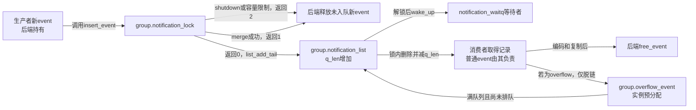
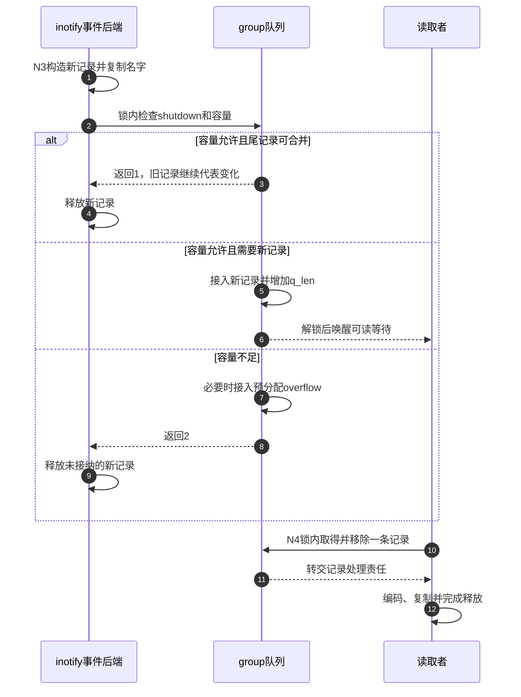

# 第59章\_事件合并排队与溢出

事件产生路径与监听者读消息的速度不一致，所以匹配成功后还要保存记录。队列不能无限扩张，重复提示也未必需要逐条保留。本篇沿inotify记录构造、公共入队和出队所有权说明：队列保存的是可合并、可丢失的变化提示，不能据此精确计数文件操作。

**讲解层次：实现层，Linux 6.12.20。** 固定提交 `dfaf2136deb2af2e60b994421281ba42f1c087e0`。原件：[inotify_fsnotify.c](../../linux/fs/notify/inotify/inotify_fsnotify.c)、[notification.c](../../linux/fs/notify/notification.c)、[inotify.h](../../linux/fs/notify/inotify/inotify.h)、[fsnotify_backend.h](../../linux/include/linux/fsnotify_backend.h)。代码保留执行语句，中文注释为仓库补充。[通知导读](../navigation/P19_事件观察与许可响应的交接.md#19.1_沿通知周期定位状态与执行者)的N3、N4在这里通过具体队列交接；版本出处见 [总索引](../navigation/P01_Linux_6.12_VFS源码阅读索引.md)。

原件摘要与配置见 [通知源码基线](../../linux/SOURCE_BASELINE.md#1.299_事件观察与许可响应的交接)，应用场景见 [正文通知周期](../../../../knowledge/kernel_subsystems/vfs/P20_fsnotify_inotify与fanotify.md#20.3_从登记到读取追踪同一次变化)。

## 59.1\_后端先把当前事件变成独立记录

公共分派器传来的名字与对象只在其调用协议中有效。inotify因此分配自己的inotify_event_info，保存wd、mask、cookie和名字字节。该结构嵌入fsnotify_event，其公共部分只需要链表节点；用户可读的inotify_event是稍后编码出的ABI结构，不是直接把内核结构体拷出。

```c
/** @brief 仓库补充阅读说明：取得当前wd并构造后端记录，交给公共队列；未接纳的记录由当前路径归还。 */
int inotify_handle_inode_event(struct fsnotify_mark *inode_mark, u32 mask,
                               struct inode *inode, struct inode *dir,
                               const struct qstr *name, u32 cookie)
{
        /* 仓库补充：取得当前wd并构造后端记录，交给公共队列；未接纳的记录由当前路径归还。 */
        struct inotify_inode_mark *i_mark;
        struct inotify_event_info *event;
        struct fsnotify_event *fsn_event;
        struct fsnotify_group *group = inode_mark->group;
        int ret;
        int len = 0, wd;
        int alloc_len = sizeof(struct inotify_event_info);
        struct mem_cgroup *old_memcg;
        if (name) {
                len = name->len;
                alloc_len += len + 1;
        }
        pr_debug("%s: group=%p mark=%p mask=%x\n", __func__, group, inode_mark,
                 mask);
        i_mark = container_of(inode_mark, struct inotify_inode_mark,
                              fsn_mark);
        wd = READ_ONCE(i_mark->wd);
        if (wd == -1)
                return 0;
        old_memcg = set_active_memcg(group->memcg);
        event = kmalloc(alloc_len, GFP_KERNEL_ACCOUNT | __GFP_RETRY_MAYFAIL);
        set_active_memcg(old_memcg);
        if (unlikely(!event)) {
                fsnotify_queue_overflow(group);
                return -ENOMEM;
        }
        if (mask & (IN_MOVE_SELF | IN_DELETE_SELF))
                mask &= ~IN_ISDIR;
        fsn_event = &event->fse;
        fsnotify_init_event(fsn_event);
        event->mask = mask;
        event->wd = wd;
        event->sync_cookie = cookie;
        event->name_len = len;
        if (len)
                strcpy(event->name, name->name);
        ret = fsnotify_add_event(group, fsn_event, inotify_merge);
        /* 仓库补充：未接纳或已合并时，本次新事件仍由后端释放。 */
        if (ret) {
                fsnotify_destroy_event(group, fsn_event);
        }
        if (inode_mark->flags & FSNOTIFY_MARK_FLAG_IN_ONESHOT)
                fsnotify_destroy_mark(inode_mark, group);
        return 0;
}
```

READ_ONCE(wd)得到-1时，观察已进入移除过程，本次不生成普通记录。分配在group.memcg记账域内完成并恢复原域；失败则排入预分配overflow提示。RETRY_MAYFAIL允许一定分配重试，但不表示无限重试或必须触发OOM杀死任务。

名字按name->len复制并补零，记录name_len保存实际名字长度，用户ABI填充长度在读出时计算。MOVE_SELF和DELETE_SELF去掉ISDIR是此接口既有编码行为，不能仅从对象是目录就推定每条自身事件都带ISDIR。

成功入队后队列接管记录；返回合并或未接纳时，新构造记录没有交给队列，当前后端必须释放。ONESHOT随后撤销mark，表示一次性观察，不保证监听者已经读到这条记录；撤销还可能产生IGNORED。

## 59.2\_队列容量与记录所有权一起交接

notification_lock把shutdown、容量、合并判断和链表插入保护成一个决定。消费者也在同一锁下取走记录，因此不能出现两个消费者同时取得同一个普通队列节点。

```c
/** @brief 仓库补充阅读说明：在队列锁内决定拒收、溢出、合并或入队，发布完成后唤醒等待者。 */
int fsnotify_insert_event(struct fsnotify_group *group,
                          struct fsnotify_event *event,
                          int (*merge)(struct fsnotify_group *,
                                       struct fsnotify_event *),
                          void (*insert)(struct fsnotify_group *,
                                         struct fsnotify_event *))
{
        /* 仓库补充：在队列锁内决定拒收、溢出、合并或入队，发布完成后唤醒等待者。 */
        int ret = 0;
        struct list_head *list = &group->notification_list;
        pr_debug("%s: group=%p event=%p\n", __func__, group, event);
        spin_lock(&group->notification_lock);
        if (group->shutdown) {
                spin_unlock(&group->notification_lock);
                return 2;
        }
        /* 仓库补充：容量判断先于合并；溢出使用实例预分配记录。 */
        if (event == group->overflow_event ||
            group->q_len >= group->max_events) {
                ret = 2;
                if (!list_empty(&group->overflow_event->list)) {
                        spin_unlock(&group->notification_lock);
                        return ret;
                }
                event = group->overflow_event;
                goto queue;
        }
        if (!list_empty(list) && merge) {
                ret = merge(group, event);
                if (ret) {
                        spin_unlock(&group->notification_lock);
                        return ret;
                }
        }
queue:
        group->q_len++;
        list_add_tail(&event->list, list);
        if (insert)
                insert(group, event);
        spin_unlock(&group->notification_lock);
        wake_up(&group->notification_waitq);
        kill_fasync(&group->fsn_fa, SIGIO, POLL_IN);
        return ret;
}
```

| 返回值 | 本次传入记录的结果 | 调用方责任 |
| --- | --- | --- |
| 0 | 新记录已进入通知队列 | 不再由生产路径直接释放 |
| 1 | 已由merge处理为已有提示 | 释放本次未入队记录 |
| 2 | shutdown或容量限制等导致未接纳 | 释放本次未入队记录；队列中可能另有overflow记录 |

检查容量发生在merge以前。因此即使当前事件可能和队尾重复，满队列也先走溢出处理。预分配overflow自身用list是否为空表示已在队列中；若已经排队就不重复追加，若刚被读走则可再次入队。q_len可能因此多出溢出提示这一项，不能把max_events解释成任何时刻链表节点数绝不超过的硬上界。



wake_up和kill_fasync在解锁后报告可读性；记录已经发布在队列里，通知不是消息本体。kill_fasync面向已登记的SIGIO使用者，不能把它写成每次都会给所有进程发信号。

## 59.3\_只合并允许相同含义的提示

inotify的合并策略检查队尾，不扫描整条历史，也不把不同wd视为同一个文件。IGNORED尤其不能随意消掉，因为它告诉用户一个编号的观察生命周期已经结束。

```c
/** @brief 仓库补充阅读说明：比较mask、wd、名字长度及名字内容，拒绝把已有IGNORED记录合并掉。 */
static bool event_compare(struct fsnotify_event *old_fsn,
                          struct fsnotify_event *new_fsn)
{
        /* 仓库补充：比较mask、wd、名字长度及名字内容，拒绝把已有IGNORED记录合并掉。 */
        struct inotify_event_info *old, *new;
        old = INOTIFY_E(old_fsn);
        new = INOTIFY_E(new_fsn);
        if (old->mask & FS_IN_IGNORED)
                return false;
        if ((old->mask == new->mask) &&
            (old->wd == new->wd) &&
            (old->name_len == new->name_len) &&
            (!old->name_len || !strcmp(old->name, new->name)))
                return true;
        return false;
}
```

```c
/** @brief 仓库补充阅读说明：仅比较当前通知队列的最后一条记录，相同则报告合并。 */
static int inotify_merge(struct fsnotify_group *group,
                         struct fsnotify_event *event)
{
        /* 仓库补充：仅比较当前通知队列的最后一条记录，相同则报告合并。 */
        struct list_head *list = &group->notification_list;
        struct fsnotify_event *last_event;
        last_event = list_entry(list->prev, struct fsnotify_event, list);
        return event_compare(last_event, event);
}
```

这个比较没有把cookie列为独立比较项，不能把函数名误读成逐字段完全相等。重要的是遵循此版本具体后端的合并规则，不从通用队列接口推断所有后端都采用同一种策略。fanotify可以提供自己的merge与哈希插入回调，许可事件则不能像普通提示那样随意合并。



步骤3～4使“两次产生”可能只留下“一条可读记录”；步骤7～9使历史可能缺项。监听者必须把overflow当作恢复触发，而不是忽略它继续相信本地缓存完整。步骤10～12之后，复制失败也未必能把事件放回队列，下一篇进一步解释。

## 59.4\_关联编号与对象析构各有边界

```c
/** @brief 仓库补充阅读说明：调用者持队列锁时移除节点并减少长度，同时恢复可再次使用的空节点状态。 */
void fsnotify_remove_queued_event(struct fsnotify_group *group,
                                  struct fsnotify_event *event)
{
        /* 仓库补充：调用者持队列锁时移除节点并减少长度，同时恢复可再次使用的空节点状态。 */
        assert_spin_locked(&group->notification_lock);
        /* 仓库补充：恢复空节点，overflow下次才能重新排入。 */
        list_del_init(&event->list);
        group->q_len--;
}
```

fsnotify_peek_first_event只查看队首，fsnotify_remove_first_event再调用上述移除函数；取得记录的调用者随后负责释放。list_del_init对overflow尤为关键：不重新初始化节点，下一次溢出会误以为提示仍在队列里。

```c
/** @brief 仓库补充阅读说明：普通事件交给后端释放；实例共用的overflow对象留到group退出。 */
void fsnotify_destroy_event(struct fsnotify_group *group,
                            struct fsnotify_event *event)
{
        /* 仓库补充：普通事件交给后端释放；实例共用的overflow对象留到group退出。 */
        if (!event || event == group->overflow_event)
                return;
        if (!list_empty(&event->list)) {
                spin_lock(&group->notification_lock);
                WARN_ON(!list_empty(&event->list));
                spin_unlock(&group->notification_lock);
        }
        /* 仓库补充：诊断不会替调用者脱链；到这里应已没有队列持有。 */
        group->ops->free_event(group, event);
}
```

WARN检查事件是否仍在队列，但不会自动替调用者脱链。若改变调用顺序，出现WARN后仍调用free_event可能暴露更严重的生命周期错误；不能用“只是调试输出”消解这个前置条件。

```c
/** @brief 仓库补充阅读说明：对全局有限宽度计数器递增，为本次移动的相关记录取得共同编号。 */
u32 fsnotify_get_cookie(void)
{
        /* 仓库补充：对全局有限宽度计数器递增，为本次移动的相关记录取得共同编号。 */
        return atomic_inc_return(&fsnotify_sync_cookie);
}
```

fsnotify_sync_cookie在notification.c以ATOMIC_INIT(0)定义，atomic_inc_return提供并发递增。返回值为u32，会随有限宽度计数器回绕，所以本地实验只比较同一次改名两端的值，不要求永远非零或跨无限历史唯一。

| 状态与辅助符号 | 定义及所有权 |
| --- | --- |
| inotify_event_info | inotify.h定义fse、mask、wd、sync_cookie、name_len及名字区；生产者填写，读取者编码，后端free_event归还 |
| fsnotify_event.list | fsnotify_backend.h声明；init_event初始化空链，入队/出队在notification_lock内改写 |
| group.q_len / max_events / shutdown | 初始化或实例建立设值，入队与移除维护；shutdown使新请求返回未接纳 |
| fsnotify_add_event / queue_overflow | 头文件包装公共insert_event，前者不使用额外insert回调，后者提交实例的overflow对象 |
| container_of、kmalloc、memcpy | 分别恢复嵌入对象、分配记录、复制事件名字；不会增加被观察inode引用 |
| assert_spin_locked / pr_debug | 检查锁前提与可选日志；不代替真正spin_lock，也不建立消费者可见性 |

notification.c开头仍有旧event_holder模型的注释。此版本实际结构和代码使用后端记录中的fsnotify_event.list，不按那段旧注释画“多个group共享同一个holder”的图。修改队列应以当前定义、调用者和释放路径共同为准。

**可修改性：** 调整容量或merge必须同时审查0/1/2返回后的记录归属、overflow重用、q_len与链表一致性、唤醒以及shutdown。验证至少包含可合并尾事件、不合并事件、满队列、overflow读出后再次溢出、关闭与并发入队。增加通知可靠性不能只扩大max_events；若要求逐操作审计，还需要改变允许合并和丢失的接口契约。
