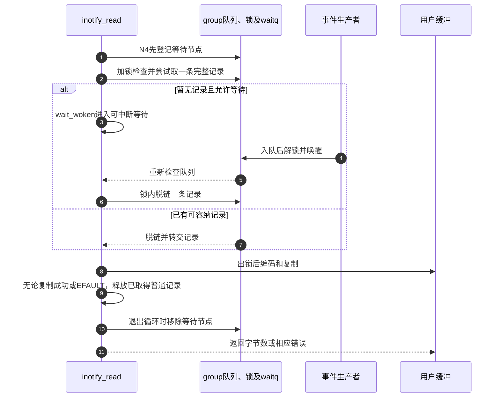
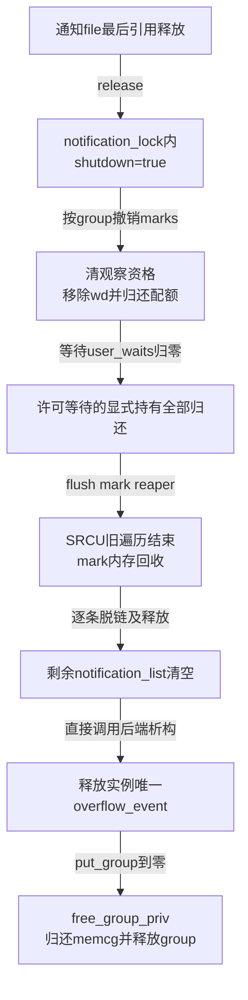

# 第60章\_通知读取与监听实例退出

队列中的记录还不是用户空间已经收到的消息。读取要完成大小检查、脱链、编码和复制；监听者退出还要阻止新事件、撤销观察并等待在途使用者。把这些步骤分开，才能回答read失败后是否还能重读，以及关闭一个通知fd是否立即释放所有状态。

**讲解层次：实现层，Linux 6.12.20。** 固定提交 `dfaf2136deb2af2e60b994421281ba42f1c087e0`。原件：[inotify_user.c](../../linux/fs/notify/inotify/inotify_user.c)、[inotify_fsnotify.c](../../linux/fs/notify/inotify/inotify_fsnotify.c)、[group.c](../../linux/fs/notify/group.c)、[UAPI inotify.h](../../linux/include/uapi/linux/inotify.h)。执行语句保留，中文注释为仓库补充。本篇承接 [通知导读](../navigation/P19_事件观察与许可响应的交接.md#19.1_沿通知周期定位状态与执行者)的N4消费、N5退出，来源见 [总索引](../navigation/P01_Linux_6.12_VFS源码阅读索引.md)。

原件摘要与配置见 [通知源码基线](../../linux/SOURCE_BASELINE.md#1.299_事件观察与许可响应的交接)，应用场景见 [正文通知周期](../../../../knowledge/kernel_subsystems/vfs/P20_fsnotify_inotify与fanotify.md#20.3_从登记到读取追踪同一次变化)。

## 60.1\_先取得完整记录再复制给用户

每条inotify记录长度不同。get_one_event先在notification_lock内看队首，确认剩余用户缓冲能够容纳完整头和填充后的名称区，才将记录移出队列。这使“缓冲太小”和“脱链后复制失败”有不同后果。

```c
/** @brief 仓库补充阅读说明：队首放得下才移除；缓冲太小返回EINVAL并保留该记录。 */
static struct fsnotify_event *get_one_event(struct fsnotify_group *group,
                                            size_t count)
{
        /* 仓库补充：队首放得下才移除；缓冲太小返回EINVAL并保留该记录。 */
        size_t event_size = sizeof(struct inotify_event);
        struct fsnotify_event *event;
        event = fsnotify_peek_first_event(group);
        if (!event)
                return NULL;
        pr_debug("%s: group=%p event=%p\n", __func__, group, event);
        event_size += round_event_name_len(event);
        /* 仓库补充：空间不足时还没有移除队首，后续可以重新尝试。 */
        if (event_size > count)
                return ERR_PTR(-EINVAL);
        fsnotify_remove_first_event(group);
        return event;
}
```

```c
/** @brief 仓库补充阅读说明：把内核事件编码成UAPI头和零填充名称区，任何用户内存写入失败都返回EFAULT。 */
static ssize_t copy_event_to_user(struct fsnotify_group *group,
                                  struct fsnotify_event *fsn_event,
                                  char __user *buf)
{
        /* 仓库补充：把内核事件编码成UAPI头和零填充名称区，任何用户内存写入失败都返回EFAULT。 */
        struct inotify_event inotify_event;
        struct inotify_event_info *event;
        size_t event_size = sizeof(struct inotify_event);
        size_t name_len;
        size_t pad_name_len;
        pr_debug("%s: group=%p event=%p\n", __func__, group, fsn_event);
        event = INOTIFY_E(fsn_event);
        name_len = event->name_len;
        pad_name_len = round_event_name_len(fsn_event);
        inotify_event.len = pad_name_len;
        inotify_event.mask = inotify_mask_to_arg(event->mask);
        inotify_event.wd = event->wd;
        inotify_event.cookie = event->sync_cookie;
        if (copy_to_user(buf, &inotify_event, event_size))
                return -EFAULT;
        buf += event_size;
        if (pad_name_len) {
                if (copy_to_user(buf, event->name, name_len))
                        return -EFAULT;
                buf += name_len;
                /* 仓库补充：名称结尾与对齐填充一并清零，仍可能发生用户访问失败。 */
                if (clear_user(buf, pad_name_len - name_len))
                        return -EFAULT;
                event_size += pad_name_len;
        }
        return event_size;
}
```

round_event_name_len把非空名字的“长度加结尾零”向sizeof(struct inotify_event)取整；没有名字则len为0。copy_to_user复制固定头和名字，clear_user清剩余填充，包括结束零字节。内核内部记录布局与UAPI布局不同，不能把内核地址直接交给用户解析。

| 情况 | 记录是否已从队列移除 | 用户可以依赖什么 |
| --- | --- | --- |
| 队列为空 | 没有取得记录 | 根据非阻塞、信号及已有复制量决定等待或返回 |
| 剩余缓冲太小 | 尚未移除该记录 | 后续足够大的读取仍可取它，除非另一消费者先取走 |
| 完整编码复制成功 | 已移除 | 返回字节数包含该条完整记录 |
| copy_to_user或clear_user失败 | 已移除 | 当前记录仍会释放；不能承诺下一次read可重读它 |

## 60.2\_等待队列怎样避免丢掉可读时刻

若先检查空队列、再登记睡眠，生产者可能恰好在两者之间入队并唤醒一个尚不存在的等待者。inotify_read先把wait加入等待队列，再进入检查循环；woken_wake_function和wait_woken配合记住唤醒，避免将检查与睡眠割裂。

```c
/** @brief 仓库补充阅读说明：先登记等待，再循环取得记录；复制后释放事件，按非阻塞、信号和已复制量决定返回。 */
static ssize_t inotify_read(struct file *file, char __user *buf,
                            size_t count, loff_t *pos)
{
        /* 仓库补充：先登记等待，再循环取得记录；复制后释放事件，按非阻塞、信号和已复制量决定返回。 */
        struct fsnotify_group *group;
        struct fsnotify_event *kevent;
        char __user *start;
        int ret;
        DEFINE_WAIT_FUNC(wait, woken_wake_function);
        start = buf;
        group = file->private_data;
        add_wait_queue(&group->notification_waitq, &wait);
        while (1) {
                spin_lock(&group->notification_lock);
                kevent = get_one_event(group, count);
                spin_unlock(&group->notification_lock);
                pr_debug("%s: group=%p kevent=%p\n", __func__, group, kevent);
                if (kevent) {
                        ret = PTR_ERR(kevent);
                        if (IS_ERR(kevent))
                                break;
                        ret = copy_event_to_user(group, kevent, buf);
                        /* 仓库补充：即使复制失败，已脱链记录也在此释放，不能承诺重读。 */
                        fsnotify_destroy_event(group, kevent);
                        if (ret < 0)
                                break;
                        buf += ret;
                        count -= ret;
                        continue;
                }
                ret = -EAGAIN;
                if (file->f_flags & O_NONBLOCK)
                        break;
                ret = -ERESTARTSYS;
                if (signal_pending(current))
                        break;
                if (start != buf)
                        break;
                wait_woken(&wait, TASK_INTERRUPTIBLE, MAX_SCHEDULE_TIMEOUT);
        }
        remove_wait_queue(&group->notification_waitq, &wait);
        if (start != buf && ret != -EFAULT)
                ret = buf - start;
        return ret;
}
```

已成功复制一些记录时，后面没有新记录通常返回已有字节，不继续等下一条。EFAULT是明确例外：即使前面已经复制了记录，该实现仍返回EFAULT；所以不能将这个read抽象成“失败完全没有消费”的事务。

```c
/** @brief 仓库补充阅读说明：先登记notification_waitq，再在队列锁下判断当前是否可读。 */
static __poll_t inotify_poll(struct file *file, poll_table *wait)
{
        /* 仓库补充：先登记notification_waitq，再在队列锁下判断当前是否可读。 */
        struct fsnotify_group *group = file->private_data;
        __poll_t ret = 0;
        poll_wait(file, &group->notification_waitq, wait);
        spin_lock(&group->notification_lock);
        if (!fsnotify_notify_queue_is_empty(group))
                ret = EPOLLIN | EPOLLRDNORM;
        spin_unlock(&group->notification_lock);
        return ret;
}
```

poll_wait只是把调用者的等待机制连接到该waitqueue，真正可读性来自锁内队列是否为空。另一个线程可能在poll返回以后先读走消息，非阻塞read仍可能EAGAIN；这不表示poll凭空制造了事件。



步骤8在队列自旋锁外进行，因为访问用户内存可能发生缺页。步骤9说明消息消费与用户成功接收不是同一个原子动作。这个接口没有应用处理完成后的ACK，也不会把对象锁到用户处理完为止。

## 60.3\_撤销wd要同时终止编号与观察资格

rm_watch先按wd取得mark引用，使它在退出流程中保持有效；随后进入前篇的destroy_mark，再归还查找引用。后端freeing_mark负责报告IGNORED并移除IDR编号，最终内存回收仍由引用和SRCU协议决定。

```c
/** @brief 仓库补充阅读说明：验证通知fd，按wd取得mark引用，撤销观察后归还查找持有。 */
SYSCALL_DEFINE2(inotify_rm_watch, int, fd, __s32, wd)
{
        /* 仓库补充：验证通知fd，按wd取得mark引用，撤销观察后归还查找持有。 */
        struct fsnotify_group *group;
        struct inotify_inode_mark *i_mark;
        struct fd f;
        int ret = -EINVAL;
        f = fdget(fd);
        if (unlikely(!fd_file(f)))
                return -EBADF;
        if (unlikely(fd_file(f)->f_op != &inotify_fops))
                goto out;
        group = fd_file(f)->private_data;
        i_mark = inotify_idr_find(group, wd);
        if (unlikely(!i_mark))
                goto out;
        ret = 0;
        fsnotify_destroy_mark(&i_mark->fsn_mark, group);
        fsnotify_put_mark(&i_mark->fsn_mark);
out:
        fdput(f);
        return ret;
}
```

```c
/** @brief 仓库补充阅读说明：在wd仍可用时排入IGNORED，再移除编号并归还正常观察配额。 */
void inotify_ignored_and_remove_idr(struct fsnotify_mark *fsn_mark,
                                    struct fsnotify_group *group)
{
        /* 仓库补充：在wd仍可用时排入IGNORED，再移除编号并归还正常观察配额。 */
        struct inotify_inode_mark *i_mark;
        inotify_handle_inode_event(fsn_mark, FS_IN_IGNORED, NULL, NULL, NULL,
                                   0);
        i_mark = container_of(fsn_mark, struct inotify_inode_mark, fsn_mark);
        inotify_remove_from_idr(group, i_mark);
        dec_inotify_watches(group->inotify_data.ucounts);
}
```

```c
/** @brief 仓库补充阅读说明：在索引锁下核对wd对应对象，删除编号与其引用，并使对象wd失效。 */
static void inotify_remove_from_idr(struct fsnotify_group *group,
                                    struct inotify_inode_mark *i_mark)
{
        /* 仓库补充：在索引锁下核对wd对应对象，删除编号与其引用，并使对象wd失效。 */
        struct idr *idr = &group->inotify_data.idr;
        spinlock_t *idr_lock = &group->inotify_data.idr_lock;
        struct inotify_inode_mark *found_i_mark = NULL;
        int wd;
        spin_lock(idr_lock);
        wd = i_mark->wd;
        if (wd == -1) {
                WARN_ONCE(1, "%s: i_mark=%p i_mark->wd=%d i_mark->group=%p\n",
                        __func__, i_mark, i_mark->wd, i_mark->fsn_mark.group);
                goto out;
        }
        found_i_mark = inotify_idr_find_locked(group, wd);
        if (unlikely(!found_i_mark)) {
                WARN_ONCE(1, "%s: i_mark=%p i_mark->wd=%d i_mark->group=%p\n",
                        __func__, i_mark, i_mark->wd, i_mark->fsn_mark.group);
                goto out;
        }
        if (unlikely(found_i_mark != i_mark)) {
                WARN_ONCE(1, "%s: i_mark=%p i_mark->wd=%d i_mark->group=%p "
                        "found_i_mark=%p found_i_mark->wd=%d "
                        "found_i_mark->group=%p\n", __func__, i_mark,
                        i_mark->wd, i_mark->fsn_mark.group, found_i_mark,
                        found_i_mark->wd, found_i_mark->fsn_mark.group);
                goto out;
        }
        if (unlikely(refcount_read(&i_mark->fsn_mark.refcnt) < 2)) {
                printk(KERN_ERR "%s: i_mark=%p i_mark->wd=%d i_mark->group=%p\n",
                         __func__, i_mark, i_mark->wd, i_mark->fsn_mark.group);
                BUG();
        }
        idr_remove(idr, wd);
        fsnotify_put_mark(&i_mark->fsn_mark);
out:
        /* 仓库补充：编号失效与对象内存释放分开，其他引用仍可持有mark。 */
        i_mark->wd = -1;
        spin_unlock(idr_lock);
        if (found_i_mark)
                fsnotify_put_mark(&found_i_mark->fsn_mark);
}
```

inotify_idr_find_locked对找到的mark额外取得引用，remove内部的查找引用与IDR持有引用必须分别归还。正常路径删除映射后把wd设为-1；异常路径里的WARN和BUG检查编号、对象与引用一致性，有些分支跳过删除，不能只当作日志忽略。IDR本身不替调用者析构mark，相关基础见 [IDR查找和移除](../../kref/source_explanations/lib/idr.c.md#1.2_查询与移除不管理对象引用)。

IGNORED排队与用户读到它之间仍有时间差；原wd之后可能复用，应用需要按消息顺序更新自己的映射。IN_ONESHOT、对象删除或卸载也会使观察退出，不只显式rm_watch会产生这条生命周期消息。

## 60.4\_最后一个通知file退出才销毁监听实例

dup或fork可能使多个fd引用同一个通知file；关闭其中一个编号只归还该份file引用。真正执行inotify_release是在该file最终释放时，不能把每次close都画成group立即消失。

```c
/** @brief 仓库补充阅读说明：通知file最终释放时启动group退出流程。 */
static int inotify_release(struct inode *ignored, struct file *file)
{
        /* 仓库补充：通知file最终释放时启动group退出流程。 */
        struct fsnotify_group *group = file->private_data;
        pr_debug("%s: group=%p\n", __func__, group);
        fsnotify_destroy_group(group);
        return 0;
}
```

```c
/** @brief 仓库补充阅读说明：阻止新入队、撤销全部观察并等待在途持有，最后清空记录并归还group。 */
void fsnotify_destroy_group(struct fsnotify_group *group)
{
        /* 仓库补充：阻止新入队、撤销全部观察并等待在途持有，最后清空记录并归还group。 */
        fsnotify_group_stop_queueing(group);
        fsnotify_clear_marks_by_group(group, FSNOTIFY_OBJ_TYPE_ANY);
        /* 仓库补充：观察已经撤销，等待此前许可路径取得的持有全部归还。 */
        wait_event(group->notification_waitq, !atomic_read(&group->user_waits));
        fsnotify_wait_marks_destroyed();
        fsnotify_flush_notify(group);
        if (group->overflow_event)
                group->ops->free_event(group, group->overflow_event);
        fsnotify_put_group(group);
}
```



先shutdown使在途生产者不再加入新记录；撤销marks切断新观察持有，等待user_waits处理已经转交给许可等待的责任，等待reaper又关闭旧SRCU遍历。只有这些条件成立，清空队列才不会刚清完又被旧生产者补入。

overflow不能用普通fsnotify_destroy_event释放，因为该函数特意跳过它，所以group退出直接调用后端free_event。fsnotify_put_group归零以后才运行fsnotify_final_destroy_group；其他路径仍有group引用时，结构本身可以更晚归还。

## 60.5\_读取与退出的辅助符号和修改边界

| 符号或字段 | 定义、读写及配对关系 |
| --- | --- |
| inotify_event | UAPI头定义wd、mask、cookie、len；用户按头大小加len遍历，不按内核结构大小遍历 |
| INOTIFY_E / inotify_mask_to_arg | 以container_of取得后端记录，并过滤为用户可见事件位；内部标志不全部输出 |
| notification_waitq | group建立时初始化；生产者入队唤醒，read/poll等待，退出也借它等待user_waits归零 |
| fsnotify_group_stop_queueing | 在notification_lock内置shutdown，之后insert_event拒收；不能代替撤销mark或等待旧使用者 |
| fsnotify_flush_notify | 锁内移除记录、锁外析构，再继续下一条；不会持自旋锁执行后端的完整释放过程 |
| inotify_free_group_priv | 后端退出检查IDR应为空，销毁IDR并归还实例配额；其中遍历告警不是替正常流程逐个释放观察的兜底 |
| fsnotify_fasync / ioctl | 前者维护SIGIO订阅，FIONREAD统计当前编码字节数；统计以后队列仍会变化，不能把数值当作预留的稳定消息量 |
| 当前配置 | INOTIFY_USER开启；fanotify许可等待未启用，但公共group退出仍包含该协议，不能把源码分支误写成已执行观测 |

修改读取时必须保留整条长度检查、出锁复制、所有出口清等待节点，以及复制失败后的明确消费语义。修改退出时要同时检查mark回收、队列、overflow、IDR和配额；若删除user_waits等待，必须先给出许可事件的新持有证明。下一篇将说明为什么等待用户以前需要把SRCU读侧责任换成显式mark持有。
