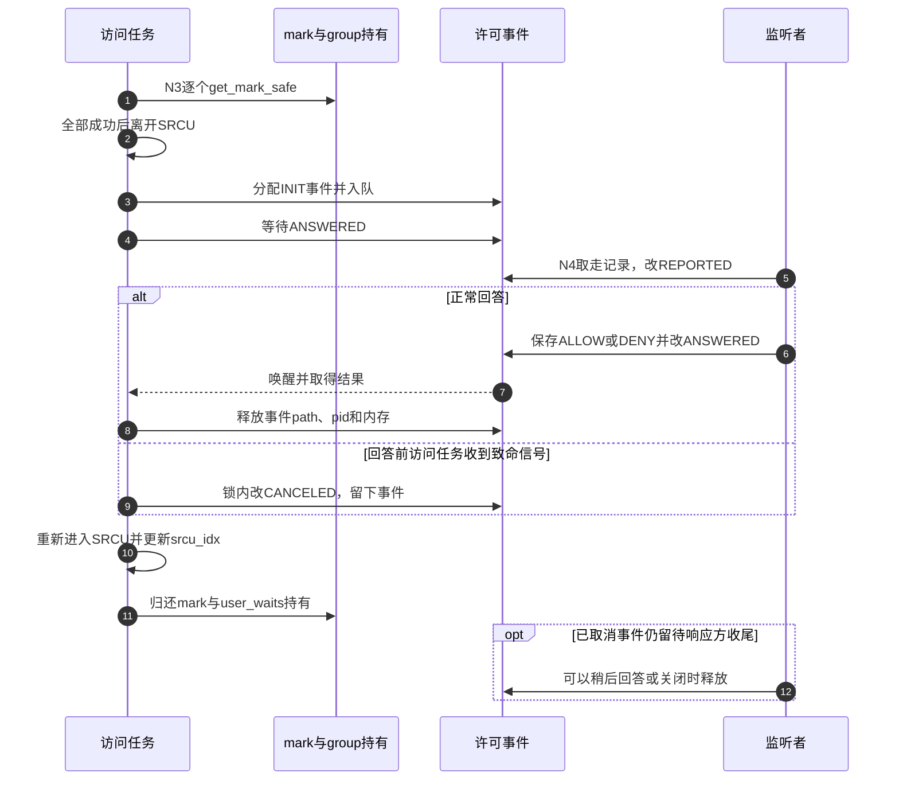

# 第61章\_fanotify许可等待与观察持有

普通通知排队以后，产生者就能继续执行。许可事件不同：产生者需要等待用户空间回答，等待期间监听者可能关闭实例，mark也可能被移除。若始终占着全局观察遍历的SRCU读侧，回收会被用户响应时间拖住；若直接离开SRCU，又可能继续使用已经释放的mark。这里需要一次明确的持有责任转移。

**讲解层次：实现层，Linux 6.12.20。** 固定提交 `dfaf2136deb2af2e60b994421281ba42f1c087e0`。原件：[fsnotify.h](../../linux/include/linux/fsnotify.h)、[mark.c](../../linux/fs/notify/mark.c)、[fanotify.c](../../linux/fs/notify/fanotify/fanotify.c)、[fanotify.h](../../linux/fs/notify/fanotify/fanotify.h)、[Kconfig](../../linux/fs/notify/fanotify/Kconfig)。执行语句保留，中文注释为仓库补充。[导读](../navigation/P19_事件观察与许可响应的交接.md#19.1_沿通知周期定位状态与执行者)的N2～N4在这里增加等待分支，版本总入口见 [索引](../navigation/P01_Linux_6.12_VFS源码阅读索引.md)。

本次目标配置关闭FANOTIFY与SECURITY，下面是固定源码的可选实现，并非本次机器已经运行这条路径。FANOTIFY_ACCESS_PERMISSIONS还依赖FANOTIFY和SECURITY；未开启时头文件中的相应许可包装返回0，不产生用户许可等待。

原件摘要与配置见 [通知源码基线](../../linux/SOURCE_BASELINE.md#1.299_事件观察与许可响应的交接)，应用场景见 [正文通知周期](../../../../knowledge/kernel_subsystems/vfs/P20_fsnotify_inotify与fanotify.md#20.3_从登记到读取追踪同一次变化)。

## 61.1\_先找出操作之前的许可接入点

事后OPEN或ACCESS消息只能报告发生过什么。要让用户策略决定操作是否继续，必须在真正开放访问以前调用许可包装，并把非0结果传回原操作路径。

```c
/** @brief 仓库补充阅读说明：读取访问前发出ACCESS_PERM；锁依赖检查只核对冻结保护前提，不执行解锁。 */
static inline int fsnotify_file_area_perm(struct file *file, int perm_mask,
                                          const loff_t *ppos, size_t count)
{
        /* 仓库补充：读取访问前发出ACCESS_PERM；锁依赖检查只核对冻结保护前提，不执行解锁。 */
        __u32 fsnotify_mask = FS_ACCESS_PERM;
        lockdep_assert_once(file_write_not_started(file));
        if (!(perm_mask & MAY_READ))
                return 0;
        return fsnotify_file(file, fsnotify_mask);
}
```

虽然函数有ppos与count参数，这个版本没有把范围加入许可消息，不能据函数名承诺逐字节范围裁决。这里只对MAY_READ发ACCESS_PERM。lockdep_assert_once检查没有持有不适合这次等待的文件系统写入冻结保护，因为用户处理可能需要修改文件系统；检查本身不释放锁，也不会替调用方修正错误顺序。

```c
/** @brief 仓库补充阅读说明：执行用途先检查OPEN_EXEC_PERM，通过后再检查通常OPEN_PERM。 */
static inline int fsnotify_open_perm(struct file *file)
{
        /* 仓库补充：执行用途先检查OPEN_EXEC_PERM，通过后再检查通常OPEN_PERM。 */
        int ret;
        if (file->f_flags & __FMODE_EXEC) {
                ret = fsnotify_file(file, FS_OPEN_EXEC_PERM);
                if (ret)
                        return ret;
        }
        return fsnotify_file(file, FS_OPEN_PERM);
}
```

security_file_open的接入与默认配置分支已在 [VFS安全钩子](P55_VFS安全钩子的登记与调用.md)展开；本篇只拥有通知许可包装。fsnotify_file和多group分派见 [事件分派](P58_fsnotify事件匹配与分派.md#58.2_按group汇合不同对象的观察)。入口先后决定许可到底约束什么，不能把通知方法的存在当成任何读取路径都必经同一检查的证明。

## 61.2\_等待用户以前先转移观察责任

fsnotify遍历时，iter_info.marks保存多个对象链头，其中不一定每个都属于当前报告group。等待结束还要继续原来的多链遍历，所以prepare保护的是所有非空链头，不仅是report_mask中的几个。

```c
/** @brief 仓库补充阅读说明：只对仍有引用且仍ATTACHED的mark建立等待持有，并登记所属group的user_waits。 */
static bool fsnotify_get_mark_safe(struct fsnotify_mark *mark)
{
        /* 仓库补充：只对仍有引用且仍ATTACHED的mark建立等待持有，并登记所属group的user_waits。 */
        if (!mark)
                return true;
        if (refcount_inc_not_zero(&mark->refcnt)) {
                spin_lock(&mark->lock);
                if (mark->flags & FSNOTIFY_MARK_FLAG_ATTACHED) {
                        /* 仓库补充：引用与仍有效的观察资格同时成立，才登记退出等待责任。 */
                        atomic_inc(&mark->group->user_waits);
                        spin_unlock(&mark->lock);
                        return true;
                }
                spin_unlock(&mark->lock);
                fsnotify_put_mark(mark);
        }
        return false;
}
```

refcount_inc_not_zero防止复活已经归零的对象；取得引用以后还要在mark锁下检查ATTACHED，防止把已经撤销的观察重新延长为有效等待。NULL槽无需持有，返回true。失败时已取得的临时引用要归还。

```c
/** @brief 仓库补充阅读说明：逐个建立显式mark持有；全部成功才真正离开SRCU，失败则回退已取得持有。 */
bool fsnotify_prepare_user_wait(struct fsnotify_iter_info *iter_info)
        __releases(&fsnotify_mark_srcu)
{
        /* 仓库补充：逐个建立显式mark持有；全部成功才真正离开SRCU，失败则回退已取得持有。 */
        int type;
        fsnotify_foreach_iter_type(type) {
                if (!fsnotify_get_mark_safe(iter_info->marks[type])) {
                        /* 仓库补充：这只是静态分析注解，失败路径没有执行真正的SRCU解锁。 */
                        __release(&fsnotify_mark_srcu);
                        goto fail;
                }
        }
        srcu_read_unlock(&fsnotify_mark_srcu, iter_info->srcu_idx);
        return true;
fail:
        for (type--; type >= 0; type--)
                fsnotify_put_mark_wake(iter_info->marks[type]);
        return false;
}
```

成功后，每个被保护mark有一份引用，其group.user_waits也增加。mark原本持有group，加上退出方等待user_waits归零的协议，使等待期间的mark和group都保持有效。这里不是把对象复制一份，而是把“靠读侧保护地址”换成“明确持有这些地址”。

失败分支中的`__release(&fsnotify_mark_srcu)`是静态检查注解，**没有执行srcu_read_unlock**。真正成功路径才调用srcu_read_unlock。失败时外层fsnotify仍处于原SRCU读侧，会在其正常出口解锁；把注解当功能动作，会错误地推导这里存在双重解锁。

```c
/** @brief 仓库补充阅读说明：恢复SRCU读侧和新的索引，再归还等待期间各mark的显式持有。 */
void fsnotify_finish_user_wait(struct fsnotify_iter_info *iter_info)
        __acquires(&fsnotify_mark_srcu)
{
        /* 仓库补充：恢复SRCU读侧和新的索引，再归还等待期间各mark的显式持有。 */
        int type;
        /* 仓库补充：先恢复读侧保护，再归还链头引用，供外层安全继续遍历。 */
        iter_info->srcu_idx = srcu_read_lock(&fsnotify_mark_srcu);
        fsnotify_foreach_iter_type(type)
                fsnotify_put_mark_wake(iter_info->marks[type]);
}
```

```c
/** @brief 仓库补充阅读说明：归还mark及user_waits责任，最后等待持有结束时唤醒正在退出的group。 */
static void fsnotify_put_mark_wake(struct fsnotify_mark *mark)
{
        /* 仓库补充：归还mark及user_waits责任，最后等待持有结束时唤醒正在退出的group。 */
        if (mark) {
                struct fsnotify_group *group = mark->group;
                fsnotify_put_mark(mark);
                if (atomic_dec_and_test(&group->user_waits) && group->shutdown)
                        wake_up(&group->notification_waitq);
        }
}
```

恢复顺序不能颠倒：先重新进入同一SRCU域，再放掉链头引用，后续才能安全继续遍历。user_waits是退出协议的计数，不是事件回答数；一个许可等待可能持有来自多个group的链头，也可能给同组增加多份。


图中访问任务等的是事件回答，销毁方等的是持有责任归零，两种等待条件和waitqueue不同。即使回答已经发布，访问任务还需要执行finish，退出方才可以继续收口。

## 61.3\_事件对象保存回答以前所需的对象关系

许可事件自身还要保留路径，以便用户读取事件时打开相应对象。这个持有与mark引用作用不同：mark保证观察遍历可继续，path保证本条事件关联的对象路径载体仍可使用。

```c
/** @brief 仓库补充阅读说明：建立INIT许可事件并持有path，回答字段初始为空。 */
static struct fanotify_event *fanotify_alloc_perm_event(const struct path *path,
                                                        gfp_t gfp)
{
        /* 仓库补充：建立INIT许可事件并持有path，回答字段初始为空。 */
        struct fanotify_perm_event *pevent;
        pevent = kmem_cache_alloc(fanotify_perm_event_cachep, gfp);
        if (!pevent)
                return NULL;
        pevent->fae.type = FANOTIFY_EVENT_TYPE_PATH_PERM;
        pevent->response = 0;
        pevent->hdr.type = FAN_RESPONSE_INFO_NONE;
        pevent->hdr.pad = 0;
        pevent->hdr.len = 0;
        pevent->state = FAN_EVENT_INIT;
        pevent->path = *path;
        path_get(path);
        return &pevent->fae;
}
```

fanotify_alloc_event按事件类型选择此分配器，随后初始化公共事件、mask、pid和哈希相关字段；许可事件类型为PATH_PERM。path_get与后端free_event中的path_put配对，pid引用也在后端析构归还，不能只释放slab而遗留这些持有。

```c
/** @brief 仓库补充阅读说明：筛选本组兴趣，许可事件先交接mark持有，再分配排队和等待；所有已准备路径都恢复遍历责任。 */
static int fanotify_handle_event(struct fsnotify_group *group, u32 mask,
                                 const void *data, int data_type,
                                 struct inode *dir,
                                 const struct qstr *file_name, u32 cookie,
                                 struct fsnotify_iter_info *iter_info)
{
        /* 仓库补充：筛选本组兴趣，许可事件先交接mark持有，再分配排队和等待；所有已准备路径都恢复遍历责任。 */
        int ret = 0;
        struct fanotify_event *event;
        struct fsnotify_event *fsn_event;
        __kernel_fsid_t fsid = {};
        u32 match_mask = 0;
        BUILD_BUG_ON(FAN_ACCESS != FS_ACCESS);
        BUILD_BUG_ON(FAN_MODIFY != FS_MODIFY);
        BUILD_BUG_ON(FAN_ATTRIB != FS_ATTRIB);
        BUILD_BUG_ON(FAN_CLOSE_NOWRITE != FS_CLOSE_NOWRITE);
        BUILD_BUG_ON(FAN_CLOSE_WRITE != FS_CLOSE_WRITE);
        BUILD_BUG_ON(FAN_OPEN != FS_OPEN);
        BUILD_BUG_ON(FAN_MOVED_TO != FS_MOVED_TO);
        BUILD_BUG_ON(FAN_MOVED_FROM != FS_MOVED_FROM);
        BUILD_BUG_ON(FAN_CREATE != FS_CREATE);
        BUILD_BUG_ON(FAN_DELETE != FS_DELETE);
        BUILD_BUG_ON(FAN_DELETE_SELF != FS_DELETE_SELF);
        BUILD_BUG_ON(FAN_MOVE_SELF != FS_MOVE_SELF);
        BUILD_BUG_ON(FAN_EVENT_ON_CHILD != FS_EVENT_ON_CHILD);
        BUILD_BUG_ON(FAN_Q_OVERFLOW != FS_Q_OVERFLOW);
        BUILD_BUG_ON(FAN_OPEN_PERM != FS_OPEN_PERM);
        BUILD_BUG_ON(FAN_ACCESS_PERM != FS_ACCESS_PERM);
        BUILD_BUG_ON(FAN_ONDIR != FS_ISDIR);
        BUILD_BUG_ON(FAN_OPEN_EXEC != FS_OPEN_EXEC);
        BUILD_BUG_ON(FAN_OPEN_EXEC_PERM != FS_OPEN_EXEC_PERM);
        BUILD_BUG_ON(FAN_FS_ERROR != FS_ERROR);
        BUILD_BUG_ON(FAN_RENAME != FS_RENAME);
        BUILD_BUG_ON(HWEIGHT32(ALL_FANOTIFY_EVENT_BITS) != 21);
        mask = fanotify_group_event_mask(group, iter_info, &match_mask,
                                         mask, data, data_type, dir);
        if (!mask)
                return 0;
        pr_debug("%s: group=%p mask=%x report_mask=%x\n", __func__,
                 group, mask, match_mask);
        if (fanotify_is_perm_event(mask)) {
                if (!fsnotify_prepare_user_wait(iter_info))
                        return 0;
        }
        if (FAN_GROUP_FLAG(group, FANOTIFY_FID_BITS))
                fsid = fanotify_get_fsid(iter_info);
        event = fanotify_alloc_event(group, mask, data, data_type, dir,
                                     file_name, &fsid, match_mask);
        ret = -ENOMEM;
        if (unlikely(!event)) {
                if (!fanotify_is_perm_event(mask))
                        fsnotify_queue_overflow(group);
                goto finish;
        }
        fsn_event = &event->fse;
        ret = fsnotify_insert_event(group, fsn_event, fanotify_merge,
                                    fanotify_insert_event);
        if (ret) {
                BUG_ON(ret == 1 && mask & FANOTIFY_PERM_EVENTS);
                fsnotify_destroy_event(group, fsn_event);
                /* 仓库补充：未接纳许可事件的实际结果是允许；与分配失败不同。 */
                ret = 0;
        } else if (fanotify_is_perm_event(mask)) {
                ret = fanotify_get_response(group, FANOTIFY_PERM(event),
                                            iter_info);
        }
finish:
        if (fanotify_is_perm_event(mask))
                fsnotify_finish_user_wait(iter_info);
        return ret;
}
```

fanotify_group_event_mask按本组mark和报告模式保留需要的事件位并给出match_mask。FID模式使用文件系统身份和句柄组织普通通知；许可事件不因此自动具备FID模式的同一能力组合。BUILD_BUG_ON检查FS/FAN位布局相等，BUG_ON禁止把许可事件合并掉；它们不是产生事件或取得权限的功能步骤。

| 当前分支 | 原操作看到的结果 | 资源如何交接 |
| --- | --- | --- |
| mark正在删除，prepare失败 | 返回0，允许继续 | 回退已取得持有，保留外层SRCU读侧 |
| 许可事件分配失败 | ENOMEM传回操作 | 没有事件可等待，finish恢复遍历并归还持有 |
| 队列满或shutdown，事件未接纳 | 释放新事件后返回0 | 不等待用户回答，仍必须finish |
| 成功排入许可事件 | 等待回答或信号 | get_response处理事件，finish处理观察持有 |

普通通知的分配失败可以另排overflow提示；许可分配失败直接使访问返回错误，不排该提示。尤其不能把“队列满”与“分配失败”概括成同一个失败策略。此处结果描述固定版本实现，不是所有安全策略都应采用的设计建议。

## 61.4\_回答与信号竞态决定事件由谁释放

访问任务在access_waitq上等待event.state成为ANSWERED。等待可被致命信号中断并参与冻结，没有设置固定时间上限；源码其他位置提到timeout的旧注释不能替代实际wait调用。

```c
/** @brief 仓库补充阅读说明：等待ANSWERED；信号路径按是否已经报告给用户决定取消标记或直接取回并释放事件。 */
static int fanotify_get_response(struct fsnotify_group *group,
                                 struct fanotify_perm_event *event,
                                 struct fsnotify_iter_info *iter_info)
{
        /* 仓库补充：等待ANSWERED；信号路径按是否已经报告给用户决定取消标记或直接取回并释放事件。 */
        int ret;
        pr_debug("%s: group=%p event=%p\n", __func__, group, event);
        ret = wait_event_state(group->fanotify_data.access_waitq,
                                  event->state == FAN_EVENT_ANSWERED,
                                  (TASK_KILLABLE|TASK_FREEZABLE));
        if (ret < 0) {
                spin_lock(&group->notification_lock);
                /* 仓库补充：读取者已接管记录，取消方只标状态，将释放留给后续响应路径。 */
                if (event->state == FAN_EVENT_REPORTED) {
                        event->state = FAN_EVENT_CANCELED;
                        spin_unlock(&group->notification_lock);
                        return ret;
                }
                if (event->state == FAN_EVENT_INIT) {
                        fsnotify_remove_queued_event(group, &event->fae.fse);
                        WARN_ON_ONCE(!hlist_unhashed(&event->fae.merge_list));
                }
                spin_unlock(&group->notification_lock);
                goto out;
        }
        switch (event->response & FANOTIFY_RESPONSE_ACCESS) {
        case FAN_ALLOW:
                ret = 0;
                break;
        case FAN_DENY:
        default:
                ret = -EPERM;
        }
        if (event->response & FAN_AUDIT)
                audit_fanotify(event->response & ~FAN_AUDIT,
                               &event->audit_rule);
        pr_debug("%s: group=%p event=%p about to return ret=%d\n", __func__,
                 group, event, ret);
out:
        fsnotify_destroy_event(group, &event->fae.fse);
        return ret;
}
```

INIT表示事件还在通知队列，信号路径可在锁内把它移除并自行释放。REPORTED表示读取者已经取走事件，可能正在复制或已放入access_list，此时访问任务只能标CANCELED并离开，将释放责任交给响应或关闭路径。若回答与信号相撞，已经ANSWERED的事件由访问方释放，但返回仍可保留信号错误。



步骤9标记取消后，访问方可以通过步骤10～11先恢复遍历并离开，步骤12的响应收尾可以更晚发生；这里画出一种允许的交错，不要求回答先于访问任务退出。这正是CANCELED状态存在的理由。INIT阶段尚未报告的信号分支没有用户持有，直接脱链释放，不能把它和REPORTED取消画成相同的资源交接。

## 61.5\_可修改性取决于两套状态能否同时闭合

| 声明与辅助符号 | 当前使用契约 |
| --- | --- |
| fanotify_perm_event | fanotify.h定义fae、path、state、response、fd及审计字段；INIT由分配者设，REPORTED由读者设，ANSWERED由回答方设，CANCELED由被中断访问方设 |
| FANOTIFY_PERM / fanotify_is_perm_event | 前者按已确认类型恢复外层对象，后者测试许可事件mask；不能未检查类型就转换任意事件 |
| access_waitq / user_waits | 前者通知许可回答，后者阻止group过早退出；分别由事件状态和mark持有协议驱动 |
| __acquires / __releases / __release | 编译静态分析注解；功能锁和SRCU动作仍以实际调用为准 |
| TASK_KILLABLE / TASK_FREEZABLE | 描述本等待的信号和冻结参与行为，不等于自动超时或任意信号都返回 |
| FAN_AUDIT / audit_fanotify | 可选记录已作出的许可结论；ALLOW/DENY判断先决定访问结果，审计不替代用户答复 |

最小修改面至少覆盖mark.c的prepare/finish、fanotify.c的handle/get_response及下一篇fanotify_user.c的read/response/release。验证应覆盖prepare中途失败、分配失败、队列满、INIT取消、REPORTED取消、回答与信号同时发生以及实例退出。只验证正常ALLOW会遗漏最容易出现重复释放或无限等待的所有权转折。
