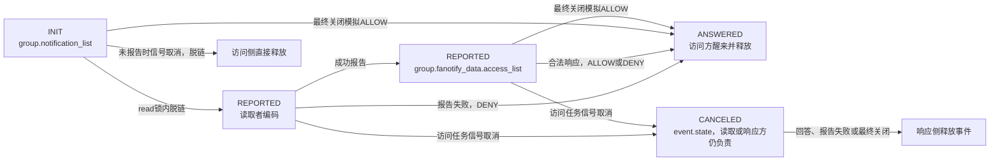
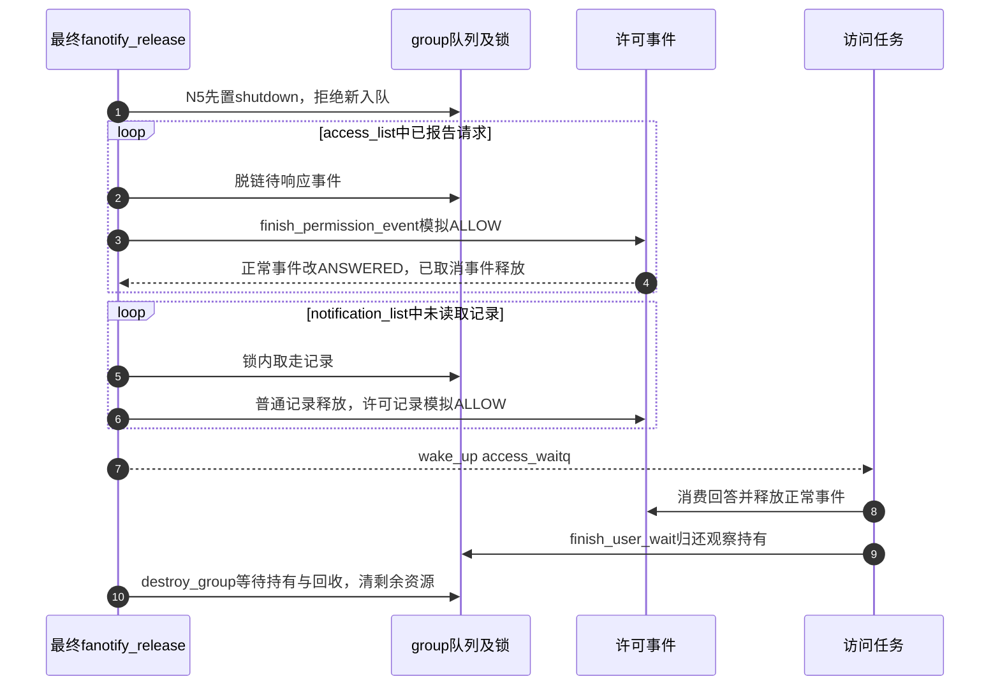

# 第62章\_fanotify响应状态与退出收尾

前篇的访问任务已经把许可请求排队并等待。监听者现在读取它，但“事件已从通知队列取走”还不能释放事件：记录必须继续保存到回答匹配或退出收尾。本篇跟踪同一个事件从notification_list进入access_list，再回到访问任务或由响应方释放的过程。

**讲解层次：实现层，Linux 6.12.20。** 固定提交 `dfaf2136deb2af2e60b994421281ba42f1c087e0`。原件：[fanotify_user.c](../../linux/fs/notify/fanotify/fanotify_user.c)、[fanotify.h](../../linux/fs/notify/fanotify/fanotify.h)、[UAPI fanotify.h](../../linux/include/uapi/linux/fanotify.h)。执行语句保留，中文注释为仓库补充。阶段回链见 [通知导读](../navigation/P19_事件观察与许可响应的交接.md#19.1_沿通知周期定位状态与执行者)，版本入口见 [总索引](../navigation/P01_Linux_6.12_VFS源码阅读索引.md)。本次目标未启用FANOTIFY，本文是可选实现的源码分析。

原件摘要与配置见 [通知源码基线](../../linux/SOURCE_BASELINE.md#1.299_事件观察与许可响应的交接)，应用场景见 [正文通知周期](../../../../knowledge/kernel_subsystems/vfs/P20_fsnotify_inotify与fanotify.md#20.3_从登记到读取追踪同一次变化)。

## 62.1\_报告事件需要新建监听者可用的对象fd

fanotify的通知fd表示监听实例，事件里的fd则表示本条事件关联对象。后者由监听者读取时新建，使用监听者的当前凭据和实例约定的打开标志，并不是把触发任务的原fd数字抄给另一个进程。

```c
/** @brief 仓库补充阅读说明：在队列锁内检查大小并脱链，许可事件立即进入REPORTED状态。 */
static struct fanotify_event *get_one_event(struct fsnotify_group *group,
                                            size_t count)
{
        /* 仓库补充：在队列锁内检查大小并脱链，许可事件立即进入REPORTED状态。 */
        size_t event_size;
        struct fanotify_event *event = NULL;
        struct fsnotify_event *fsn_event;
        unsigned int info_mode = FAN_GROUP_FLAG(group, FANOTIFY_INFO_MODES);
        pr_debug("%s: group=%p count=%zd\n", __func__, group, count);
        spin_lock(&group->notification_lock);
        fsn_event = fsnotify_peek_first_event(group);
        if (!fsn_event)
                goto out;
        event = FANOTIFY_E(fsn_event);
        event_size = fanotify_event_len(info_mode, event);
        if (event_size > count) {
                event = ERR_PTR(-EINVAL);
                goto out;
        }
        fsnotify_remove_first_event(group);
        /* 仓库补充：REPORTED在用户复制之前发布，表达读取方已经接管。 */
        if (fanotify_is_perm_event(event->mask))
                FANOTIFY_PERM(event)->state = FAN_EVENT_REPORTED;
        if (fanotify_is_hashed_event(event->mask))
                fanotify_unhash_event(group, event);
out:
        spin_unlock(&group->notification_lock);
        return event;
}
```

REPORTED在复制以前设置，所以它表示“读取方已接管”，不保证用户已经成功收到记录。这为信号取消方提供判断：一旦进入REPORTED，就不能再把事件当作仍由通知队列独占的INIT对象释放。

```c
/** @brief 仓库补充阅读说明：先预留监听者fd，再按当前凭据打开事件path；失败归还预留编号。 */
static int create_fd(struct fsnotify_group *group, const struct path *path,
                     struct file **file)
{
        /* 仓库补充：先预留监听者fd，再按当前凭据打开事件path；失败归还预留编号。 */
        int client_fd;
        struct file *new_file;
        client_fd = get_unused_fd_flags(group->fanotify_data.f_flags);
        if (client_fd < 0)
                return client_fd;
        /* 仓库补充：使用监听者当前凭据建立新file，不复制触发任务的fd。 */
        new_file = dentry_open(path,
                               group->fanotify_data.f_flags | __FMODE_NONOTIFY,
                               current_cred());
        if (IS_ERR(new_file)) {
                put_unused_fd(client_fd);
                client_fd = PTR_ERR(new_file);
        } else {
                *file = new_file;
        }
        return client_fd;
}
```

dentry_open带__FMODE_NONOTIFY，避免此内部打开按普通路径再次生成同类通知；这并不证明监听程序之后的任意业务访问都不会产生递归依赖。返回成功时file尚未fd_install，编码与复制成功后才发布。

```c
/** @brief 仓库补充阅读说明：构造元数据和可选信息记录，成功复制后安装对象fd及pidfd；失败归还尚未发布的资源。 */
static ssize_t copy_event_to_user(struct fsnotify_group *group,
                                  struct fanotify_event *event,
                                  char __user *buf, size_t count)
{
        /* 仓库补充：构造元数据和可选信息记录，成功复制后安装对象fd及pidfd；失败归还尚未发布的资源。 */
        struct fanotify_event_metadata metadata;
        const struct path *path = fanotify_event_path(event);
        struct fanotify_info *info = fanotify_event_info(event);
        unsigned int info_mode = FAN_GROUP_FLAG(group, FANOTIFY_INFO_MODES);
        unsigned int pidfd_mode = info_mode & FAN_REPORT_PIDFD;
        struct file *f = NULL, *pidfd_file = NULL;
        int ret, pidfd = -ESRCH, fd = -EBADF;
        pr_debug("%s: group=%p event=%p\n", __func__, group, event);
        metadata.event_len = fanotify_event_len(info_mode, event);
        metadata.metadata_len = FAN_EVENT_METADATA_LEN;
        metadata.vers = FANOTIFY_METADATA_VERSION;
        metadata.reserved = 0;
        metadata.mask = event->mask & FANOTIFY_OUTGOING_EVENTS;
        metadata.pid = pid_vnr(event->pid);
        if (FAN_GROUP_FLAG(group, FANOTIFY_UNPRIV) &&
            task_tgid(current) != event->pid)
                metadata.pid = 0;
        if (!FAN_GROUP_FLAG(group, FANOTIFY_UNPRIV) &&
            path && path->mnt && path->dentry) {
                fd = create_fd(group, path, &f);
                if (fd < 0) {
                        pr_debug("fanotify: create_fd(%pd2) failed err=%d\n",
                                 path->dentry, fd);
                        if (!FAN_GROUP_FLAG(group, FAN_REPORT_FD_ERROR)) {
                                if (fd == -EOPENSTALE)
                                        fd = 0;
                                return fd;
                        }
                }
        }
        if (FAN_GROUP_FLAG(group, FAN_REPORT_FD_ERROR))
                metadata.fd = fd;
        else
                metadata.fd = fd >= 0 ? fd : FAN_NOFD;
        if (pidfd_mode) {
                WARN_ON_ONCE(FAN_GROUP_FLAG(group, FAN_REPORT_TID));
                if (metadata.pid && pid_has_task(event->pid, PIDTYPE_TGID))
                        pidfd = pidfd_prepare(event->pid, 0, &pidfd_file);
                if (!FAN_GROUP_FLAG(group, FAN_REPORT_FD_ERROR) && pidfd < 0)
                        pidfd = pidfd == -ESRCH ? FAN_NOPIDFD : FAN_EPIDFD;
        }
        ret = -EFAULT;
        if (WARN_ON_ONCE(metadata.event_len > count))
                goto out_close_fd;
        if (copy_to_user(buf, &metadata, FAN_EVENT_METADATA_LEN))
                goto out_close_fd;
        buf += FAN_EVENT_METADATA_LEN;
        count -= FAN_EVENT_METADATA_LEN;
        if (info_mode) {
                ret = copy_info_records_to_user(event, info, info_mode, pidfd,
                                                buf, count);
                if (ret < 0)
                        goto out_close_fd;
        }
        /* 仓库补充：所有数据复制成功以后才发布预留fd。 */
        if (f)
                fd_install(fd, f);
        if (pidfd_file)
                fd_install(pidfd, pidfd_file);
        if (fanotify_is_perm_event(event->mask))
                FANOTIFY_PERM(event)->fd = fd;
        return metadata.event_len;
out_close_fd:
        if (f) {
                put_unused_fd(fd);
                fput(f);
        }
        if (pidfd_file) {
                put_unused_fd(pidfd);
                fput(pidfd_file);
        }
        return ret;
}
```

event_len是整个记录长度，metadata_len是固定元数据长度，vers标明ABI版本。普通path模式可报告新fd，FID模式通过附加记录给对象句柄；受限非特权模式不提供其他任务的pid及对象fd。FAN_REPORT_FD_ERROR决定某些失败是以负错误码报告还是采用既有特殊值与返回行为，不能只检查“fd不等于FAN_NOFD”就认为可用。

copy_info_records_to_user按实例的报告模式编码文件句柄、名字、pidfd或文件系统错误等附加记录，返回实际字节数或错误；它不替调用者安装fd。本文保持该编码器为辅助契约，未展开每种记录格式算法；本地UAPI头保留类型与布局供核对。许可主线使用PATH_PERM及响应fd，不依赖FID扩展的内部布局推理。


## 62.2\_读出消息以后仍要保存待响应记录

成功复制只是把请求交给监听者，还没有取得允许或拒绝。读取路径因此需要根据事件类型和报告结果，将记录交给正确的后续责任方。

```c
/** @brief 仓库补充阅读说明：普通记录读后释放，许可记录成功报告后进入待响应链，报告失败则完成拒绝响应。 */
static ssize_t fanotify_read(struct file *file, char __user *buf,
                             size_t count, loff_t *pos)
{
        /* 仓库补充：普通记录读后释放，许可记录成功报告后进入待响应链，报告失败则完成拒绝响应。 */
        struct fsnotify_group *group;
        struct fanotify_event *event;
        char __user *start;
        int ret;
        DEFINE_WAIT_FUNC(wait, woken_wake_function);
        start = buf;
        group = file->private_data;
        pr_debug("%s: group=%p\n", __func__, group);
        add_wait_queue(&group->notification_waitq, &wait);
        while (1) {
                cond_resched();
                event = get_one_event(group, count);
                if (IS_ERR(event)) {
                        ret = PTR_ERR(event);
                        break;
                }
                if (!event) {
                        ret = -EAGAIN;
                        if (file->f_flags & O_NONBLOCK)
                                break;
                        ret = -ERESTARTSYS;
                        if (signal_pending(current))
                                break;
                        if (start != buf)
                                break;
                        wait_woken(&wait, TASK_INTERRUPTIBLE, MAX_SCHEDULE_TIMEOUT);
                        continue;
                }
                ret = copy_event_to_user(group, event, buf, count);
                if (!fanotify_is_perm_event(event->mask)) {
                        fsnotify_destroy_event(group, &event->fse);
                } else {
                        /* 仓库补充：无法成功报告许可对象时形成DENY并唤醒访问方。 */
                        if (ret <= 0 || FANOTIFY_PERM(event)->fd < 0) {
                                spin_lock(&group->notification_lock);
                                finish_permission_event(group,
                                        FANOTIFY_PERM(event), FAN_DENY, NULL);
                                wake_up(&group->fanotify_data.access_waitq);
                        } else {
                                spin_lock(&group->notification_lock);
                                list_add_tail(&event->fse.list,
                                        &group->fanotify_data.access_list);
                                spin_unlock(&group->notification_lock);
                        }
                }
                if (ret < 0)
                        break;
                buf += ret;
                count -= ret;
        }
        remove_wait_queue(&group->notification_waitq, &wait);
        if (start != buf && ret != -EFAULT)
                ret = buf - start;
        return ret;
}
```

读取许可记录失败或得到不可用事件fd时，finish_permission_event写DENY并唤醒访问任务；成功后把同一个fse.list接入access_list。这个节点已从notification_list移除，不能同时存在两条链里。读取循环中cond_resched为长批次提供调度机会，并不表示每条消息由新的任务处理。

## 62.3\_回答与取消决定谁释放事件

访问任务可能在监听者判断期间被信号中断。若响应方总是释放，正常访问任务会读已释放内存；若始终由访问方释放，已经取消离开的任务又不会回来。因此需要按CANCELED区分最终释放责任。

```c
/** @brief 仓库补充阅读说明：在队列锁内发布回答；已取消事件由本路径释放，否则交给被唤醒访问方。 */
static void finish_permission_event(struct fsnotify_group *group,
                                    struct fanotify_perm_event *event, u32 response,
                                    struct fanotify_response_info_audit_rule *friar)
                                    __releases(&group->notification_lock)
{
        /* 仓库补充：在队列锁内发布回答；已取消事件由本路径释放，否则交给被唤醒访问方。 */
        bool destroy = false;
        assert_spin_locked(&group->notification_lock);
        event->response = response & ~FAN_INFO;
        if (response & FAN_INFO)
                memcpy(&event->audit_rule, friar, sizeof(*friar));
        /* 仓库补充：取消方已经离开，由响应侧析构；正常回答留给访问方消费。 */
        if (event->state == FAN_EVENT_CANCELED)
                destroy = true;
        else
                event->state = FAN_EVENT_ANSWERED;
        spin_unlock(&group->notification_lock);
        if (destroy)
                fsnotify_destroy_event(group, &event->fae.fse);
}
```

函数接收的是已持有notification_lock的调用，内部实际spin_unlock；__releases只是描述这项契约。调用者后续若还要访问受锁保护的链，必须重新加锁。response去掉FAN_INFO后保存，附加审计字段在指定时复制；正常事件改ANSWERED，已CANCELED事件不再等待一个不会回来的访问方。



图中ANSWERED不是独立队列名，而是已发布的回答状态；access_list与notification_list是实际链表。CANCELED可能发生在读取者还未接入access_list时，读取者仍按成功或失败分支完成后续交接，所以不能仅根据“access_list里找不到”判断事件已不存在。

```c
/** @brief 仓库补充阅读说明：验证响应后按事件fd查待响应链，移除匹配项并完成回答，最后唤醒访问任务。 */
static int process_access_response(struct fsnotify_group *group,
                                   struct fanotify_response *response_struct,
                                   const char __user *info,
                                   size_t info_len)
{
        /* 仓库补充：验证响应后按事件fd查待响应链，移除匹配项并完成回答，最后唤醒访问任务。 */
        struct fanotify_perm_event *event;
        int fd = response_struct->fd;
        u32 response = response_struct->response;
        int ret = info_len;
        struct fanotify_response_info_audit_rule friar;
        pr_debug("%s: group=%p fd=%d response=%u buf=%p size=%zu\n", __func__,
                 group, fd, response, info, info_len);
        if (response & ~FANOTIFY_RESPONSE_VALID_MASK)
                return -EINVAL;
        switch (response & FANOTIFY_RESPONSE_ACCESS) {
        case FAN_ALLOW:
        case FAN_DENY:
                break;
        default:
                return -EINVAL;
        }
        if ((response & FAN_AUDIT) && !FAN_GROUP_FLAG(group, FAN_ENABLE_AUDIT))
                return -EINVAL;
        if (response & FAN_INFO) {
                ret = process_access_response_info(info, info_len, &friar);
                if (ret < 0)
                        return ret;
                if (fd == FAN_NOFD)
                        return ret;
        } else {
                ret = 0;
        }
        if (fd < 0)
                return -EINVAL;
        spin_lock(&group->notification_lock);
        list_for_each_entry(event, &group->fanotify_data.access_list,
                            fae.fse.list) {
                if (event->fd != fd)
                        continue;
                /* 仓库补充：先从待响应链取走，再发布回答；finish会消费当前锁持有。 */
                list_del_init(&event->fae.fse.list);
                finish_permission_event(group, event, response, &friar);
                wake_up(&group->fanotify_data.access_waitq);
                return ret;
        }
        spin_unlock(&group->notification_lock);
        return -ENOENT;
}
```

响应中的fd是此前报告的关联键，查找发生在本group.access_list；不是重新对该整数fdget再判断当前指向什么。应用应按协议回答并关闭事件fd，不能先关闭又任意复用编号，把本应单一的对应关系弄混。普通响应找不到记录返回ENOENT，非法值返回EINVAL。

FAN_INFO额外响应信息有类型、长度和填充验证；配合FAN_NOFD时存在仅处理这类信息的专门分支，不能从通常许可回答规则推导所有write都必须命中一个待响应事件。FAN_AUDIT还要求实例允许审计。

```c
/** @brief 仓库补充阅读说明：从用户缓冲取得响应头并处理可选信息，返回本次实际消费的响应字节数。 */
static ssize_t fanotify_write(struct file *file, const char __user *buf, size_t count, loff_t *pos)
{
        /* 仓库补充：从用户缓冲取得响应头并处理可选信息，返回本次实际消费的响应字节数。 */
        struct fanotify_response response;
        struct fsnotify_group *group;
        int ret;
        const char __user *info_buf = buf + sizeof(struct fanotify_response);
        size_t info_len;
        if (!IS_ENABLED(CONFIG_FANOTIFY_ACCESS_PERMISSIONS))
                return -EINVAL;
        group = file->private_data;
        pr_debug("%s: group=%p count=%zu\n", __func__, group, count);
        if (count < sizeof(response))
                return -EINVAL;
        if (copy_from_user(&response, buf, sizeof(response)))
                return -EFAULT;
        info_len = count - sizeof(response);
        ret = process_access_response(group, &response, info_buf, info_len);
        if (ret < 0)
                count = ret;
        else
                count = sizeof(response) + ret;
        return count;
}
```

这个write一次处理一个响应头及其信息，不是无条件接受缓冲中的任意多条结构。未配置FANOTIFY_ACCESS_PERMISSIONS时返回EINVAL。process_access_response注释中的timeout不代表实际存在自动超时；等待实现已在 [许可等待](P61_fanotify许可等待与观察持有.md#61.4_回答与信号竞态决定事件由谁释放)逐行确认。

## 62.4\_监听者退出必须处理两处未完成请求

最后一个通知file释放时，用户已经不能继续通过它读取或回答。若只清通知队列，已经读出的access_list请求会永久等待；若只清access_list，尚未读出的INIT请求也无法完成。退出因此遍历两处状态，并先shutdown阻止新请求继续进入。

```c
/** @brief 仓库补充阅读说明：停止入队，分别收尾已报告和未报告请求，模拟允许并唤醒等待者，再销毁group。 */
static int fanotify_release(struct inode *ignored, struct file *file)
{
        /* 仓库补充：停止入队，分别收尾已报告和未报告请求，模拟允许并唤醒等待者，再销毁group。 */
        struct fsnotify_group *group = file->private_data;
        struct fsnotify_event *fsn_event;
        fsnotify_group_stop_queueing(group);
        spin_lock(&group->notification_lock);
        while (!list_empty(&group->fanotify_data.access_list)) {
                struct fanotify_perm_event *event;
                event = list_first_entry(&group->fanotify_data.access_list,
                                struct fanotify_perm_event, fae.fse.list);
                list_del_init(&event->fae.fse.list);
                /* 仓库补充：最后通知file退出模拟允许，不能概括为默认拒绝。 */
                finish_permission_event(group, event, FAN_ALLOW, NULL);
                spin_lock(&group->notification_lock);
        }
        while ((fsn_event = fsnotify_remove_first_event(group))) {
                struct fanotify_event *event = FANOTIFY_E(fsn_event);
                if (!(event->mask & FANOTIFY_PERM_EVENTS)) {
                        spin_unlock(&group->notification_lock);
                        fsnotify_destroy_event(group, fsn_event);
                } else {
                        finish_permission_event(group, FANOTIFY_PERM(event),
                                                FAN_ALLOW, NULL);
                }
                spin_lock(&group->notification_lock);
        }
        spin_unlock(&group->notification_lock);
        wake_up(&group->fanotify_data.access_waitq);
        fsnotify_destroy_group(group);
        return 0;
}
```



步骤3和6明确使用ALLOW，所以不能把监听程序死亡自动等同于访问被拒绝。步骤10仍需公共group退出协议，模拟回答不能直接代替mark、SRCU和user_waits收尾。关闭某个重复fd不一定触发这张图，条件是对应通知file最终release。

## 62.5\_报告能力与生命周期要分别验收

| 状态、方法或配置 | 声明与使用边界 |
| --- | --- |
| fanotify_group_private_data | fsnotify_backend.h声明access_list、access_waitq、merge_hash、flags、f_flags、ucounts等；实例建立初始化，读写与退出使用 |
| fanotify_perm_event.fd/state/response | fd由成功报告路径保存，state在队列锁下交接，response先于ANSWERED发布；访问方按等待条件消费 |
| fanotify_init / do_fanotify_mark | fanotify_user.c验证类别、标记范围及报告组合；非特权有受限通知模式，但不能据此取得许可类别或mount/sb标记能力 |
| FAN_CLASS_NOTIF / CONTENT / PRE_CONTENT | 不同实例类别影响优先级和许可能力；FID报告要求NOTIF类别，不能把所有flags任意拼接 |
| get_unused_fd_flags / fd_install / put_unused_fd | 分别预留、发布和撤销未发布编号；失败还要fput新file，pidfd有相同配对责任 |
| fanotify_event_len / copy_info_records_to_user | 计算完整记录和编码可选信息；前者与后者必须同一布局，WARN长度不符后走失败清理 |
| fanotify_free_event | 按事件类型归还path、pid、句柄扩展和slab等资源；fsnotify_destroy_event是公共入口，不能把kfree当成所有后端统一替代 |
| AUDIT / FAN_ENABLE_AUDIT | 决定审计支持和实例允许的响应附加位；不改变本篇ALLOW/DENY与释放责任的基本区分 |

本篇只展开许可响应所需的读取、fd建立、响应和退出函数。实例参数验证、普通FID/错误事件编码及哈希合并通过上述明确契约和原件定位，不把它们伪装成已经逐句讲解；要修改这些能力，必须扩展对应实现讲解与配置验证。

修改许可状态时，应同时验证正常允许/拒绝、复制失败、事件fd建立失败、REPORTED取消、回答与信号竞争、无效响应以及最后file关闭。尤其要维持“每个普通事件最终只由一个路径释放、两个队列互斥使用同一节点、每次finish消费一次已持锁状态”三项不变量。它们比函数名中有没有finish更能说明代码是否正确。
