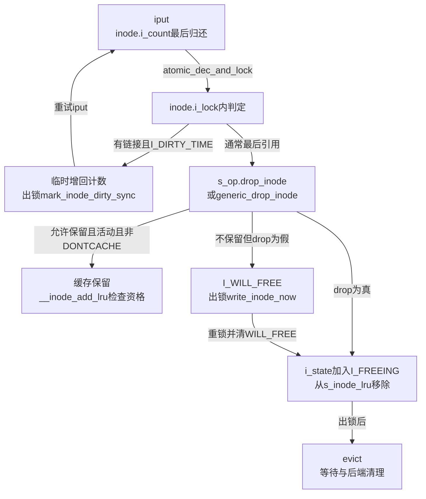
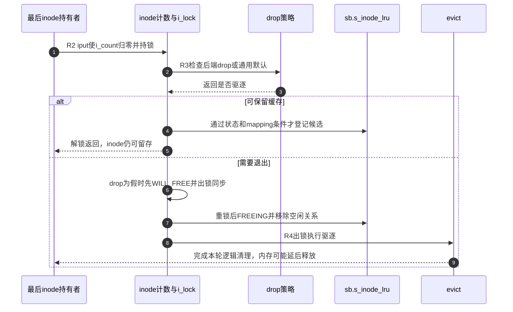

# 第63章\_最后inode引用与缓存保留

file最终清理和dentry释放会逐步归还inode使用持有，但inode引用归零以后仍要选择缓存或驱逐。它既不能在还有使用者时被回收，也不应仅为节省一次分支就把可复用缓存全部销毁。本篇从iput最后归还进入这一决策，后篇再处理真正驱逐与扫描。

**讲解层次：实现层，Linux 6.12.20。** 固定提交 `dfaf2136deb2af2e60b994421281ba42f1c087e0`。原件：[inode.c](../../linux/fs/inode.c)、[fs.h](../../linux/include/linux/fs.h)、[pagemap.h](../../linux/include/linux/pagemap.h)、[ext4/super.c](../../linux/fs/ext4/super.c)。执行语句保留，中文注释为仓库补充。阶段入口为 [对象回收导读](../navigation/P20_对象退出与缓存回收的条件.md#20.1_按退出阶段找持有与状态)，来源总入口为 [VFS索引](../navigation/P01_Linux_6.12_VFS源码阅读索引.md)。本篇聚焦R2最后使用归还到R3缓存判断，以及转交R4驱逐的条件。

原件摘要与配置见 [对象回收源码基线](../../linux/SOURCE_BASELINE.md#1.300_对象退出与缓存回收的条件)，应用场景见 [正文退出周期](../../../../knowledge/kernel_subsystems/vfs/P21_file_dentry_inode与superblock回收.md#21.3_用同一次退出串起六个阶段)。

## 63.1\_最后使用引用先进入缓存或驱逐决策

inode_init_always_gfp在每次初始化时把i_count设为1、i_state清零并记录i_sb；i_nlink初值随后还要由具体创建或加载路径建立实际含义。i_count的额外持有和归还使用独立协议，不能直接用硬链接数代替。

```c
/** @brief 仓库补充阅读说明：调用方已持有效inode引用时增加使用计数，告警不代替调用前提。 */
void ihold(struct inode *inode)
{
        /* 仓库补充：调用方已持有效inode引用时增加使用计数，告警不代替调用前提。 */
        /* 仓库补充：调用前已有有效持有；告警发生在增加之后，不是安全试取。 */
        WARN_ON(atomic_inc_return(&inode->i_count) < 2);
}
```

ihold不能从任意历史裸指针复活inode。它的WARN检查增加后的计数应至少为2，但已经执行了计数增加；不能把它当作安全的“试着获取”接口。对象查找方须使用相应锁和查找协议取得初始使用责任。

```c
/** @brief 仓库补充阅读说明：归还使用计数，最后一份在i_lock下检查lazytime状态并进入最终决策。 */
void iput(struct inode *inode)
{
        /* 仓库补充：归还使用计数，最后一份在i_lock下检查lazytime状态并进入最终决策。 */
        if (!inode)
                return;
        BUG_ON(inode->i_state & I_CLEAR);
retry:
        if (atomic_dec_and_lock(&inode->i_count, &inode->i_lock)) {
                /* 仓库补充：时间戳脏状态需临时恢复使用计数，出锁登记后重新归还。 */
                if (inode->i_nlink && (inode->i_state & I_DIRTY_TIME)) {
                        atomic_inc(&inode->i_count);
                        spin_unlock(&inode->i_lock);
                        trace_writeback_lazytime_iput(inode);
                        mark_inode_dirty_sync(inode);
                        goto retry;
                }
                /* 仓库补充：只有最后引用且完成必要重试后进入缓存决策。 */
                iput_final(inode);
        }
}
```

atomic_dec_and_lock把“可能归零”和取得i_lock连接起来，避免在零计数决策窗口与重新取得使用者各自作出冲突判断。若仍有链接且带有I_DIRTY_TIME，函数暂时把计数增回，出锁登记需要同步的inode脏状态，然后重试归还；这个条件并不要求其他脏标志全部为零。这不是用户重新open，也不是销毁失败后复活已经释放的对象。

```c
/** @brief 仓库补充阅读说明：在最后引用的锁内选择保留或驱逐，必要时先写回，再发布FREEING并转交evict。 */
static void iput_final(struct inode *inode)
{
        /* 仓库补充：在最后引用的锁内选择保留或驱逐，必要时先写回，再发布FREEING并转交evict。 */
        struct super_block *sb = inode->i_sb;
        const struct super_operations *op = inode->i_sb->s_op;
        unsigned long state;
        int drop;
        WARN_ON(inode->i_state & I_NEW);
        if (op->drop_inode)
                drop = op->drop_inode(inode);
        else
                drop = generic_drop_inode(inode);
        /* 仓库补充：只有策略、缓存标志与实例活动状态都允许才保留。 */
        if (!drop &&
            !(inode->i_state & I_DONTCACHE) &&
            (sb->s_flags & SB_ACTIVE)) {
                __inode_add_lru(inode, true);
                spin_unlock(&inode->i_lock);
                return;
        }
        state = inode->i_state;
        if (!drop) {
                /* 仓库补充：先标记退出意图，再放锁做同步写回。 */
                WRITE_ONCE(inode->i_state, state | I_WILL_FREE);
                spin_unlock(&inode->i_lock);
                write_inode_now(inode, 1);
                spin_lock(&inode->i_lock);
                state = inode->i_state;
                WARN_ON(state & I_NEW);
                state &= ~I_WILL_FREE;
        }
        /* 仓库补充：在锁内发布最终驱逐约束，随后撤销LRU关系。 */
        WRITE_ONCE(inode->i_state, state | I_FREEING);
        if (!list_empty(&inode->i_lru))
                inode_lru_list_del(inode);
        spin_unlock(&inode->i_lock);
        evict(inode);
}
```

保留分支要求drop为假、没有I_DONTCACHE、superblock仍SB_ACTIVE；随后调用__inode_add_lru并解锁。即使该辅助函数因脏页等条件未实际入LRU，inode也可以继续留在缓存，由后续清脏或页缓存变化重新取得候选资格。

若不保留而drop仍为假，先设I_WILL_FREE，出锁调用write_inode_now(inode,1)，再重锁清WILL_FREE并进入FREEING。该辅助在fs/fs-writeback.c构造WB_SYNC_ALL的writeback_control并调用writeback_single_inode；若mapping不能写回，页写入预算设为零，仍按相应inode清理协议处理。此处不以该调用的返回值恢复正常缓存路径，不能描述成“同步失败就自动保留inode”。最后设置I_FREEING与移出LRU在i_lock保护下配对，出锁后才执行可能等待的evict。



图中缓存保留与LRU资格是两个节点层次。i_state同时承载脏、写回和退出等多种标志，不应把它们强行排成一个互斥枚举；I_WILL_FREE和I_FREEING则为正在退出的窗口提供具体约束。

## 63.2\_文件系统可以决定哪些对象值得继续缓存

通用默认判断依据是链接和inode哈希可达性：没有目录链接，或已经不在正常inode哈希里时，继续保留通常无法服务下一次正常查找。但文件系统可以覆盖这个策略，不能把默认表达式写成所有后端的唯一规则。

```c
/** @brief 仓库补充阅读说明：通用默认要求无链接或已脱离inode哈希的对象进入驱逐。 */
static inline int generic_drop_inode(struct inode *inode)
{
        /* 仓库补充：通用默认要求无链接或已脱离inode哈希的对象进入驱逐。 */
        /* 仓库补充：无链接或已脱离正常inode哈希时采用通用驱逐策略。 */
        return !inode->i_nlink || inode_unhashed(inode);
}
```

```c
/** @brief 仓库补充阅读说明：先采用通用判断，再由可选加密状态补充驱逐要求。 */
static int ext4_drop_inode(struct inode *inode)
{
        /* 仓库补充：先采用通用判断，再由可选加密状态补充驱逐要求。 */
        int drop = generic_drop_inode(inode);
        /* 仓库补充：通用策略允许保留时，再询问可选加密状态。 */
        if (!drop)
                drop = fscrypt_drop_inode(inode);
        trace_ext4_drop_inode(inode, drop);
        return drop;
}
```

ext4_sops在ext4/super.c把drop_inode绑定到这个函数。本次配置关闭FS_ENCRYPTION，所以fscrypt_drop_inode在该配置下不增加驱逐要求；启用加密时要继续核对其密钥和inode状态，不把当前关闭配置的结果外推。trace_ext4_drop_inode记录已得到的结论，不负责产生drop。

**可修改性：** 改drop策略会影响缓存命中、同步时点和后端evict频率。drop回调在iput_final持i_lock的上下文调用，不能直接在这里随意睡眠或等待会重新取得i_lock的工作。必须同步检查DONTCACHE、实例关闭和无链接文件三条入口，避免只以“更少缓存”评价正确性。

## 63.3\_缓存保留不等于马上进入空闲LRU

LRU是可供扫描的候选集合。仍脏、正在同步、正退出或当前又有使用引用的inode，不应作为普通空闲对象交给扫描；页缓存状况也会影响是否值得先回收inode结构。

```c
/** @brief 仓库补充阅读说明：检查状态、使用计数、实例活动和mapping资格，符合条件才登记空闲候选。 */
static void __inode_add_lru(struct inode *inode, bool rotate)
{
        /* 仓库补充：检查状态、使用计数、实例活动和mapping资格，符合条件才登记空闲候选。 */
        /* 仓库补充：脏、同步和退出中的对象暂不作为普通空闲候选。 */
        if (inode->i_state & (I_DIRTY_ALL | I_SYNC | I_FREEING | I_WILL_FREE))
                return;
        if (atomic_read(&inode->i_count))
                return;
        if (!(inode->i_sb->s_flags & SB_ACTIVE))
                return;
        if (!mapping_shrinkable(&inode->i_data))
                return;
        /* 仓库补充：实际新入链才增加空闲统计；既有候选可标记近期使用。 */
        if (list_lru_add_obj(&inode->i_sb->s_inode_lru, &inode->i_lru))
                this_cpu_inc(nr_unused);
        else if (rotate)
                inode->i_state |= I_REFERENCED;
}
```

首次成功接入list_lru增加nr_unused；已经在链上且本次要求rotate时设置I_REFERENCED，让扫描方知道它最近被用过。这里没有每次都搬动链节点，后面的扫描会清该标志并给第二次机会，所以链表顺序并非严格逐次访问排序。

```c
/** @brief 仓库补充阅读说明：按HIGHMEM配置和页缓存索引状态判断inode是否适合作为空闲扫描候选。 */
static inline bool mapping_shrinkable(struct address_space *mapping)
{
        /* 仓库补充：按HIGHMEM配置和页缓存索引状态判断inode是否适合作为空闲扫描候选。 */
        void *head;
        /* 仓库补充：HIGHMEM下允许先处理页缓存以回收低端内存中的inode。 */
        if (IS_ENABLED(CONFIG_HIGHMEM))
                return true;
        head = rcu_access_pointer(mapping->i_pages.xa_head);
        if (!head)
                return true;
        if (!xa_is_node(head) && xa_is_value(head))
                return true;
        return false;
}
```

当前ARM配置开启CONFIG_HIGHMEM。inode结构使用的低端内存可能先紧张，而文件页位于高端内存，于是即使mapping中仍有页，也允许inode进入扫描候选；扫描方随后尝试处理关联缓存。没有HIGHMEM时，空XArray或直接存于头部的非驻留value符合这里条件；普通含页索引不会仅因i_count为零就自动符合。

mapping_shrinkable没有取得i_pages锁，不能把它的返回值当作永久缓存快照。页插入可并发改变mapping，扫描方还会核对引用和近期使用状态；页删除与inode重新入LRU也有相应i_lock协议。这个局部宽松判断依赖后续复查，不能脱离整个链单独使用。



步骤4不是无条件入队；步骤6只在drop为假却不能保留时执行同步，drop为真直接走FREEING。步骤9的返回不证明RCU回调已执行，后篇会继续追踪释放方法。

## 63.4\_字段\_检查动作与最小修改范围

| 符号或实现簇 | 声明、写读与配对 |
| --- | --- |
| inode.i_count / i_state / i_lock | fs.h声明；inode_init_always_gfp建立初值，持有路径改计数，iput与扫描在锁内判断退出资格 |
| inode.i_nlink | 文件系统名称更新路径通过链接数辅助维护；不是iput递减的计数，也不是打开fd个数 |
| inode.i_lru / sb.s_inode_lru | 对象节点与实例候选集合；__inode_add_lru加入，inode_lru_list_del移出并维护nr_unused |
| nr_inodes / nr_unused | inode.c每CPU统计，初始化与最终销毁、LRU增删维护；不决定某个对象能否释放 |
| inode_unhashed / mapping_shrinkable | 分别检查inode哈希关系和页缓存候选条件，不同索引不可混用 |
| mark_inode_dirty_sync / write_inode_now | 前者登记需同步的脏状态，后者发起同步写回；不是同一个动作，脏状态登记与写回过程见 [写回责任交接](P37_脏状态登记与写回调度.md#37.4_清理旧责任之后怎样保住并发重脏) |
| BUG_ON / WARN_ON / trace | BUG_ON检测已CLEAR对象仍被put等严重前提破坏；WARN和trace不会替调用者补引用、完成写回或修复计数 |

若修改引用策略，要把查找取得、dentry持有、通知持有和最后归还连起来核对；若修改空闲策略，要同时检查页缓存变化、写回完成和 [扫描复查](P65_空闲inode扫描与卸载驱逐.md#65.2_扫描候选仍要重新检查引用与缓存)。文件系统私有evict与最终内存析构接着由 [驱逐实现](P64_inode驱逐与最终释放.md#64.1_先退出工作集合再让后端清理)解释。当前没有缓存压力或故障注入实测，普通unlink实验只能验证上层持有语义。
