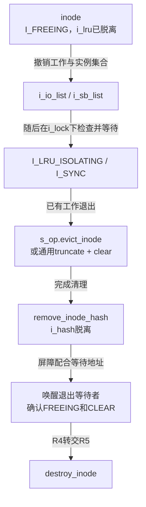
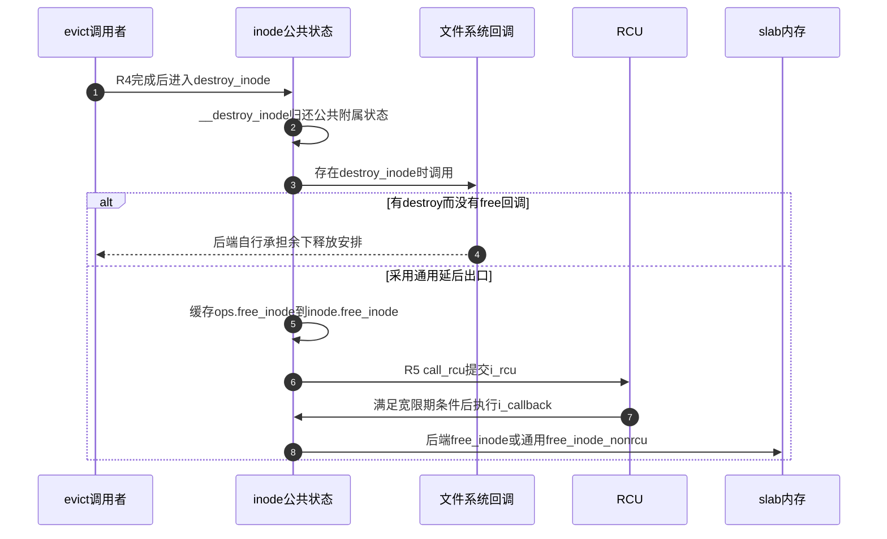

# 第64章\_inode驱逐与最终释放

前篇已经把最后使用引用与缓存保留分开。现在假定某个inode确实需要驱逐：它已经设置I_FREEING并退出空闲LRU，但写回执行者、临时隔离者和无锁观察者可能还没有全部离开。直接释放结构会让这些路径访问失效内存，因此清理必须分成退出工作集合、完成后端清理和最终归还内存。

**讲解层次：实现层，Linux 6.12.20。** 固定提交 `dfaf2136deb2af2e60b994421281ba42f1c087e0`。原件：[inode.c](../../linux/fs/inode.c)、[fs.h](../../linux/include/linux/fs.h)、[ext4/super.c](../../linux/fs/ext4/super.c)、[ext4/inode.c](../../linux/fs/ext4/inode.c)、[ext4.h](../../linux/fs/ext4/ext4.h)。中文说明与注释为仓库补充，执行语句保留。阶段入口为 [对象回收导读](../navigation/P20_对象退出与缓存回收的条件.md#20.1_按退出阶段找持有与状态)，总入口为 [VFS源码索引](../navigation/P01_Linux_6.12_VFS源码阅读索引.md)。本篇展开R4与R5，不重复file和dentry的引用归还函数。

原件摘要与配置见 [对象回收源码基线](../../linux/SOURCE_BASELINE.md#1.300_对象退出与缓存回收的条件)，应用场景见 [正文退出周期](../../../../knowledge/kernel_subsystems/vfs/P21_file_dentry_inode与superblock回收.md#21.3_用同一次退出串起六个阶段)。

## 64.1\_先退出工作集合再让后端清理

I_FREEING是退出约束，不是“结构已经释放”。调用者先设置它并移除空闲候选，使正常扫描与写回路径不会把对象当作新的工作重新接入；evict再等待已经进入的工作退出。先阻止新增、再等已有责任结束，才能给后端一个可以清理的对象。

```c
/** @brief 仓库补充阅读说明：在FREEING且已退出LRU的前提下等待隔离与写回，完成后端清理后解除哈希并转交销毁。 */
static void evict(struct inode *inode)
{
        /* 仓库补充：在FREEING且已退出LRU的前提下等待隔离与写回，完成后端清理后解除哈希并转交销毁。 */
        const struct super_operations *op = inode->i_sb->s_op;
        BUG_ON(!(inode->i_state & I_FREEING));
        BUG_ON(!list_empty(&inode->i_lru));
        if (!list_empty(&inode->i_io_list))
                inode_io_list_del(inode);
        inode_sb_list_del(inode);
        spin_lock(&inode->i_lock);
        /* 仓库补充：等待扫描者锁外处理窗口结束。 */
        inode_wait_for_lru_isolating(inode);
        /* 仓库补充：FREEING阻止新增写回，再等待已进入的工作退出。 */
        inode_wait_for_writeback(inode);
        spin_unlock(&inode->i_lock);
        /* 仓库补充：有后端回调由其兑现清理契约，否则采用通用清理。 */
        if (op->evict_inode) {
                op->evict_inode(inode);
        } else {
                truncate_inode_pages_final(&inode->i_data);
                clear_inode(inode);
        }
        if (S_ISCHR(inode->i_mode) && inode->i_cdev)
                cd_forget(inode);
        remove_inode_hash(inode);
        spin_lock(&inode->i_lock);
        /* 仓库补充：与等待登记配对，避免撤销哈希和唤醒之间丢失退出通知。 */
        smp_mb();
        inode_wake_up_bit(inode, __I_NEW);
        BUG_ON(inode->i_state != (I_FREEING | I_CLEAR));
        spin_unlock(&inode->i_lock);
        destroy_inode(inode);
}
```

inode_io_list_del撤销写回调度链，inode_sb_list_del撤销实例的inode集合关系。它们分别作用于i_io_list与i_sb_list，不能用一个“摘链”词掩盖两个索引。inode_wait_for_lru_isolating等待扫描者临时放锁处理缓存的窗口；inode_wait_for_writeback等待已经进行的I_SYNC工作。等待辅助会按协议释放并重新取得i_lock，因此这里不等于持自旋锁忙等整个磁盘操作。

随后优先调用文件系统evict_inode；没有该回调才走truncate_inode_pages_final与clear_inode。专用回调须兑现相应清理契约，不能因为通用分支存在就以为后端可以跳过页缓存与inode清理。字符设备还需cd_forget撤销与cdev的关联。

最后remove_inode_hash撤销inode哈希关系，重取i_lock并用屏障和唤醒配合等待者。这里调用inode_wake_up_bit(__I_NEW)是使用对应等待地址唤醒退出相关等待者，并没有把inode改回I_NEW；退出等待方还会检查哈希是否已经撤销，不能仅从函数参数推测状态写入。BUG_ON确认剩下的状态恰为I_FREEING | I_CLEAR，但断言本身不负责完成清理。



图中的两条集合关系都在等待之前退出；后端调用发生在i_lock外。若把后端清理提前到等待之前，就会让正在使用mapping或后端私有状态的执行者与销毁重叠。这是修改顺序时必须保留的因果约束。

## 64.2\_清理完成标志不能代替实际清理

clear_inode检查调用者是否已经兑现清理责任，再发布I_CLEAR。它不会替后端把所有页和私有链自动清空。

```c
/** @brief 仓库补充阅读说明：同步页索引末次删除并检查清理前提，然后把退出状态收敛为FREEING与CLEAR。 */
void clear_inode(struct inode *inode)
{
        /* 仓库补充：同步页索引末次删除并检查清理前提，然后把退出状态收敛为FREEING与CLEAR。 */
        /* 仓库补充：与最后页删除同步；没有驻留页不等于索引节点绝对为空。 */
        xa_lock_irq(&inode->i_data.i_pages);
        BUG_ON(inode->i_data.nrpages);
        xa_unlock_irq(&inode->i_data.i_pages);
        BUG_ON(!list_empty(&inode->i_data.i_private_list));
        BUG_ON(!(inode->i_state & I_FREEING));
        BUG_ON(inode->i_state & I_CLEAR);
        BUG_ON(!list_empty(&inode->i_wb_list));
        /* 仓库补充：前置清理完成以后才发布CLEAR，本行不代替实际资源清理。 */
        inode->i_state = I_FREEING | I_CLEAR;
}
```

先取再放i_pages的XArray锁，是与可能正在移除最后一页的回收路径同步；nrpages必须为零。这里刻意没有断言mapping_empty，因为该版本记录了索引节点残留的已知情形；不能把“没有驻留页”与“XArray内部结构绝对为空”混成一个条件。

i_private_list与i_wb_list也必须为空，且已经FREEING、尚未CLEAR。满足退出协议以后不再有并发状态修改，所以此处直接写i_state，而不是补一把锁来掩盖调用前提不成立。若只手工设置I_CLEAR而不清缓存，后面的析构仍可能触碰未完成的责任。

以ext4为例，ext4_sops的evict_inode指向ext4_evict_inode。该函数在仍有链接时也会截断内核页缓存并进入no_delete清理；这条路径是在驱逐缓存inode，磁盘文件仍在。无链接分支才进一步涉及日志事务、块与扩展属性清理、孤儿记录和配额等责任。日志启动、元数据写入还存在错误出口，所以通用evict返回不能证明磁盘数据已经持久擦除。

本篇只核对这个回调的调用契约与两种退出边界，不展开ext4磁盘格式和日志删除算法。原件的ext4_evict_inode是后端继续阅读入口；用户截断如何撤销页缓存与映射，见 [截断与页缓存撤销](P50_映射同步与截断撤销.md#50.2_截断在缓存删除前后各撤销一次页表)。这里的内核缓存驱逐与truncate改变文件长度也不是同一个用户动作。

## 64.3\_公共析构与最终内存归还分别交接

inode中除文件系统私有数据外，还有通知、锁上下文、ACL缓存和写回关联。释放结构前先归还这些公共责任，再由后端回调组合决定最终内存出口。

```c
/** @brief 仓库补充阅读说明：清理公共附属状态及统计，再由外层选择后端析构与内存释放方式。 */
void __destroy_inode(struct inode *inode)
{
        /* 仓库补充：清理公共附属状态及统计，再由外层选择后端析构与内存释放方式。 */
        BUG_ON(inode_has_buffers(inode));
        inode_detach_wb(inode);
        security_inode_free(inode);
        fsnotify_inode_delete(inode);
        locks_free_lock_context(inode);
        /* 仓库补充：无链接登记随公共析构归还，告警不阻止后续减计数。 */
        if (!inode->i_nlink) {
                WARN_ON(atomic_long_read(&inode->i_sb->s_remove_count) == 0);
                atomic_long_dec(&inode->i_sb->s_remove_count);
        }
/* 仓库补充：只归还真实ACL缓存引用，跳过未缓存哨兵。 */
#ifdef CONFIG_FS_POSIX_ACL
        if (inode->i_acl && !is_uncached_acl(inode->i_acl))
                posix_acl_release(inode->i_acl);
        if (inode->i_default_acl && !is_uncached_acl(inode->i_default_acl))
                posix_acl_release(inode->i_default_acl);
#endif
        this_cpu_dec(nr_inodes);
}
```

inode_detach_wb退出写回关联，fsnotify_inode_delete清理对象通知标记，locks_free_lock_context归还文件锁上下文。当前配置FSNOTIFY、FILE_LOCKING和FS_POSIX_ACL开启，而SECURITY关闭；security_inode_free在当前配置采用对应空实现，不能因此推导启用LSM时也无需安全清理。无链接对象还要归还s_remove_count中的登记，WARN只报告异常计数，后面的减法仍会执行。

ACL指针既可能为空，也可能是“尚未缓存”等特殊值；只有实际缓存对象才posix_acl_release。nr_inodes是每CPU统计，不是决定这个inode能否退出的引用计数。这些动作不能与前篇i_count最后归还交换职责。

```c
/** @brief 仓库补充阅读说明：先运行公共与可选后端析构，再按回调组合选择后端自管或通用RCU延后释放。 */
static void destroy_inode(struct inode *inode)
{
        /* 仓库补充：先运行公共与可选后端析构，再按回调组合选择后端自管或通用RCU延后释放。 */
        const struct super_operations *ops = inode->i_sb->s_op;
        BUG_ON(!list_empty(&inode->i_lru));
        __destroy_inode(inode);
        if (ops->destroy_inode) {
                ops->destroy_inode(inode);
                /* 仓库补充：旧式后端仅提供destroy时，由其承担余下释放安排。 */
                if (!ops->free_inode)
                        return;
        }
        /* 仓库补充：保存最终释放方法，RCU回调无需重新读取superblock操作表。 */
        inode->free_inode = ops->free_inode;
        call_rcu(&inode->i_rcu, i_callback);
}
```

有destroy_inode但没有free_inode时，调用后端destroy后直接返回，后端承担余下释放安排。其他组合将free_inode函数指针保存在inode自身，再提交i_rcu。不能省略这条特殊分支而画出“所有inode必经同一RCU回调”。

```c
/** @brief 仓库补充阅读说明：从i_rcu还原inode并调用缓存的后端释放函数，缺省时释放通用inode缓存对象。 */
static void i_callback(struct rcu_head *head)
{
        /* 仓库补充：从i_rcu还原inode并调用缓存的后端释放函数，缺省时释放通用inode缓存对象。 */
        struct inode *inode = container_of(head, struct inode, i_rcu);
        /* 仓库补充：此时按已保存的释放器归还正确类型的结构。 */
        if (inode->free_inode)
                inode->free_inode(inode);
        else
                free_inode_nonrcu(inode);
}
```

```c
/** @brief 仓库补充阅读说明：归还通用inode slab对象，本函数自己不等待RCU。 */
void free_inode_nonrcu(struct inode *inode)
{
        /* 仓库补充：归还通用inode slab对象，本函数自己不等待RCU。 */
        /* 仓库补充：这个辅助自己不等待宽限期，安全时点由调用方负责。 */
        kmem_cache_free(inode_cachep, inode);
}
```

通用回调使用inode.free_inode，不必在此重新沿i_sb读取s_op。函数名free_inode_nonrcu表示它自己不提供宽限期，不表示调用它的路径从来没有等待：i_callback已处在RCU回调阶段，另一些初始化失败路径则需要自己的安全前提。本次配置采用TINY_RCU，不能将Tree RCU的每CPU层级结构套到这个环境。



步骤4不承诺后端同步释放；步骤6只是提交回调，步骤8才到相应内存归还函数。若把call_rcu换成直接free，必须重新证明所有合法的旧观察者都已退出，不能只用i_count为零作为这项证明。

## 64.4\_用ext4区分检查回调与真正释放

同为s_op中的名字，destroy与free不必做同一种事。ext4同时提供两个回调，恰好能检验是否把检查动作误当成释放。

```c
/** @brief 仓库补充阅读说明：检查孤儿链及预留块是否按协议清理，诊断不会替代资源回收。 */
static void ext4_destroy_inode(struct inode *inode)
{
        /* 仓库补充：检查孤儿链及预留块是否按协议清理，诊断不会替代资源回收。 */
        /* 仓库补充：检查孤儿链残留；本函数的输出不会替代清理。 */
        if (!list_empty(&(EXT4_I(inode)->i_orphan))) {
                ext4_msg(inode->i_sb, KERN_ERR,
                         "Inode %lu (%p): orphan list check failed!",
                         inode->i_ino, EXT4_I(inode));
                print_hex_dump(KERN_INFO, "", DUMP_PREFIX_ADDRESS, 16, 4,
                                EXT4_I(inode), sizeof(struct ext4_inode_info),
                                true);
                dump_stack();
        }
        if (!(EXT4_SB(inode->i_sb)->s_mount_state & EXT4_ERROR_FS) &&
            WARN_ON_ONCE(EXT4_I(inode)->i_reserved_data_blocks))
                ext4_msg(inode->i_sb, KERN_ERR,
                         "Inode %lu (%p): i_reserved_data_blocks (%u) not cleared!",
                         inode->i_ino, EXT4_I(inode),
                         EXT4_I(inode)->i_reserved_data_blocks);
}
```

这里检查ext4_inode_info.i_orphan是否仍挂链，以及非已标记错误的实例中i_reserved_data_blocks是否仍非零；输出、十六进制转储和栈回溯用于定位前序清理问题。它没有在告警后替调用者移除孤儿链，也没有在这里归还ext4_inode_cachep。

```c
/** @brief 仓库补充阅读说明：清理可选加密附属状态，检查快提交链，然后归还ext4私有inode缓存对象。 */
static void ext4_free_in_core_inode(struct inode *inode)
{
        /* 仓库补充：清理可选加密附属状态，检查快提交链，然后归还ext4私有inode缓存对象。 */
        fscrypt_free_inode(inode);
        if (!list_empty(&(EXT4_I(inode)->i_fc_list))) {
                pr_warn("%s: inode %ld still in fc list",
                        __func__, inode->i_ino);
        }
        /* 仓库补充：EXT4_I取得外层私有对象，必须归还对应ext4缓存。 */
        kmem_cache_free(ext4_inode_cachep, EXT4_I(inode));
}
```

EXT4_I通过嵌入的vfs_inode取得外层ext4_inode_info，而不是另分配一个影子inode。当前关闭FS_ENCRYPTION，fscrypt_free_inode采用空实现；i_fc_list检查后仍继续kmem_cache_free，因此告警不是阻止非法释放的恢复机制。slab分配与初始构造由ext4_alloc_inode及初始化器建立，实际原件见ext4/super.c；不能用通用inode_cachep释放这种外层私有结构。

| 实现簇或字段 | 建立、修改与使用责任 |
| --- | --- |
| super_operations.evict_inode / destroy_inode / free_inode | fs.h声明，ext4_sops绑定；分别在驱逐、公共析构之后、延后回调中使用，不能互换 |
| inode.i_state / i_lru / i_io_list / i_sb_list / i_hash | 初始化与使用路径建立；驱逐先收敛状态并退出不同工作集合，最终撤销查找关系 |
| inode.i_data与i_wb_list | 缓存和写回路径维护；clear_inode检查清理前提，不执行完整写回 |
| inode.i_rcu / free_inode | destroy_inode写回调及提交，i_callback读回调；提交与执行之间对象内存仍需有效 |
| i_acl / i_default_acl / s_remove_count | ACL与无链接登记各自维护；公共析构归还，不等于减少活动实例引用 |
| EXT4_I / i_orphan / i_reserved_data_blocks / i_fc_list | 由ext4私有对象及对应日志、预留、快提交路径维护；本篇只核对退出检查与实际释放责任 |
| BUG、WARN、trace和日志输出 | 诊断前提与异常；不生成引用、不完成写回、不补做孤儿与块清理 |

修改回调组合前，要核对分配器、公共清理、后端清理和最终释放器是否配对；修改等待顺序前，要检查写回及 [LRU隔离窗口](P65_空闲inode扫描与卸载驱逐.md#65.3_暂时放锁为何需要独立隔离状态)。本篇没有压力回收或后端故障注入实测，结论来自固定源码的控制流与配置核对。
