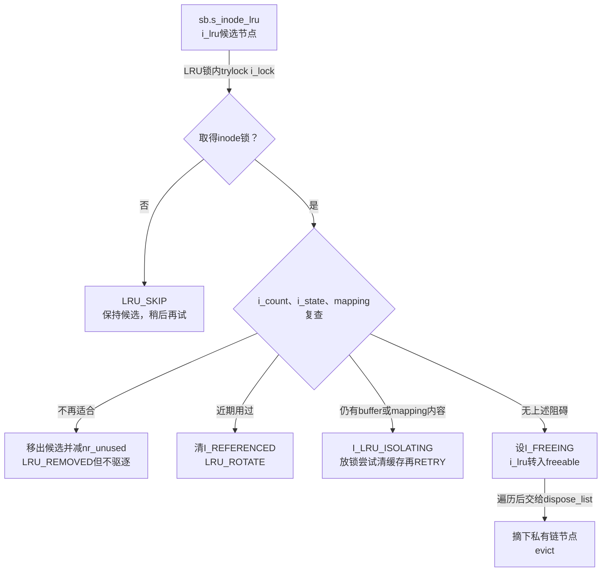
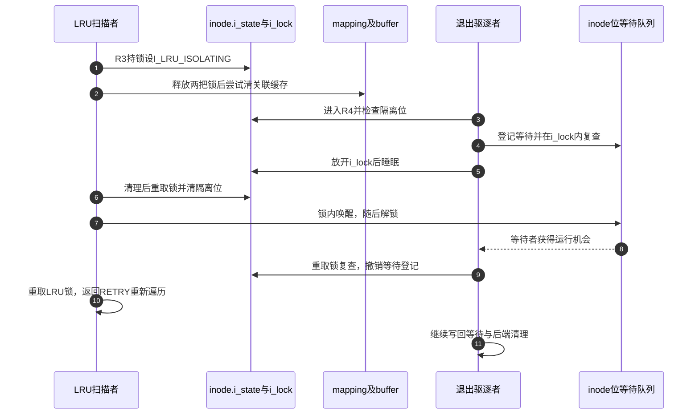

# 第65章\_空闲inode扫描与卸载驱逐

最后引用归还时，保留inode能服务后续查找；内存压力到来以后，这些对象又要让出空间。但“曾经空闲”不能证明“现在仍可回收”：新查找、重脏和页缓存填充都可能改变它。因此扫描是一轮重新取得处置资格的过程，不能把LRU中的每个节点直接传给free。

**讲解层次：实现层，Linux 6.12.20。** 固定提交 `dfaf2136deb2af2e60b994421281ba42f1c087e0`。原件：[super.c](../../linux/fs/super.c)、[inode.c](../../linux/fs/inode.c)、[list_lru.c](../../linux/mm/list_lru.c)、[list_lru.h](../../linux/include/linux/list_lru.h)、[shrinker.h](../../linux/include/linux/shrinker.h)。中文注释与讲解为仓库补充，执行语句保留。由 [对象回收导读](../navigation/P20_对象退出与缓存回收的条件.md#20.1_按退出阶段找持有与状态)进入R3候选复查，之后转交R4驱逐；总入口为 [VFS源码索引](../navigation/P01_Linux_6.12_VFS源码阅读索引.md)。

原件摘要与配置见 [对象回收源码基线](../../linux/SOURCE_BASELINE.md#1.300_对象退出与缓存回收的条件)，应用场景见 [正文退出周期](../../../../knowledge/kernel_subsystems/vfs/P21_file_dentry_inode与superblock回收.md#21.3_用同一次退出串起六个阶段)。

## 65.1\_压力扫描先估计预算再取得实例访问资格

superblock分配时建立实例的shrinker，private_data指回该实例，count_objects与scan_objects分别绑定本节两个回调。计数用于决定扫描预算，扫描才尝试处置对象。把计数和扫描分开，允许预算计算使用较便宜的估计，而不必为一次计数锁住整个文件系统实例。

```c
/** @brief 仓库补充阅读说明：先避开尚未发布的实例，再估计目录、inode与后端私有缓存数量。 */
static unsigned long super_cache_count(struct shrinker *shrink,
                                       struct shrink_control *sc)
{
        /* 仓库补充：先避开尚未发布的实例，再估计目录、inode与后端私有缓存数量。 */
        struct super_block *sb;
        long    total_objects = 0;
        sb = shrink->private_data;
        /* 仓库补充：计数不取得实例共享锁，但必须避开尚未发布的构造状态。 */
        if (!(sb->s_flags & SB_BORN))
                return 0;
        smp_rmb();
        if (sb->s_op && sb->s_op->nr_cached_objects)
                total_objects = sb->s_op->nr_cached_objects(sb, sc);
        total_objects += list_lru_shrink_count(&sb->s_dentry_lru, sc);
        total_objects += list_lru_shrink_count(&sb->s_inode_lru, sc);
        if (!total_objects)
                return SHRINK_EMPTY;
        /* 仓库补充：按策略缩放估计值，不提供逐对象可回收性证明。 */
        total_objects = vfs_pressure_ratio(total_objects);
        return total_objects;
}
```

SB_BORN及读屏障配合实例发布，避免访问尚在构造的后端状态。此处不调用super_trylock_shared，所以返回值不是保持锁保护的快照；计数与扫描之间对象可以增减。SHRINK_EMPTY表示本次没有估计对象，vfs_pressure_ratio再按缓存压力策略调整估计，并不是逐对象判定可释放性。

```c
/** @brief 仓库补充阅读说明：在允许进入文件系统且取得实例共享访问后分配扫描份额，先目录缓存再inode缓存。 */
static unsigned long super_cache_scan(struct shrinker *shrink,
                                      struct shrink_control *sc)
{
        /* 仓库补充：在允许进入文件系统且取得实例共享访问后分配扫描份额，先目录缓存再inode缓存。 */
        struct super_block *sb;
        long    fs_objects = 0;
        long    total_objects;
        long    freed = 0;
        long    dentries;
        long    inodes;
        sb = shrink->private_data;
        /* 仓库补充：不允许递归进入文件系统的回收上下文立即停止本轮。 */
        if (!(sc->gfp_mask & __GFP_FS))
                return SHRINK_STOP;
        if (!super_trylock_shared(sb))
                return SHRINK_STOP;
        if (sb->s_op->nr_cached_objects)
                fs_objects = sb->s_op->nr_cached_objects(sb, sc);
        inodes = list_lru_shrink_count(&sb->s_inode_lru, sc);
        dentries = list_lru_shrink_count(&sb->s_dentry_lru, sc);
        total_objects = dentries + inodes + fs_objects + 1;
        if (!total_objects)
                total_objects = 1;
        dentries = mult_frac(sc->nr_to_scan, dentries, total_objects);
        inodes = mult_frac(sc->nr_to_scan, inodes, total_objects);
        fs_objects = mult_frac(sc->nr_to_scan, fs_objects, total_objects);
        /* 仓库补充：先释放可能持有inode的目录缓存，再扫描inode缓存。 */
        sc->nr_to_scan = dentries + 1;
        freed = prune_dcache_sb(sb, sc);
        sc->nr_to_scan = inodes + 1;
        freed += prune_icache_sb(sb, sc);
        if (fs_objects) {
                sc->nr_to_scan = fs_objects + 1;
                freed += sb->s_op->free_cached_objects(sb, sc);
        }
        super_unlock_shared(sb);
        return freed;
}
```

__GFP_FS不足时返回SHRINK_STOP，避免在已持文件系统相关锁的回收上下文再次进入文件系统形成死锁。super_trylock_shared失败同样停止本轮，不等待实例关闭或构造。它与退出路径的锁协议见 [实例锁与发布](P06_实例匹配与构造完成的交接.md#6.4_等待条件与实例锁完成两次确认)。

预算按三类估计数量分摊，分母保留非零保护，各通用缓存扫描份额再加1。先扫描dentry，是因为正dentry的inode关联可能还使inode不能回收；先处理外层名称缓存，才可能释放内层候选。后端私有free_cached_objects则只在分得相应份额时调用。这一顺序不保证本轮一定回收某个文件，候选仍要经过下面的复查。

## 65.2\_扫描候选仍要重新检查引用与缓存

inode_lru_isolate作为list_lru遍历回调运行。遍历方已持LRU锁，而一般inode路径可能先持i_lock再改LRU；若这里阻塞取得i_lock，就会倒置锁顺序。因此它使用trylock，失败时跳过，后续轮次再看。

```c
/** @brief 仓库补充阅读说明：按引用、状态、近期使用及缓存内容复查候选，只有满足条件的对象才进入待驱逐集合。 */
static enum lru_status inode_lru_isolate(struct list_head *item,
                struct list_lru_one *lru, spinlock_t *lru_lock, void *arg)
{
        /* 仓库补充：按引用、状态、近期使用及缓存内容复查候选，只有满足条件的对象才进入待驱逐集合。 */
        struct list_head *freeable = arg;
        struct inode    *inode = container_of(item, struct inode, i_lru);
        /* 仓库补充：已有LRU锁，不能阻塞倒置正常i_lock到LRU锁的顺序。 */
        if (!spin_trylock(&inode->i_lock))
                return LRU_SKIP;
        /* 仓库补充：候选失效只撤销登记，不设置FREEING，也不释放inode。 */
        if (atomic_read(&inode->i_count) ||
            (inode->i_state & ~I_REFERENCED) ||
            !mapping_shrinkable(&inode->i_data)) {
                list_lru_isolate(lru, &inode->i_lru);
                spin_unlock(&inode->i_lock);
                this_cpu_dec(nr_unused);
                return LRU_REMOVED;
        }
        /* 仓库补充：近期使用对象清标志并轮转，得到第二次机会。 */
        if (inode->i_state & I_REFERENCED) {
                inode->i_state &= ~I_REFERENCED;
                spin_unlock(&inode->i_lock);
                return LRU_ROTATE;
        }
        if (inode_has_buffers(inode) || !mapping_empty(&inode->i_data)) {
                /* 仓库补充：放锁清缓存前先建立独立隔离保护。 */
                inode_pin_lru_isolating(inode);
                spin_unlock(&inode->i_lock);
                spin_unlock(lru_lock);
                if (remove_inode_buffers(inode)) {
                        unsigned long reap;
                        reap = invalidate_mapping_pages(&inode->i_data, 0, -1);
                        if (current_is_kswapd())
                                __count_vm_events(KSWAPD_INODESTEAL, reap);
                        else
                                __count_vm_events(PGINODESTEAL, reap);
                        mm_account_reclaimed_pages(reap);
                }
                inode_unpin_lru_isolating(inode);
                spin_lock(lru_lock);
                return LRU_RETRY;
        }
        WARN_ON(inode->i_state & I_NEW);
        /* 仓库补充：只有最终合格候选才转入私有待驱逐链。 */
        inode->i_state |= I_FREEING;
        list_lru_isolate_move(lru, &inode->i_lru, freeable);
        spin_unlock(&inode->i_lock);
        this_cpu_dec(nr_unused);
        return LRU_REMOVED;
}
```

第一条成功加锁后的分支也可能返回LRU_REMOVED，但它没有设置FREEING：对象重新被引用、重脏或mapping不再适合回收时，只把过期候选登记移出。以后iput、清脏或页缓存删除可重新登记它。第二条分支清I_REFERENCED并返回LRU_ROTATE，让近期使用对象得到第二次机会。

若还有buffer或mapping内容，扫描会暂时放锁处理缓存，再返回LRU_RETRY；不能将invalidate_mapping_pages解释成不论脏页、锁定和在途使用都强制清空。这里只尝试可撤销部分，下一轮重新检查全部前提。KSWAPD_INODESTEAL与PGINODESTEAL记录不同执行上下文的回收页统计，mm_account_reclaimed_pages把数量计入当前回收责任，它们不决定某个inode是否安全。

真正的可驱逐分支设置I_FREEING，把i_lru从实例LRU转移到调用者的freeable链，归还锁后再递减空闲统计。这样使用同一个链节点表达的是所有权转移，不能让它同时属于候选链和待释放链。



```c
/** @brief 仓库补充阅读说明：收集符合驱逐条件的inode到局部freeable链，再在扫描之后逐个处理。 */
long prune_icache_sb(struct super_block *sb, struct shrink_control *sc)
{
        /* 仓库补充：收集符合驱逐条件的inode到局部freeable链，再在扫描之后逐个处理。 */
        LIST_HEAD(freeable);
        long freed;
        freed = list_lru_shrink_walk(&sb->s_inode_lru, sc,
                                     inode_lru_isolate, &freeable);
        /* 仓库补充：遍历返回移除统计，实际待驱逐对象另由局部链承接。 */
        dispose_list(&freeable);
        return freed;
}
```

这里变量名freed容易误导。list_lru遍历框架将LRU_REMOVED计入移除数，而第一条移除分支只撤销过期候选、并未驱逐。因此prune_icache_sb返回的统计不能逐个等同于“已释放inode结构数”，更不能等同于已经完成RCU回调的数量。[list_lru.c](../../linux/mm/list_lru.c)中的__list_lru_walk_one是这个返回值语义的核对入口。

**可修改性：** 若调整候选策略，必须同时检查前篇__inode_add_lru的登记条件、这里每条返回状态以及后续dispose_list。删除一次trylock或把统计名当成完成证明，都可能分别引入锁死或错误的可观测性结论。

## 65.3\_暂时放锁为何需要独立隔离状态

清理关联页缓存可能需要离开LRU锁和i_lock，但只要放锁，最后使用归还等路径就可能同时决定驱逐inode。单纯记住裸指针无法保护清理窗口；这里用I_LRU_ISOLATING让驱逐方等待，而不是额外增加i_count，把它伪装成一个普通文件使用者。

```c
/** @brief 仓库补充阅读说明：在i_lock内建立临时隔离状态，阻止驱逐越过锁外缓存处理窗口。 */
static void inode_pin_lru_isolating(struct inode *inode)
{
        /* 仓库补充：在i_lock内建立临时隔离状态，阻止驱逐越过锁外缓存处理窗口。 */
        lockdep_assert_held(&inode->i_lock);
        WARN_ON(inode->i_state & (I_LRU_ISOLATING | I_FREEING | I_WILL_FREE));
        /* 仓库补充：这是独立状态保护，不增加i_count。 */
        inode->i_state |= I_LRU_ISOLATING;
}
```

```c
/** @brief 仓库补充阅读说明：重新取得i_lock后清除隔离状态，并唤醒等待该状态的驱逐者。 */
static void inode_unpin_lru_isolating(struct inode *inode)
{
        /* 仓库补充：重新取得i_lock后清除隔离状态，并唤醒等待该状态的驱逐者。 */
        spin_lock(&inode->i_lock);
        WARN_ON(!(inode->i_state & I_LRU_ISOLATING));
        inode->i_state &= ~I_LRU_ISOLATING;
        /* 仓库补充：持锁清位后通知等待方，唤醒不等于对方已完成运行。 */
        inode_wake_up_bit(inode, __I_LRU_ISOLATING);
        spin_unlock(&inode->i_lock);
}
```

```c
/** @brief 仓库补充阅读说明：在锁与等待队列协议中复查隔离位，等待期间放开i_lock，返回时重新持有。 */
static void inode_wait_for_lru_isolating(struct inode *inode)
{
        /* 仓库补充：在锁与等待队列协议中复查隔离位，等待期间放开i_lock，返回时重新持有。 */
        struct wait_bit_queue_entry wqe;
        struct wait_queue_head *wq_head;
        lockdep_assert_held(&inode->i_lock);
        if (!(inode->i_state & I_LRU_ISOLATING))
                return;
        wq_head = inode_bit_waitqueue(&wqe, inode, __I_LRU_ISOLATING);
        for (;;) {
                /* 仓库补充：先登记等待再检查状态，避免清位发生在登记前后造成漏等。 */
                prepare_to_wait_event(wq_head, &wqe.wq_entry, TASK_UNINTERRUPTIBLE);
                if (!(inode->i_state & I_LRU_ISOLATING))
                        break;
                spin_unlock(&inode->i_lock);
                /* 仓库补充：睡眠前已放开i_lock，恢复后重取锁并复查。 */
                schedule();
                spin_lock(&inode->i_lock);
        }
        finish_wait(wq_head, &wqe.wq_entry);
        WARN_ON(inode->i_state & I_LRU_ISOLATING);
}
```

inode_bit_waitqueue将inode和位标识映射到相应等待地址。fs.h中的inode_state_wait_address按 `(char *)&inode->i_state + bit` 生成等待键，inode_bit_waitqueue再用init_wait_var_entry和__var_waitqueue登记、定位队列；这里的地址用于区分等待条件，不是在该字节地址读写真实状态位。inode_wake_up_bit也用同一个键调用wake_up_var，它自己不会清位。

prepare_to_wait_event先登记等待，再检查状态，schedule前放锁，醒来后重锁复查，finish_wait撤销登记。清位方也持i_lock，保证这里读取到的状态与唤醒协议有一致的先后关系。lockdep_assert_held和WARN检查前提，真正建立保护的是状态写入与等待循环。



步骤2是保护窗口所在；步骤8只是唤醒，不表示退出者已经执行步骤9。步骤10与11可以分别推进，正确性依赖步骤6以后扫描者不再通过这个旧inode指针处理缓存，以及驱逐者在隔离结束前不能越过等待。示意没有承诺两个线程的调度先后。

## 65.4\_卸载清理扫描的是实例集合

内存压力只想释放适量缓存；实例退出则不再需要留下普通缓存。evict_inodes用于SB_ACTIVE已经清除后的实例清理，遍历s_inodes，而不是把压力LRU预算扩大到无限大。

```c
/** @brief 仓库补充阅读说明：遍历实例inode集合，锁内再次确认无引用与退出资格，再批量转交驱逐。 */
void evict_inodes(struct super_block *sb)
{
        /* 仓库补充：遍历实例inode集合，锁内再次确认无引用与退出资格，再批量转交驱逐。 */
        struct inode *inode, *next;
        LIST_HEAD(dispose);
again:
        spin_lock(&sb->s_inode_list_lock);
        list_for_each_entry_safe(inode, next, &sb->s_inodes, i_sb_list) {
                if (atomic_read(&inode->i_count))
                        continue;
                /* 仓库补充：外层计数只是快速筛选，锁内必须再次确认。 */
                spin_lock(&inode->i_lock);
                if (atomic_read(&inode->i_count)) {
                        spin_unlock(&inode->i_lock);
                        continue;
                }
                if (inode->i_state & (I_NEW | I_FREEING | I_WILL_FREE)) {
                        spin_unlock(&inode->i_lock);
                        continue;
                }
                /* 仓库补充：仍有引用或已有退出者的对象已经跳过，仅接管当前合格对象。 */
                inode->i_state |= I_FREEING;
                inode_lru_list_del(inode);
                spin_unlock(&inode->i_lock);
                list_add(&inode->i_lru, &dispose);
                /* 仓库补充：先放集合锁再允许调度及驱逐，重新开始遍历。 */
                if (need_resched()) {
                        spin_unlock(&sb->s_inode_list_lock);
                        cond_resched();
                        dispose_list(&dispose);
                        goto again;
                }
        }
        spin_unlock(&sb->s_inode_list_lock);
        dispose_list(&dispose);
}
```

外层计数检查只用于尽快略过明显不能处理的对象，取得i_lock后的第二次检查才与设置FREEING衔接。I_NEW、I_FREEING和I_WILL_FREE对象也跳过，已有退出者继续负责原对象。函数不会把仍非零的i_count强行改零；卸载前还存在非法持有时，外层关闭诊断不能替代责任归还。

s_inode_list_lock保护集合遍历，i_lock保护单个对象判定；可驱逐对象移出LRU以后暂存dispose。需要让出CPU时先放实例集合锁，再调度、处理已收集对象，然后从集合重新开始，避免持自旋锁跨越可能等待的evict。

```c
/** @brief 仓库补充阅读说明：从局部待处理链摘下inode，逐个执行evict并在对象间允许调度。 */
static void dispose_list(struct list_head *head)
{
        /* 仓库补充：从局部待处理链摘下inode，逐个执行evict并在对象间允许调度。 */
        while (!list_empty(head)) {
                struct inode *inode;
                inode = list_first_entry(head, struct inode, i_lru);
                /* 仓库补充：先撤销局部链关系，满足evict要求i_lru为空的前提。 */
                list_del_init(&inode->i_lru);
                evict(inode);
                cond_resched();
        }
}
```

| 状态或实现簇 | 谁建立、谁修改、谁消费 |
| --- | --- |
| sb.s_shrink / private_data / count_objects / scan_objects | alloc_super初始化并注册回收入口；回收框架调用计数与扫描，实例退出停止相应入口 |
| shrink_control.gfp_mask / nr_to_scan | 回收调用方提供上下文与预算；扫描按缓存份额重写nr_to_scan后传给子扫描 |
| s_inode_lru / inode.i_lru / nr_unused | 前篇登记候选；本篇移除、轮转或转交freeable，统计不等于最终释放证明 |
| inode.i_count / i_state / i_lock | 引用与状态路径维护；扫描和卸载都重新锁内判定，不能从LRU成员身份推断永久空闲 |
| I_LRU_ISOLATING与位等待地址 | 扫描者设位、锁外清缓存、清位唤醒；evict等待，保护窗口没有新增i_count |
| sb.s_inodes / s_inode_list_lock | inode加入实例时建立；卸载遍历，evict撤销i_sb_list；不同于空闲LRU |
| list_lru返回值与freeable/dispose | 框架处理SKIP/ROTATE/RETRY/REMOVED；局部链只接收已经FREEING的对象，dispose_list消费 |

修改实例退出顺序时，应先核对 [关闭实例](P07_实例关闭通知与最终内存回收.md#7.2_先结束公共使用再通知旧实例已退出)何时清SB_ACTIVE，再检查列表与写回责任；修改隔离状态时，必须把设位、清位、唤醒、等待和放锁窗口作为一个整体。没有内存压力实测时，普通unlink实验不能证明扫描分支都已经执行。
