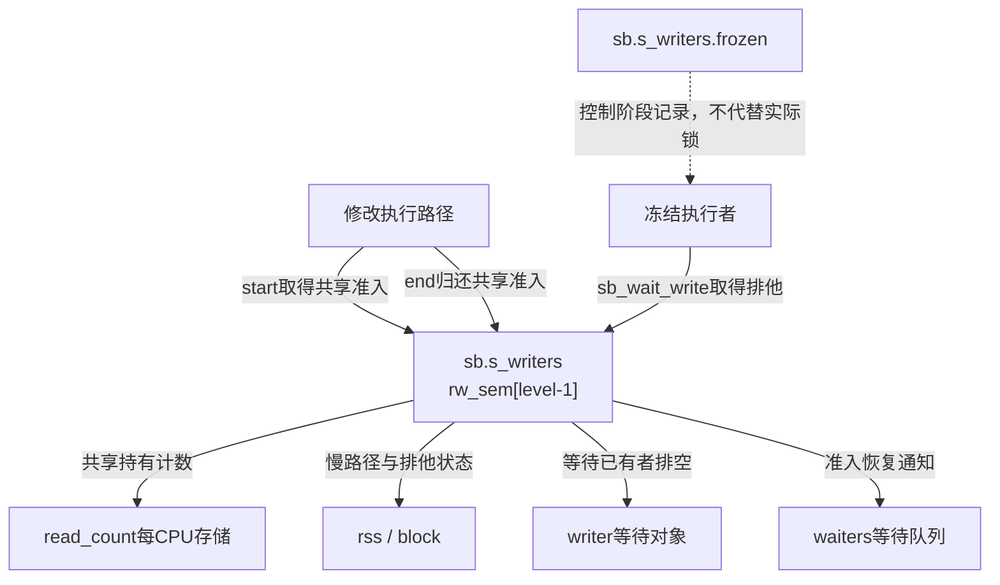
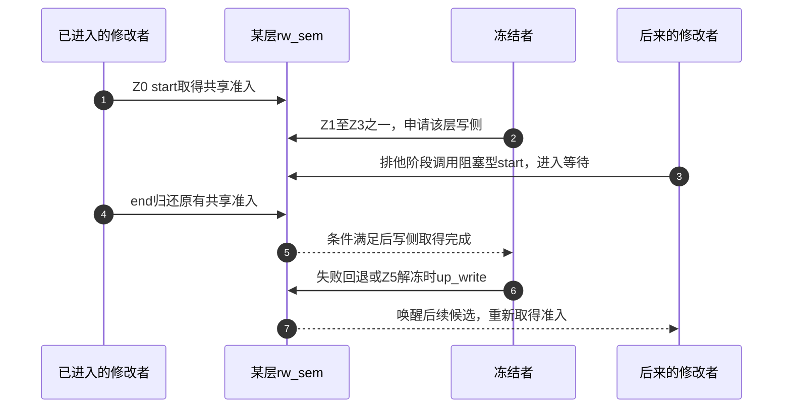

# 第66章\_冻结写入的分级准入

冻结不能只修改一个标志，然后期望正在执行的写者自行消失。每个相关修改路径都要在开始前取得准入、完成后归还，让冻结者能够阻止后来者并等已有操作退出。本篇先建立这组实际接口与状态地址，下一篇才推进完整冻结周期。

**讲解层次：实现层，Linux 6.12.20。** 固定提交 `dfaf2136deb2af2e60b994421281ba42f1c087e0`。原件：[fs.h](../../linux/include/linux/fs.h)、[super.c](../../linux/fs/super.c)、[ioctl.c](../../linux/fs/ioctl.c)、[percpu-rwsem.h](../../linux/include/linux/percpu-rwsem.h)、[percpu-rwsem.c](../../linux/kernel/locking/percpu-rwsem.c)。执行语句保留，中文注释为仓库补充。由 [冻结退出导读](../navigation/P21_冻结卸载与故障状态的边界.md#21.1_按冻结周期定位状态与参与者)进入Z0～Z3；总入口为 [VFS索引](../navigation/P01_Linux_6.12_VFS源码阅读索引.md)。

原件摘要与配置见 [冻结退出源码基线](../../linux/SOURCE_BASELINE.md#1.301_冻结卸载与故障状态的边界)，应用场景见 [正文冻结周期](../../../../knowledge/kernel_subsystems/vfs/P22_freeze_unmount与故障退出.md#22.3_一次冻结怎样走到稳定区间)。

## 66.1\_修改者在冻结门上取得读侧

sb_writers中保存三组percpu_rw_semaphore，sb_start_*与sb_end_*选择同一个数组成员配对操作。虽然调用者正在修改文件，它在这把冻结门上扮演共享参与者，所以取得的是读侧；只有要排除这一整类修改的冻结者取得写侧。

```c
/** @brief 仓库补充阅读说明：按从1开始的冻结等级选择数组项，取得共享准入并在冻结时等待。 */
static inline void __sb_start_write(struct super_block *sb, int level)
{
        /* 仓库补充：按从1开始的冻结等级选择数组项，取得共享准入并在冻结时等待。 */
        percpu_down_read(sb->s_writers.rw_sem + level - 1);
}
```

```c
/** @brief 仓库补充阅读说明：归还同等级共享准入，使等待该类操作排空的冻结者能够继续。 */
static inline void __sb_end_write(struct super_block *sb, int level)
{
        /* 仓库补充：归还同等级共享准入，使等待该类操作排空的冻结者能够继续。 */
        percpu_up_read(sb->s_writers.rw_sem + level-1);
}
```

```c
/** @brief 仓库补充阅读说明：尝试取得准入但不等待，失败时调用者不能继续执行受保护修改。 */
static inline bool __sb_start_write_trylock(struct super_block *sb, int level)
{
        /* 仓库补充：尝试取得准入但不等待，失败时调用者不能继续执行受保护修改。 */
        return percpu_down_read_trylock(sb->s_writers.rw_sem + level - 1);
}
```

这些辅助不通过读取frozen枚举决定是否允许修改，实际互斥由rw_sem兑现。因此控制路径刚发布WRITE、尚在取得写侧的窗口，也不能被描述成“所有CPU已经看到标志并停止进入”。写侧返回之后才取得该层排空的保证。

公共包装把三类语义固定到对应等级，避免调用者自行拼数组下标。

```c
/** @brief 仓库补充阅读说明：普通数据或元数据修改取得第一层冻结保护。 */
static inline void sb_start_write(struct super_block *sb)
{
        /* 仓库补充：普通数据或元数据修改取得第一层冻结保护。 */
        __sb_start_write(sb, SB_FREEZE_WRITE);
}
```
```c
/** @brief 仓库补充阅读说明：普通修改完成后归还第一层保护。 */
static inline void sb_end_write(struct super_block *sb)
{
        /* 仓库补充：普通修改完成后归还第一层保护。 */
        __sb_end_write(sb, SB_FREEZE_WRITE);
}
```
```c
/** @brief 仓库补充阅读说明：可能弄脏文件页的写缺页取得第二层冻结保护。 */
static inline void sb_start_pagefault(struct super_block *sb)
{
        /* 仓库补充：可能弄脏文件页的写缺页取得第二层冻结保护。 */
        __sb_start_write(sb, SB_FREEZE_PAGEFAULT);
}
```
```c
/** @brief 仓库补充阅读说明：写缺页操作结束后归还第二层保护。 */
static inline void sb_end_pagefault(struct super_block *sb)
{
        /* 仓库补充：写缺页操作结束后归还第二层保护。 */
        __sb_end_write(sb, SB_FREEZE_PAGEFAULT);
}
```
```c
/** @brief 仓库补充阅读说明：接入协议的文件系统内部修改取得第三层保护。 */
static inline void sb_start_intwrite(struct super_block *sb)
{
        /* 仓库补充：接入协议的文件系统内部修改取得第三层保护。 */
        __sb_start_write(sb, SB_FREEZE_FS);
}
```
```c
/** @brief 仓库补充阅读说明：内部修改结束后归还第三层保护。 */
static inline void sb_end_intwrite(struct super_block *sb)
{
        /* 仓库补充：内部修改结束后归还第三层保护。 */
        __sb_end_write(sb, SB_FREEZE_FS);
}
```
```c
/** @brief 仓库补充阅读说明：普通修改需要非等待尝试时使用同一层准入。 */
static inline bool sb_start_write_trylock(struct super_block *sb)
{
        /* 仓库补充：普通修改需要非等待尝试时使用同一层准入。 */
        return __sb_start_write_trylock(sb, SB_FREEZE_WRITE);
}
```
```c
/** @brief 仓库补充阅读说明：内部修改需要非等待尝试时使用第三层准入。 */
static inline bool sb_start_intwrite_trylock(struct super_block *sb)
{
        /* 仓库补充：内部修改需要非等待尝试时使用第三层准入。 */
        return __sb_start_write_trylock(sb, SB_FREEZE_FS);
}
```

| 等级与数组项 | 调用场景与配对 | 相关锁顺序 |
| --- | --- | --- |
| SB_FREEZE_WRITE=1，rw_sem[0] | 普通写入、目录等修改的start_write/end_write | 通常在inode锁及s_umount外侧取得 |
| SB_FREEZE_PAGEFAULT=2，rw_sem[1] | 可能弄脏文件页的start_pagefault/end_pagefault | mmap_lock可在它外侧，不能机械套普通写路径锁序 |
| SB_FREEZE_FS=3，rw_sem[2] | 后端接入的start_intwrite/end_intwrite | 内部层应排在写缺页层之后 |

只有真正调用配对接口的路径才受对应保护；函数名并不使所有内核内部操作自动接入。上层file_start_write等还会区分普通文件，相关读写入口见 [读写分派](P32_读写资格检查与文件操作分派.md#32.3_写侧保护通知与统计各有自己的边界)。

## 66.2\_冻结者等待的是共享准入归还

实例分配时，alloc_super为三组rw_sem分别调用__percpu_init_rwsem，并使用文件系统类型的s_writers_key建立锁类别；sb_writers的阶段和持有计数来自零初始化。实例构造失败或最终销毁时还需归还相应资源，构造与关闭的主实现复用前面的实例篇。

percpu_rw_semaphore具体保存read_count、block、rss、writer与waiters。正常共享进入优先增加当前CPU计数；写侧通过rcu_sync切换共享慢路径并设置排他条件，随后等待各CPU计数汇聚为零。共享退出在需要时唤醒writer，开放写侧时则通知waiters中的候选。这说明“每CPU计数”仍有汇聚与唤醒，并非冻结者靠一个固定延时猜测完成。

这里使用的是该同步原语的准入契约，不展开所有底层慢路径算法。尤其不能照抄旧注释里的sem->state作为真实字段：当前声明用rss、block等状态，引用计数、慢路径排他与等待队列也不是s_writers.frozen的别名。当前单核ARM配置仍保留这些接口及结构，不能凭SMP关闭将配对操作删除。

```c
/** @brief 仓库补充阅读说明：冻结者取得所选等级写侧，等待该层已有共享修改者退出。 */
static void sb_wait_write(struct super_block *sb, int level)
{
        /* 仓库补充：冻结者取得所选等级写侧，等待该层已有共享修改者退出。 */
        percpu_down_write(sb->s_writers.rw_sem + level-1);
}
```

```c
/** @brief 仓库补充阅读说明：按反向等级开放已经取得的写侧，用于失败回退或最终解冻。 */
static void sb_freeze_unlock(struct super_block *sb, int level)
{
        /* 仓库补充：按反向等级开放已经取得的写侧，用于失败回退或最终解冻。 */
        /* 仓库补充：只反向释放调用方已经取得的等级范围。 */
        for (level--; level >= 0; level--)
                percpu_up_write(sb->s_writers.rw_sem + level);
}
```





步骤2到5之间不能宣称该层已排空；步骤6才真正解除写侧。图中后来者选择阻塞型start；trylock失败的调用者不会因此留在等待队列中等待步骤7，需要按自己的调用协议退出或另行重试。这里描述的是冻结门的职责，不承诺步骤7的调用者必然成功完成后端I/O，它还可能遇到文件系统错误。

## 66.3\_用户请求通过文件找到整个实例

FIFREEZE与FITHAW在include/uapi/linux/fs.h定义，fs/ioctl.c的公共ioctl分派选择下面两个入口。file只是定位superblock的途径，不把冻结范围限制成一个文件。

```c
/** @brief 仓库补充阅读说明：核对所属实例的管理能力与后端支持，再选择专用或通用冻结入口。 */
static int ioctl_fsfreeze(struct file *filp)
{
        /* 仓库补充：核对所属实例的管理能力与后端支持，再选择专用或通用冻结入口。 */
        struct super_block *sb = file_inode(filp)->i_sb;
        /* 仓库补充：能力检查针对该实例所属用户命名空间。 */
        if (!ns_capable(sb->s_user_ns, CAP_SYS_ADMIN))
                return -EPERM;
        /* 仓库补充：后端必须提供冻结支持，不能仅凭打开fd推定可冻结。 */
        if (sb->s_op->freeze_fs == NULL && sb->s_op->freeze_super == NULL)
                return -EOPNOTSUPP;
        if (sb->s_op->freeze_super)
                return sb->s_op->freeze_super(sb, FREEZE_HOLDER_USERSPACE);
        return freeze_super(sb, FREEZE_HOLDER_USERSPACE);
}
```

```c
/** @brief 仓库补充阅读说明：核对同一实例权限，再把用户类别解冻请求交给专用或通用入口。 */
static int ioctl_fsthaw(struct file *filp)
{
        /* 仓库补充：核对同一实例权限，再把用户类别解冻请求交给专用或通用入口。 */
        struct super_block *sb = file_inode(filp)->i_sb;
        if (!ns_capable(sb->s_user_ns, CAP_SYS_ADMIN))
                return -EPERM;
        /* 仓库补充：专用协调入口优先，否则使用通用类别持有协议。 */
        if (sb->s_op->thaw_super)
                return sb->s_op->thaw_super(sb, FREEZE_HOLDER_USERSPACE);
        return thaw_super(sb, FREEZE_HOLDER_USERSPACE);
}
```

freeze_super/thaw_super这组s_op成员允许文件系统覆盖整个协调入口；freeze_fs/unfreeze_fs则由通用协调在适当阶段调用，两组回调不是同义名称。冻结入口要求freeze_fs或freeze_super至少有一个；否则返回EOPNOTSUPP，不能把任意tmpfs或任意打开文件直接当成支持冻结的实验对象。

ns_capable检查sb.s_user_ns中的CAP_SYS_ADMIN，权限失败与不支持分别返回EPERM、EOPNOTSUPP。FITHAW没有自动等待某个正在进行的冻结完成：它交给所选后端或通用解冻入口检查当前状态。

| 符号簇 | 初始化、写读与修改边界 |
| --- | --- |
| sb_writers.frozen / freeze_ucount / freeze_kcount | 零初始化；后两篇控制路径在s_umount下修改，普通准入不以这些计数替代信号量 |
| rw_sem[3] / SB_FREEZE_LEVELS | alloc_super逐项构造，等级减1选择；start/end与wait/unlock必须配对 |
| read_count / block / rss / writer / waiters | percpu-rwsem实现自己的状态与通信；VFS调用者不能绕过原语直接改计数 |
| freeze_super / thaw_super 与 freeze_fs / unfreeze_fs | 前组覆盖协调入口，后组处理冻结区间内的后端一致性；需核对具体s_op绑定 |
| ns_capable / file_inode / s_user_ns | 由已持有file定位实例与权限域；没有按fd单独冻结或自动解冻的含义 |

修改某条写路径时，先确定它属于哪一级、何时开始可能弄脏状态，再检查所有失败与提前返回是否配对end；trylock失败后必须退出或采取已有替代路径。修改冻结入口则还须核对 [阶段推进与回退](P67_冻结阶段推进与失败回退.md#67.1_逐级收口并把同步放在内部关闭之前)，不能只改一项frozen赋值。
