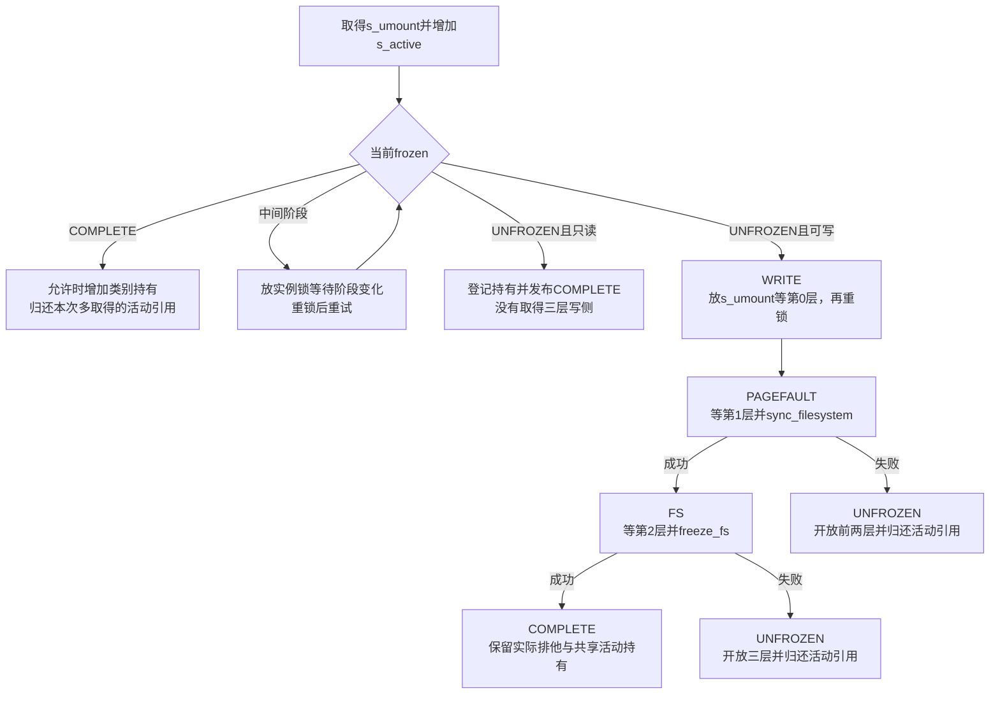
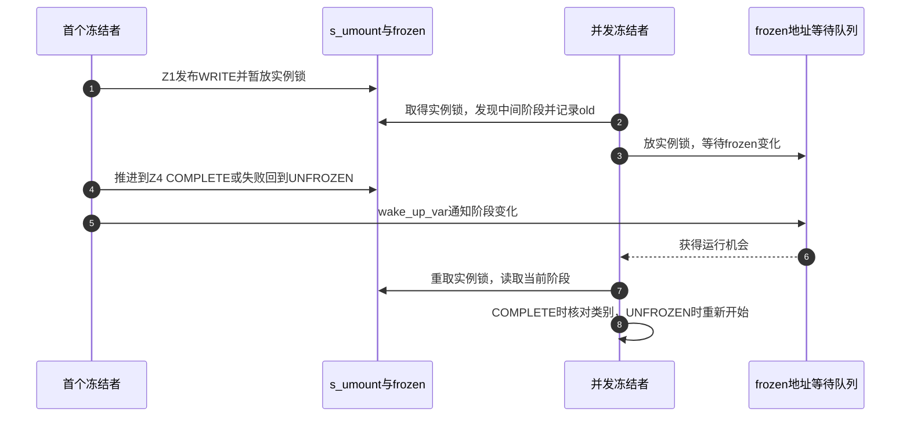

# 第67章\_冻结阶段推进与失败回退

三层准入使冻结者能够逐类等待，但什么时候同步、什么时候调用后端、失败后开放哪几层，仍由协调路径决定。若过早挡住内部工作，外层已有修改可能无法收尾；若冻结成功后又立即释放实际写侧，调用者也得不到稳定区间。

**讲解层次：实现层，Linux 6.12.20。** 固定提交 `dfaf2136deb2af2e60b994421281ba42f1c087e0`。原件：[super.c](../../linux/fs/super.c)、[sync.c](../../linux/fs/sync.c)、[fs.h](../../linux/include/linux/fs.h)。中文注释与说明为仓库补充，执行语句保留。阶段入口为 [冻结周期导读](../navigation/P21_冻结卸载与故障状态的边界.md#21.1_按冻结周期定位状态与参与者)，总入口为 [VFS索引](../navigation/P01_Linux_6.12_VFS源码阅读索引.md)。

原件摘要与配置见 [冻结退出源码基线](../../linux/SOURCE_BASELINE.md#1.301_冻结卸载与故障状态的边界)，应用场景见 [正文冻结周期](../../../../knowledge/kernel_subsystems/vfs/P22_freeze_unmount与故障退出.md#22.3_一次冻结怎样走到稳定区间)。

## 67.1\_逐级收口并把同步放在内部关闭之前

freeze_super先取得实例排他锁并增加活动持有，避免冻结过程中实例自行关闭。对于可写且尚未冻结的实例，先发布WRITE，暂放s_umount等待第0层，再重取实例锁；之后关闭第1层、同步、关闭第2层，最后调用后端freeze_fs。

```c
/** @brief 仓库补充阅读说明：按三层准入推进冻结，处理并发持有与只读捷径，并在同步或后端失败时归还已取得责任。 */
int freeze_super(struct super_block *sb, enum freeze_holder who)
{
        /* 仓库补充：按三层准入推进冻结，处理并发持有与只读捷径，并在同步或后端失败时归还已取得责任。 */
        int ret;
        if (!super_lock_excl(sb)) {
                WARN_ON_ONCE("Dying superblock while freezing!");
                return -EINVAL;
        }
        /* 仓库补充：本次先取得临时活动持有，首次成功将它留下。 */
        atomic_inc(&sb->s_active);
retry:
        /* 仓库补充：加入已完成冻结时只增加类别计数，额外活动持有随后归还。 */
        if (sb->s_writers.frozen == SB_FREEZE_COMPLETE) {
                if (may_freeze(sb, who))
                        ret = !!WARN_ON_ONCE(freeze_inc(sb, who) == 1);
                else
                        ret = -EBUSY;
                deactivate_locked_super(sb);
                return ret;
        }
        if (sb->s_writers.frozen != SB_UNFROZEN) {
                ret = wait_for_partially_frozen(sb);
                if (ret) {
                        deactivate_locked_super(sb);
                        return ret;
                }
                goto retry;
        }
        /* 仓库补充：只读捷径没有实际取得三层排他。 */
        if (sb_rdonly(sb)) {
                WARN_ON_ONCE(freeze_inc(sb, who) > 1);
                sb->s_writers.frozen = SB_FREEZE_COMPLETE;
                wake_up_var(&sb->s_writers.frozen);
                super_unlock_excl(sb);
                return 0;
        }
        sb->s_writers.frozen = SB_FREEZE_WRITE;
        super_unlock_excl(sb);
        /* 仓库补充：此时已放s_umount，避免与普通写者到实例锁的顺序倒置。 */
        sb_wait_write(sb, SB_FREEZE_WRITE);
        __super_lock_excl(sb);
        sb->s_writers.frozen = SB_FREEZE_PAGEFAULT;
        sb_wait_write(sb, SB_FREEZE_PAGEFAULT);
        /* 仓库补充：第二层已排空，第三层尚开放，允许同步所需内部工作完成。 */
        ret = sync_filesystem(sb);
        if (ret) {
                sb->s_writers.frozen = SB_UNFROZEN;
                /* 仓库补充：同步失败只开放此前取得的前两层。 */
                sb_freeze_unlock(sb, SB_FREEZE_PAGEFAULT);
                wake_up_var(&sb->s_writers.frozen);
                deactivate_locked_super(sb);
                return ret;
        }
        sb->s_writers.frozen = SB_FREEZE_FS;
        sb_wait_write(sb, SB_FREEZE_FS);
        if (sb->s_op->freeze_fs) {
                ret = sb->s_op->freeze_fs(sb);
                if (ret) {
                        printk(KERN_ERR
                                "VFS:Filesystem freeze failed\n");
                        sb->s_writers.frozen = SB_UNFROZEN;
                        sb_freeze_unlock(sb, SB_FREEZE_FS);
                        wake_up_var(&sb->s_writers.frozen);
                        deactivate_locked_super(sb);
                        return ret;
                }
        }
        WARN_ON_ONCE(freeze_inc(sb, who) > 1);
        sb->s_writers.frozen = SB_FREEZE_COMPLETE;
        wake_up_var(&sb->s_writers.frozen);
        /* 仓库补充：只归还诊断持锁记录，真实写侧保持到解冻。 */
        lockdep_sb_freeze_release(sb);
        super_unlock_excl(sb);
        return 0;
}
```

暂放s_umount是为保留普通修改准入在实例锁之前的既有锁序。此时另一名冻结者可以取得实例锁，但看到中间阶段后会进入等待，而不能从头再取得同一组三层锁。

成功进入COMPLETE时，三层实际写侧仍持有，首次冻结取得的活动引用也继续保留。若另一类别或允许嵌套的请求在COMPLETE状态加入，它只增加冻结类别计数，随后归还本次额外取得的活动引用；所有冻结责任共享原有那一份s_active。只读实例则只建立持有与COMPLETE，不按可写路径关闭三层。



图中失败出口的开放层数来自已经成功取得的责任，不是统一调用一次“全部解锁”即可。改变同步位置时，也必须重新证明后端同步不再需要被提前关闭的内部通道。

## 67.2\_同步协调的是多个后端完成步骤

关闭普通修改和写缺页以后，sync_filesystem先启动实例写回及后端同步，再等待相关工作。它还要覆盖后端仅把inode转换成脏buffer的情况，所以不能只等待一次inode回调。

```c
/** @brief 仓库补充阅读说明：在实例锁保护下协调inode与后端同步，分启动和等待阶段，并传递检查到的错误。 */
int sync_filesystem(struct super_block *sb)
{
        /* 仓库补充：在实例锁保护下协调inode与后端同步，分启动和等待阶段，并传递检查到的错误。 */
        int ret = 0;
        WARN_ON(!rwsem_is_locked(&sb->s_umount));
        /* 仓库补充：只读时无需执行本轮同步，不代表发生了磁盘写入。 */
        if (sb_rdonly(sb))
                return 0;
        /* 仓库补充：先启动写回与后端工作，再进入等待阶段。 */
        writeback_inodes_sb(sb, WB_REASON_SYNC);
        if (sb->s_op->sync_fs) {
                ret = sb->s_op->sync_fs(sb, 0);
                if (ret)
                        return ret;
        }
        ret = sync_blockdev_nowait(sb->s_bdev);
        if (ret)
                return ret;
        /* 仓库补充：第二轮等待相关inode写回，然后等待后端及块设备。 */
        sync_inodes_sb(sb);
        if (sb->s_op->sync_fs) {
                ret = sb->s_op->sync_fs(sb, 1);
                if (ret)
                        return ret;
        }
        return sync_blockdev(sb->s_bdev);
}
```

writeback_inodes_sb与sync_inodes_sb分别承担启动和等待相关写回的责任；sync_fs的wait参数0、1让后端区分这两轮，块设备同步也分nowait与等待。实际持久化保证仍取决于文件系统和设备协议，不能只凭函数名把所有错误传播都视为完备。

只读实例直接返回0，表示当前不需要执行这组同步。WARN_ON只是检查实例锁前提，不会替调用者取得锁。进入冻结协调时，这个函数发生在第二层已经收口、第三层尚未收口的窗口；它不是冻结完成后的附加装饰。

## 67.3\_并发冻结请求等待阶段再登记类别

FREEZE_HOLDER_KERNEL与FREEZE_HOLDER_USERSPACE选择类别，FREEZE_MAY_NEST只表示该入口允许同类嵌套。位标志不是任务身份；调用方必须提供合法类别组合，WARN不替错误调用方自动纠正参数。

```c
/** @brief 仓库补充阅读说明：在已有冻结完成时判断本类别能否再取得一份责任。 */
static inline bool may_freeze(struct super_block *sb, enum freeze_holder who)
{
        /* 仓库补充：在已有冻结完成时判断本类别能否再取得一份责任。 */
        WARN_ON_ONCE((who & ~FREEZE_FLAGS));
        WARN_ON_ONCE(hweight32(who & FREEZE_HOLDERS) > 1);
        /* 仓库补充：本类别已有责任时，需要显式允许嵌套才能再取得。 */
        if (who & FREEZE_HOLDER_KERNEL)
                return (who & FREEZE_MAY_NEST) ||
                       sb->s_writers.freeze_kcount == 0;
        if (who & FREEZE_HOLDER_USERSPACE)
                return (who & FREEZE_MAY_NEST) ||
                       sb->s_writers.freeze_ucount == 0;
        return false;
}
```

```c
/** @brief 仓库补充阅读说明：增加所选类别计数并返回总持有数，不按每份责任增加活动实例引用。 */
static inline int freeze_inc(struct super_block *sb, enum freeze_holder who)
{
        /* 仓库补充：增加所选类别计数并返回总持有数，不按每份责任增加活动实例引用。 */
        WARN_ON_ONCE((who & ~FREEZE_FLAGS));
        WARN_ON_ONCE(hweight32(who & FREEZE_HOLDERS) > 1);
        /* 仓库补充：WARN只检查参数，真实计数由类别位决定。 */
        if (who & FREEZE_HOLDER_KERNEL)
                ++sb->s_writers.freeze_kcount;
        if (who & FREEZE_HOLDER_USERSPACE)
                ++sb->s_writers.freeze_ucount;
        return sb->s_writers.freeze_kcount + sb->s_writers.freeze_ucount;
}
```

```c
/** @brief 仓库补充阅读说明：暂放s_umount等待阶段变化，醒来重锁后继续检查是否到达稳定端点。 */
static int wait_for_partially_frozen(struct super_block *sb)
{
        /* 仓库补充：暂放s_umount等待阶段变化，醒来重锁后继续检查是否到达稳定端点。 */
        int ret = 0;
        do {
                unsigned short old = sb->s_writers.frozen;
                /* 仓库补充：等待字段变化之前放实例锁，让另一名冻结者能够推进。 */
                up_write(&sb->s_umount);
                ret = wait_var_event_killable(&sb->s_writers.frozen,
                                               sb->s_writers.frozen != old);
                /* 仓库补充：醒来重新取得实例锁，不能只凭被唤醒就宣称冻结成功。 */
                down_write(&sb->s_umount);
        } while (ret == 0 &&
                 sb->s_writers.frozen != SB_UNFROZEN &&
                 sb->s_writers.frozen != SB_FREEZE_COMPLETE);
        return ret;
}
```

等待地址是sb.s_writers.frozen。函数先记录old，放s_umount后用可被致命信号打断的wait_var_event_killable等待字段变化，再重取写锁；尚未到UNFROZEN或COMPLETE时继续等待。外层freeze_super在信号错误时归还本次活动持有并返回，不把未完成请求登记为成功持有。



步骤3的条件检查能够覆盖通知先到达的情况，不要求等待者必须先实际睡着。步骤4既可能成功也可能回退，步骤8必须依据锁内重读结果；醒来本身不是“本请求冻结成功”。

## 67.4\_诊断持锁记录交接不开放实际准入

冻结完成后调用者可能返回用户空间，之后由另一任务解冻。lockdep跟踪的是任务的锁依赖记录，不能让发起任务永远看起来持有三组锁，也不能让解冻任务看起来释放从未取得的锁。因此协调层显式交接这些检查记录。

```c
/** @brief 仓库补充阅读说明：只归还lockdep的任务持锁记录，真实三层信号量仍保持排他。 */
static void lockdep_sb_freeze_release(struct super_block *sb)
{
        /* 仓库补充：只归还lockdep的任务持锁记录，真实三层信号量仍保持排他。 */
        int level;
        /* 仓库补充：逐层归还任务检查记录，不调用真实percpu_up_write。 */
        for (level = SB_FREEZE_LEVELS - 1; level >= 0; level--)
                percpu_rwsem_release(sb->s_writers.rw_sem + level, _THIS_IP_);
}
```

percpu_rwsem_release最终作用于dep_map的检查记录，和sb_freeze_unlock调用percpu_up_write开放准入不是同一动作。本次配置DEBUG_LOCK_ALLOC与PROVE_LOCKING开启；关闭诊断配置也不能删除真实的三层排他与持有协议。

| 状态或实现簇 | 写入者、读取者与配对 |
| --- | --- |
| s_umount / s_active | 协调入口取得锁和临时活动持有；首次成功留下共享活动持有，加入已有冻结或失败则归还额外持有 |
| s_writers.frozen | 协调者按Z1～Z4写入；并发控制路径重锁读取，通过同一地址等待与唤醒 |
| freeze_ucount / freeze_kcount | freeze_inc登记类别，后篇freeze_dec归还；不是按PID存储的独占句柄 |
| rw_sem[0..2] | 逐层取得、按已取得层数回退；同步放在第二层与第三层之间 |
| dep_map / lockdep_sb_freeze_release | 诊断任务持锁关系，后篇acquire接回；不改变真实准入状态 |
| sync_fs / freeze_fs | 后端完成自己的同步与冻结责任，错误决定通用回退；不能互换两者时点 |

修改新增入口时应同时核对合法类别、嵌套策略、活动引用和失败回退；修改阶段顺序时应核对普通修改到s_umount的锁序以及同步的内部依赖。下一篇继续 [最后持有归还与后端恢复](P68_解冻持有与后端恢复.md#68.1_先减少所属类别再判断能否开放)。
