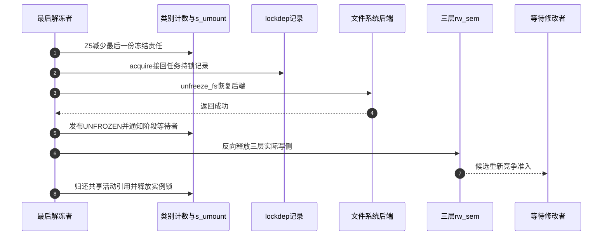
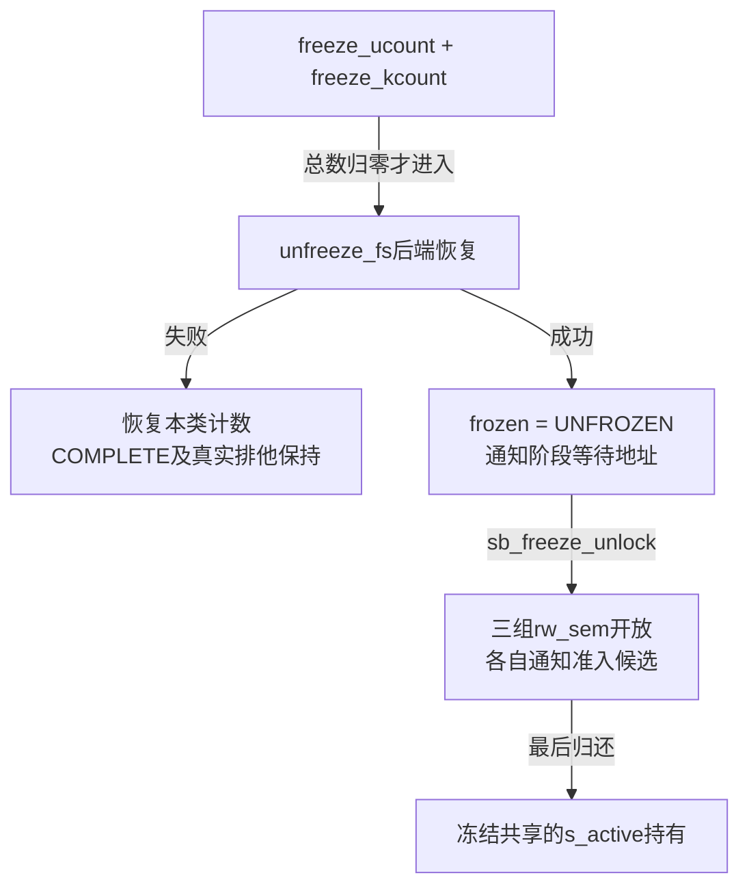

# 第68章\_解冻持有与后端恢复

冻结成功留下三层实际排他和一份共享活动引用，调用者返回以后这些责任仍存在。解冻必须先判断谁还要求保持冻结，再让后端恢复，最后开放准入；它不是简单将frozen改成零，更不是撤销文件系统故障状态的通用修复接口。

**讲解层次：实现层，Linux 6.12.20。** 固定提交 `dfaf2136deb2af2e60b994421281ba42f1c087e0`。原件：[super.c](../../linux/fs/super.c)、[ext4/super.c](../../linux/fs/ext4/super.c)、[fs.h](../../linux/include/linux/fs.h)、[percpu-rwsem.h](../../linux/include/linux/percpu-rwsem.h)。中文注释与说明为仓库补充，执行语句保留。阶段入口为 [冻结周期导读](../navigation/P21_冻结卸载与故障状态的边界.md#21.1_按冻结周期定位状态与参与者)，总入口为 [VFS索引](../navigation/P01_Linux_6.12_VFS源码阅读索引.md)。

原件摘要与配置见 [冻结退出源码基线](../../linux/SOURCE_BASELINE.md#1.301_冻结卸载与故障状态的边界)，应用场景见 [正文冻结周期](../../../../knowledge/kernel_subsystems/vfs/P22_freeze_unmount与故障退出.md#22.3_一次冻结怎样走到稳定区间)。

## 68.1\_先减少所属类别再判断能否开放

thaw_super先取得实例排他锁。如果实例已经进入不能取得锁的退出状态，就返回EINVAL；成功取得以后，由thaw_super_locked检查冻结是否已经完成。它不会像另一个freeze请求那样等待中间阶段完成。

```c
/** @brief 仓库补充阅读说明：取得有效实例的排他控制，再交给锁内解冻路径。 */
int thaw_super(struct super_block *sb, enum freeze_holder who)
{
        /* 仓库补充：取得有效实例的排他控制，再交给锁内解冻路径。 */
        if (!super_lock_excl(sb)) {
                WARN_ON_ONCE("Dying superblock while thawing!");
                return -EINVAL;
        }
        /* 仓库补充：锁取得成功以后仍要检查当前是否冻结完成。 */
        return thaw_super_locked(sb, who);
}
```

```c
/** @brief 仓库补充阅读说明：只减少请求类别中已有的计数，返回两类剩余总数。 */
static inline int freeze_dec(struct super_block *sb, enum freeze_holder who)
{
        /* 仓库补充：只减少请求类别中已有的计数，返回两类剩余总数。 */
        WARN_ON_ONCE((who & ~FREEZE_FLAGS));
        WARN_ON_ONCE(hweight32(who & FREEZE_HOLDERS) > 1);
        /* 仓库补充：仅减少非零的本类计数，再返回所有类别剩余总数。 */
        if ((who & FREEZE_HOLDER_KERNEL) && sb->s_writers.freeze_kcount)
                --sb->s_writers.freeze_kcount;
        if ((who & FREEZE_HOLDER_USERSPACE) && sb->s_writers.freeze_ucount)
                --sb->s_writers.freeze_ucount;
        return sb->s_writers.freeze_kcount + sb->s_writers.freeze_ucount;
}
```

```c
/** @brief 仓库补充阅读说明：根据剩余持有、只读分支与后端恢复结果决定是否真正开放三层准入。 */
static int thaw_super_locked(struct super_block *sb, enum freeze_holder who)
{
        /* 仓库补充：根据剩余持有、只读分支与后端恢复结果决定是否真正开放三层准入。 */
        int error = -EINVAL;
        if (sb->s_writers.frozen != SB_FREEZE_COMPLETE)
                goto out_unlock;
        /* 仓库补充：固定版本此处可能已减少计数，却保留初始-EINVAL返回。 */
        if (freeze_dec(sb, who))
                goto out_unlock;
        /* 仓库补充：与冻结只读捷径配对，不释放从未取得的三层写侧。 */
        if (sb_rdonly(sb)) {
                sb->s_writers.frozen = SB_UNFROZEN;
                wake_up_var(&sb->s_writers.frozen);
                goto out_deactivate;
        }
        lockdep_sb_freeze_acquire(sb);
        if (sb->s_op->unfreeze_fs) {
                error = sb->s_op->unfreeze_fs(sb);
                if (error) {
                        pr_err("VFS: Filesystem thaw failed\n");
                        /* 仓库补充：后端恢复失败时恢复责任，实际准入继续关闭。 */
                        freeze_inc(sb, who);
                        lockdep_sb_freeze_release(sb);
                        goto out_unlock;
                }
        }
        sb->s_writers.frozen = SB_UNFROZEN;
        wake_up_var(&sb->s_writers.frozen);
        /* 仓库补充：发布与通知阶段以后，才真正开放三层准入。 */
        sb_freeze_unlock(sb, SB_FREEZE_FS);
out_deactivate:
        deactivate_locked_super(sb);
        return 0;
out_unlock:
        super_unlock_excl(sb);
        return error;
}
```

这个固定版本初始化error为-EINVAL。若freeze_dec以后仍有持有，跳到out_unlock返回这个值，但该类别的计数可能已经减少。因此“返回错误”与“完全没有状态变化”在这里不等价。

| 调用前持有与条件 | 本次动作 | 调用后状态与返回 |
| --- | --- | --- |
| frozen尚未COMPLETE | 不减少持有 | 保持原阶段，-EINVAL |
| ucount=1、kcount=1，用户解冻 | ucount减到0 | kcount仍为1，继续冻结，固定版本返回-EINVAL |
| ucount=2、kcount=0，允许嵌套入口归还一次 | ucount减到1 | 仍冻结，固定版本返回-EINVAL |
| 最后持有、可写、unfreeze_fs失败 | 先减到0，再恢复本类持有 | 保持COMPLETE和实际排他，返回后端错误 |
| 最后持有、后端成功 | 清冻结阶段并开放准入 | 归还共享活动引用，返回0 |
| 最后持有、只读实例 | 不调用三层开放 | 清阶段、归还活动引用，返回0 |

这些结果按选定提交记录，不用较新内核的行为替换本地证据。返回值不足以构成可盲目重试的“每次必定未归还”协议；调用者还必须遵守自己的类别与嵌套责任。

## 68.2\_先恢复后端再开放真正的写侧

可写实例最后一次解冻先重新建立lockdep记录，让当前解冻任务在检查器中持有三层写侧，再调用unfreeze_fs。后端失败则恢复类别计数并把诊断持锁记录交回，实际排他保持不动。

```c
/** @brief 仓库补充阅读说明：在当前任务中接回三层诊断持锁记录，不重复取得真实写侧。 */
static void lockdep_sb_freeze_acquire(struct super_block *sb)
{
        /* 仓库补充：在当前任务中接回三层诊断持锁记录，不重复取得真实写侧。 */
        int level;
        /* 仓库补充：为当前解冻任务接回检查记录，不重复取得真实写侧。 */
        for (level = 0; level < SB_FREEZE_LEVELS; ++level)
                percpu_rwsem_acquire(sb->s_writers.rw_sem + level, 0, _THIS_IP_);
}
```

成功以后先发布UNFROZEN并wake_up_var，再调用sb_freeze_unlock开放三层。阶段等待者仍需取得s_umount后复查；普通修改者等待的是各层信号量。因此先写阶段并通知，不等于它们可以绕过尚未开放的实际准入。



步骤2不是重新加三把实际锁，步骤6才开放准入。若步骤4失败，后续步骤5～8不按图执行：恢复本类计数、release诊断记录，只解s_umount并保留冻结。这里的成功时间线不拿失败分支的“仍冻结”当成已经开放过的状态。



## 68.3\_ext4回调依赖上层冻结门保持区间

ext4_sops把freeze_fs绑定为ext4_freeze、unfreeze_fs绑定为ext4_unfreeze。它没有在这里用同名freeze_super成员替代整个通用协调；上层已经排空三类修改，后端才处理日志及磁盘超级块的一致性标记。

```c
/** @brief 仓库补充阅读说明：在上层已限制修改的条件下冲刷日志并更新恢复标志，返回时释放临时日志屏障。 */
static int ext4_freeze(struct super_block *sb)
{
        /* 仓库补充：在上层已限制修改的条件下冲刷日志并更新恢复标志，返回时释放临时日志屏障。 */
        int error = 0;
        journal_t *journal = EXT4_SB(sb)->s_journal;
        if (journal) {
                jbd2_journal_lock_updates(journal);
                /* 仓库补充：冲刷失败时不能清除需要恢复的磁盘标志。 */
                error = jbd2_journal_flush(journal, 0);
                if (error < 0)
                        goto out;
                ext4_clear_feature_journal_needs_recovery(sb);
                if (ext4_orphan_file_empty(sb))
                        ext4_clear_feature_orphan_present(sb);
        }
        error = ext4_commit_super(sb);
out:
        if (journal)
                /* 仓库补充：回调退出便释放临时日志屏障，稳定区间由上层准入保持。 */
                jbd2_journal_unlock_updates(journal);
        return error;
}
```

有日志时，jbd2_journal_lock_updates先限制日志更新，jbd2_journal_flush冲刷日志；失败时保留恢复需要标志，走out释放临时日志屏障。成功冲刷以后才能清needs_recovery，孤儿文件已空时还清orphan_present，随后提交磁盘superblock。

这里无论成功或失败都在退出时解开日志更新屏障，冻结区间继续依赖上层三层准入，而不是一把一直跨用户空间持有的JBD2屏障。没有日志的ext4分支直接执行相应superblock提交；不能把有日志路径推广为所有挂载方式。

```c
/** @brief 仓库补充阅读说明：恢复日志相关标志，但不把它的成功返回扩展成设备恢复或完整持久化证明。 */
static int ext4_unfreeze(struct super_block *sb)
{
        /* 仓库补充：恢复日志相关标志，但不把它的成功返回扩展成设备恢复或完整持久化证明。 */
        /* 仓库补充：已停止服务时直接返回，不清除shutdown位。 */
        if (ext4_forced_shutdown(sb))
                return 0;
        if (EXT4_SB(sb)->s_journal) {
                ext4_set_feature_journal_needs_recovery(sb);
                if (ext4_has_feature_orphan_file(sb))
                        ext4_set_feature_orphan_present(sb);
        }
        /* 仓库补充：当前实现不传出这次提交的返回值。 */
        ext4_commit_super(sb);
        return 0;
}
```

已处于forced_shutdown时它直接返回0；普通有日志分支先恢复needs_recovery等标志，再调用ext4_commit_super，随后仍返回0，没有传递该调用的返回值。因此通用thaw看到成功，只能按此回调契约开放冻结准入，不能声称已经清除shutdown或验证了全部磁盘写入。

| 实现簇 | 责任与修改检查 |
| --- | --- |
| freeze_dec与freeze_inc | 在s_umount控制下减少、失败恢复类别持有；计数不是进程所有权表 |
| thaw_super_locked / s_writers.frozen | 控制解冻端点；非最后持有分支可能已改计数却返回-EINVAL |
| lockdep acquire/release | 交接当前任务的检查记录；真实开放由sb_freeze_unlock完成 |
| ext4_sops.freeze_fs / unfreeze_fs | 上层冻结门与后端日志标志的接口；须保持回调时点与失败责任 |
| jbd2_journal_lock_updates / flush / unlock_updates | 临时日志更新屏障与冲刷，退出时配对；不替代上层长期冻结区间 |
| journal_needs_recovery / orphan_present | 磁盘格式的恢复标志，与VFS frozen、私有shutdown分别维护 |
| ext4_commit_super返回值 | 冻结回调会返回其错误；当前解冻回调不传出，不能给两条路径相同完成证明 |

修改解冻时必须同时审查计数、共享活动引用、诊断记录和实际准入，避免只处理正常最后持有。下一篇将 [故障停止服务](P69_设备失效与文件系统停止服务.md#69.2_停止服务位如何改变后续入口)与本篇的恢复准入分开。
