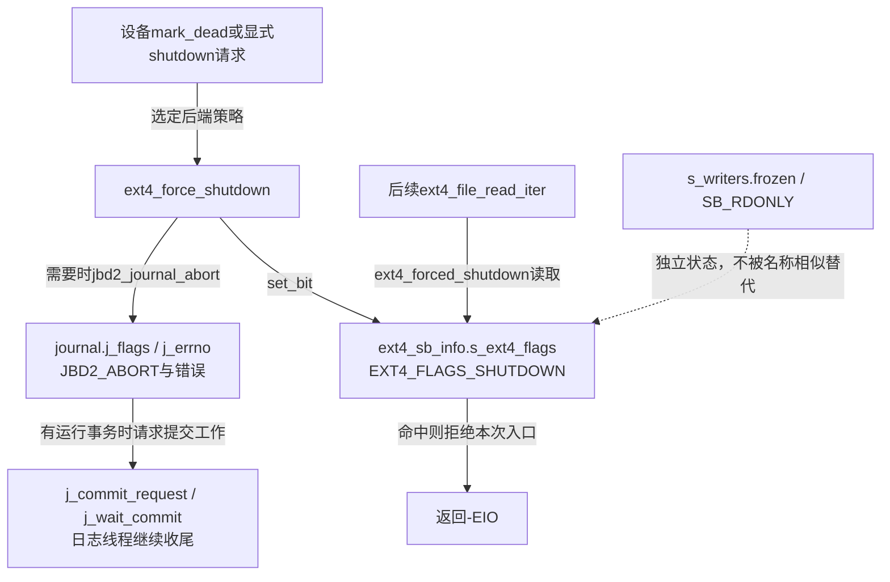
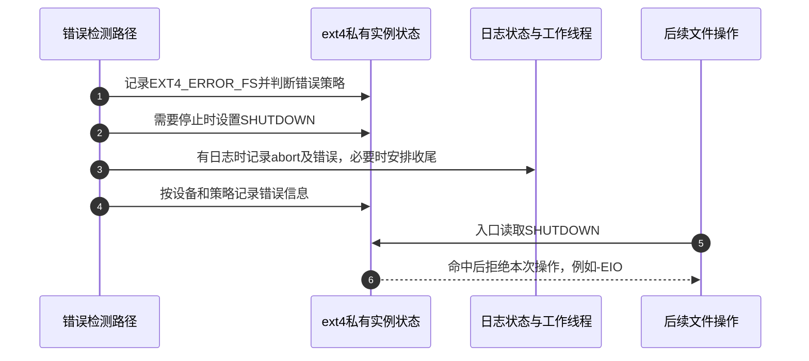

# 第69章\_设备失效与文件系统停止服务

解冻恢复的是冻结准入，不能让失效设备或中止日志重新成为正常服务。故障路径需要持久保存错误状态，让后续操作看到拒绝服务条件；已经进入的工作则按各自I/O、日志或写回协议收尾。本篇选定块设备通知与ext4，避免虚构一个适用于所有文件系统的统一shutdown状态机。

**讲解层次：实现层，Linux 6.12.20。** 固定提交 `dfaf2136deb2af2e60b994421281ba42f1c087e0`。原件：[super.c](../../linux/fs/super.c)、[ext4/super.c](../../linux/fs/ext4/super.c)、[ext4/ioctl.c](../../linux/fs/ext4/ioctl.c)、[ext4/ext4.h](../../linux/fs/ext4/ext4.h)、[ext4/file.c](../../linux/fs/ext4/file.c)、[jbd2/journal.c](../../linux/fs/jbd2/journal.c)、[jbd2.h](../../linux/include/linux/jbd2.h)。中文说明与注释为仓库补充，执行语句保留。入口为 [冻结退出导读](../navigation/P21_冻结卸载与故障状态的边界.md#21.4_把返回值放回各自接口责任)，总入口为 [VFS索引](../navigation/P01_Linux_6.12_VFS源码阅读索引.md)。

原件摘要与配置见 [冻结退出源码基线](../../linux/SOURCE_BASELINE.md#1.301_冻结卸载与故障状态的边界)，应用场景见 [正文冻结周期](../../../../knowledge/kernel_subsystems/vfs/P22_freeze_unmount与故障退出.md#22.3_一次冻结怎样走到稳定区间)。

## 69.1\_设备失效通知先取得仍有效的实例

fs_holder_ops的mark_dead绑定fs_bdev_mark_dead。这个回调首先通过bdev_super_lock取得仍有效实例的共享访问，不能直接从一个历史bdev指针一路解引用到已经关闭的superblock。

```c
/** @brief 仓库补充阅读说明：在有效实例共享锁下区分预告与突然失效，清缓存并调用后端停止服务方法。 */
static void fs_bdev_mark_dead(struct block_device *bdev, bool surprise)
{
        /* 仓库补充：在有效实例共享锁下区分预告与突然失效，清缓存并调用后端停止服务方法。 */
        struct super_block *sb;
        sb = bdev_super_lock(bdev, false);
        if (!sb)
                return;
        /* 仓库补充：预告失效先尝试同步；突然失效不执行这一步。 */
        if (!surprise)
                sync_filesystem(sb);
        shrink_dcache_sb(sb);
        invalidate_inodes(sb);
        /* 仓库补充：后端决定停止服务状态，不由此强制清零对象引用。 */
        if (sb->s_op->shutdown)
                sb->s_op->shutdown(sb);
        super_unlock_shared(sb);
}
```

bdev_super_lock通过设备持有关系找到实例，临时增加s_count以跨越放开设备持有锁的窗口，再取得实例锁并归还临时引用；还要检查根与SB_ACTIVE。该辅助保证的是本次访问生命期，不证明设备仍正常读写。

非surprise通知先尝试sync_filesystem；突然失效跳过这一步。这里不接收同步返回值作为“设备安全退出”的最终证明，后续仍清目录缓存、尝试invalidate_inodes，并调用后端shutdown。仍有持有的对象不是靠这一通知强行清零。

```c
/** @brief 仓库补充阅读说明：块设备停止服务入口选择不冲刷日志的强制关闭策略。 */
static void ext4_shutdown(struct super_block *sb)
{
        /* 仓库补充：块设备停止服务入口选择不冲刷日志的强制关闭策略。 */
       ext4_force_shutdown(sb, EXT4_GOING_FLAGS_NOLOGFLUSH);
}
```

ext4的shutdown回调传入NOLOGFLUSH，说明设备失效收尾不能照抄正常卸载或成功冻结的持久化承诺。原有挂载拓扑是否仍存在，是另一个由namespace及mount生命期决定的问题。

## 69.2\_停止服务位如何改变后续入口

EXT4_FLAGS_SHUTDOWN是ext4_sb_info.s_ext4_flags中的位，既不是s_writers.frozen，也不是SB_RDONLY。显式关闭请求根据策略设置它，读写等入口再检查它，形成跨调用持续有效的状态通信。

```c
/** @brief 仓库补充阅读说明：按所选策略设置停止服务位并处理日志，中间失败与忽略的返回值分别保留。 */
int ext4_force_shutdown(struct super_block *sb, u32 flags)
{
        /* 仓库补充：按所选策略设置停止服务位并处理日志，中间失败与忽略的返回值分别保留。 */
        struct ext4_sb_info *sbi = EXT4_SB(sb);
        int ret;
        if (flags > EXT4_GOING_FLAGS_NOLOGFLUSH)
                return -EINVAL;
        if (ext4_forced_shutdown(sb))
                return 0;
        ext4_msg(sb, KERN_ALERT, "shut down requested (%d)", flags);
        trace_ext4_shutdown(sb, flags);
        switch (flags) {
        /* 仓库补充：默认策略先尝试冻结，成功后才设置停止服务位。 */
        case EXT4_GOING_FLAGS_DEFAULT:
                ret = bdev_freeze(sb->s_bdev);
                if (ret)
                        return ret;
                set_bit(EXT4_FLAGS_SHUTDOWN, &sbi->s_ext4_flags);
                bdev_thaw(sb->s_bdev);
                break;
        case EXT4_GOING_FLAGS_LOGFLUSH:
                set_bit(EXT4_FLAGS_SHUTDOWN, &sbi->s_ext4_flags);
                if (sbi->s_journal && !is_journal_aborted(sbi->s_journal)) {
                        /* 仓库补充：日志冲刷请求的返回值在此明确被忽略。 */
                        (void) ext4_force_commit(sb);
                        jbd2_journal_abort(sbi->s_journal, -ESHUTDOWN);
                }
                break;
        /* 仓库补充：无日志冲刷策略不承诺保住尚未完成的修改。 */
        case EXT4_GOING_FLAGS_NOLOGFLUSH:
                set_bit(EXT4_FLAGS_SHUTDOWN, &sbi->s_ext4_flags);
                if (sbi->s_journal && !is_journal_aborted(sbi->s_journal))
                        jbd2_journal_abort(sbi->s_journal, -ESHUTDOWN);
                break;
        default:
                return -EINVAL;
        }
        clear_opt(sb, DISCARD);
        return 0;
}
```

DEFAULT策略先请求块设备冻结；失败就返回，成功才设shutdown位并调用bdev_thaw，这里也没有向外传递bdev_thaw的返回值。LOGFLUSH策略先设位，再在日志可用时尝试提交并中止日志；这里显式忽略ext4_force_commit返回值。NOLOGFLUSH直接设位并中止仍有效日志。末尾关闭DISCARD选项，避免继续按正常丢弃策略工作。已经shutdown时直接返回0也不表示设备曾经恢复。

```c
/** @brief 仓库补充阅读说明：显式管理请求先检查能力并从用户空间读取策略，再调用后端强制关闭。 */
static int ext4_ioctl_shutdown(struct super_block *sb, unsigned long arg)
{
        /* 仓库补充：显式管理请求先检查能力并从用户空间读取策略，再调用后端强制关闭。 */
        u32 flags;
        /* 仓库补充：这里使用当前capable权限域，不能与ns_capable实例域混同。 */
        if (!capable(CAP_SYS_ADMIN))
                return -EPERM;
        if (get_user(flags, (__u32 __user *)arg))
                return -EFAULT;
        return ext4_force_shutdown(sb, flags);
}
```

这个入口检查capable(CAP_SYS_ADMIN)，与前篇通用冻结按sb.s_user_ns调用ns_capable的权限坐标不同；不能只看到同一个能力名就把范围混用。读取策略失败返回EFAULT，本篇不提供在工作文件系统上执行关闭请求的实验。

```c
/** @brief 仓库补充阅读说明：读取ext4实例的停止服务位，不依据VFS只读或冻结阶段替代判断。 */
static inline int ext4_forced_shutdown(struct super_block *sb)
{
        /* 仓库补充：读取ext4实例的停止服务位，不依据VFS只读或冻结阶段替代判断。 */
        return test_bit(EXT4_FLAGS_SHUTDOWN, &EXT4_SB(sb)->s_ext4_flags);
}
```

```c
/** @brief 仓库补充阅读说明：读入口先检查停止服务状态，之后才区分空请求及DAX、直接或缓存读路径。 */
static ssize_t ext4_file_read_iter(struct kiocb *iocb, struct iov_iter *to)
{
        /* 仓库补充：读入口先检查停止服务状态，之后才区分空请求及DAX、直接或缓存读路径。 */
        struct inode *inode = file_inode(iocb->ki_filp);
        /* 仓库补充：停止服务检查先于空读取及具体数据路径分派。 */
        if (unlikely(ext4_forced_shutdown(inode->i_sb)))
                return -EIO;
        if (!iov_iter_count(to))
                return 0;
#ifdef CONFIG_FS_DAX
        if (IS_DAX(inode))
                return ext4_dax_read_iter(iocb, to);
#endif
        if (iocb->ki_flags & IOCB_DIRECT)
                return ext4_dio_read_iter(iocb, to);
        return generic_file_read_iter(iocb, to);
}
```

这里shutdown检查在空读取之前，命中后返回EIO。它说明后续通过该入口发起的读也可能失败，不能把停止服务简化成“只禁止写”。与此同时，它没有追溯撤销用户进程已经持有的所有内存映射；其他接口是否检查、在途操作如何完成，仍要分别沿路径核对。直接I/O的分派与缓存交接继续见 [直接IO实现](P41_直接IO的缓存交接与实现入口.md#41.3_ext4怎样选择iomap入口)。



日志中止通过j_abort_mutex串行化，j_state_lock保护主要状态写入；记录JBD2_ABORT和j_errno后，若有运行事务则请求相应提交工作以释放日志缓冲责任。__jbd2_log_start_commit写j_commit_request并唤醒j_wait_commit，实际工作由日志线程执行。它没有向所有VFS等待者广播“成功”，也不在这行调用中完成全部事务。

## 69.3\_错误日志不等于相应VFS标志已经修改

ext4_handle_error根据挂载错误策略与force_ro决定继续服务、停止修改或panic。诊断输出、错误记录和功能状态各自承担不同责任，不能只读最后一条日志来重建控制流。

```c
/** @brief 仓库补充阅读说明：记录实例错误并按策略停止服务或继续，保持诊断与实际状态修改的区别。 */
static void ext4_handle_error(struct super_block *sb, bool force_ro, int error,
                              __u32 ino, __u64 block,
                              const char *func, unsigned int line)
{
        /* 仓库补充：记录实例错误并按策略停止服务或继续，保持诊断与实际状态修改的区别。 */
        journal_t *journal = EXT4_SB(sb)->s_journal;
        bool continue_fs = !force_ro && test_opt(sb, ERRORS_CONT);
        /* 仓库补充：错误记录位与冻结阶段、VFS只读位分别维护。 */
        EXT4_SB(sb)->s_mount_state |= EXT4_ERROR_FS;
        if (test_opt(sb, WARN_ON_ERROR))
                WARN_ON_ONCE(1);
        /* 仓库补充：实际停止修改依靠ext4私有shutdown位。 */
        if (!continue_fs && !sb_rdonly(sb)) {
                set_bit(EXT4_FLAGS_SHUTDOWN, &EXT4_SB(sb)->s_ext4_flags);
                if (journal)
                        jbd2_journal_abort(journal, -EIO);
        }
        if (!bdev_read_only(sb->s_bdev)) {
                save_error_info(sb, error, ino, block, func, line);
                if (continue_fs && journal)
                        schedule_work(&EXT4_SB(sb)->s_sb_upd_work);
                else
                        ext4_commit_super(sb);
        }
        /* 仓库补充：panic是终止策略，不能描述成只打印诊断。 */
        if (test_opt(sb, ERRORS_PANIC) && !system_going_down()) {
                panic("EXT4-fs (device %s): panic forced after error\n",
                        sb->s_id);
        }
        if (sb_rdonly(sb) || continue_fs)
                return;
        /* 仓库补充：这条日志之后没有直接写SB_RDONLY；功能状态已由私有位表达。 */
        ext4_msg(sb, KERN_CRIT, "Remounting filesystem read-only");
}
```

s_mount_state中的EXT4_ERROR_FS记录文件系统错误；WARN_ON_ERROR只增加告警。需要停止且实例尚非只读时，实际设置的是EXT4_FLAGS_SHUTDOWN，并在有日志时中止它。若底层设备允许写入，save_error_info在s_error_lock下记录错误位置及时间；继续服务且有日志时把超级块更新交给s_sb_upd_work，否则尝试直接提交。错误记录自身也受设备能力影响。

ERRORS_PANIC且系统未进入关机时会panic，所以这个分支不只是记录一条日志。其他分支末尾打印“Remounting filesystem read-only”，源码却明确不直接设置SB_RDONLY：它没有取得正规重配所需的s_umount，随意改变会破坏冻结等路径的假设。停止修改由私有shutdown位承担，不能用日志文本代替状态写入证据。



步骤3是状态与工作交接，不是成功持久化确认。步骤6也只说明新进入的这条路径看到错误；已经在I/O等待中的请求仍依赖其完成通知和错误结果，冻结等待又有自己的阶段及信号量协议。

## 69.4\_按状态所有者核对故障收尾

| 状态或回调 | 写入与观察责任 | 不承担的保证 |
| --- | --- | --- |
| bdev持有关系 / s_count / 实例锁 | 设备通知取得有效实例访问，再归还临时持有 | 不保证设备仍可用 |
| s_ext4_flags.SHUTDOWN | 强制关闭或错误策略写入，具体后端入口读取 | 不自动撤销namespace拓扑或所有旧映射 |
| s_mount_state.ERROR_FS / 错误记录 | 错误处理记录，管理与恢复路径使用 | 不等同于SB_RDONLY已经设置 |
| journal.j_flags / j_errno | JBD2中止记录，日志路径检查并收尾 | 不表示日志或数据全部持久化 |
| j_commit_request / j_wait_commit | 提交请求写状态并唤醒工作线程 | 通知不代替线程执行及其完成条件 |
| s_writers.frozen与三层准入 | 冻结协调及解冻路径维护 | 不清除ext4私有shutdown |
| WARN、日志和panic | 告警、诊断或终止系统的策略动作 | 前两者不替代功能清理；panic也不是恢复 |

修改错误处理前，要确定新状态由哪些入口读取、是否需要特定锁、如何影响正在进行的冻结及实例退出。把错误一律改成成功返回、直接改SB_RDONLY或随意唤醒所有队列，都不能代替这些配对证明。本篇依据固定源码，没有设备失效或日志中止注入实测。
