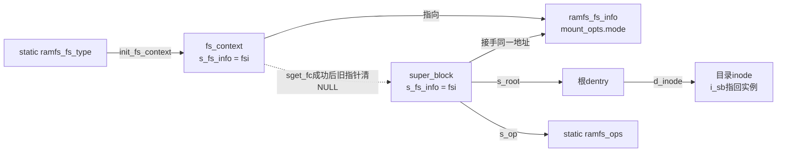
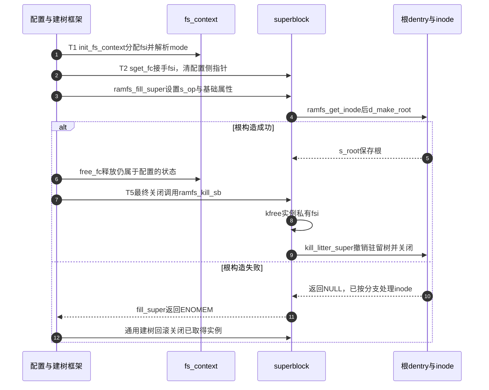

# 第70章\_ramfs配置根与实例生命期

注册ramfs只是登记一种能力。要实际存放文件，还要为每次建树建立选项、superblock和根目录，并使失败清理与正常关闭知道谁拥有私有内存。这里沿T0到T2建立这些责任，再检查T5的回收入口。

**讲解层次：实现层，Linux 6.12.20。** 固定提交 `dfaf2136deb2af2e60b994421281ba42f1c087e0`。原件：[ramfs/inode.c](../../linux/fs/ramfs/inode.c)、[ramfs.h](../../linux/include/linux/ramfs.h)、[dcache.c](../../linux/fs/dcache.c)、[inode.c](../../linux/fs/inode.c)、[libfs.c](../../linux/fs/libfs.c)。中文注释为仓库补充，执行语句保留。关联 [总索引](../navigation/P01_Linux_6.12_VFS源码阅读索引.md)、[ramfs导读](../navigation/P22_ramfs把缓存对象变成文件系统.md#22.1_沿一次实例使用定位状态) 与 [知识场景](../../../../knowledge/kernel_subsystems/vfs/P23_具体文件系统接入VFS.md#23.2_注册一种能力与创建一个实例分开)。

原件摘要及配置见 [ramfs源码基线](../../linux/SOURCE_BASELINE.md#1.302_ramfs的实例名称与页数据责任)。

## 70.1\_类型描述只注册能力而不保存实例状态

类型表有静态生命期，fs_initcall把init_ramfs_fs加入内核初始化。注册只将类型交给通用查询结构，不在这里分配用户挂载的根inode。实例操作表ramfs_ops则由每个新superblock引用；两张表都能共享，但它们描述的对象层次不同。

```c
/** @brief 仓库补充阅读说明：登记类型名字、建树入口、参数表、关闭方法及用户命名空间挂载能力。 */
static struct file_system_type ramfs_fs_type = {
        /* 仓库补充：登记类型名字、建树入口、参数表、关闭方法及用户命名空间挂载能力。 */
        .name           = "ramfs",
        .init_fs_context = ramfs_init_fs_context,
        .parameters     = ramfs_fs_parameters,
        .kill_sb        = ramfs_kill_sb,
        .fs_flags       = FS_USERNS_MOUNT,
};
```

```c
/** @brief 仓库补充阅读说明：在初始化阶段把静态类型描述登记到VFS。 */
static int __init init_ramfs_fs(void)
{
        /* 仓库补充：在初始化阶段把静态类型描述登记到VFS。 */
        return register_filesystem(&ramfs_fs_type);
}
```

FS_USERNS_MOUNT允许该类型参与用户命名空间中的挂载规则，不等于取消通用挂载权限检查。这里没有FS_ALLOW_IDMAP，后面的inode初始化使用nop_mnt_idmap；不能仅靠改一个idmap参数就宣称整个后端支持映射挂载。

| 对象及声明 | 初始化与读取者 | 实现所有权与修改边界 |
| --- | --- | --- |
| ramfs_fs_type，inode.c内static定义 | 静态初始化；register_filesystem登记，通用挂载查找类型 | [类型注册](P03_文件系统类型表的发布与持有.md#3.1_类型表在锁内怎样找到插入位置)；名字与能力标志必须与实际回调一致 |
| ramfs_fs_parameters，ramfs.h声明、inode.c定义 | 静态参数描述；ramfs_parse_param查询 | 本节与70.2；Opt_mode是本文件枚举，fsparam_u32oct要求八进制无符号参数 |
| ramfs_context_ops，inode.c内static定义 | init_fs_context赋给fc.ops；配置框架调用 | 70.2～70.3；free只释放配置仍拥有的状态 |
| ramfs_fs_info.mount_opts.mode，inode.c私有结构 | kzalloc清零后设0755，parse更新；fill_super与show_options读取 | 每请求或实例一份，不写入静态方法表 |
| ramfs_ops，inode.c内static定义 | fill_super赋给sb.s_op；VFS查询、末次iput、显示选项时调用 | 70.3；drop建议并不代替引用计数 |

表中类型注册链接用于追踪通用容器，本篇不复制注册算法。`__init`与fs_initcall是初始化布局及调用登记；它们不提供运行时每实例互斥。回调中的kzalloc/kfree负责实际分配释放，错误码控制构造回滚；没有依赖某个调试检查器才成立的所有权协议。

## 70.2\_配置指针只能由一侧负责释放

T1先分配私有选项，T2再由sget_fc接入新superblock。移交后fc.s_fs_info变为NULL，后续free_fc可以安全调用kfree(NULL)；建树前失败则仍由配置侧释放。具体移交与set失败回滚由 [实例匹配与构造交接](P06_实例匹配与构造完成的交接.md#6.2_发布前重查避免重复候选)唯一解释。

```c
/** @brief 仓库补充阅读说明：声明本后端的mode参数，空项结束描述表。 */
const struct fs_parameter_spec ramfs_fs_parameters[] = {
        /* 仓库补充：声明本后端的mode参数，空项结束描述表。 */
        fsparam_u32oct("mode",  Opt_mode),
        {}
};
```

```c
/** @brief 仓库补充阅读说明：把配置释放、参数解析和建树方法交给fs_context框架。 */
static const struct fs_context_operations ramfs_context_ops = {
        /* 仓库补充：把配置释放、参数解析和建树方法交给fs_context框架。 */
        .free           = ramfs_free_fc,
        .parse_param    = ramfs_parse_param,
        .get_tree       = ramfs_get_tree,
};
```

```c
/** @brief 仓库补充阅读说明：为一次请求建立独立选项，配置默认根权限并安装回调。 */
int ramfs_init_fs_context(struct fs_context *fc)
{
        /* 仓库补充：为一次请求建立独立选项，配置默认根权限并安装回调。 */
        struct ramfs_fs_info *fsi;
        /* 仓库补充：每个请求单独分配，失败前尚无私有地址移交。 */
        fsi = kzalloc(sizeof(*fsi), GFP_KERNEL);
        if (!fsi)
                return -ENOMEM;
        fsi->mount_opts.mode = RAMFS_DEFAULT_MODE;
        /* 仓库补充：将选项挂到配置请求；成功建实例时由sget_fc接手。 */
        fc->s_fs_info = fsi;
        fc->ops = &ramfs_context_ops;
        return 0;
}
```

```c
/** @brief 仓库补充阅读说明：解析mode与通用source，按本版本规则忽略仍未识别的参数。 */
static int ramfs_parse_param(struct fs_context *fc, struct fs_parameter *param)
{
        /* 仓库补充：解析mode与通用source，按本版本规则忽略仍未识别的参数。 */
        struct fs_parse_result result;
        struct ramfs_fs_info *fsi = fc->s_fs_info;
        int opt;
        opt = fs_parse(fc, ramfs_fs_parameters, param, &result);
        /* 仓库补充：未命中专用参数时先尝试通用source，仍不认识则按本版本规则忽略。 */
        if (opt == -ENOPARAM) {
                opt = vfs_parse_fs_param_source(fc, param);
                if (opt != -ENOPARAM)
                        return opt;
                return 0;
        }
        if (opt < 0)
                return opt;
        switch (opt) {
        case Opt_mode:
                /* 仓库补充：只接纳权限位，不允许参数改变根inode的文件类型。 */
                fsi->mount_opts.mode = result.uint_32 & S_IALLUGO;
                break;
        }
        return 0;
}
```

参数解析不是只看返回成功与否。fs_parse未识别时返回ENOPARAM，接着尝试通用source；source是否有效由通用解析返回。仍未识别时这里返回0，**没有为size建立任何容量字段**。已识别mode但值非法会返回解析错误；不能把“未知选项忽略”扩大成所有错误都忽略。mode的掩码S_IALLUGO只保留权限相关位，根的目录类型由fill_super另行组合。



同一地址出现在图中两条所有权路径，表示前后阶段的交接，不是要求两边各free一次。最小安全参数扩展需同时修改私有结构、默认值、描述表、解析、显示及真正消费路径；只加解析项仍不会出现容量控制。

## 70.3\_根构造与退出各自承担一次清理

```c
/** @brief 仓库补充阅读说明：选择不依赖块设备的新实例建树路径。 */
static int ramfs_get_tree(struct fs_context *fc)
{
        /* 仓库补充：选择不依赖块设备的新实例建树路径。 */
        return get_tree_nodev(fc, ramfs_fill_super);
}
```

```c
/** @brief 仓库补充阅读说明：设置实例属性并建立根目录，把根持有留在s_root。 */
static int ramfs_fill_super(struct super_block *sb, struct fs_context *fc)
{
        /* 仓库补充：设置实例属性并建立根目录，把根持有留在s_root。 */
        struct ramfs_fs_info *fsi = sb->s_fs_info;
        struct inode *inode;
        sb->s_maxbytes          = MAX_LFS_FILESIZE;
        sb->s_blocksize         = PAGE_SIZE;
        sb->s_blocksize_bits    = PAGE_SHIFT;
        sb->s_magic             = RAMFS_MAGIC;
        sb->s_op                = &ramfs_ops;
        sb->s_time_gran         = 1;
        /* 仓库补充：根目录依照该实例选项构造；d_make_root消费传入的inode持有。 */
        inode = ramfs_get_inode(sb, NULL, S_IFDIR | fsi->mount_opts.mode, 0);
        sb->s_root = d_make_root(inode);
        if (!sb->s_root)
                return -ENOMEM;
        return 0;
}
```

```c
/** @brief 仓库补充阅读说明：消费传入的根inode引用；dentry分配失败时归还它。 */
struct dentry *d_make_root(struct inode *root_inode)
{
        /* 仓库补充：消费传入的根inode引用；dentry分配失败时归还它。 */
        struct dentry *res = NULL;
        if (root_inode) {
                /* 仓库补充：先分配根dentry；失败分支归还传入的inode引用。 */
                res = d_alloc_anon(root_inode->i_sb);
                if (res)
                        d_instantiate(res, root_inode);
                else
                        iput(root_inode);
        }
        return res;
}
```

get_tree_nodev选择新的匿名设备实例；不是按同一个磁盘设备复用实例。s_maxbytes是文件大小界限，PAGE_SIZE/PAGE_SHIFT描述块大小，RAMFS_MAGIC供类型识别，s_time_gran为时间粒度；它们没有累计已用页数量来实施总容量上限。ramfs_get_inode的类型与mapping初始化见 [名称和驻留责任](P71_ramfs名称操作与驻留责任.md#71.1_创建成功以后把名字留在内存)。d_alloc_anon先为根分配dentry，d_instantiate交接inode关联；若分配失败，d_make_root自身iput，调用者不能再释放同一份引用。



```c
/** @brief 仓库补充阅读说明：只释放当前仍由配置请求拥有的私有地址。 */
static void ramfs_free_fc(struct fs_context *fc)
{
        /* 仓库补充：只释放当前仍由配置请求拥有的私有地址。 */
        kfree(fc->s_fs_info);
}
```

```c
/** @brief 仓库补充阅读说明：实例结束先释放选项，再让驻留树与通用实例退出。 */
void ramfs_kill_sb(struct super_block *sb)
{
        /* 仓库补充：实例结束先释放选项，再让驻留树与通用实例退出。 */
        kfree(sb->s_fs_info);
        kill_litter_super(sb);
}
```

```c
/** @brief 仓库补充阅读说明：实例查询、末次inode引用处理与挂载选项显示分别使用对应方法。 */
static const struct super_operations ramfs_ops = {
        /* 仓库补充：实例查询、末次inode引用处理与挂载选项显示分别使用对应方法。 */
        .statfs         = simple_statfs,
        .drop_inode     = generic_delete_inode,
        .show_options   = ramfs_show_options,
};
```

```c
/** @brief 仓库补充阅读说明：末次无使用引用时总是建议驱逐，不检查链接数来保留缓存inode。 */
int generic_delete_inode(struct inode *inode)
{
        /* 仓库补充：末次无使用引用时总是建议驱逐，不检查链接数来保留缓存inode。 */
        return 1;
}
```

这个建议只在末次引用路径询问。有效正名称额外持有dentry，dentry关联又保持inode，所以close并不自动进入generic_delete_inode。通用 [末次引用与驱逐](P63_最后inode引用与缓存保留.md#63.1_最后使用引用先进入缓存或驱逐决策) 和 [实例关闭](P07_实例关闭通知与最终内存回收.md#7.2_先结束公共使用再通知旧实例已退出)负责其余清理，不在ramfs_kill_sb中手工再拆一次同样的inode。

```c
/** @brief 仓库补充阅读说明：读取实例根权限选项，非默认值才输出mode字段。 */
static int ramfs_show_options(struct seq_file *m, struct dentry *root)
{
        /* 仓库补充：读取实例根权限选项，非默认值才输出mode字段。 */
        struct ramfs_fs_info *fsi = root->d_sb->s_fs_info;
        if (fsi->mount_opts.mode != RAMFS_DEFAULT_MODE)
                seq_printf(m, ",mode=%o", fsi->mount_opts.mode);
        return 0;
}
```

```c
/** @brief 仓库补充阅读说明：返回类型、页大小、匿名设备标识和名称长度，不建立容量配额。 */
int simple_statfs(struct dentry *dentry, struct kstatfs *buf)
{
        /* 仓库补充：返回类型、页大小、匿名设备标识和名称长度，不建立容量配额。 */
        u64 id = huge_encode_dev(dentry->d_sb->s_dev);
        buf->f_fsid = u64_to_fsid(id);
        buf->f_type = dentry->d_sb->s_magic;
        buf->f_bsize = PAGE_SIZE;
        buf->f_namelen = NAME_MAX;
        return 0;
}
```

show_options的seq_printf只负责输出序列，既不更新权限也不施加限制。simple_statfs的f_fsid由s_dev编码，f_bsize是PAGE_SIZE，f_namelen是NAME_MAX；未填总块数或空闲量不能解释成无限物理内存。它与ramfs_ops、私有选项一起组成查询路径，和真正分配内容的路径不同。

修改生命期时至少核对四个出口：选项分配失败、解析失败、根分配失败和正常最终关闭。改变根构造不得破坏d_make_root的引用消费约定；改变drop策略应同时检查名称驻留和清树协议。可观察验证包括非法mode、未知size、独立两次挂载的根权限，以及卸载后的私有状态释放；当前只有固定源码核对，没有内核故障注入或泄漏检测结果。
