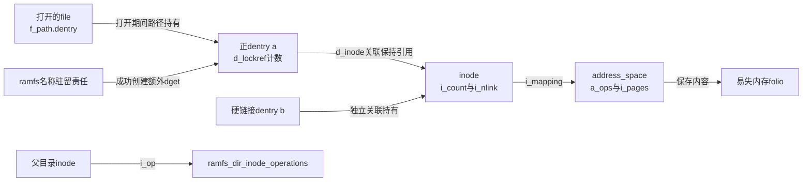
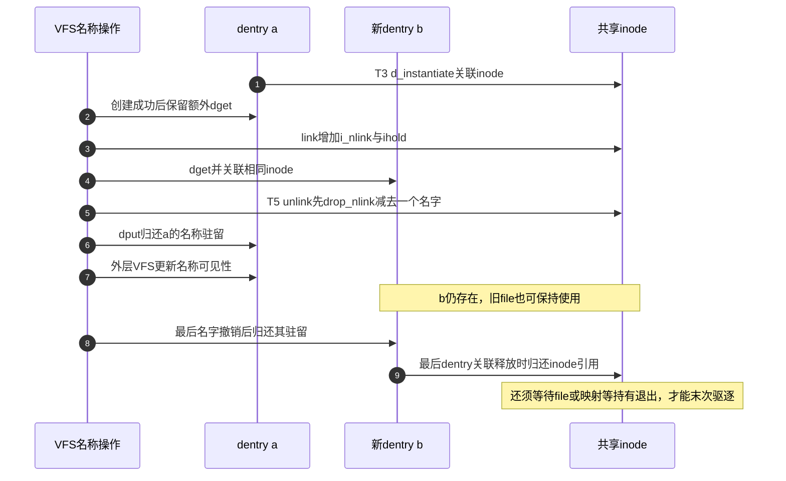

# 第71章\_ramfs名称操作与驻留责任

ramfs没有另一份磁盘目录，不能在用户关闭文件以后丢掉仍有效的名字。本篇沿T3创建、T4使用和T5撤销解释额外持有的配对；目录方法表只是这些责任的入口集合。

**讲解层次：实现层，Linux 6.12.20。** 固定提交 `dfaf2136deb2af2e60b994421281ba42f1c087e0`。原件：[ramfs/inode.c](../../linux/fs/ramfs/inode.c)、[libfs.c](../../linux/fs/libfs.c)、[ramfs.h](../../linux/include/linux/ramfs.h)、[dcache.h](../../linux/include/linux/dcache.h)、[security.h](../../linux/include/linux/security.h)。中文注释为仓库补充，执行语句保留。入口为 [总索引](../navigation/P01_Linux_6.12_VFS源码阅读索引.md)、[ramfs导读](../navigation/P22_ramfs把缓存对象变成文件系统.md#22.1_沿一次实例使用定位状态) 和 [创建场景](../../../../knowledge/kernel_subsystems/vfs/P23_具体文件系统接入VFS.md#23.3_创建名称时为什么多取一次持有)。

原件摘要及配置见 [ramfs源码基线](../../linux/SOURCE_BASELINE.md#1.302_ramfs的实例名称与页数据责任)。

## 71.1\_创建成功以后把名字留在内存

new_inode取得一个新inode并与实例建立关系。ramfs_get_inode为它分配编号、初始化属主和时间，再按文件类型选操作表。所有类型先设置ram_aops与mapping分配属性；普通文件选择ramfs文件表，目录选择目录方法，符号链接选择页式链接方法，其他特殊类型交给init_special_inode。

```c
/** @brief 仓库补充阅读说明：建立inode的类型能力与内存mapping策略，分配失败返回NULL。 */
struct inode *ramfs_get_inode(struct super_block *sb,
                                const struct inode *dir, umode_t mode, dev_t dev)
{
        /* 仓库补充：建立inode的类型能力与内存mapping策略，分配失败返回NULL。 */
        struct inode * inode = new_inode(sb);
        if (inode) {
                inode->i_ino = get_next_ino();
                inode_init_owner(&nop_mnt_idmap, inode, dir, mode);
                /* 仓库补充：mapping的页数据由内存后端负责，不交给磁盘写回。 */
                inode->i_mapping->a_ops = &ram_aops;
                mapping_set_gfp_mask(inode->i_mapping, GFP_HIGHUSER);
                mapping_set_unevictable(inode->i_mapping);
                simple_inode_init_ts(inode);
                /* 仓库补充：同一分配入口按类型选择不同操作表，不把目录和普通文件混用。 */
                switch (mode & S_IFMT) {
                default:
                        init_special_inode(inode, mode, dev);
                        break;
                case S_IFREG:
                        inode->i_op = &ramfs_file_inode_operations;
                        inode->i_fop = &ramfs_file_operations;
                        break;
                case S_IFDIR:
                        inode->i_op = &ramfs_dir_inode_operations;
                        inode->i_fop = &simple_dir_operations;
                        /* 仓库补充：目录初始链接数增加一份，配合目录创建和删除记账。 */
                        inc_nlink(inode);
                        break;
                case S_IFLNK:
                        inode->i_op = &page_symlink_inode_operations;
                        inode_nohighmem(inode);
                        break;
                }
        }
        return inode;
}
```

GFP_HIGHUSER允许数据页采用适合用户页的分配区域，mapping_set_unevictable使其不走普通可驱逐页缓存的回收策略。符号链接随后inode_nohighmem收紧其页分配区域，不能只看前一个公共赋值。i_ino用于实例内对象标识；它不是磁盘上的inode地址。目录在初始链接数上增加一份，父目录的链接数量则在mkdir成功后另行更新。

```c
/** @brief 仓库补充阅读说明：在安全初始化成功后交接inode并额外保留名称dentry。 */
static int
ramfs_mknod(struct mnt_idmap *idmap, struct inode *dir,
            struct dentry *dentry, umode_t mode, dev_t dev)
{
        /* 仓库补充：在安全初始化成功后交接inode并额外保留名称dentry。 */
        struct inode * inode = ramfs_get_inode(dir->i_sb, dir, mode, dev);
        int error = -ENOSPC;
        if (inode) {
                error = security_inode_init_security(inode, dir,
                                                     &dentry->d_name, NULL,
                                                     NULL);
                /* 仓库补充：安全初始化失败还没有建立dentry关联，直接归还新inode。 */
                if (error) {
                        iput(inode);
                        goto out;
                }
                /* 仓库补充：先建立关联，再以额外dentry持有保留这个有效名字。 */
                d_instantiate(dentry, inode);
                dget(dentry);
                error = 0;
                inode_set_mtime_to_ts(dir, inode_set_ctime_current(dir));
        }
out:
        return error;
}
```

```c
/** @brief 仓库补充阅读说明：把普通文件类型加入mode后复用创建过程。 */
static int ramfs_create(struct mnt_idmap *idmap, struct inode *dir,
                        struct dentry *dentry, umode_t mode, bool excl)
{
        /* 仓库补充：把普通文件类型加入mode后复用创建过程。 */
        return ramfs_mknod(&nop_mnt_idmap, dir, dentry, mode | S_IFREG, 0);
}
```

```c
/** @brief 仓库补充阅读说明：建立目录后才增加父目录链接数，失败不增加。 */
static int ramfs_mkdir(struct mnt_idmap *idmap, struct inode *dir,
                       struct dentry *dentry, umode_t mode)
{
        /* 仓库补充：建立目录后才增加父目录链接数，失败不增加。 */
        int retval = ramfs_mknod(&nop_mnt_idmap, dir, dentry, mode | S_IFDIR, 0);
        if (!retval)
                inc_nlink(dir);
        return retval;
}
```

VFS先完成父目录同步与候选查找，再调用这些后端方法；ramfs不在这里另建一套名称锁。security_inode_init_security是功能性的安全初始化入口，可能拒绝创建，失败必须iput尚未交接的inode。当前CONFIG_SECURITY关闭时其头文件退化返回0；不是“所有配置下都不会失败”。create的excl和idmap形参不在本函数消费，排他创建条件由外层VFS处理，ramfs本身不声明FS_ALLOW_IDMAP。



图中i_nlink表达名称链接数量，i_count表达inode使用生命期，d_lockref表达dentry使用和驻留责任。它们互相关联但不能用一个计数代替三个问题。d_instantiate的唯一实现见 [建立inode关联](P11_名称候选的建立发布与持有.md#11.3_建立inode关联不能代替发布名称索引)；它没有替任意裸dentry完成全部名称索引发布。

## 71.2\_链接目标与未命名文件有不同的成功点

符号链接先把目标字符串写入页式存储，再接inode并额外持有名字。目标内容建立失败时仍须iput，不能留下一个成功发布但无内容的名字。未命名临时文件则没有普通目录名字要保留，使用d_tmpfile和finish_open_simple完成专门交接。

```c
/** @brief 仓库补充阅读说明：内容建立和安全初始化成功以后，才交接inode并保留名称。 */
static int ramfs_symlink(struct mnt_idmap *idmap, struct inode *dir,
                         struct dentry *dentry, const char *symname)
{
        /* 仓库补充：内容建立和安全初始化成功以后，才交接inode并保留名称。 */
        struct inode *inode;
        int error = -ENOSPC;
        inode = ramfs_get_inode(dir->i_sb, dir, S_IFLNK|S_IRWXUGO, 0);
        if (inode) {
                int l = strlen(symname)+1;
                error = security_inode_init_security(inode, dir,
                                                     &dentry->d_name, NULL,
                                                     NULL);
                if (error) {
                        iput(inode);
                        goto out;
                }
                /* 仓库补充：先建立链接目标内容，成功以后才保留名称关联。 */
                error = page_symlink(inode, symname, l);
                if (!error) {
                        d_instantiate(dentry, inode);
                        dget(dentry);
                        inode_set_mtime_to_ts(dir,
                                              inode_set_ctime_current(dir));
                } else
                        iput(inode);
        }
out:
        return error;
}
```

```c
/** @brief 仓库补充阅读说明：把未命名inode交给临时文件协议，不套用普通名称的额外持有。 */
static int ramfs_tmpfile(struct mnt_idmap *idmap,
                         struct inode *dir, struct file *file, umode_t mode)
{
        /* 仓库补充：把未命名inode交给临时文件协议，不套用普通名称的额外持有。 */
        struct inode *inode;
        int error;
        inode = ramfs_get_inode(dir->i_sb, dir, mode, 0);
        if (!inode)
                return -ENOSPC;
        error = security_inode_init_security(inode, dir,
                                             &file_dentry(file)->d_name, NULL,
                                             NULL);
        if (error) {
                iput(inode);
                goto out;
        }
        /* 仓库补充：未命名临时文件使用专门交接，不按普通正名称多取dget。 */
        d_tmpfile(file, inode);
out:
        return finish_open_simple(file, error);
}
```

page_symlink负责页式目标内容，strlen加一包括终止字节；inode_nohighmem与page_symlink_inode_operations配合其访问约定。d_tmpfile为未命名文件安排dentry与inode关系及链接记账，finish_open_simple完成简化打开及错误返回。本篇保留这两个调用的生命期边界，不展开临时文件后续linkat资格与页式链接解引用算法；它们不是主实验中创建普通文件a的路径。

## 71.3\_查找与硬链接必须保持同一份名称模型

```c
/** @brief 仓库补充阅读说明：集中登记名称操作，VFS根据操作种类选择入口。 */
static const struct inode_operations ramfs_dir_inode_operations = {
        /* 仓库补充：集中登记名称操作，VFS根据操作种类选择入口。 */
        .create         = ramfs_create,
        .lookup         = simple_lookup,
        .link           = simple_link,
        .unlink         = simple_unlink,
        .symlink        = ramfs_symlink,
        .mkdir          = ramfs_mkdir,
        .rmdir          = simple_rmdir,
        .mknod          = ramfs_mknod,
        .rename         = simple_rename,
        .tmpfile        = ramfs_tmpfile,
};
```

这张表没有另一份目录数据库。有效名字已经保留在dcache；simple_lookup对未找到的候选建立负结果。simple_dentry_operations选择末次释放时删除的策略，它不是“只删除负dentry”：正项由于额外持有尚未到达末次释放，才不会被这个策略提前删掉。

```c
/** @brief 仓库补充阅读说明：在末次释放决策点建议删除该dentry，不自行扣减引用。 */
int always_delete_dentry(const struct dentry *dentry)
{
        /* 仓库补充：在末次释放决策点建议删除该dentry，不自行扣减引用。 */
        return 1;
}
```

```c
/** @brief 仓库补充阅读说明：把末次释放判断交给always_delete_dentry。 */
const struct dentry_operations simple_dentry_operations = {
        /* 仓库补充：把末次释放判断交给always_delete_dentry。 */
        .d_delete = always_delete_dentry,
};
```

```c
/** @brief 仓库补充阅读说明：拒绝过长名称，为没有后备目录内容的候选登记负结果。 */
struct dentry *simple_lookup(struct inode *dir, struct dentry *dentry, unsigned int flags)
{
        /* 仓库补充：拒绝过长名称，为没有后备目录内容的候选登记负结果。 */
        if (dentry->d_name.len > NAME_MAX)
                return ERR_PTR(-ENAMETOOLONG);
        /* 仓库补充：实例没有自定dentry操作时，为当前候选选择末次释放策略。 */
        if (!dentry->d_sb->s_d_op)
                d_set_d_op(dentry, &simple_dentry_operations);
        d_add(dentry, NULL);
        return NULL;
}
```

```c
/** @brief 仓库补充阅读说明：给新名字分别建立链接数量、inode关联引用和dentry驻留引用。 */
int simple_link(struct dentry *old_dentry, struct inode *dir, struct dentry *dentry)
{
        /* 仓库补充：给新名字分别建立链接数量、inode关联引用和dentry驻留引用。 */
        struct inode *inode = d_inode(old_dentry);
        inode_set_mtime_to_ts(dir,
                              inode_set_ctime_to_ts(dir, inode_set_ctime_current(inode)));
        /* 仓库补充：链接计数、inode关联持有和新名字持有分别增加，不能互相代替。 */
        inc_nlink(inode);
        ihold(inode);
        dget(dentry);
        d_instantiate(dentry, inode);
        return 0;
}
```

simple_lookup只在实例未设置s_d_op时给候选安装通用dentry操作；不能据此覆盖所有后端自己的策略。d_add(dentry,NULL)的发布和并行查找交接见 [发布名称结果](P11_名称候选的建立发布与持有.md#11.4_发布结果时结束并行查询再供后续查找)。simple_link对旧inode增加i_nlink与ihold，并dget新dentry再交接关联；不能删掉ihold来“避免重复计数”，两个计数的责任不同。



图表示责任先后，不给并发环境中的总引用数赋一个固定常数。simple_unlink内部先drop_nlink再dput，图与下方代码采用同一顺序。

## 71.4\_删除和改名各自归还什么

```c
/** @brief 仓库补充阅读说明：在父子dentry锁保护下检查是否仍有有效正子项。 */
int simple_empty(struct dentry *dentry)
{
        /* 仓库补充：在父子dentry锁保护下检查是否仍有有效正子项。 */
        struct dentry *child;
        int ret = 0;
        /* 仓库补充：遍历父目录子项期间保护链表，并逐个锁住被检查的子dentry。 */
        spin_lock(&dentry->d_lock);
        hlist_for_each_entry(child, &dentry->d_children, d_sib) {
                spin_lock_nested(&child->d_lock, DENTRY_D_LOCK_NESTED);
                /* 仓库补充：只要仍有有效正名称就不是空目录，负查找结果不算文件。 */
                if (simple_positive(child)) {
                        spin_unlock(&child->d_lock);
                        goto out;
                }
                spin_unlock(&child->d_lock);
        }
        ret = 1;
out:
        spin_unlock(&dentry->d_lock);
        return ret;
}
```

simple_positive要求子项有inode且仍在名称索引中，负项不阻止空目录判断。d_children/d_sib承载父子关系，d_lock保护遍历与检查；spin_lock_nested仍然取得实际自旋锁，DENTRY_D_LOCK_NESTED只是为lockdep区分嵌套层次，关闭检查不会删除实际互斥。

```c
/** @brief 仓库补充阅读说明：减少链接数和名称驻留引用，已有使用者不在这里被强行关闭。 */
int simple_unlink(struct inode *dir, struct dentry *dentry)
{
        /* 仓库补充：减少链接数和名称驻留引用，已有使用者不在这里被强行关闭。 */
        struct inode *inode = d_inode(dentry);
        inode_set_mtime_to_ts(dir,
                              inode_set_ctime_to_ts(dir, inode_set_ctime_current(inode)));
        /* 仓库补充：撤销一份链接数量及名称驻留持有；名称可见性由外层VFS继续处理。 */
        drop_nlink(inode);
        dput(dentry);
        return 0;
}
```

```c
/** @brief 仓库补充阅读说明：空目录才允许删除，同时调整子目录与父目录链接计数。 */
int simple_rmdir(struct inode *dir, struct dentry *dentry)
{
        /* 仓库补充：空目录才允许删除，同时调整子目录与父目录链接计数。 */
        if (!simple_empty(dentry))
                return -ENOTEMPTY;
        /* 仓库补充：空目录自身与父目录的链接记账要一起减少。 */
        drop_nlink(d_inode(dentry));
        simple_unlink(dir, dentry);
        drop_nlink(dir);
        return 0;
}
```

```c
/** @brief 仓库补充阅读说明：为涉及的目录与inode更新规定的修改时间。 */
void simple_rename_timestamp(struct inode *old_dir, struct dentry *old_dentry,
                             struct inode *new_dir, struct dentry *new_dentry)
{
        /* 仓库补充：为涉及的目录与inode更新规定的修改时间。 */
        struct inode *newino = d_inode(new_dentry);
        inode_set_mtime_to_ts(old_dir, inode_set_ctime_current(old_dir));
        if (new_dir != old_dir)
                inode_set_mtime_to_ts(new_dir,
                                      inode_set_ctime_current(new_dir));
        inode_set_ctime_current(d_inode(old_dentry));
        if (newino)
                inode_set_ctime_current(newino);
}
```

```c
/** @brief 仓库补充阅读说明：跨目录交换不同类型时调整父链接数，再更新时间。 */
int simple_rename_exchange(struct inode *old_dir, struct dentry *old_dentry,
                           struct inode *new_dir, struct dentry *new_dentry)
{
        /* 仓库补充：跨目录交换不同类型时调整父链接数，再更新时间。 */
        bool old_is_dir = d_is_dir(old_dentry);
        bool new_is_dir = d_is_dir(new_dentry);
        /* 仓库补充：跨父目录交换且类型不同才转移父目录链接数量。 */
        if (old_dir != new_dir && old_is_dir != new_is_dir) {
                if (old_is_dir) {
                        drop_nlink(old_dir);
                        inc_nlink(new_dir);
                } else {
                        drop_nlink(new_dir);
                        inc_nlink(old_dir);
                }
        }
        simple_rename_timestamp(old_dir, old_dentry, new_dir, new_dentry);
        return 0;
}
```

```c
/** @brief 仓库补充阅读说明：校验支持的标志并处理目标覆盖和目录链接计数，留下dcache移动给VFS。 */
int simple_rename(struct mnt_idmap *idmap, struct inode *old_dir,
                  struct dentry *old_dentry, struct inode *new_dir,
                  struct dentry *new_dentry, unsigned int flags)
{
        /* 仓库补充：校验支持的标志并处理目标覆盖和目录链接计数，留下dcache移动给VFS。 */
        int they_are_dirs = d_is_dir(old_dentry);
        if (flags & ~(RENAME_NOREPLACE | RENAME_EXCHANGE))
                return -EINVAL;
        /* 仓库补充：交换路径有自己的链接计数协议，不走覆盖目标分支。 */
        if (flags & RENAME_EXCHANGE)
                return simple_rename_exchange(old_dir, old_dentry, new_dir, new_dentry);
        if (!simple_empty(new_dentry))
                return -ENOTEMPTY;
        /* 仓库补充：覆盖目标先归还目标名称的责任；本函数不负责dcache拓扑移动。 */
        if (d_really_is_positive(new_dentry)) {
                simple_unlink(new_dir, new_dentry);
                if (they_are_dirs) {
                        drop_nlink(d_inode(new_dentry));
                        drop_nlink(old_dir);
                }
        } else if (they_are_dirs) {
                drop_nlink(old_dir);
                inc_nlink(new_dir);
        }
        simple_rename_timestamp(old_dir, old_dentry, new_dir, new_dentry);
        return 0;
}
```

RENAME_NOREPLACE虽在允许掩码中，是否已存在目标由外层VFS先检查；本函数不重复所有前置验证。RENAME_EXCHANGE走交换分支；普通覆盖先simple_unlink目标，目录还要调整对应父子链接数量。simple_rename_timestamp只是时间更新，绝不等同于名字交换。实际锁序与后端成功后的缓存移动分别见 [重命名交接](P21_重命名的拓扑检查与锁顺序.md#21.4_后端成功后才执行对应缓存交接) 和 [缓存名称移动](P22_缓存名称移动与读侧序列交接.md#22.2_移动要同时维护名字父关系和索引)。

| 实现簇与声明 | 写入或消费点 | 修改必须保持的配对 |
| --- | --- | --- |
| ramfs_get_inode，ramfs.h声明；名称回调为inode.c内static | 创建时写i_op/i_fop/a_ops、权限、时间及分配策略 | 普通、目录、符号链接和特殊文件分支不能共用错误方法表 |
| ramfs_dir_inode_operations，inode.c内static；simple系列由fs.h声明、libfs.c定义 | VFS选择回调，创建/链接写名称与计数，删除归还 | 成功交接后不再iput原引用；失败未交接必须归还 |
| simple_dentry_operations与always_delete_dentry，fs.h声明、libfs.c定义 | simple_lookup安装；末次dput路径读取 | 额外名称持有与unlink、清树必须成对 |
| simple_empty与重命名辅助函数 | 锁内读父子关系，更新i_nlink与时间 | 不在后端重复d_move，不省掉外层拓扑与类型检查 |
| 时间访问器、d_inode、d_is_dir、d_really_is_positive | 取得对象、判断类型、更新元数据 | 这些不是额外持有；不能把访问器返回值当成新增引用 |

修改一个创建分支时，用分配失败、安全拒绝、内容建立失败、成功后关闭再打开、硬链接后删一名、覆盖重命名及空目录删除逐项检查。最后dput/iput的通用算法见 [名称最后使用者退出](P12_名称失效与最后使用者退出.md#12.6_销毁同时归还别名父关系和最终内存) 与 [inode末次引用](P63_最后inode引用与缓存保留.md#63.1_最后使用引用先进入缓存或驱逐决策)。没有真实并发和故障注入结果时，不把源码配对检查写成压力测试已经通过。

ramfs_get_inode的特殊类型分支进入 [init_special_inode及公共打开](P73_特殊inode的类型选择与打开分派.md#73.1_类型位决定初始入口而非最终服务)，只设置类型入口和设备号，实际设备状态另由对应子系统负责。
