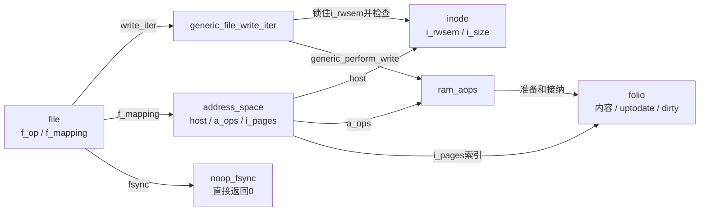
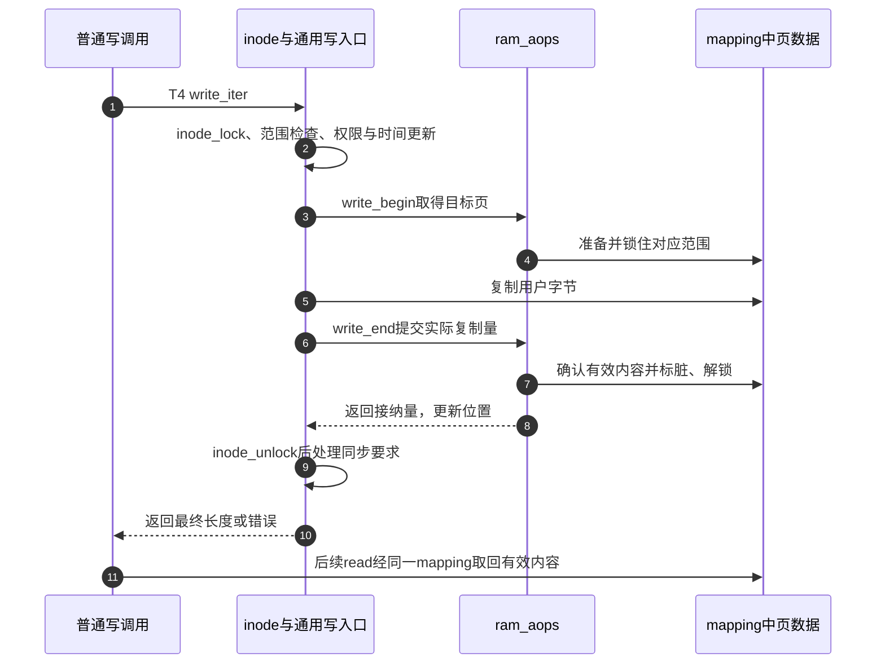

# 第72章\_ramfs页数据与文件操作表

有效名称把inode留在内存，内容还需要自己的存放和访问协议。本篇沿T4观察普通文件方法怎样进入mapping，解释为何noop_dirty_folio仍修改状态，而noop_fsync返回成功也不会产生磁盘副本。

**讲解层次：实现层，Linux 6.12.20。** 固定提交 `dfaf2136deb2af2e60b994421281ba42f1c087e0`。原件：[Makefile](../../linux/fs/ramfs/Makefile)、[file-mmu.c](../../linux/fs/ramfs/file-mmu.c)、[file-nommu.c](../../linux/fs/ramfs/file-nommu.c)、[internal.h](../../linux/fs/ramfs/internal.h)、[libfs.c](../../linux/fs/libfs.c)、[filemap.c](../../linux/mm/filemap.c)、[page-writeback.c](../../linux/mm/page-writeback.c)。中文注释为仓库补充，执行语句保留。关联 [总索引](../navigation/P01_Linux_6.12_VFS源码阅读索引.md)、[ramfs导读](../navigation/P22_ramfs把缓存对象变成文件系统.md#22.1_沿一次实例使用定位状态) 和 [内存字节访问场景](../../../../knowledge/kernel_subsystems/vfs/P23_具体文件系统接入VFS.md#23.4_操作表怎样把读写引到内存字节)。

原件摘要及配置见 [ramfs源码基线](../../linux/SOURCE_BASELINE.md#1.302_ramfs的实例名称与页数据责任)。

## 72.1\_MMU构建选择具体文件操作表

Makefile先把file-mmu-y设为file-nommu.o；CONFIG_MMU=y时，同一个变量被改为file-mmu.o。ramfs-objs由inode.o与选出的文件组成。因此同名表在当前构建中只来自一套实现，不能把有MMU的映射路径和无MMU的分配约束拼成一条调用链。

```c
/** @brief 仓库补充阅读说明：MMU构建中的普通文件操作入口，共享方法但不共享每次打开的位置。 */
const struct file_operations ramfs_file_operations = {
        /* 仓库补充：MMU构建中的普通文件操作入口，共享方法但不共享每次打开的位置。 */
        .read_iter      = generic_file_read_iter,
        .write_iter     = generic_file_write_iter,
        .mmap           = generic_file_mmap,
        .fsync          = noop_fsync,
        .splice_read    = filemap_splice_read,
        .splice_write   = iter_file_splice_write,
        .llseek         = generic_file_llseek,
        .get_unmapped_area      = ramfs_mmu_get_unmapped_area,
};
```

```c
/** @brief 仓库补充阅读说明：把普通文件属性读写交给内存对象方法。 */
const struct inode_operations ramfs_file_inode_operations = {
        /* 仓库补充：把普通文件属性读写交给内存对象方法。 */
        .setattr        = simple_setattr,
        .getattr        = simple_getattr,
};
```

```c
/** @brief 仓库补充阅读说明：为页缓存提供读入、写准备、接纳与标脏，不登记磁盘写回方法。 */
const struct address_space_operations ram_aops = {
        /* 仓库补充：为页缓存提供读入、写准备、接纳与标脏，不登记磁盘写回方法。 */
        .read_folio     = simple_read_folio,
        .write_begin    = simple_write_begin,
        .write_end      = simple_write_end,
        .dirty_folio    = noop_dirty_folio,
};
```

| 符号及定义位置 | 初始化与消费 | 当前展开位置 |
| --- | --- | --- |
| ramfs_file_operations，file-mmu.c定义、ramfs.h声明 | ramfs_get_inode赋i_fop，打开时取得f_op | 本节；MMU关闭改选file-nommu.c，不以当前表外推 |
| ramfs_file_inode_operations，internal.h声明 | 普通inode的i_op读取，属性入口调用 | 72.3；不是目录i_op |
| ram_aops，libfs.c定义、fs.h声明 | inode的mapping.a_ops读取 | 本节及72.2，write_begin/end在既有实现唯一展开 |
| read_iter / write_iter | 使用file.f_mapping与kiocb.ki_pos | [通用读入口](P41_直接IO的缓存交接与实现入口.md#41.2_通用读写入口如何表达回退) 与72.2 |
| mmap / get_unmapped_area | VMA连接文件mapping；后者选择虚拟地址区间 | [映射发布](P45_文件映射的发布与引用归还.md#45.2_操作表决定以后由谁接住缺页) 与下方包装 |
| splice_read / splice_write / llseek | 页缓存到管道、管道迭代写、文件位置调整 | 本次只记录方法契约，实验不走管道splice或seek，不据此推导零复制与并发位置保证 |
| fsync / setattr / getattr | 同步请求、属性更新、属性读取 | 72.3分别解释，不能互相代替 |

```c
/** @brief 仓库补充阅读说明：把地址区间选择交给当前进程mm的通用入口，不在此分配文件内容。 */
static unsigned long ramfs_mmu_get_unmapped_area(struct file *file,
                unsigned long addr, unsigned long len, unsigned long pgoff,
                unsigned long flags)
{
        /* 仓库补充：把地址区间选择交给当前进程mm的通用入口，不在此分配文件内容。 */
        return mm_get_unmapped_area(current->mm, file, addr, len, pgoff, flags);
}
```

addr、len、pgoff和flags是映射区间请求，mm_get_unmapped_area负责按当前mm及文件规则选区间；返回地址不证明页已经驻留。当前实验只走普通缓冲I/O，未展开地址空间选址算法、管道splice算法或无MMU的连续映射方案，它们不参与“关闭后内容保留”的证明。



这里的共享是同一文件mapping及其页数据共享，不是所有ramfs实例共用一个mapping。方法表是静态能力，内容状态仍归各inode的address_space。

## 72.2\_缓冲写入后留下的是实际内容

```c
/** @brief 仓库补充阅读说明：在inode同步范围内检查并接纳写入，再按请求完成同步要求。 */
ssize_t generic_file_write_iter(struct kiocb *iocb, struct iov_iter *from)
{
        /* 仓库补充：在inode同步范围内检查并接纳写入，再按请求完成同步要求。 */
        struct file *file = iocb->ki_filp;
        struct inode *inode = file->f_mapping->host;
        ssize_t ret;
        /* 仓库补充：序列化通用写检查与内容接纳，退出锁以后才执行同步要求。 */
        inode_lock(inode);
        ret = generic_write_checks(iocb, from);
        if (ret > 0)
                ret = __generic_file_write_iter(iocb, from);
        inode_unlock(inode);
        if (ret > 0)
                ret = generic_write_sync(iocb, ret);
        return ret;
}
```

```c
/** @brief 仓库补充阅读说明：先处理权限与时间副作用，再选择通用直接或缓冲路径。 */
ssize_t __generic_file_write_iter(struct kiocb *iocb, struct iov_iter *from)
{
        /* 仓库补充：先处理权限与时间副作用，再选择通用直接或缓冲路径。 */
        struct file *file = iocb->ki_filp;
        struct address_space *mapping = file->f_mapping;
        struct inode *inode = mapping->host;
        ssize_t ret;
        /* 仓库补充：写入前更新权限副作用及时间；任何失败直接返回。 */
        ret = file_remove_privs(file);
        if (ret)
                return ret;
        ret = file_update_time(file);
        if (ret)
                return ret;
        /* 仓库补充：通用函数同时服务其他后端；此分支存在不证明ramfs支持直接IO。 */
        if (iocb->ki_flags & IOCB_DIRECT) {
                ret = generic_file_direct_write(iocb, from);
                if (ret < 0 || !iov_iter_count(from) || IS_DAX(inode))
                        return ret;
                return direct_write_fallback(iocb, from, ret,
                                generic_perform_write(iocb, from));
        }
        return generic_perform_write(iocb, from);
}
```

generic_write_checks调整并检查本次写入范围，file_remove_privs处理写入导致的特权位等变化，file_update_time更新时间；失败就不进入后续内容复制。inode_lock/unlock使用inode.i_rwsem同步这一写入口。generic_write_sync在接纳成功且同步标志要求时调用相应同步协议，其返回值可能改变最终报告；它不是所有缓冲写都写一次磁盘。

完整函数保留IOCB_DIRECT分支，因为它也服务其他后端。ramfs的ram_aops没有direct_IO，文件表也没有open方法为其设置专门能力；[打开能力检查](P26_file初始化与打开后失败清理.md#26.3_具体打开前取得自己的持有与操作表)会拒绝不支持的O_DIRECT。不能因为复用了这个通用函数就宣称ramfs存在直接I/O设备通道。IS_DAX、iov_iter_count和direct_write_fallback服务其他后端的通用分支，唯一细节见 [直接I/O交接](P41_直接IO的缓存交接与实现入口.md#41.2_通用读写入口如何表达回退)。

当前缓冲分支中的generic_perform_write及simple_write_begin/end见 [接纳循环](P36_缓冲写的准备接纳与标脏.md#36.1_通用循环以接纳量提交进度) 与 [ram_aops准备结束协议](P36_缓冲写的准备接纳与标脏.md#36.2_ram_aops怎样兑现最小准备和结束协议)。准备取得锁住的页，复制后结束方法确认接纳、更新i_size并标脏；返回的接纳量才推进本次写位置，不能把尝试长度当成最终写入量。

```c
/** @brief 仓库补充阅读说明：为没有后备数据的新folio建立零内容、缓存一致性与有效状态，再解锁。 */
static int simple_read_folio(struct file *file, struct folio *folio)
{
        /* 仓库补充：为没有后备数据的新folio建立零内容、缓存一致性与有效状态，再解锁。 */
        /* 仓库补充：没有后备介质读入步骤，整个新folio建立零内容。 */
        folio_zero_range(folio, 0, folio_size(folio));
        flush_dcache_folio(folio);
        folio_mark_uptodate(folio);
        folio_unlock(folio);
        return 0;
}
```

```c
/** @brief 仓库补充阅读说明：把folio脏位设为真并报告是否首次改变，不执行设备写回记账。 */
bool noop_dirty_folio(struct address_space *mapping, struct folio *folio)
{
        /* 仓库补充：把folio脏位设为真并报告是否首次改变，不执行设备写回记账。 */
        /* 仓库补充：仍要设置脏位；省去的是后备设备写回记账。 */
        if (!folio_test_dirty(folio))
                return !folio_test_set_dirty(folio);
        return false;
}
```

folio_zero_range覆盖整个folio，flush_dcache_folio完成该路径所需的数据缓存维护，mark_uptodate表示内容可使用，unlock完成本次读入交接。已有有效页不会每读一次都被这个方法清零。noop_dirty_folio在原来未脏时test_set_dirty；并发已经设置时返回false，表示本次没有首次置脏，绝不表示当前页是干净的。



失败也在这一协议内：检查失败不进入复制，准备失败不提交接纳；短复制由write_end和循环处理，不能跳过结束方法留下锁住的页。该内存后端没有把页内容清理后写往块设备的writepages方法，mapping_set_unevictable与名称驻留共同使有效内容不被普通缓存淘汰策略丢掉。截断与最终驱逐仍可以按各自协议撤销内容，不等于页永远无法释放。

## 72.3\_属性和同步接口必须按后端契约理解

```c
/** @brief 仓库补充阅读说明：内存后端没有额外持久化动作，这个方法直接返回成功。 */
int noop_fsync(struct file *file, loff_t start, loff_t end, int datasync)
{
        /* 仓库补充：内存后端没有额外持久化动作，这个方法直接返回成功。 */
        return 0;
}
```

```c
/** @brief 仓库补充阅读说明：从inode填属性，并把当前页数换算成512字节单位的占用量。 */
int simple_getattr(struct mnt_idmap *idmap, const struct path *path,
                   struct kstat *stat, u32 request_mask,
                   unsigned int query_flags)
{
        /* 仓库补充：从inode填属性，并把当前页数换算成512字节单位的占用量。 */
        struct inode *inode = d_inode(path->dentry);
        generic_fillattr(&nop_mnt_idmap, request_mask, inode, stat);
        stat->blocks = inode->i_mapping->nrpages << (PAGE_SHIFT - 9);
        return 0;
}
```

```c
/** @brief 仓库补充阅读说明：先校验属性请求，大小变化执行截断，再复制属性并标记inode修改。 */
int simple_setattr(struct mnt_idmap *idmap, struct dentry *dentry,
                   struct iattr *iattr)
{
        /* 仓库补充：先校验属性请求，大小变化执行截断，再复制属性并标记inode修改。 */
        struct inode *inode = d_inode(dentry);
        int error;
        error = setattr_prepare(idmap, dentry, iattr);
        if (error)
                return error;
        /* 仓库补充：大小变化必须执行截断撤销，再复制其余属性。 */
        if (iattr->ia_valid & ATTR_SIZE)
                truncate_setsize(inode, iattr->ia_size);
        setattr_copy(idmap, inode, iattr);
        mark_inode_dirty(inode);
        return 0;
}
```

noop_fsync不读取start、end、datasync来安排I/O。成功只说明该后端没有额外同步动作，不能变成断电持久性证据。simple_getattr使用nop_mnt_idmap填充属性，nrpages左移PAGE_SHIFT减9得到512字节单位的blocks；该值并不表示真实磁盘分配。

setattr_prepare校验请求，失败不复制新属性。ATTR_SIZE触发truncate_setsize，其中页表和页缓存撤销见 [截断交接](P50_映射同步与截断撤销.md#50.2_截断在缓存删除前后各撤销一次页表)；随后setattr_copy复制被请求的属性，mark_inode_dirty记录元数据变化。这些都是功能状态更新，不是诊断标志；也不能因为标脏函数被调用，就推导出ramfs拥有磁盘写回后端。

**实现原理与修改边界**：最小修改不能只替换某个函数指针。若增加后备存储，必须共同设计read_folio、write_begin/end、dirty_folio、写回、fsync和出错协议；若更改页驻留策略，必须回答有效内容从哪里重建。修改getattr的占用统计要保留单位，修改setattr要检查截断的页表撤销及失败次序，修改MMU选择要同时检查另一构建分支的同名符号。C实验只验证少量字节、名称变更和重开预期，当前没有Linux执行、内存压力、映射截断竞态或持久化测试结果。
