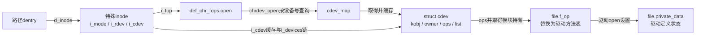
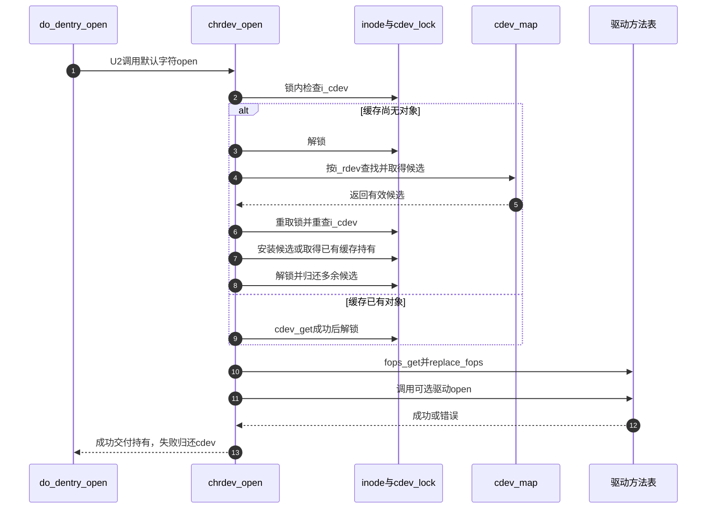

# 第73章\_特殊inode的类型选择与打开分派

设备节点已经能够通过路径查到，但路径所在文件系统并不知道驱动如何收发数据。U1的类型初始化先安装公共入口，U2的打开再取得具体后端；本篇只展开这段VFS交接，设备号登记与硬件生命期由字符设备专题负责。

**讲解层次：实现层，Linux 6.12.20。** 固定提交 `dfaf2136deb2af2e60b994421281ba42f1c087e0`。原件：[inode.c](../../linux/fs/inode.c)、[char_dev.c](../../linux/fs/char_dev.c)、[fs.h](../../linux/include/linux/fs.h)、[cdev.h](../../linux/include/linux/cdev.h)。中文注释为仓库补充，执行语句保留。关联 [VFS总索引](../navigation/P01_Linux_6.12_VFS源码阅读索引.md)、[特殊对象导读](../navigation/P23_特殊文件与匿名对象的VFS交接.md#23.1_沿建立发布使用退出定位状态) 和 [知识场景](../../../../knowledge/kernel_subsystems/vfs/P24_特殊文件与伪文件系统接入.md#24.2_特殊inode先选择入口再交给具体后端)。

原件摘要和配置见 [特殊对象源码基线](../../linux/SOURCE_BASELINE.md#1.303_特殊文件与匿名对象的VFS交接)。

## 73.1\_类型位决定初始入口而非最终服务

```c
/** @brief 仓库补充阅读说明：按文件类型选择初始方法表，设备类型另外记录设备号。 */
void init_special_inode(struct inode *inode, umode_t mode, dev_t rdev)
{
        /* 仓库补充：按文件类型选择初始方法表，设备类型另外记录设备号。 */
        inode->i_mode = mode;
        /* 仓库补充：类型选择初始入口；真正字符方法表在open交接时取得。 */
        if (S_ISCHR(mode)) {
                inode->i_fop = &def_chr_fops;
                inode->i_rdev = rdev;
        } else if (S_ISBLK(mode)) {
                /* 仓库补充：块设备方法受构建配置约束，不能忽略关闭分支。 */
                if (IS_ENABLED(CONFIG_BLOCK))
                        inode->i_fop = &def_blk_fops;
                inode->i_rdev = rdev;
        } else if (S_ISFIFO(mode))
                inode->i_fop = &pipefifo_fops;
        else if (S_ISSOCK(mode))
                ;
        else
                printk(KERN_DEBUG "init_special_inode: bogus i_mode (%o) for"
                                  " inode %s:%lu\n", mode, inode->i_sb->s_id,
                                  inode->i_ino);
}
```

```c
/** @brief 仓库补充阅读说明：字符特殊inode先进入公共open，由它安装驱动方法。 */
const struct file_operations def_chr_fops = {
        /* 仓库补充：字符特殊inode先进入公共open，由它安装驱动方法。 */
        .open = chrdev_open,
        .llseek = noop_llseek,
};
```

字符分支写i_rdev并选def_chr_fops；块分支在CONFIG_BLOCK开启时选def_blk_fops，关闭时不安装这张表。FIFO选择pipefifo_fops，socket分支不替换默认no_open_fops。因此路径中的socket节点不是普通open可以取得的通信端点，后者需要socket创建、连接或接受协议。

printk的非法mode消息是诊断输出，不会自动为非法类型补齐操作表或返回一个错误；调用者必须提供正确类型。IS_ENABLED是构建配置条件，S_ISCHR等是类型位判断，二者检查对象不同。def_chr_fops的noop_llseek只是默认入口方法，不保证最终驱动支持普通文件位置语义。



## 73.2\_离开缓存锁查找以后必须重查

```c
/** @brief 仓库补充阅读说明：同时取得cdev对象和所属模块的可用持有，失败撤销已取得部分。 */
static struct kobject *cdev_get(struct cdev *p)
{
        /* 仓库补充：同时取得cdev对象和所属模块的可用持有，失败撤销已取得部分。 */
        struct module *owner = p->owner;
        struct kobject *kobj;
        if (!try_module_get(owner))
                return NULL;
        /* 仓库补充：模块已被保护，再取得尚未归零的对象引用。 */
        kobj = kobject_get_unless_zero(&p->kobj);
        if (!kobj)
                module_put(owner);
        return kobj;
}
```

```c
/** @brief 仓库补充阅读说明：先保存owner再归还kobject及模块，允许空候选。 */
void cdev_put(struct cdev *p)
{
        /* 仓库补充：先保存owner再归还kobject及模块，允许空候选。 */
        if (p) {
                /* 仓库补充：先保存owner，避免对象归还后再解引用cdev。 */
                struct module *owner = p->owner;
                kobject_put(&p->kobj);
                module_put(owner);
        }
}
```

```c
/** @brief 仓库补充阅读说明：通过缓存或号码查找取得cdev，重查竞态后安装并调用驱动操作表。 */
static int chrdev_open(struct inode *inode, struct file *filp)
{
        /* 仓库补充：通过缓存或号码查找取得cdev，重查竞态后安装并调用驱动操作表。 */
        const struct file_operations *fops;
        struct cdev *p;
        struct cdev *new = NULL;
        int ret = 0;
        spin_lock(&cdev_lock);
        p = inode->i_cdev;
        if (!p) {
                struct kobject *kobj;
                int idx;
                spin_unlock(&cdev_lock);
                /* 仓库补充：查号在cdev缓存锁之外进行，返回后必须重查。 */
                kobj = kobj_lookup(cdev_map, inode->i_rdev, &idx);
                if (!kobj)
                        return -ENXIO;
                new = container_of(kobj, struct cdev, kobj);
                spin_lock(&cdev_lock);
                /* 仓库补充：另一个打开者可能已填充缓存，不能覆盖它的关联。 */
                p = inode->i_cdev;
                if (!p) {
                        inode->i_cdev = p = new;
                        list_add(&inode->i_devices, &p->list);
                        new = NULL;
                } else if (!cdev_get(p))
                        ret = -ENXIO;
        } else if (!cdev_get(p))
                ret = -ENXIO;
        spin_unlock(&cdev_lock);
        /* 仓库补充：未被采用的查询候选在锁外归还。 */
        cdev_put(new);
        if (ret)
                return ret;
        ret = -ENXIO;
        fops = fops_get(p->ops);
        if (!fops)
                goto out_cdev_put;
        /* 仓库补充：新方法表已取得模块保护，替换旧表后才调用驱动open。 */
        replace_fops(filp, fops);
        if (filp->f_op->open) {
                ret = filp->f_op->open(inode, filp);
                if (ret)
                        goto out_cdev_put;
        }
        return 0;
 out_cdev_put:
        cdev_put(p);
        return ret;
}
```

cdev_lock保护inode.i_cdev及关联链。没有缓存时先解锁再kobj_lookup，因为号码查询有自己的查找、探测和引用协议；重新取锁后另一个打开者可能已安装缓存。当前候选new若被采用就设为NULL，将那份持有交给成功打开；若缓存已有别的结果，则为缓存对象取得引用，再在锁外cdev_put(new)归还多余候选。不能把重查删除成一次无条件赋值。

缓存命中也必须cdev_get：缓存指针不是已经为本次file准备好的独立使用引用。取得cdev之后，fops_get再保护操作表所属模块；cdev.owner与fops.owner是不同的持有责任。replace_fops归还旧方法表持有并把新表赋给file，驱动open随后才执行。驱动open失败时本函数归还cdev，其余file构造清理沿 [打开后失败清理](P26_file初始化与打开后失败清理.md#26.3_具体打开前取得自己的持有与操作表)继续。



图中查找失败会提前返回ENXIO，不执行后面的安装；缓存对象取引用失败、方法表模块不可用也会退出。驱动没有open回调时可以直接完成公共打开。成功后的cdev归还在最终file清理中，见 [最后file引用](P30_描述符脱离与最后file引用的释放.md#30.4_最终清理归还file自己的依赖)。

## 73.3\_修改分派必须同时检查对象和代码生命期

| 符号与声明 | 初始化、读写和消费 | 修改边界 |
| --- | --- | --- |
| init_special_inode，fs.h声明、inode.c定义 | 后端创建特殊文件时写i_mode、i_rdev和i_fop | 不替代设备注册；必须保留BLOCK配置与socket分支 |
| def_chr_fops，fs.h声明、char_dev.c定义 | 静态表，inode创建选择，普通打开读取 | 驱动替换的是file表，不能全局改这张公共表 |
| cdev_lock，char_dev.c静态自旋锁 | DEFINE_SPINLOCK初始化，打开与cdev关联撤销路径使用 | 不跨kobj_lookup或驱动open持有，缓存发布后必须配对清理 |
| cdev_map，char_dev.c静态指针 | chrdev_init通过kobj_map_init建立，cdev登记写号码映射，open查询 | 完整登记与撤销边界见 [字符设备号模型](../../../../knowledge/driver_model/character_device/P02_设备号_注册与设备节点.md) |
| cdev.kobj/owner/ops/list，cdev.h结构 | 登记前初始化；本次打开取得对象和模块，最后file清理归还 | 硬件可用性仍须驱动协议保证，引用不等于设备永不移除 |
| inode.i_cdev/i_devices，fs.h字段 | 打开缓存关联，cd_forget/cdev_purge等撤销 | 这份关联不等于每次open已经持有引用 |
| fops_get/fops_put/replace_fops，fs.h宏 | 取得新表模块、归还旧表模块、赋值新表 | replace_fops要求新表非空且已被保护；其BUG_ON表达式内含赋值，不能将整句当成可随手删除的日志 |

fops_get使用try_module_get，失败返回NULL；fops_put按owner归还。replace_fops在旧表归还以后检查新表，不是一个能从任意无效指针恢复的通用交换API。kobject_get_unless_zero防止把零引用对象重新复活；cdev_put先缓存owner，避免kobject_put后再读可能已释放的cdev字段。container_of只由成员地址恢复容器，不会额外增加引用。

**实现原理与修改边界**：最小修改通常在驱动自己的open或方法表，不在公共类型分派中硬编码设备。若修改公共缓存逻辑，至少检查无缓存首次打开、两个打开者同时查询、已缓存对象取引用失败、模块不可用、驱动open失败及最后close。当前只有固定源码与图文核对，没有设备热移除并发或故障注入实测。驱动登记、队列和硬件退出继续从 [字符设备打开与寿命导读](../../character_device/navigation/P03_文件操作与打开寿命导读.md)进入。
