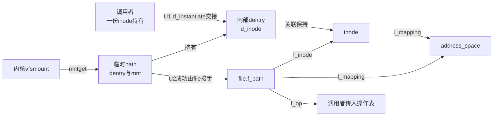
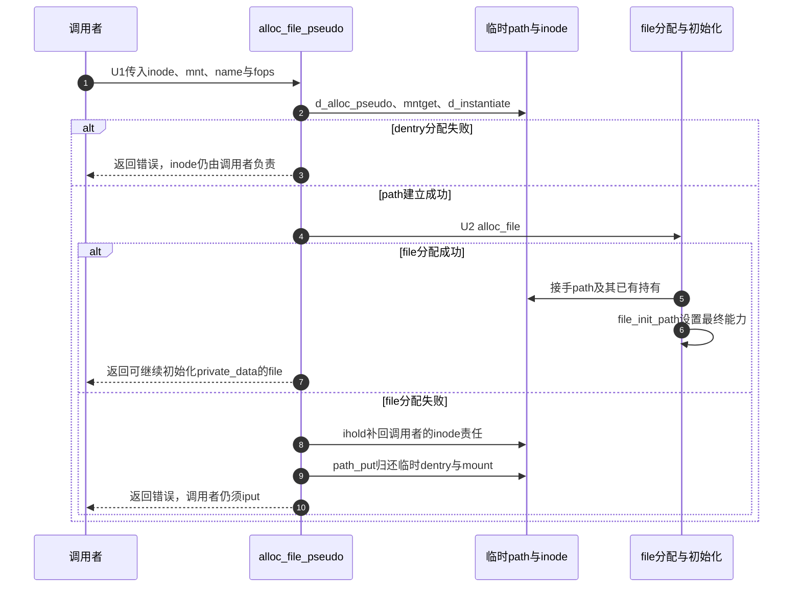

# 第74章\_伪路径file的建立与失败归还

不经过用户目录查找的file仍要有inode、dentry、mount和最终方法表。U1～U2的构造要把这些关系移交给file，失败时则恢复调用者原有的责任；alloc_file_pseudo中的一次ihold正是在维护这条失败契约。

**讲解层次：实现层，Linux 6.12.20。** 固定提交 `dfaf2136deb2af2e60b994421281ba42f1c087e0`。原件：[file_table.c](../../linux/fs/file_table.c)、[file.h](../../linux/include/linux/file.h)、[fs.h](../../linux/include/linux/fs.h)、[pipe.c](../../linux/fs/pipe.c)、[socket.c](../../linux/net/socket.c)。中文注释为仓库补充，执行语句保留。关联 [总索引](../navigation/P01_Linux_6.12_VFS源码阅读索引.md)、[特殊对象导读](../navigation/P23_特殊文件与匿名对象的VFS交接.md#23.1_沿建立发布使用退出定位状态) 和 [知识场景](../../../../knowledge/kernel_subsystems/vfs/P24_特殊文件与伪文件系统接入.md#24.3_没有普通路径的对象也要完整交接)。

原件摘要和配置见 [特殊对象源码基线](../../linux/SOURCE_BASELINE.md#1.303_特殊文件与匿名对象的VFS交接)。

## 74.1\_内部path仍有真实持有责任

```c
/** @brief 仓库补充阅读说明：分配内部dentry并取得mount持有，把传入inode交接给关联。 */
static inline int alloc_path_pseudo(const char *name, struct inode *inode,
                                    struct vfsmount *mnt, struct path *path)
{
        /* 仓库补充：分配内部dentry并取得mount持有，把传入inode交接给关联。 */
        struct qstr this = QSTR_INIT(name, strlen(name));
        path->dentry = d_alloc_pseudo(mnt->mnt_sb, &this);
        if (!path->dentry)
                return -ENOMEM;
        /* 仓库补充：取得mount持有，inode则交给dentry关联。 */
        path->mnt = mntget(mnt);
        d_instantiate(path->dentry, inode);
        return 0;
}
```

```c
/** @brief 仓库补充阅读说明：成功把path交给file，失败恢复调用者的inode持有再归还临时path。 */
struct file *alloc_file_pseudo(struct inode *inode, struct vfsmount *mnt,
                               const char *name, int flags,
                               const struct file_operations *fops)
{
        /* 仓库补充：成功把path交给file，失败恢复调用者的inode持有再归还临时path。 */
        int ret;
        struct path path;
        struct file *file;
        ret = alloc_path_pseudo(name, inode, mnt, &path);
        if (ret)
                return ERR_PTR(ret);
        file = alloc_file(&path, flags, fops);
        if (IS_ERR(file)) {
                /* 仓库补充：补回调用者失败时应保有的引用，再让path_put拆临时关联。 */
                ihold(inode);
                path_put(&path);
        }
        return file;
}
```

name通过QSTR_INIT形成长度与名称描述，d_alloc_pseudo创建内部dentry；它不是在用户目录中插入一个可open的名字。mntget取得mount持有，d_instantiate将传入inode接给dentry。若dentry分配失败，inode仍在调用者手中；若后续file分配失败，path_put会归还dentry并间接归还它的inode关联，所以必须先ihold补回调用者失败时应保有的一份。



图中的f_inode只是对象定位，并非每给指针赋值一次就独立ihold。真正使此inode保持可用的是已有path关联等责任；不得通过数指针数量来推算引用计数。

## 74.2\_初始化file不等于重新走一次普通open

```c
/** @brief 仓库补充阅读说明：先分配空file，再按已准备的path和方法表初始化。 */
static struct file *alloc_file(const struct path *path, int flags,
                const struct file_operations *fop)
{
        /* 仓库补充：先分配空file，再按已准备的path和方法表初始化。 */
        struct file *file;
        file = alloc_empty_file(flags, current_cred());
        if (!IS_ERR(file))
                file_init_path(file, path, fop);
        return file;
}
```

```c
/** @brief 仓库补充阅读说明：接收path与方法表并设置可用能力及错误观察起点。 */
static void file_init_path(struct file *file, const struct path *path,
                           const struct file_operations *fop)
{
        /* 仓库补充：接收path与方法表并设置可用能力及错误观察起点。 */
        file->f_path = *path;
        file->f_inode = path->dentry->d_inode;
        file->f_mapping = path->dentry->d_inode->i_mapping;
        /* 仓库补充：只采样本次打开的错误观察起点，不清除共享错误。 */
        file->f_wb_err = filemap_sample_wb_err(file->f_mapping);
        file->f_sb_err = file_sample_sb_err(file);
        if (fop->llseek)
                file->f_mode |= FMODE_LSEEK;
        if ((file->f_mode & FMODE_READ) &&
             likely(fop->read || fop->read_iter))
                file->f_mode |= FMODE_CAN_READ;
        if ((file->f_mode & FMODE_WRITE) &&
             likely(fop->write || fop->write_iter))
                file->f_mode |= FMODE_CAN_WRITE;
        file->f_iocb_flags = iocb_flags(file);
        /* 仓库补充：从这里具备完整file退出语义，实际后端状态还须先于fd发布。 */
        file->f_mode |= FMODE_OPENED;
        file->f_op = fop;
        if ((file->f_mode & (FMODE_READ | FMODE_WRITE)) == FMODE_READ)
                i_readcount_inc(path->dentry->d_inode);
}
```

alloc_empty_file的分配、凭据与最初引用见 [file分配](P26_file初始化与打开后失败清理.md#26.1_分配成功只建立最初的凭据锁与引用)。这里直接调用file_init_path，没有调用某个具体fops.open。调用者必须已经准备好后端状态，不能把关键初始化只放在一个此路径根本不会调用的open回调里。

file_init_path复制path并设置f_inode、f_mapping，采样mapping和实例的写回错误序号；采样建立的是本次打开的观察起点，既不消除全局错误也不触发写回。FMODE_LSEEK/CAN_READ/CAN_WRITE按方法存在与访问模式设置，FMODE_OPENED使其进入完整退出协议。只读打开还增加i_readcount，由通用最终退出配对；f_op在此直接接收调用者提供的表，所需模块持有必须由构造调用者安排。



成功返回也不等于已发布fd：private_data等实例状态还可以在发布前填写，最后才交给 [fd_install](P27_描述符预留扩容与发布协议.md#27.4_安装把已经初始化的持有交给槽位)。失败路径不能调用成功后的release来猜测清理，除非具体构造契约明确已经形成可走完整退出的file。

## 74.3\_多个file可以共同引用一个后备对象

```c
/** @brief 仓库补充阅读说明：建立新的file并显式增加共享path持有，继承后备mapping。 */
struct file *alloc_file_clone(struct file *base, int flags,
                                const struct file_operations *fops)
{
        /* 仓库补充：建立新的file并显式增加共享path持有，继承后备mapping。 */
        struct file *f;
        f = alloc_file(&base->f_path, flags, fops);
        if (!IS_ERR(f)) {
                /* 仓库补充：这是新的file，必须另外持有与base共享的path。 */
                path_get(&f->f_path);
                f->f_mapping = base->f_mapping;
        }
        return f;
}
```

alloc_file_clone与dup不同：前者分配新file，后者只是让另一个fd持有同一个file。clone先初始化新file，成功后path_get增加共享path的持有，并把base.f_mapping复制过来；它并不自动复制private_data。调用者必须为新的file设置其业务状态。

pipe的create_pipe_files先建立一份pipe inode和pipe_inode_info，再用alloc_file_pseudo建立写file、用alloc_file_clone建立读file。两端分别设置private_data为同一inode.i_pipe，随后stream_open撤销普通位置能力。读file构造失败时，管道路径归还pipe责任并fput已建写file；不是把半个管道交给用户。

socket的sock_alloc_file用SOCK_INODE取得socket关联inode，以socket_file_ops建立file，再设置sock.file和file.private_data，调用stream_open。失败由sock_release接管清理。这里只核对file到后备对象的交接，管道环形缓冲算法、socket协议和唤醒竞态属于后续子系统，未在本篇复制。

| 符号与声明 | 初始化及消费 | 配对或裁剪边界 |
| --- | --- | --- |
| alloc_file_pseudo / alloc_file_clone，file.h声明、file_table.c定义 | 管道、socket与匿名对象构造调用 | 成功接手path，失败保持传入inode责任；clone生成新file |
| alloc_path_pseudo / alloc_file / file_init_path，file_table.c内static | U1～U2内部串联 | 不调用后端open，也不自动为任意fops取模块持有 |
| file.f_path/f_inode/f_mapping/f_op/f_mode，fs.h结构 | 构造写入，I/O与最终退出读取 | 路径持有、能力位与普通定位指针不能混为一种引用 |
| filemap_sample_wb_err / file_sample_sb_err | 初始化各file的错误观察起点 | [写回错误观察](P40_写回错误序列与每file观察.md#40.1_共享记录与观察游标分别保存)；本篇不重新展开errseq算法 |
| iocb_flags与i_readcount_inc | 初始化I/O标志和只读使用记账 | 必须与最终 [file清理](P30_描述符脱离与最后file引用的释放.md#30.4_最终清理归还file自己的依赖)一致 |
| QSTR_INIT、IS_ERR、ERR_PTR | 名称描述、错误指针判断和转换 | 不建立引用；不能把失败指针当普通对象解引用 |
| noaccount变体 | 同文件的独立入口，使用不计入普通file计数的分配 | 本篇调用链未使用，不将其分配统计语义混入这里 |

**实现原理与修改边界**：最小安全变化应保持“成功消费传入inode，失败让调用者仍能归还inode”的契约。检查dentry失败、file失败、clone失败、后端private_data初始化失败以及最后fput，确认没有双iput或漏mntput。改变file_init_path的能力位或错误采样要同时检查管道、socket和匿名对象这些调用者，不能只运行普通文件open实验。
