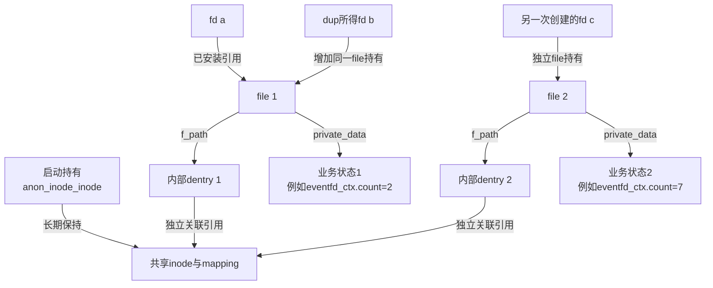
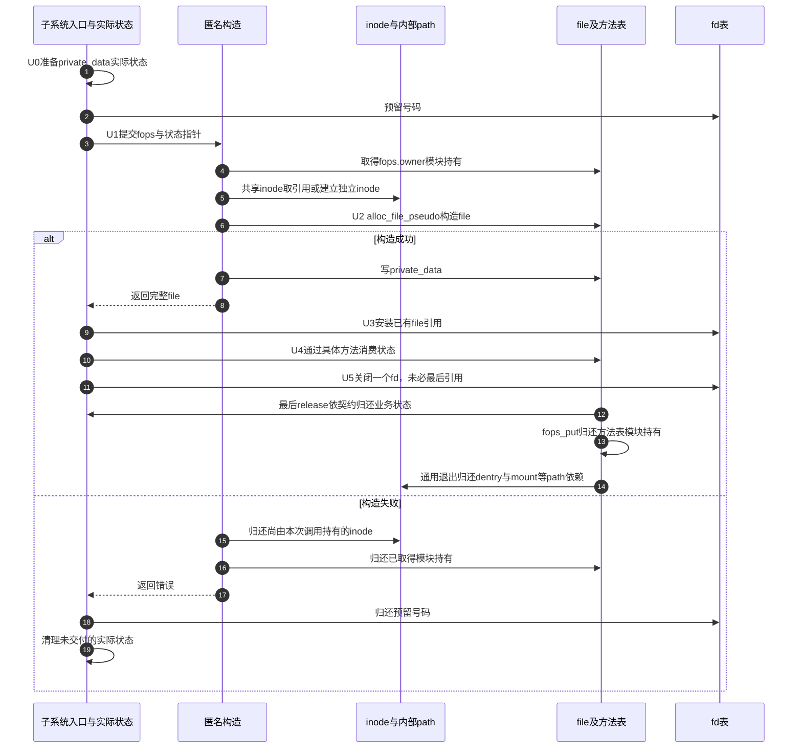

# 第75章\_匿名inode的共享与私有对象交接

一个计数器需要自己的计数和等待状态，却未必需要独立inode元数据。匿名inode框架把这两个需要分开：可复用一个inode承载多个file，每次创建仍由自己的private_data承载业务身份；需要独立inode时再选另一条构造分支。

**讲解层次：实现层，Linux 6.12.20。** 固定提交 `dfaf2136deb2af2e60b994421281ba42f1c087e0`。原件：[anon_inodes.c](../../linux/fs/anon_inodes.c)、[anon_inodes.h](../../linux/include/linux/anon_inodes.h)、[libfs.c](../../linux/fs/libfs.c)、[pseudo_fs.h](../../linux/include/linux/pseudo_fs.h)、[security.h](../../linux/include/linux/security.h)、[eventfd.c](../../linux/fs/eventfd.c)。中文注释为仓库补充，执行语句保留。关联 [总索引](../navigation/P01_Linux_6.12_VFS源码阅读索引.md)、[特殊对象导读](../navigation/P23_特殊文件与匿名对象的VFS交接.md#23.1_沿建立发布使用退出定位状态) 和 [计数共享实验](../../../../knowledge/kernel_subsystems/vfs/P24_特殊文件与伪文件系统接入.md#24.5_用两个计数对象区分身份与共享)。

原件摘要和配置见 [特殊对象源码基线](../../linux/SOURCE_BASELINE.md#1.303_特殊文件与匿名对象的VFS交接)。

## 75.1\_先为内部对象建立一个承载实例

anon_inode_mnt和anon_inode_inode是anon_inodes.c中的静态指针，带__ro_after_init，在启动初始化完成后不再改写指针。前者指向内核挂载，后者保存长期保有的共享inode；不把每个eventfd计数写进这两个全局对象。

```c
/** @brief 仓库补充阅读说明：为内部匿名对象提供建树入口与实例关闭方法。 */
static struct file_system_type anon_inode_fs_type = {
        /* 仓库补充：为内部匿名对象提供建树入口与实例关闭方法。 */
        .name           = "anon_inodefs",
        .init_fs_context = anon_inodefs_init_fs_context,
        .kill_sb        = kill_anon_super,
};
```

```c
/** @brief 仓库补充阅读说明：启动时建立内核挂载并分配共享inode，失败属于启动不可继续的条件。 */
static int __init anon_inode_init(void)
{
        /* 仓库补充：启动时建立内核挂载并分配共享inode，失败属于启动不可继续的条件。 */
        anon_inode_mnt = kern_mount(&anon_inode_fs_type);
        if (IS_ERR(anon_inode_mnt))
                panic("anon_inode_init() kernel mount failed (%ld)\n", PTR_ERR(anon_inode_mnt));
        /* 仓库补充：保留共享inode的长期持有，后续每次构造另取自己的引用。 */
        anon_inode_inode = alloc_anon_inode(anon_inode_mnt->mnt_sb);
        if (IS_ERR(anon_inode_inode))
                panic("anon_inode_init() inode allocation failed (%ld)\n", PTR_ERR(anon_inode_inode));
        return 0;
}
```

kern_mount采用内部挂载入口，fs_initcall在初始化阶段执行它。这里panic不是普通诊断消息：挂载或共享inode建立失败会停止正常启动，不能写成返回错误让用户系统调用稍后重试。

```c
/** @brief 仓库补充阅读说明：创建伪文件系统配置并安装匿名名称显示方法。 */
static int anon_inodefs_init_fs_context(struct fs_context *fc)
{
        /* 仓库补充：创建伪文件系统配置并安装匿名名称显示方法。 */
        struct pseudo_fs_context *ctx = init_pseudo(fc, ANON_INODE_FS_MAGIC);
        if (!ctx)
                return -ENOMEM;
        ctx->dops = &anon_inodefs_dentry_operations;
        return 0;
}
```

```c
/** @brief 仓库补充阅读说明：分配建树配置，声明内部挂载属性并选择公共建树回调。 */
struct pseudo_fs_context *init_pseudo(struct fs_context *fc,
                                        unsigned long magic)
{
        /* 仓库补充：分配建树配置，声明内部挂载属性并选择公共建树回调。 */
        struct pseudo_fs_context *ctx;
        ctx = kzalloc(sizeof(struct pseudo_fs_context), GFP_KERNEL);
        if (likely(ctx)) {
                ctx->magic = magic;
                /* 仓库补充：配置对象只供建树使用，不是移交给s_fs_info的实例私有内存。 */
                fc->fs_private = ctx;
                fc->ops = &pseudo_fs_context_ops;
                fc->sb_flags |= SB_NOUSER;
                fc->global = true;
        }
        return ctx;
}
```

ctx保存在fc.fs_private，配置释放时销毁；它与ramfs使用fc.s_fs_info向实例移交私有地址的方案不同。magic、ops、xattr和dops是构造参数，fill_super把需要的值或方法指针放到superblock中，不把这个ctx对象本身移交给sb.s_fs_info。

```c
/** @brief 仓库补充阅读说明：未提供专用实例方法时，采用简单statfs查询。 */
static const struct super_operations simple_super_operations = {
        /* 仓库补充：未提供专用实例方法时，采用简单statfs查询。 */
        .statfs         = simple_statfs,
};
```

```c
/** @brief 仓库补充阅读说明：配对建树与配置私有对象释放。 */
static const struct fs_context_operations pseudo_fs_context_ops = {
        /* 仓库补充：配对建树与配置私有对象释放。 */
        .free           = pseudo_fs_free,
        .get_tree       = pseudo_fs_get_tree,
};
```

```c
/** @brief 仓库补充阅读说明：为内核伪文件系统选择无块设备建树路径。 */
static int pseudo_fs_get_tree(struct fs_context *fc)
{
        /* 仓库补充：为内核伪文件系统选择无块设备建树路径。 */
        return get_tree_nodev(fc, pseudo_fs_fill_super);
}
```

```c
/** @brief 仓库补充阅读说明：从临时配置填充实例方法、根和dentry操作。 */
static int pseudo_fs_fill_super(struct super_block *s, struct fs_context *fc)
{
        /* 仓库补充：从临时配置填充实例方法、根和dentry操作。 */
        struct pseudo_fs_context *ctx = fc->fs_private;
        struct inode *root;
        s->s_maxbytes = MAX_LFS_FILESIZE;
        s->s_blocksize = PAGE_SIZE;
        s->s_blocksize_bits = PAGE_SHIFT;
        s->s_magic = ctx->magic;
        /* 仓库补充：专用方法为空才选公共查询表；其他方法集合按指针登记。 */
        s->s_op = ctx->ops ?: &simple_super_operations;
        s->s_xattr = ctx->xattr;
        s->s_time_gran = 1;
        root = new_inode(s);
        if (!root)
                return -ENOMEM;
        root->i_ino = 1;
        root->i_mode = S_IFDIR | S_IRUSR | S_IWUSR;
        simple_inode_init_ts(root);
        s->s_root = d_make_root(root);
        if (!s->s_root)
                return -ENOMEM;
        s->s_d_op = ctx->dops;
        return 0;
}
```

```c
/** @brief 仓库补充阅读说明：释放构造专用的fs_private，不释放已建实例本身。 */
static void pseudo_fs_free(struct fs_context *fc)
{
        /* 仓库补充：释放构造专用的fs_private，不释放已建实例本身。 */
        kfree(fc->fs_private);
}
```

SB_NOUSER排除普通用户挂载用途，fc.global使sget_fc选择init_user_ns作为实例的用户命名空间；不是说任意两次get_tree_nodev自动共用一个superblock。共享匿名实例来自本文件只在启动时保留一份anon_inode_mnt。根inode由new_inode构造，根dentry的成功与失败引用消费见 [d_make_root](P70_ramfs配置根与实例生命期.md#70.3_根构造与退出各自承担一次清理)；simple_statfs也在那里唯一展开。ctx.ops为空时选simple_super_operations，ctx.xattr和ctx.dops是方法集合指针，不复制外部对象数据。

```c
/** @brief 仓库补充阅读说明：分配内部inode并设置匿名承载属性，不建立某个业务计数器。 */
struct inode *alloc_anon_inode(struct super_block *s)
{
        /* 仓库补充：分配内部inode并设置匿名承载属性，不建立某个业务计数器。 */
        static const struct address_space_operations anon_aops = {
                .dirty_folio    = noop_dirty_folio,
        };
        struct inode *inode = new_inode_pseudo(s);
        if (!inode)
                return ERR_PTR(-ENOMEM);
        inode->i_ino = get_next_ino();
        inode->i_mapping->a_ops = &anon_aops;
        /* 仓库补充：预置匿名承载状态，避免按普通首次标脏路径排入写回队列。 */
        inode->i_state = I_DIRTY;
        inode->i_mode = S_IRUSR | S_IWUSR;
        inode->i_uid = current_fsuid();
        inode->i_gid = current_fsgid();
        inode->i_flags |= S_PRIVATE;
        simple_inode_init_ts(inode);
        return inode;
}
```

new_inode_pseudo负责初始inode分配，失败使用ERR_PTR；i_ino取得编号，anon_aops只提供noop_dirty_folio。i_state预设I_DIRTY使其不按普通inode首次标脏方式进入写回队列，不代表已有磁盘数据需要同步。i_mode只设置用户读写权限，S_PRIVATE声明这种内部承载身份，属主取创建上下文。这里没有建立普通文件内容协议；[noop标脏](P72_ramfs页数据与文件操作表.md#72.2_缓冲写入后留下的是实际内容)的功能状态仍由其自身实现决定。

## 75.2\_共享inode不共享每次创建的私有状态

```c
/** @brief 仓库补充阅读说明：为需要独立身份的请求分配inode，清S_PRIVATE并执行安全初始化。 */
static struct inode *anon_inode_make_secure_inode(
        const char *name,
        const struct inode *context_inode)
{
        /* 仓库补充：为需要独立身份的请求分配inode，清S_PRIVATE并执行安全初始化。 */
        struct inode *inode;
        const struct qstr qname = QSTR_INIT(name, strlen(name));
        int error;
        inode = alloc_anon_inode(anon_inode_mnt->mnt_sb);
        if (IS_ERR(inode))
                return inode;
        /* 仓库补充：独立inode取消内部私有标记，进入安全初始化。 */
        inode->i_flags &= ~S_PRIVATE;
        error = security_inode_init_security_anon(inode, &qname, context_inode);
        /* 仓库补充：安全拒绝时归还新inode，不把失败对象交给file。 */
        if (error) {
                iput(inode);
                return ERR_PTR(error);
        }
        return inode;
}
```

```c
/** @brief 仓库补充阅读说明：保护方法表所属模块，取得共享或独立inode，再构造带私有状态的file。 */
static struct file *__anon_inode_getfile(const char *name,
                                         const struct file_operations *fops,
                                         void *priv, int flags,
                                         const struct inode *context_inode,
                                         bool make_inode)
{
        /* 仓库补充：保护方法表所属模块，取得共享或独立inode，再构造带私有状态的file。 */
        struct inode *inode;
        struct file *file;
        if (fops->owner && !try_module_get(fops->owner))
                return ERR_PTR(-ENOENT);
        /* 仓库补充：按接口选择独立inode或全局共享inode。 */
        if (make_inode) {
                inode = anon_inode_make_secure_inode(name, context_inode);
                if (IS_ERR(inode)) {
                        file = ERR_CAST(inode);
                        goto err;
                }
        } else {
                inode = anon_inode_inode;
                if (IS_ERR(inode)) {
                        file = ERR_PTR(-ENODEV);
                        goto err;
                }
                /* 仓库补充：共享inode有长期初始持有，这里取得本次构造的一份。 */
                ihold(inode);
        }
        /* 仓库补充：成功把inode交接给内部path，失败仍由本函数iput。 */
        file = alloc_file_pseudo(inode, anon_inode_mnt, name,
                                 flags & (O_ACCMODE | O_NONBLOCK), fops);
        if (IS_ERR(file))
                goto err_iput;
        file->f_mapping = inode->i_mapping;
        /* 仓库补充：只保存指针，业务引用与释放策略由调用者负责。 */
        file->private_data = priv;
        return file;
err_iput:
        iput(inode);
err:
        module_put(fops->owner);
        return file;
}
```

make_inode为false时对全局inode执行ihold，成立前提是启动阶段留下的长期持有没有归还；这不是对任意可能已归零inode无条件复活。为true时先alloc_anon_inode，再清S_PRIVATE并调用security_inode_init_security_anon，失败归还新inode。当前CONFIG_SECURITY关闭，安全hook退化返回0，但独立inode分配与S_PRIVATE清除仍然执行。

fops.owner存在时先try_module_get；构造失败必须module_put，成功则把这份代码生命期责任留给file最终退出。alloc_file_pseudo失败后调用者仍拥有inode持有，因此err_iput正确地iput；成功以后path已经承接它，不能再执行同样的iput。private_data只复制传入指针，框架不会猜测其分配方式、加引用或释放方法。



图中共享inode位于基础承载层，两份计数位于业务层；dup共享的是file 1及它指向的状态1。fd号可以复用，显示名称也可以相同，均不能单独作为内核业务对象的唯一身份。

```c
/** @brief 仓库补充阅读说明：选择共享inode构造file，不预留或安装用户fd。 */
struct file *anon_inode_getfile(const char *name,
                                const struct file_operations *fops,
                                void *priv, int flags)
{
        /* 仓库补充：选择共享inode构造file，不预留或安装用户fd。 */
        return __anon_inode_getfile(name, fops, priv, flags, NULL, false);
}
```

```c
/** @brief 仓库补充阅读说明：共享构造成功后附加调用者请求的file模式能力。 */
struct file *anon_inode_getfile_fmode(const char *name,
                                const struct file_operations *fops,
                                void *priv, int flags, fmode_t f_mode)
{
        /* 仓库补充：共享构造成功后附加调用者请求的file模式能力。 */
        struct file *file;
        file = __anon_inode_getfile(name, fops, priv, flags, NULL, false);
        if (!IS_ERR(file))
                file->f_mode |= f_mode;
        return file;
}
```

```c
/** @brief 仓库补充阅读说明：选择独立inode及安全初始化分支，仍只返回file。 */
struct file *anon_inode_create_getfile(const char *name,
                                       const struct file_operations *fops,
                                       void *priv, int flags,
                                       const struct inode *context_inode)
{
        /* 仓库补充：选择独立inode及安全初始化分支，仍只返回file。 */
        return __anon_inode_getfile(name, fops, priv, flags,
                                    context_inode, true);
}
```

context_inode提供给安全hook的是上下文关系，框架不额外持有它，调用者要保证调用期间有效。fmode变体按位增加能力，不能把不支持的能力随意置位；其检查边界与具体fops契约必须一致。文件层flags只保留O_ACCMODE和O_NONBLOCK，O_CLOEXEC另属于fd表的描述符状态。

## 75.3\_号码发布和类别显示都不创造业务状态

```c
/** @brief 仓库补充阅读说明：先预留号码，再构造file，成功安装或失败归还号码。 */
static int __anon_inode_getfd(const char *name,
                              const struct file_operations *fops,
                              void *priv, int flags,
                              const struct inode *context_inode,
                              bool make_inode)
{
        /* 仓库补充：先预留号码，再构造file，成功安装或失败归还号码。 */
        int error, fd;
        struct file *file;
        error = get_unused_fd_flags(flags);
        if (error < 0)
                return error;
        fd = error;
        /* 仓库补充：号码已预留但尚未发布，file失败必须归还号码。 */
        file = __anon_inode_getfile(name, fops, priv, flags, context_inode,
                                    make_inode);
        if (IS_ERR(file)) {
                error = PTR_ERR(file);
                goto err_put_unused_fd;
        }
        /* 仓库补充：把完整file的现有引用交给描述符槽位。 */
        fd_install(fd, file);
        return fd;
err_put_unused_fd:
        put_unused_fd(fd);
        return error;
}
```

```c
/** @brief 仓库补充阅读说明：以共享inode完成匿名file及fd发布。 */
int anon_inode_getfd(const char *name, const struct file_operations *fops,
                     void *priv, int flags)
{
        /* 仓库补充：以共享inode完成匿名file及fd发布。 */
        return __anon_inode_getfd(name, fops, priv, flags, NULL, false);
}
```

```c
/** @brief 仓库补充阅读说明：以独立inode完成匿名file及fd发布。 */
int anon_inode_create_getfd(const char *name, const struct file_operations *fops,
                            void *priv, int flags,
                            const struct inode *context_inode)
{
        /* 仓库补充：以独立inode完成匿名file及fd发布。 */
        return __anon_inode_getfd(name, fops, priv, flags, context_inode, true);
}
```

get_unused_fd_flags负责包括CLOEXEC在内的描述符状态，失败还没有file；构造失败则put_unused_fd释放号码，成功fd_install消费待发布file引用。具体协议见 [预留与安装](P27_描述符预留扩容与发布协议.md#27.1_分配号码只改变占用状态)，不要把失败号码清理改成对未安装对象执行close。



这是成功走到inode和file构造后的完整配对；更早的模块引用失败不会再归还从未取得的inode。getfd包装把预留和安装收在内部；getfile调用者也可以像eventfd那样自行安排预留、补充file能力和最后安装。

```c
/** @brief 仓库补充阅读说明：为内部dentry选择诊断名称生成方法。 */
static const struct dentry_operations anon_inodefs_dentry_operations = {
        /* 仓库补充：为内部dentry选择诊断名称生成方法。 */
        .d_dname        = anon_inodefs_dname,
};
```

```c
/** @brief 仓库补充阅读说明：从类别字符串生成anon_inode显示文本，不生成可查找目录路径。 */
static char *anon_inodefs_dname(struct dentry *dentry, char *buffer, int buflen)
{
        /* 仓库补充：从类别字符串生成anon_inode显示文本，不生成可查找目录路径。 */
        return dynamic_dname(buffer, buflen, "anon_inode:%s",
                                dentry->d_name.name);
}
```

dynamic_dname向调用者缓冲区格式化名称，name由各子系统提供，例如eventfd传入带方括号的类别。显示机制不分配业务ID，不把file加入普通目录，也不会建立第二个计数器。读取/proc/self/fd观察到相同文本，只能说明显示类别相同。

## 75.4\_按实例字段核对接口与修改边界

| 实现簇与声明 | 初始化、读写与配置 | 修改必须维持的关系 |
| --- | --- | --- |
| anon_inode_mnt / anon_inode_inode，anon_inodes.c内static | initcall初始化后指针只读，共享inode长期持有 | 不在每个file退出时释放全局那份初始引用 |
| anon_inode_fs_type与dentry操作表，同文件静态定义 | 启动建树消费；d_path读取名称方法 | 显示名不是普通查找名，不能用它区分所有对象 |
| pseudo_fs_context，pseudo_fs.h定义；init_pseudo在libfs.c | 分配到fc.fs_private，建根读取，free回收配置 | 不套用s_fs_info移交协议；方法指针引用的表必须长于实例 |
| alloc_anon_inode，fs.h声明、libfs.c定义 | 建立共享或独立inode，设置I_DIRTY与S_PRIVATE等功能状态 | 不按普通文件写回含义解释预置状态 |
| anon_inode_getfile/getfd及create、fmode变体，anon_inodes.h声明 | U1～U3取得不同层次结果 | getfile不是已发布fd，create分支不是全局共享inode |
| fops.owner、file.private_data、context_inode | 模块持有保护代码；priv按值保存；安全上下文不额外保活 | 框架不负责任意业务指针引用，失败和release分别配对 |
| security_inode_init_security_anon | SECURITY开启时进入安全框架，关闭时返回0 | 关闭安全hook不取消独立inode分配 |
| eventfd_ctx，eventfd.c私有结构 | do_eventfd每次分配、初始化count/kref/wqh，传给anon_inode_getfile | 本篇核对实例交接，不复制计数等待算法为第二套教程 |

eventfd的do_eventfd先建立ctx，再预留fd并调用anon_inode_getfile，最后设置FMODE_NOWAIT并安装；失败路径eventfd_free_ctx回收尚未交付的对象。eventfd_read从private_data取得ctx，在wqh.lock保护下检查计数，空且非阻塞返回EAGAIN；非信号量模式的eventfd_ctx_do_read取走当前计数并减少它。因此正文实验的两个创建互不影响，而dup后的两个fd消费同一ctx。这里只说明本实验的少量非阻塞读，不扩展到计数溢出、信号唤醒、内核额外kref持有或用户复制失败后的消费语义。

**实现原理与修改边界**：如果业务需要独立inode元数据，选择create分支并检查安全上下文，不应把每对象状态写进全局inode。修改构造或失败标签时，要覆盖模块持有失败、inode失败、安全拒绝、dentry失败、file失败和fd预留失败，保留各阶段实际已取得的责任。最后file.release不保证所有子系统额外引用都已消失；release应归还本file的业务责任，最终对象回收由其自身引用协议决定。当前没有Linux编译运行、配置组合或失败注入实测。
