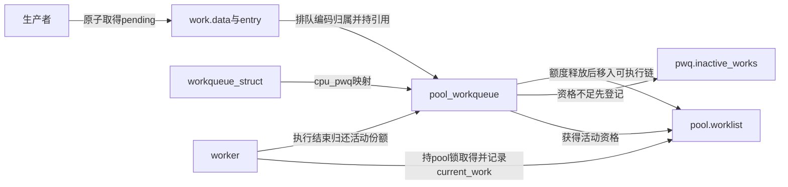
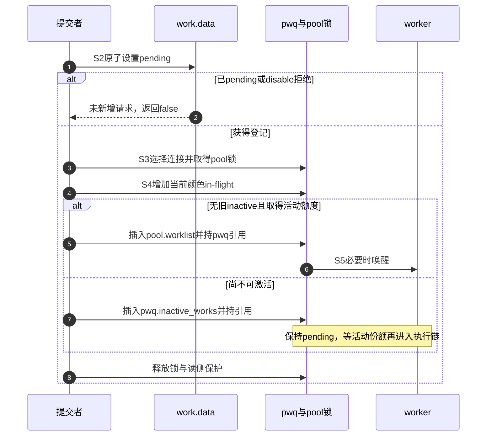

# 第2章\_Linux\_6.12\_工作队列对象与投递模块源码概念导读

## 2.1\_模块问题

本章追踪一个 work 从提交前的 off-queue 状态，到 pending、pwq 归属、active/inactive 和 pool worklist。worker 如何执行和 flush 如何等待分别留给 P03/P04。

沿知识正文的采样设备，生产者已经保存记录，现在需要知道“谁接收这次执行请求、是否可立即激活、对象地址由谁保持”。off-queue 指 data 当前没有采用排队时的 pwq 指针编码，不等于回调一定没有运行；运行中的工作仍可能记录在 worker 的 current_work 中。下面按固定 6.12.20 的具体地址追踪，不能只查看 pending 一位判断整个生命周期。

## 2.2\_五层对象与状态所有权

一个设备的 work_struct 保存工作描述；它选择的 workqueue_struct 定义属性和完成等待范围。实际资源在 worker_pool，连接对象 pool_workqueue 为该逻辑队列在该池维护自己的活动与在途账本；worker 则保存真实执行者与当前回调。共享池需要这些独立账本，才能避免一个设备额度耗尽就把别的设备也停掉。

| 对象 | 关键字段/概念 | 主要锁域 |
| --- | --- | --- |
| `work_struct` | `data`、`entry`、`func` | 原子 data + 当前 pool lock |
| `pool_workqueue` | pool/wq、color、in-flight、nr_active、inactive | pool lock；部分 wq 管理锁 |
| `worker_pool` | lock、worklist、worker/idle、nr_running | `pool->lock` |
| `workqueue_struct` | pwqs、mutex、colors、attrs、rescuer、flags | `wq->mutex` 与专用锁域 |
| `worker` | task、current_work/pwq、scheduled | pool lock 与 worker 自身执行上下文 |

固定提交在结构注释中用 I/L/WQ/MD 等缩写标记访问规则。先读文件顶部锁规则，再读字段，避免把所有状态都误认为由 pool lock 保护。

这里 I 表示构造/销毁路径可修改、其他路径只读；L 表示 pool->lock；WQ 表示 wq->mutex；MD 表示 wq_mayday_lock。它们是该文件的访问规则标签，不是处理器寄存器或配置项。节点活动账本还使用 LN：写入需 pool 锁与节点锁，读取可持其中之一，具体字段仍按原文规则判断。



## 2.3\_从queue\_work到insert\_work

`queue_work()` 是提交函数；它向 `queue_work_on()` 传入 `WORK_CPU_UNBOUND`，这个 CPU 参数常量表示没有指定目标处理器，不等于目标队列一定设置了 WQ_UNBOUND 属性。下面的 PENDING 是 `WORK_STRUCT_PENDING_BIT` 的简写，表示已有一次待执行登记。调用链只表达控制关系，不是可编译源码。

```text
queue_work(wq, work)
  → queue_work_on(WORK_CPU_UNBOUND, wq, work)
    → test_and_set_bit(PENDING)
    → 已pending则失败；clear_pending_if_disabled也可能拒绝
    → __queue_work(cpu, wq, work)
      → 选择 bound/unbound CPU 与 pwq
      → 检查 last_pool与同一wq执行归属，满足前提时保持非重入
      → pwq->nr_in_flight[work_color]++
      → pwq_tryinc_nr_active()
      → insert_work(pool->worklist 或 pwq->inactive_works)
      → active分支才kick_pool()
```

具体函数体见[投递与激活源码实现](../source_explanations/P02_Linux_6.12_工作队列投递与激活源码实现.md#2.3_insert_work写入归属并链接)。



同 work 的非重入还要求始终投递到同一 workqueue、不改函数、不重新初始化。源码旧池分支明确比较 worker->current_pwq->wq 与目标 wq；跨 CPU 重排不是跨逻辑队列重排，不能省去这个条件。

## 2.4\_active与inactive

前面已有 inactive work，或 `pwq_tryinc_nr_active()` 无法取得额度时，新的普通 work 插入 `pwq->inactive_works` 并带 INACTIVE 标志。bound 队列可按 pwq 活动数检查，unbound 还要协调 wq->node_nr_active 的节点共享账本。活动 work 完成后 `pwq_dec_nr_active()` 释放份额，再由对应激活路径推进暂缓工作，不能一律画成每个 pwq 各自比较 max_active。

barrier work 也可能带 INACTIVE 标志但不位于 inactive list：它不占普通活动额度，却需要跟随目标执行并参与颜色账本。因此普通工作可以按该标志理解暂缓状态，不能把这一推断直接用于 barrier。

## 2.5\_unbound选择与RCU生命期

unbound queue 根据允许 CPU 与 pod 选择 pwq；`cpu_pwq` 指针通过 RCU 读取。若选中的 pwq refcnt 已归零，`__queue_work()` 释放 pool lock 后重试。旧 pwq 的释放也经 RCU/kthread work 延迟，避免热路径读取悬空连接对象。

## 2.6\_delayed与RCU\_work边界

`delayed_work` 在 work 之外保存 timer、目标 wq 和 CPU；timer 到期才调用 `__queue_work()`。`rcu_work` 在 RCU callback 之后排队内含 work。两者都增加一个前置异步生产者，cancel/destroy 必须覆盖 timer/RCU 阶段，不能只看 pool worklist。

## 2.7\_复核问题

- work.data 在 queued 与 off-queue 时分别编码什么？
- last_pool 检查为什么与“同一 work 不并发执行”有关？
- INACTIVE 标志为什么不能直接推断 work 位于 inactive_works？
- unbound pwq 更换时，哪一层负责旧连接对象生命期？

总索引：[工作队列源码总阅读索引](P01_Linux_6.12_工作队列源码总阅读索引.md#1.6_建议阅读顺序)。

上一篇：[工作队列源码总阅读索引](P01_Linux_6.12_工作队列源码总阅读索引.md)。

下一篇：[worker 管理模块源码概念导读](P03_Linux_6.12_worker管理模块源码概念导读.md)。
