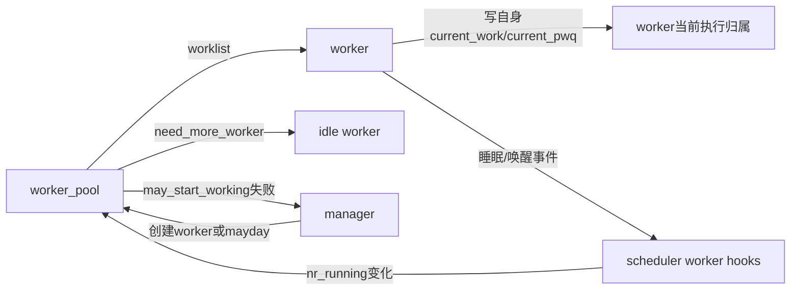
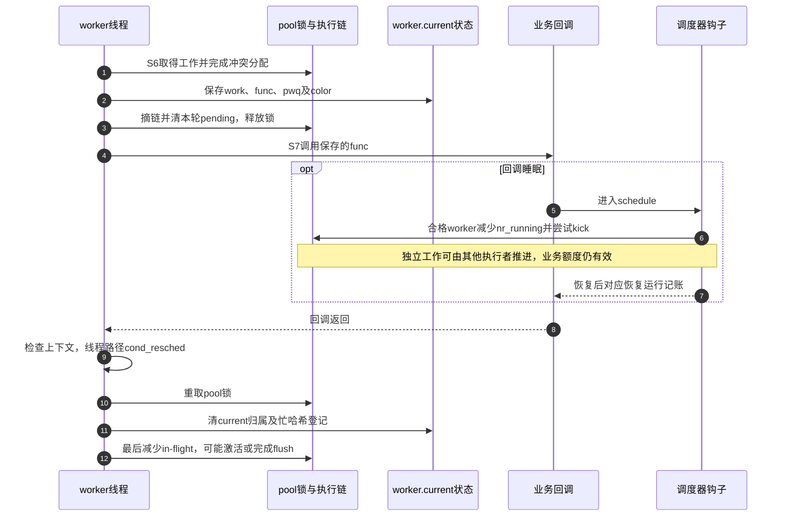

# 第3章\_Linux\_6.12\_worker管理模块源码概念导读

## 3.1\_模块问题

本章回答 pool 如何在 worker 可能睡眠的条件下维持执行能力，以及 work function 前后哪些状态必须写回。投递和 flush 的详细实现不在这里重复。

上一模块把 work 放入执行链，却没有说明谁取走它。以下先追踪普通 bound 线程池：一个 worker 正在处理采样数据，睡眠时另有独立工作等待。我们要同时追踪 worker 自身的 current 状态、pool 的运行数和调度器的睡眠通知，不能把“池里有线程”当成“池里有人能继续执行”。

## 3.2\_pool与worker通信



`worker_pool.nr_running` 不是所有 task 的通用运行计数，而是并发管理需要的 worker 可运行证据；调度器在 worker 睡眠/唤醒边界帮助维护。

进入睡眠时的 wq_worker_sleeping 会检查 WORKER_NOT_RUNNING 等排除条件，登记 worker->sleeping，然后在 pool 锁下减少运行数并 kick；恢复执行的 wq_worker_running 补回对应记账。unbound、CPU-intensive、准备阶段等执行者不会都按普通 worker 计入，不能以 nr_running 反推活动回调总数。

## 3.3\_worker\_thread与process\_one\_work

这里 `PF_WQ_WORKER` 是任务标志，用来把执行线程标识为工作队列 worker；DIE 简写自 `WORKER_DIE`，是该 worker 应退出的控制标志。前文的 `WORKER_NOT_RUNNING` 则是多个“不计入普通运行数”状态位的组合掩码，不是一个独立线程状态。

```text
worker_thread(worker)
  → 标记 PF_WQ_WORKER
  → pool lock 下检查 DIE、离开 idle
  → need_more_worker / may_start_working
  → 必要时 manage_workers
  → 从 pool->worklist 移到 worker->scheduled
  → process_scheduled_works
    → process_one_work(worker, work)
      → 记录 current_work/current_func/current_pwq/color
      → 从队列移除并准备执行状态
      → 释放 pool lock
      → worker->current_func(work)
      → cond_resched 与泄漏检查
      → 重取 pool lock，清 current 状态
      → pwq_dec_nr_in_flight()
```

裁剪实现见[worker、flush 与取消源码实现](../source_explanations/P03_Linux_6.12_worker_flush与取消源码实现.md#3.3_worker_thread与process_one_work执行边界)。



## 3.4\_工作函数边界检查

`process_one_work()` 保存调用前的 Lockdep 与 RCU 深度；返回后比较这两份深度，并在线程 worker 路径检查 in_atomic。它没有把 preempt 深度也按同样方式保存成前后相减的计数。锁依赖检查器 Lockdep 与读复制更新 RCU 的诊断都依赖配置和实际接入，能发现已执行回调的部分配对错误，不能证明业务事件已完整处理或 remove 生命周期正确。

代码在 worker->task 存在时调用 `cond_resched()`，这是线程 worker 的让出机会，尤其用于避免非抢占配置下持续自重排霸占 CPU，并帮助报告 RCU 静止状态；不能把源码中的条件改写成一个只在非抢占配置才存在的分支。BH 执行上下文没有这份可睡眠线程保证。本次未重新取得目标配置，不声称已验证部署上的调度效果。

## 3.5\_manager与rescuer边界

`manage_workers()` 让某 worker 临时承担 manager 角色并按需创建 worker。创建受阻时，WQ_MEM_RECLAIM 队列通过 mayday 列表通知预建 rescuer。rescuer 只挑选需要救援的 pwq work，不替代普通 pool 的长期执行策略。

创建路径启动 mayday 定时检查；定时回调确认仍需创建 worker 后，才把有 rescuer 的连接登记到 wq->maydays 并唤醒救援者。关系中的 manager 是临时角色，mayday 是求助登记与通知，rescuer 才是预建执行线程，三者不能画成同一个常规调度环节。

## 3.6\_复核问题

- work function 执行时为什么不能持有 pool lock？
- current_work/current_pwq 为 flush、诊断和非重入提供什么证据？
- worker 睡眠后，谁发现 pool 需要另一个执行者？
- 工作函数返回后的上下文泄漏检查覆盖哪些状态，遗漏哪些业务事实？

总索引：[工作队列源码总阅读索引](P01_Linux_6.12_工作队列源码总阅读索引.md#1.6_建议阅读顺序)。

上一篇：[工作队列对象与投递模块源码概念导读](P02_Linux_6.12_工作队列对象与投递模块源码概念导读.md)。

下一篇：[flush、取消与生命周期模块源码概念导读](P04_Linux_6.12_flush取消与生命周期模块源码概念导读.md)。
