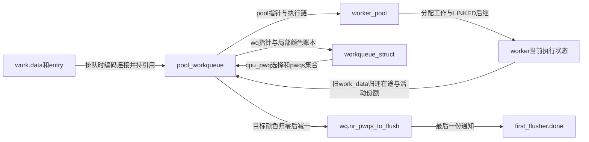

# 第1章\_Linux\_6.12\_工作队列对象布局源码实现

## 1.1\_实现讲解边界

沿采样设备的提交继续追踪：同一个执行池可以处理不同设备的工作，但设备 A 的 flush 不能等待设备 B 的全部未来请求，A 的活动限额也不能直接成为整个池的限额。因此至少要分开“实际执行资源”“设备选用的逻辑队列”“两者之间的局部账本”。本章把这些角色兑现为结构体，说明字段由谁修改、怎样参与投递与完成。

以下取自 NXP Linux 6.12.20 固定提交 `dfaf2136deb2af2e60b994421281ba42f1c087e0` 的 `kernel/workqueue.c`。代码保留完整定义与功能语句，替换原文注释为仓库补充的中文阅读说明；不是可脱离内核编译的示例程序。证据身份与当前环境限制见[源码核对记录](../../linux/SOURCE_BASELINE.md#1.170_工作队列执行模型与取消版本边界)。

图中 LINKED 指把当前工作与后继绑定到同一执行序列的状态标志；它在第三章的 barrier 路径展开。RCU（Read-Copy Update，读复制更新）在本章用于延迟回收被无锁查找的连接和池，不是工作执行完成通知。



## 1.2\_源码符号覆盖账本

先看三层归属，再读定义：pool 管实际执行者，pwq 管一条连接，wq 管用户选择的策略与跨连接完成域。节点额度和一次 flush 的等待者是这三层协调时需要的附加状态。

| 权威标题 | 上游位置 | 创建与生命期 | 主要写入与消费 |
| --- | --- | --- | --- |
| [worker_pool](#1.3_worker_pool拥有物理执行资源) | `kernel/workqueue.c`，struct worker_pool | 标准池在初始化阶段建立；unbound 池可按属性共享并受引用/RCU 保护 | 投递者与 worker 更新执行链，调度器钩子参与运行数，manager 管创建 |
| [pool_workqueue](#1.4_pool_workqueue连接逻辑队列与物理pool) | 同文件，struct pool_workqueue | 建立 wq/pool 连接；排队工作持引用，释放经 kthread work 与 RCU | 投递增加颜色/活动账本，执行或取消减少，flush 读目标颜色 |
| [workqueue_struct及附加账本](#1.5_workqueue_struct拥有属性与flush域) | 同文件，struct workqueue_struct/wq_flusher/wq_node_nr_active | alloc_workqueue 建立队列；flusher 属于一次等待；节点账本随 wq 管理 | 队列管理锁协调颜色与等待者，pool 锁保护局部推进，节点锁协调额度等待 |

## 1.3\_worker\_pool拥有物理执行资源

池里即使已经创建十个线程，也不等于有十个线程正在推进工作：有些空闲，有些在回调里睡眠，还有一个可能临时管理线程创建。因此 `nr_workers`、`nr_idle`、`nr_running` 必须分开。`worklist` 承载已经获得活动资格的普通工作及不占额度的 barrier 后继；执行者取得工作后把当前归属放到自己的 worker 字段，并登记在 `busy_hash`，供非重入与完成路径寻找。


```c
/**
 * @brief 仓库补充：执行资源、可执行工作和执行者管理状态。
 * DECLARE_HASHTABLE 声明哈希桶数组，BUSY_WORKER_HASH_ORDER 为桶数的二进制阶数。
 */
struct worker_pool {
    raw_spinlock_t      lock;
    int         cpu;
    int         node;
    int         id;
    unsigned int        flags;

    unsigned long       watchdog_ts;
    bool            cpu_stall;

    int         nr_running;

    struct list_head    worklist;

    int         nr_workers;
    int         nr_idle;

    struct list_head    idle_list;
    struct timer_list   idle_timer;
    struct work_struct      idle_cull_work;

    struct timer_list   mayday_timer;

    DECLARE_HASHTABLE(busy_hash, BUSY_WORKER_HASH_ORDER);

    struct worker       *manager;
    struct list_head    workers;

    struct ida      worker_ida;

    struct workqueue_attrs  *attrs;
    struct hlist_node   hash_node;
    int         refcnt;

    struct rcu_head     rcu;
};
```

`lock` 保护执行链以及大部分热路径状态；`nr_running` 有更具体的协议：关联 CPU 上关闭抢占后增加，减少/重置还需持 pool 锁，读者持 pool 锁观察归零。不能因为它是普通 int 就在任意 CPU 上读写。

| 字段组 | 当前读者需要区分的作用与边界 |
| --- | --- |
| cpu/node/id/attrs | 池的处理器、节点、编号和执行属性；构造后通常只读，id 用于 off-queue 编码追溯旧池 |
| worklist/busy_hash/idle_list | 等待执行、正在执行、空闲执行者三类位置；不能用一个链表是否为空概括整个池 |
| manager/workers/worker_ida | manager 指针只作信息记录；附着线程列表有独立附着锁，编号分配用于线程名 |
| idle_timer/idle_cull_work | 空闲检测与回收工作，避免长期保留多余执行资源 |
| mayday_timer | 创建受阻后的求助检查；救援线程属于 wq，未存放在这里 |
| watchdog_ts/cpu_stall | 进度观察与停滞诊断，不能代替业务完成条件 |
| hash_node/refcnt/rcu | unbound 池的共享查找、引用与延迟回收；不能在最后一个引用释放后继续保存裸指针 |

源码锁标签 L 表示 pool 锁，A 表示附着锁，PL 表示全局池管理锁，WD 表示 watchdog 的访问规则；具体锁关系仍以文件顶部说明为准。这些锁保护的是不同对象集合，不能统称为“一把工作队列锁”。

## 1.4\_pool\_workqueue连接逻辑队列与物理pool

若两个设备共享同一池，仅统计 pool 上有多少工作，就无法回答 A 自己还有多少旧工作未完成。`pool_workqueue` 同时指向 wq 与 pool，在连接处保存 A 的在途数量、活动数量和暂缓链。工作进入该连接时持有一份引用，离开时归还，所以连接更换不会立即使在途工作丢失归属。


```c
/**
 * @brief 仓库补充：连接归属、在途颜色、活动份额与连接生命期。
 * WORK_NR_COLORS 是颜色槽数量，PWQ_NR_STATS 是统计槽数量。
 * WORK_STRUCT_PWQ_SHIFT 给出 data 中指针以上区域与低位编码的分界。
 */
struct pool_workqueue {
    struct worker_pool  *pool;
    struct workqueue_struct *wq;
    int         work_color;
    int         flush_color;
    int         refcnt;
    int         nr_in_flight[WORK_NR_COLORS];

    bool            plugged;

    int         nr_active;
    struct list_head    inactive_works;
    struct list_head    pending_node;
    struct list_head    pwqs_node;
    struct list_head    mayday_node;

    u64         stats[PWQ_NR_STATS];

    struct kthread_work release_work;
    struct rcu_head     rcu;
/* 对齐为 data 低位状态编码预留零位，不能删除这个属性。 */
} __aligned(1 << WORK_STRUCT_PWQ_SHIFT);
```

`work_color` 决定新请求记入哪一格 `nr_in_flight`，`flush_color` 表示当前等待哪一格归零。`nr_active` 则计入具有执行资格的普通工作，包括正在运行或睡眠的回调；它不是 CPU 当前运行数。未取得资格的普通工作放入 `inactive_works`。barrier 是例外：它带 INACTIVE 以免占额度，却可以在可执行链上。

`pending_node` 把这个连接挂到节点共享额度的等待链，`pwqs_node` 把它挂到 wq 的连接集合，`mayday_node` 把它挂到救援请求集合。三个链节点不能互换：前者等额度，中者表达归属，后者请求执行资源。`plugged` 可暂停该连接的激活，ordered 队列更换连接时利用这一类控制维持顺序。

排队期间 work.data 高位保存 pwq 指针，低位保存标志和颜色；定义末尾的对齐使这些低位可用。未排队时 data 可改成旧 pool 编号等另一种编码，不能始终当作指针。`release_work` 把 unbound 连接释放交给 kthread worker，`rcu` 延后最终回收；`stats` 是诊断统计，不参与是否可释放业务对象的证明。

## 1.5\_workqueue\_struct拥有属性与flush域

一次 flush 需要等待这个 wq 在多个池上的旧请求，所以 wq 保存连接集合和跨连接的 `nr_pwqs_to_flush`。每个调用者又要有自己的等待对象；若直接让所有调用者共享一个 completion，就无法区分他们各自封存的颜色。因此 `wq_flusher` 记录本次目标、排队节点与完成通知。


```c
/** @brief 仓库补充：一次 flush 的目标颜色与调用者等待对象。 */
struct wq_flusher {
    struct list_head    list;
    int         flush_color;
    struct completion   done;
};
```

unbound 队列可能跨多个节点执行。所有池频繁争用一个全局活动计数会增加跨节点通信，所以该版本把额度分摊到节点；同一节点的多个 pwq 共享计数。取得失败后把连接登记到等待链，完成者归还额度时再推进等待者。`max` 的分配还受最小活动额度约束，不能由这里推导所有节点额度之和永远严格等于用户的 max_active。


```c
/** @brief 仓库补充：节点共享活动计数与等待连接；节点锁嵌套在 pool 锁内。 */
struct wq_node_nr_active {
    int         max;
    atomic_t        nr;
    raw_spinlock_t      lock;
    struct list_head    pending_pwqs;
};
```

```c
/**
 * @brief 仓库补充：逻辑队列的策略、连接集合、完成汇聚与生命周期状态。
 * CONFIG_SYSFS 控制 sysfs 入口，CONFIG_LOCKDEP 控制锁依赖诊断字段。
 * WQ_NAME_LEN 是名称缓冲区容量，均不是运行中的工作计数。
 */
struct workqueue_struct {
    struct list_head    pwqs;
    struct list_head    list;

    struct mutex        mutex;
    int         work_color;
    int         flush_color;
    atomic_t        nr_pwqs_to_flush;
    struct wq_flusher   *first_flusher;
    struct list_head    flusher_queue;
    struct list_head    flusher_overflow;

    struct list_head    maydays;
    struct worker       *rescuer;

    int         nr_drainers;

    int         max_active;
    int         min_active;
    int         saved_max_active;
    int         saved_min_active;

    struct workqueue_attrs  *unbound_attrs;
    struct pool_workqueue __rcu *dfl_pwq;

#ifdef CONFIG_SYSFS
    struct wq_device    *wq_dev;
#endif
#ifdef CONFIG_LOCKDEP
    char            *lock_name;
    struct lock_class_key   key;
    struct lockdep_map  __lockdep_map;
    struct lockdep_map  *lockdep_map;
#endif
    char            name[WQ_NAME_LEN];

    struct rcu_head     rcu;

    unsigned int        flags ____cacheline_aligned;
    struct pool_workqueue __rcu * __percpu *cpu_pwq;
    struct wq_node_nr_active *node_nr_active[];
};
```

`mutex` 协调颜色推进、flusher 队列和管理操作，不能代替热路径的 pool 锁。首个等待者 `first_flusher` 收到完成通知后负责推进后续等待者；颜色空间暂满时，后来者进入 `flusher_overflow`，等待可复用的颜色。颜色是有限代际标记，不是无限递增的事件总数。

`cpu_pwq` 是按 CPU 选择连接的 RCU 指针集合，`dfl_pwq` 是 unbound 默认连接，`node_nr_active[]` 指向节点账本。属性更新可能替换连接，所以投递路径还要在 pool 锁内检查连接引用是否仍有效。

`maydays/rescuer` 保存本队列的救援请求和执行者；`nr_drainers` 与内部 flags 控制排空阶段；saved_min/max_active 用于保存受冻结等管理操作影响的限额。CONFIG_SYSFS 字段支持观察和配置入口，CONFIG_LOCKDEP 字段支持依赖检查；它们不是功能工作链。`list/rcu` 支持全局队列遍历与回收，name 用于识别，flags 的缓存行对齐服务热路径。修改布局时必须同时核对分配尺寸、初始化、配置裁剪和销毁，不能只修改本页可见字段。

## 1.6\_复核问题

- 哪个对象同时指向 wq 与 pool，并保存局部 in-flight？
- pool worklist 与 pwq inactive list 分别受哪种条件驱动？
- 为什么 wq 的 flush 完成必须跨所有相关 pwq 汇聚？

核对答案：连接对象 pool_workqueue 同时指向 wq 与 pool，并保存各颜色的 in-flight；pool worklist 等待执行者取得，pwq inactive list 等待活动资格；一个 wq 可以连接多个 pool，任一连接尚有目标颜色的工作都不能宣布全队列目标完成。三者分别是执行资源、资格控制和完成范围，不能用同一个计数替代。

模块导读：[工作队列对象与投递模块源码概念导读](../navigation/P02_Linux_6.12_工作队列对象与投递模块源码概念导读.md#2.2_五层对象与状态所有权)。

总索引：[Linux 6.12 工作队列源码总阅读索引](../navigation/P01_Linux_6.12_工作队列源码总阅读索引.md#1.6_建议阅读顺序)。

下一篇：[工作队列投递与激活源码实现](P02_Linux_6.12_工作队列投递与激活源码实现.md)。
