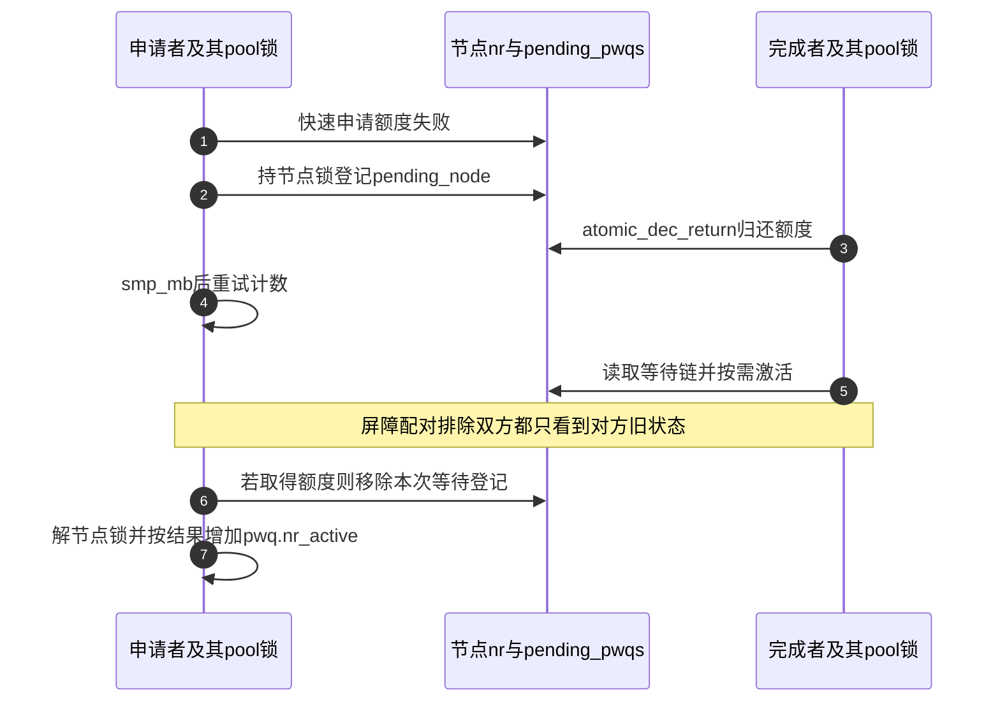

# 第2章\_Linux\_6.12\_工作队列投递与激活源码实现

## 2.1\_实现讲解边界

上一章已经找到 work 的连接归属与三套账本，现在跟踪 S2～S5：取得一次 pending 登记后，怎样选中仍然存活的连接、保住同一 work 的非重入约束，再把请求送到可执行链或暂缓链。本章保留完整投递函数，避免省略重试或锁分支后得到一段不能成立的“源码骨架”。

以下取自 NXP Linux 6.12.20 固定提交 `dfaf2136deb2af2e60b994421281ba42f1c087e0` 的 `kernel/workqueue.c`。代码保留完整定义与功能语句，替换原文注释为仓库补充的中文阅读说明；不是可脱离内核编译的示例程序。证据身份与当前环境限制见[源码核对记录](../../linux/SOURCE_BASELINE.md#1.170_工作队列执行模型与取消版本边界)。

## 2.2\_源码符号覆盖账本

| 权威标题 | 上游位置 | 进入条件与完成结果 |
| --- | --- | --- |
| [登记与插链](#2.3_insert_work写入归属并链接) | `kernel/workqueue.c`，queue_work_on/clear_pending_if_disabled/insert_work | 原子取得 pending；拒绝 disable；归属、链节点和引用一并写入 |
| [选择与分流](#2.4_queue_work选择pool并保持非重入) | 同文件，__queue_work | 本地 IRQ 已关且 pending 已取得；选择有效 pwq，记录颜色，插入一条工作链 |
| [取得活动份额](#2.5_active与inactive分流) | 同文件，pwq_tryinc_nr_active | 持 pool 锁；成功则增加活动数，失败则维持暂缓资格 |

## 2.3\_insert\_work写入归属并链接

两名生产者同时请求执行同一个 work 时，不能各自把同一个 entry 插入链表。因此先用原子位操作争取本轮 pending。该位已存在就返回 false；即便刚取得它，工作被 disable 时也必须归还登记并拒绝提交。这里的 false 不能解释为“上一次业务事件已经完成”。


```c
/**
 * @brief 仓库补充：S2 原子取得本轮登记；关闭本地 IRQ 覆盖取得到排队的窗口。
 * WORK_STRUCT_PENDING_BIT 是 pending 位的位置，work_data_bits 返回 data 的位操作地址。
 */
bool queue_work_on(int cpu, struct workqueue_struct *wq,
           struct work_struct *work)
{
    bool ret = false;
    unsigned long irq_flags;

    local_irq_save(irq_flags);

    if (!test_and_set_bit(WORK_STRUCT_PENDING_BIT, work_data_bits(work)) &&
        !clear_pending_if_disabled(work)) {
        __queue_work(cpu, wq, work);
        ret = true;
    }

    local_irq_restore(irq_flags);
    return ret;
}
```

```c
/**
 * @brief 仓库补充：读取 off-queue 禁用计数；拒绝时保留旧池与禁用状态并清 pending。
 * WORK_STRUCT_PWQ 表示 data 使用指针编码；WORK_OFFQ_DISABLE_MASK 提取另一种编码里的禁用计数。
 */
static bool clear_pending_if_disabled(struct work_struct *work)
{
    unsigned long data = *work_data_bits(work);
    struct work_offq_data offqd;

    if (likely((data & WORK_STRUCT_PWQ) ||
           !(data & WORK_OFFQ_DISABLE_MASK)))
        return false;

    work_offqd_unpack(&offqd, data);
    set_work_pool_and_clear_pending(work, offqd.pool_id,
                    work_offqd_pack_flags(&offqd));
    return true;
}
```

`WORK_CPU_UNBOUND` 作为 cpu 参数表示未指定处理器；它与队列的 WQ_UNBOUND 属性不是一回事。指定 CPU 的调用方还要保证该 CPU 可用。`local_irq_save/restore` 保存并恢复本地中断状态，不能代替跨 CPU 的 pool 锁；其作用之一是避免本 CPU 在“pending 已设置、尚未插链”窗口被需要夺取 pending 的路径打断。

当 pwq 与目标链已经选定，`insert_work()` 才完成三件必须一致的事情：data 编码归属，entry 入链，连接加引用。debug_work_activate 与 KASAN 辅助栈记录用于诊断，不能把它们当成增加业务引用。


```c
/** @brief 仓库补充：持 pool 锁写入连接归属、插入指定链并保活 pwq。 */
static void insert_work(struct pool_workqueue *pwq, struct work_struct *work,
            struct list_head *head, unsigned int extra_flags)
{
    debug_work_activate(work);

    kasan_record_aux_stack_noalloc(work);

    set_work_pwq(work, pwq, extra_flags);
    list_add_tail(&work->entry, head);
    get_pwq(pwq);
}
```

这里 head 不是固定意义的“队列头”：普通投递传链表头，barrier 也可传目标的后继节点，从而借 list_add_tail 插到目标之后。get_pwq 保活连接，不能代替包含 work 的驱动对象引用。

## 2.4\_queue\_work选择pool并保持非重入

假设 work 正在旧池运行，另一 CPU 又提交它。直接按新 CPU 选池，两个池就可能各自执行同一回调。下面先选择候选连接，再查旧池；只有旧池确实仍执行此 work 且属于同一个 wq，才沿 worker->current_pwq 重排。ordered 队列要使用最新连接维护顺序，由其排序协议保证非重入，不能无条件退回旧连接。


```c
/**
 * @brief 仓库补充：S3～S5 选择有效连接，保持同队列非重入，记录颜色并分流。
 * WARN_ON/WARN_ON_ONCE/WARN_ONCE 检查异常并告警，后两种限制重复输出。
 * WORK_STRUCT_INACTIVE 标记不占普通活动份额的工作。
 */
static void __queue_work(int cpu, struct workqueue_struct *wq,
             struct work_struct *work)
{
    struct pool_workqueue *pwq;
    struct worker_pool *last_pool, *pool;
    unsigned int work_flags;
    unsigned int req_cpu = cpu;

    lockdep_assert_irqs_disabled();

    if (unlikely(wq->flags & (__WQ_DESTROYING | __WQ_DRAINING) &&
             WARN_ON_ONCE(!is_chained_work(wq))))
        return;
    rcu_read_lock();
retry:

    if (req_cpu == WORK_CPU_UNBOUND) {
        if (wq->flags & WQ_UNBOUND)
            cpu = wq_select_unbound_cpu(raw_smp_processor_id());
        else
            cpu = raw_smp_processor_id();
    }

    pwq = rcu_dereference(*per_cpu_ptr(wq->cpu_pwq, cpu));
    pool = pwq->pool;

/* 旧池身份只提供查找入口，还必须在锁内核对当前执行者与同一 wq。 */
    last_pool = get_work_pool(work);
    if (last_pool && last_pool != pool && !(wq->flags & __WQ_ORDERED)) {
        struct worker *worker;

        raw_spin_lock(&last_pool->lock);

        worker = find_worker_executing_work(last_pool, work);

        if (worker && worker->current_pwq->wq == wq) {
            pwq = worker->current_pwq;
            pool = pwq->pool;
            WARN_ON_ONCE(pool != last_pool);
        } else {

            raw_spin_unlock(&last_pool->lock);
            raw_spin_lock(&pool->lock);
        }
    } else {
        raw_spin_lock(&pool->lock);
    }

/* unbound 属性替换可能使候选连接失效，释放锁后重新选择。 */
    if (unlikely(!pwq->refcnt)) {
        if (wq->flags & WQ_UNBOUND) {
            raw_spin_unlock(&pool->lock);
            cpu_relax();
            goto retry;
        }

        WARN_ONCE(true, "workqueue: per-cpu pwq for %s on cpu%d has 0 refcnt",
              wq->name, cpu);
    }

    trace_workqueue_queue_work(req_cpu, pwq, work);

    if (WARN_ON(!list_empty(&work->entry)))
        goto out;

/* 在途计数先登记；能否立即获得活动资格是下一层判断。 */
    pwq->nr_in_flight[pwq->work_color]++;
    work_flags = work_color_to_flags(pwq->work_color);

    if (list_empty(&pwq->inactive_works) && pwq_tryinc_nr_active(pwq, false)) {
        if (list_empty(&pool->worklist))
            pool->watchdog_ts = jiffies;

        trace_workqueue_activate_work(work);
        insert_work(pwq, work, &pool->worklist, work_flags);
        kick_pool(pool);
    } else {
        work_flags |= WORK_STRUCT_INACTIVE;
        insert_work(pwq, work, &pwq->inactive_works, work_flags);
    }

out:
    raw_spin_unlock(&pool->lock);
    rcu_read_unlock();
}
```

`get_work_pool` 从 work 编码取旧池，`find_worker_executing_work` 从忙哈希找实际执行者；两者合起来才构成当前运行证据。非重入契约还要求不改回调函数、不重新初始化并始终使用同一 wq。跨 wq 任意重排不在这个保证内。

RCU 使候选连接在选择期间不会消失，却不保证其引用仍非零；所以锁内 refcnt 检查仍必要。重试只在 unbound 路径成立，per-CPU 连接归零被视为异常。`__WQ_DESTROYING/__WQ_DRAINING` 是生命周期误用检查：告警后的返回不是调用者可以依赖的正常提交协议，停止生产者仍须由设备退出路径完成。

插链前保留了 debug/trace 检查、work entry 空链验证与 watchdog 时间戳更新。它们分别帮助发现重复链接和观察进度，没有改变颜色登记、活动资格与实际执行三者的区别。只有 active 分支调用 kick_pool；inactive 请求已经 pending，也已经进入 flush 的在途范围。

## 2.5\_active与inactive分流

没有旧 inactive 才尝试直接激活，是为了不在额度变化时越过先到工作。bound/BH 路径可以检查该 pwq 的活动数；unbound 连接还必须向节点共享账本申请份额，不能给每个 pwq 各发一份完整队列额度。


```c
/**
 * @brief 仓库补充：取得本连接的活动资格；unbound 还协调节点共享额度与等待链。
 * READ_ONCE 固定一次共享标量读取，不代替后续节点计数的原子操作和屏障。
 */
static bool pwq_tryinc_nr_active(struct pool_workqueue *pwq, bool fill)
{
    struct workqueue_struct *wq = pwq->wq;
    struct worker_pool *pool = pwq->pool;
    struct wq_node_nr_active *nna = wq_node_nr_active(wq, pool->node);
    bool obtained = false;

    lockdep_assert_held(&pool->lock);

    if (!nna) {

        obtained = pwq->nr_active < READ_ONCE(wq->max_active);
        goto out;
    }

    if (unlikely(pwq->plugged))
        return false;

    if (!list_empty(&pwq->pending_node) && likely(!fill))
        goto out;

    obtained = tryinc_node_nr_active(nna);
    if (obtained)
        goto out;

/* 快速申请失败后登记等待，再重试，防止遗漏同时归还的额度。 */
    raw_spin_lock(&nna->lock);

    if (list_empty(&pwq->pending_node))
        list_add_tail(&pwq->pending_node, &nna->pending_pwqs);
    else if (likely(!fill))
        goto out_unlock;

/* 与归还方 atomic_dec_return 的屏障配对，避免两边都看不到对方更新。 */
    smp_mb();

    obtained = tryinc_node_nr_active(nna);

    if (obtained && likely(!fill))
        list_del_init(&pwq->pending_node);

out_unlock:
    raw_spin_unlock(&nna->lock);
out:
    if (obtained)
        pwq->nr_active++;
    return obtained;
}
```

`tryinc_node_nr_active()` 用原子比较交换尝试在节点上限内增加计数；成功后本函数增加 pwq->nr_active。失败后先进入 pending_pwqs 等待链，再作有序重试：要么申请者看到归还的新额度，要么归还者看到新等待者。只做一次无锁失败就返回，会留下“额度已空闲、连接却无人激活”的窗口。

下面固定“申请先失败、归还恰好随后发生”的交错。箭头表达共享状态写入与读取，不表示节点账本主动执行代码；真正执行两侧操作的仍是申请者和完成者。



`fill` 为 true 用于上限增加后的补充激活；普通投递传 false，已有等待登记时不插队。`plugged` 则直接禁止该 unbound 连接激活。完成或取消会走 pwq_dec_nr_in_flight：先归还普通活动份额，再减少颜色在途计数；具体见[完成归还路径](P03_Linux_6.12_worker_flush与取消源码实现.md#3.4.4_局部完成怎样唤醒首个等待者)。

## 2.6\_复核问题

- get_pwq() 保活的是业务对象、workqueue 还是连接对象？
- 为什么 work 正在旧 pool 执行时要继续使用它的 current_pwq？
- inactive work 是否已经属于本轮 flush 的 in-flight？

核对答案：get_pwq 保活连接，不保证业务对象存活；同一 wq 的 work 仍在旧池执行时沿 current_pwq 排队，避免新池独立执行它，ordered 路径按自身连接排序规则处理；普通 inactive 请求已经进入颜色在途账本，所以即使还没获得活动额度，相关 flush 也必须等它离开在途集合。

模块导读：[工作队列对象与投递模块源码概念导读](../navigation/P02_Linux_6.12_工作队列对象与投递模块源码概念导读.md#2.3_从queue_work到insert_work)。

总索引：[Linux 6.12 工作队列源码总阅读索引](../navigation/P01_Linux_6.12_工作队列源码总阅读索引.md#1.6_建议阅读顺序)。

上一篇：[工作队列对象布局源码实现](P01_Linux_6.12_工作队列对象布局源码实现.md)。

下一篇：[worker、flush 与取消源码实现](P03_Linux_6.12_worker_flush与取消源码实现.md)。
