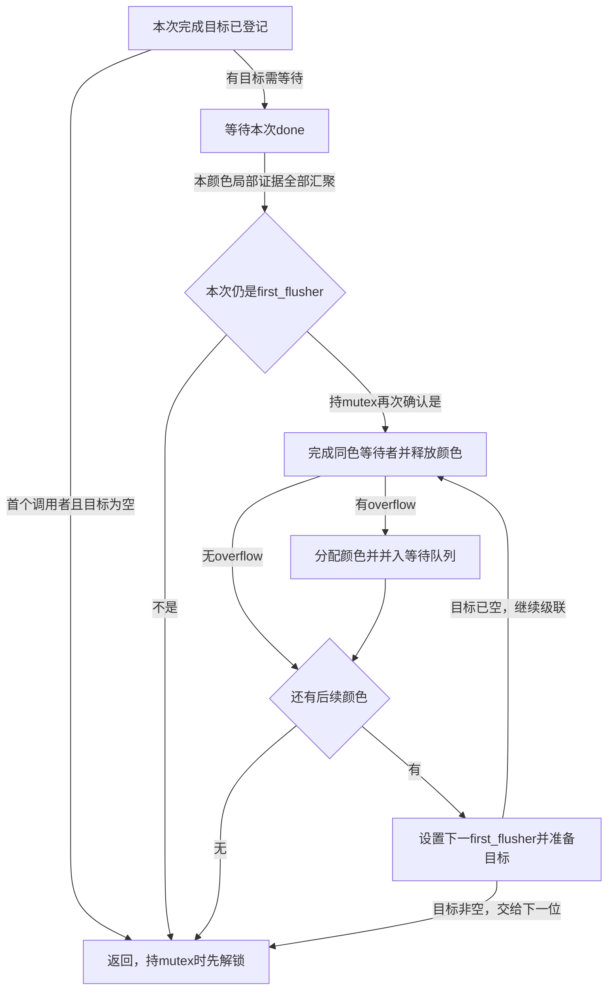

# 第3章\_Linux\_6.12\_worker\_flush与取消源码实现

## 3.1\_实现讲解边界

投递已经建立 pending、连接归属与颜色账本，接下来必须把“已经开始”“已经返回”“可以继续等待者”连成一条流程。若只清 pending，回调可能还在运行；若只从链上删除，也可能漏掉 flush 的在途计数。本章按 S6～S8 追踪执行交接、局部 barrier、跨连接汇聚和取消，解释为什么收尾必须有固定顺序。

以下取自 NXP Linux 6.12.20 固定提交 `dfaf2136deb2af2e60b994421281ba42f1c087e0` 的 `kernel/workqueue.c`。代码保留完整定义与功能语句，替换原文注释为仓库补充的中文阅读说明；不是可脱离内核编译的示例程序。证据身份与当前环境限制见[源码核对记录](../../linux/SOURCE_BASELINE.md#1.170_工作队列执行模型与取消版本边界)。

## 3.2\_源码符号覆盖账本

本章不是一个单独的状态机：worker 当前归属、work 的 pending、pwq 的颜色计数、wq 的等待者和 disable 计数分别回答不同问题。以下每个定义保留完整控制流；内核诊断辅助接口只解释其在这里的作用，不把诊断状态当成功能状态。

| 权威标题 | 上游位置 | 当前状态与调用条件 |
| --- | --- | --- |
| [执行交接](#3.3_worker_thread与process_one_work执行边界) | `kernel/workqueue.c`，worker_thread/process_one_work | 线程循环持 pool 锁取得工作；单工作函数临时解锁调用回调，再完成归还 |
| [barrier与颜色完成](#3.4_flush颜色与barrier) | 同文件，wq_barrier/insert_wq_barrier/flush_workqueue_prep_pwqs/__flush_workqueue/pwq_dec_nr_in_flight | barrier 等一个局部顺序；颜色汇聚等一组旧请求，各自有独立 completion |
| [取消与禁用](#3.5_cancel_work_sync撤销与等待) | 同文件，__cancel_work/__cancel_work_sync | 夺取 pending、增加禁用计数、等待在执行者，再按调用模式归还禁用层 |

## 3.3\_worker\_thread与process\_one\_work执行边界

先看线程如何在取工作与睡眠之间切换，再放大一次回调前后的归属交接。两层分别维持“池还有执行能力”和“这一轮工作仍能正确归还账本”，不能把外层睡眠等同于内层业务完成。

### 3.3.1\_线程为何先登记睡眠再释放锁

一个线程醒来，并不保证还有工作留给它：其他 worker 可能已经取走工作，也可能需要先创建额外执行者。`worker_thread()` 每次醒来都在 pool 锁下重查需求；manage_workers 返回后回到 recheck，而不是假定管理过程中队列没变。

准备睡眠时则倒过来：先在同一锁域登记 idle 和 TASK_IDLE，再释放锁并 schedule。投递者的唤醒遵循 pool 锁或本 CPU 规则，因此不能落在“投递者已经唤醒、worker 却还没设置睡眠状态”的丢通知窗口。这里的 TASK_IDLE 是任务睡眠状态，不等于 pwq->inactive_works 的活动额度状态。


```c
/**
 * @brief 仓库补充：普通线程 worker 的完整退出、复查、分配与睡眠循环。
 * WORKER_DIE 请求退出；WORKER_PREP/WORKER_REBOUND 是准备/重新绑定阶段标志。
 * WARN_ON_ONCE 是一次性异常检查，不能替代锁与状态交接。
 */
static int worker_thread(void *__worker)
{
    struct worker *worker = __worker;
    struct worker_pool *pool = worker->pool;

    set_pf_worker(true);
woke_up:
    raw_spin_lock_irq(&pool->lock);

    if (unlikely(worker->flags & WORKER_DIE)) {
        raw_spin_unlock_irq(&pool->lock);
        set_pf_worker(false);

        worker->pool = NULL;
        ida_free(&pool->worker_ida, worker->id);
        return 0;
    }

    worker_leave_idle(worker);
recheck:

    if (!need_more_worker(pool))
        goto sleep;

    if (unlikely(!may_start_working(pool)) && manage_workers(worker))
        goto recheck;

    WARN_ON_ONCE(!list_empty(&worker->scheduled));

/* 结束准备/重新绑定阶段，合格执行者开始参与并发管理。 */
    worker_clr_flags(worker, WORKER_PREP | WORKER_REBOUND);

    do {
        struct work_struct *work =
            list_first_entry(&pool->worklist,
                     struct work_struct, entry);

        if (assign_work(work, worker, NULL))
            process_scheduled_works(worker);
    } while (keep_working(pool));

    worker_set_flags(worker, WORKER_PREP);
sleep:

    worker_enter_idle(worker);
/* 先登记睡眠状态再解锁，随后 schedule 才能与唤醒正确衔接。 */
    __set_current_state(TASK_IDLE);
    raw_spin_unlock_irq(&pool->lock);
    schedule();
    goto woke_up;
}
```

`set_pf_worker` 在附着锁下标识任务身份，WORKER_DIE 分支在清标志后不再让调度路径使用旧 pool 指针。`need_more_worker` 决定是否需要继续推进，`may_start_working/manage_workers` 协调空闲后备与临时管理者，`keep_working` 决定当前批次是否继续。这些判断针对池的执行能力，不代替业务是否完成的判断。

`assign_work` 处理当前工作及 LINKED 后继，并检查与其他执行者的冲突；成功归给本 worker 后，`process_scheduled_works` 反复从它的 scheduled 链首取工作。不能省去 assign_work 后把任意 pool 链首直接交给 process_one_work，否则会丢掉非重入与 barrier 跟随关系。

### 3.3.2\_先把运行归属搬到worker再允许下一轮登记

`process_one_work()` 入场时持 pool 锁。它先从 work 保存 pwq、函数和颜色，登记 busy_hash/current_*，再摘链并清 pending。此时当前执行证据已经从“排队项”转到 worker，所以生产者可以申请下一轮 pending，而完成者仍知道这一轮应该归还哪份账本。

随后释放 pool 锁执行回调。若持锁调用，回调的睡眠或再次投递就可能阻塞整个共享池，甚至形成自锁。返回后使用之前保存的 work_data/pwq 收尾，不能重新读可能已经属于下一轮的 work.data。回调还允许在符合自身生命周期协议时释放 work 所在对象，因此 Lockdep 映射在调用前复制，执行结束 trace 只记录 work 地址。


```c
/**
 * @brief 仓库补充：S6～S7 保存执行归属，锁外调用，再按旧颜色完成本轮。
 * POOL_DISASSOCIATED 表示池已脱离关联 CPU，POOL_BH_DRAINING 表示离线后的 BH 排空。
 * WQ_CPU_INTENSIVE 是队列属性，WORKER_CPU_INTENSIVE 是执行者的运行数排除标志。
 * WORKER_DESC_LEN 限定描述缓冲区；PWQ_STAT_STARTED/COMPLETED 统计开始与结束次数。
 * INT_MAX 在清理时表示不再持有有效颜色；诊断输出中的 BUG 只是错误文本。
 */
static void process_one_work(struct worker *worker, struct work_struct *work)
__releases(&pool->lock)
__acquires(&pool->lock)
{
    struct pool_workqueue *pwq = get_work_pwq(work);
    struct worker_pool *pool = worker->pool;
    unsigned long work_data;
    int lockdep_start_depth, rcu_start_depth;
    bool bh_draining = pool->flags & POOL_BH_DRAINING;
#ifdef CONFIG_LOCKDEP

    struct lockdep_map lockdep_map;

    lockdep_copy_map(&lockdep_map, &work->lockdep_map);
#endif

    WARN_ON_ONCE(!(pool->flags & POOL_DISASSOCIATED) &&
             raw_smp_processor_id() != pool->cpu);

    debug_work_deactivate(work);
    hash_add(pool->busy_hash, &worker->hentry, (unsigned long)work);
    worker->current_work = work;
    worker->current_func = work->func;
    worker->current_pwq = pwq;
    if (worker->task)
        worker->current_at = worker->task->se.sum_exec_runtime;
    work_data = *work_data_bits(work);
    worker->current_color = get_work_color(work_data);

    strscpy(worker->desc, pwq->wq->name, WORKER_DESC_LEN);

    list_del_init(&work->entry);

    if (unlikely(pwq->wq->flags & WQ_CPU_INTENSIVE))
        worker_set_flags(worker, WORKER_CPU_INTENSIVE);

    kick_pool(pool);

/* 这是对 work 的最后一次状态写入；之后可能出现下一轮登记。 */
    set_work_pool_and_clear_pending(work, pool->id, pool_offq_flags(pool));

    pwq->stats[PWQ_STAT_STARTED]++;
    raw_spin_unlock_irq(&pool->lock);

    rcu_start_depth = rcu_preempt_depth();
    lockdep_start_depth = lockdep_depth(current);

    if (!bh_draining)
        lock_map_acquire(pwq->wq->lockdep_map);
    lock_map_acquire(&lockdep_map);

    lockdep_invariant_state(true);
    trace_workqueue_execute_start(work);
/* 线程回调按协议可睡眠，BH 回调不可；业务对象生命期由调用方协议保证。 */
    worker->current_func(work);

    trace_workqueue_execute_end(work, worker->current_func);
    pwq->stats[PWQ_STAT_COMPLETED]++;
    lock_map_release(&lockdep_map);
    if (!bh_draining)
        lock_map_release(pwq->wq->lockdep_map);

    if (unlikely((worker->task && in_atomic()) ||
             lockdep_depth(current) != lockdep_start_depth ||
             rcu_preempt_depth() != rcu_start_depth)) {
        pr_err("BUG: workqueue leaked atomic, lock or RCU: %s[%d]\n"
               "     preempt=0x%08x lock=%d->%d RCU=%d->%d workfn=%ps\n",
               current->comm, task_pid_nr(current), preempt_count(),
               lockdep_start_depth, lockdep_depth(current),
               rcu_start_depth, rcu_preempt_depth(),
               worker->current_func);
        debug_show_held_locks(current);
        dump_stack();
    }

    if (worker->task)
        cond_resched();

    raw_spin_lock_irq(&pool->lock);

    worker_clr_flags(worker, WORKER_CPU_INTENSIVE);

    worker->last_func = worker->current_func;

    hash_del(&worker->hentry);
    worker->current_work = NULL;
    worker->current_func = NULL;
    worker->current_pwq = NULL;
    worker->current_color = INT_MAX;

/* 最后归还账本，函数内部可能临时放锁并释放连接引用。 */
    pwq_dec_nr_in_flight(pwq, work_data);
}
```

WORKER_CPU_INTENSIVE 把执行者从普通并发运行数中排除，kick_pool 可让其他独立工作继续；它不取消活动额度。POOL_BH_DRAINING 是 CPU 离线后处理 BH 工作时的特殊路径，不能把本函数所有调用都解释为可睡眠线程回调。

Lockdep 的 lock_map_acquire/release 记录逻辑依赖，并不真正锁住 wq；invariant 标记服务检查器的依赖模型，不能当成硬件屏障。CONFIG_LOCKDEP 关闭时相应诊断接口按配置退化。返回检查比较 Lockdep/RCU 深度，并在线程路径检查 in_atomic；它不证明驱动业务锁之外的所有状态正确。`cond_resched` 只在 worker->task 存在时给出调度机会，随后重新持 pool 锁清 busy_hash/current_*，最后才减少在途计数。

## 3.4\_flush颜色与barrier

等待一个 work 与等待整个 wq 需要不同的完成证据。本节先用跟随目标的 barrier 建立局部执行顺序，再用颜色把多个连接的旧请求汇聚起来，最后回到完成者怎样递交这份证据。

### 3.4.1\_用后继工作证明目标已经越过执行点

等待单个 work 时，观察 pending 清零不够，因为回调在开始前就清了它。barrier 选择另一种证据：在同一执行序列中放一个后继工作，由它 complete。目标已在执行时，后继放到对应 worker 的 scheduled 链首；目标还在排队时，将两者用 LINKED 连接，不能让另一个 worker 越过目标先执行 barrier。


```c
/** @brief 仓库补充：局部后继工作及等待者 completion；task 仅用于信息记录。 */
struct wq_barrier {
    struct work_struct  work;
    struct completion   done;
    struct task_struct  *task;
};
```

```c
/** @brief 仓库补充：后继回调执行到此，向等待者报告局部顺序已经越过。 */
static void wq_barrier_func(struct work_struct *work)
{
    struct wq_barrier *barr = container_of(work, struct wq_barrier, work);
    complete(&barr->done);
}
```

```c
/**
 * @brief 仓库补充：持 pool 锁插入跟随目标的后继，继承颜色但不占普通活动额度。
 * INIT_WORK_ONSTACK_KEY 初始化带诊断类的栈上工作；WQ_BH 选择 BH 上下文对应的类。
 * WORK_STRUCT_LINKED 是后继绑定掩码，WORK_STRUCT_LINKED_BIT 是它的位位置。
 */
static void insert_wq_barrier(struct pool_workqueue *pwq,
                  struct wq_barrier *barr,
                  struct work_struct *target, struct worker *worker)
{
    static __maybe_unused struct lock_class_key bh_key, thr_key;
    unsigned int work_flags = 0;
    unsigned int work_color;
    struct list_head *head;

    INIT_WORK_ONSTACK_KEY(&barr->work, wq_barrier_func,
                  (pwq->wq->flags & WQ_BH) ? &bh_key : &thr_key);
    __set_bit(WORK_STRUCT_PENDING_BIT, work_data_bits(&barr->work));

    init_completion_map(&barr->done, &target->lockdep_map);

    barr->task = current;

/* 此标志只排除活动额度，不代表该 barrier 位于 inactive_works。 */
    work_flags |= WORK_STRUCT_INACTIVE;

    if (worker) {
        head = worker->scheduled.next;
        work_color = worker->current_color;
    } else {
        unsigned long *bits = work_data_bits(target);

        head = target->entry.next;

        work_flags |= *bits & WORK_STRUCT_LINKED;
        work_color = get_work_color(*bits);
        __set_bit(WORK_STRUCT_LINKED_BIT, bits);
    }

    pwq->nr_in_flight[work_color]++;
    work_flags |= work_color_to_flags(work_color);

    insert_work(pwq, &barr->work, head, work_flags);
}
```

INIT_WORK_ONSTACK_KEY 和 init_completion_map 初始化栈上工作与等待对象，并给 BH/线程路径不同的 Lockdep 类，避免把两类上下文混成一个锁使用方式。调用者必须保持 barrier 栈对象有效直到等待与销毁完成。`target->entry.next` 结合 insert_work 内的尾插得到“目标之后”；已有 LINKED 后继时继承标志，使整条链保持连接。

barrier 参与颜色在途计数并持 pwq 引用，但不占普通活动份额。它证明目标在本次建立的执行序列里已经完成，不证明外部生产者永远不再提交；排队中的 barrier 也不能按普通工作任意取消，否则可能破坏前一个 LINKED 项的后继约束。

### 3.4.2\_先登记所有连接再允许汇聚完成

等待整个 wq 需要收集多个 pwq 的证据。准备函数遍历连接时会逐个取得 pool 锁；先检查的连接可能在遍历后续连接之前就完成。若计数从零开始，首个连接的减一可能提前触发全局完成。因此先放一份准备哨兵，再为每个非空目标颜色增加一份；遍历结束才归还哨兵。


```c
/** @brief 仓库补充：在 wq 管理锁下逐连接登记目标、切换颜色，并用哨兵覆盖准备窗口。 */
static bool flush_workqueue_prep_pwqs(struct workqueue_struct *wq,
                      int flush_color, int work_color)
{
    bool wait = false;
    struct pool_workqueue *pwq;

    if (flush_color >= 0) {
        WARN_ON_ONCE(atomic_read(&wq->nr_pwqs_to_flush));
/* 准备阶段的额外一份尚未归还，局部完成不能提前把总数降到零。 */
        atomic_set(&wq->nr_pwqs_to_flush, 1);
    }

    for_each_pwq(pwq, wq) {
        struct worker_pool *pool = pwq->pool;

        raw_spin_lock_irq(&pool->lock);

        if (flush_color >= 0) {
            WARN_ON_ONCE(pwq->flush_color != -1);

            if (pwq->nr_in_flight[flush_color]) {
                pwq->flush_color = flush_color;
                atomic_inc(&wq->nr_pwqs_to_flush);
                wait = true;
            }
        }

        if (work_color >= 0) {
            WARN_ON_ONCE(work_color != work_next_color(pwq->work_color));
            pwq->work_color = work_color;
        }

        raw_spin_unlock_irq(&pool->lock);
    }

    if (flush_color >= 0 && atomic_dec_and_test(&wq->nr_pwqs_to_flush))
        complete(&wq->first_flusher->done);

    return wait;
}
```

非负 flush_color 表示登记等待目标，负数表示本次不改变目标；非负 work_color 表示推进新提交颜色。每个连接在自己的 pool 锁域切换，所以不能把全局颜色更新理解为所有 CPU 在一个瞬间完成切换。传入非负目标前，调用者必须先初始化 first_flusher，否则准备末尾的 complete 没有合法接收者。

### 3.4.3\_首个等待者怎样接力后续flush

仅有准备函数还不足以实现公开 flush：每个调用者要初始化自己的 completion，登记目标颜色，并解决同时来的其他 flush。下面分两段控制阶段阅读同一个完整函数。前半段分配颜色：尚无首个等待者就成为 first_flusher，有首个则排队，颜色暂满则进入 overflow。后半段在首个等待者被唤醒后推进队列：完成同色等待者，释放一个颜色，把 overflow 纳入后续代际，再为下一个目标准备 pwq。


```c
/**
 * @brief 仓库补充：完整的登记等待与唤醒级联；保留空目标、并发等待与颜色溢出分支。
 * LIST_HEAD_INIT 初始化空链；COMPLETION_INITIALIZER_ONSTACK_MAP 初始化栈上完成对象与诊断映射。
 * READ_ONCE/WRITE_ONCE 固定共享身份的一次读写，不能取代持 mutex 后的复查。
 */
void __flush_workqueue(struct workqueue_struct *wq)
{
    struct wq_flusher this_flusher = {
        .list = LIST_HEAD_INIT(this_flusher.list),
        .flush_color = -1,
        .done = COMPLETION_INITIALIZER_ONSTACK_MAP(this_flusher.done, (*wq->lockdep_map)),
    };
    int next_color;

    if (WARN_ON(!wq_online))
        return;

    touch_wq_lockdep_map(wq);

    mutex_lock(&wq->mutex);

    next_color = work_next_color(wq->work_color);

    if (next_color != wq->flush_color) {

        WARN_ON_ONCE(!list_empty(&wq->flusher_overflow));
        this_flusher.flush_color = wq->work_color;
        wq->work_color = next_color;

        if (!wq->first_flusher) {

            WARN_ON_ONCE(wq->flush_color != this_flusher.flush_color);

            wq->first_flusher = &this_flusher;

            if (!flush_workqueue_prep_pwqs(wq, wq->flush_color,
                               wq->work_color)) {

                wq->flush_color = next_color;
                wq->first_flusher = NULL;
                goto out_unlock;
            }
        } else {

            WARN_ON_ONCE(wq->flush_color == this_flusher.flush_color);
            list_add_tail(&this_flusher.list, &wq->flusher_queue);
            flush_workqueue_prep_pwqs(wq, -1, wq->work_color);
        }
    } else {

        list_add_tail(&this_flusher.list, &wq->flusher_overflow);
    }

    check_flush_dependency(wq, NULL, false);

    mutex_unlock(&wq->mutex);

/* completion 在函数入口初始化；通知可早于真正睡眠发生。 */
    wait_for_completion(&this_flusher.done);

    if (READ_ONCE(wq->first_flusher) != &this_flusher)
        return;

    mutex_lock(&wq->mutex);

    if (wq->first_flusher != &this_flusher)
        goto out_unlock;

/* 当前首个等待者承担级联责任，后续目标可能转交给下一位。 */
    WRITE_ONCE(wq->first_flusher, NULL);

    WARN_ON_ONCE(!list_empty(&this_flusher.list));
    WARN_ON_ONCE(wq->flush_color != this_flusher.flush_color);

    while (true) {
        struct wq_flusher *next, *tmp;

        list_for_each_entry_safe(next, tmp, &wq->flusher_queue, list) {
            if (next->flush_color != wq->flush_color)
                break;
            list_del_init(&next->list);
            complete(&next->done);
        }

        WARN_ON_ONCE(!list_empty(&wq->flusher_overflow) &&
                 wq->flush_color != work_next_color(wq->work_color));

        wq->flush_color = work_next_color(wq->flush_color);

        if (!list_empty(&wq->flusher_overflow)) {

            list_for_each_entry(tmp, &wq->flusher_overflow, list)
                tmp->flush_color = wq->work_color;

            wq->work_color = work_next_color(wq->work_color);

            list_splice_tail_init(&wq->flusher_overflow,
                          &wq->flusher_queue);
            flush_workqueue_prep_pwqs(wq, -1, wq->work_color);
        }

        if (list_empty(&wq->flusher_queue)) {
            WARN_ON_ONCE(wq->flush_color != wq->work_color);
            break;
        }

        WARN_ON_ONCE(wq->flush_color == wq->work_color);
        WARN_ON_ONCE(wq->flush_color != next->flush_color);

        list_del_init(&next->list);
        wq->first_flusher = next;

        if (flush_workqueue_prep_pwqs(wq, wq->flush_color, -1))
            break;

        wq->first_flusher = NULL;
    }

out_unlock:
    mutex_unlock(&wq->mutex);
}
```

没有旧工作的首个调用者走 out_unlock；等待过的非首个调用者在收到完成后可直接返回。首个调用者则先锁外读身份，再持 mutex 复查，防止身份在竞争中变化。颜色空间是环状的有限集合：overflow 等待者会一起取得一个可用颜色，这解释了为什么函数要完成“同色的所有等待者”，而不是每次只唤醒一个。

`touch_wq_lockdep_map/check_flush_dependency` 提供依赖诊断，不能使回调中的同步等待变得安全。如果回调等自己的后继、或持有目标回调必需的锁进入 flush，真实依赖环仍由调用者消除。新增请求进入推进后的颜色，避免不断到来的未来工作让当前目标永不结束；这并不关闭生产者入口。



### 3.4.4\_局部完成怎样唤醒首个等待者

执行完成或撤销一个排队请求时，先判断它是否占普通活动额度，再减少该请求颜色的在途计数。只有本连接正在等待的颜色归零，才归还一份全局 pwq 计数；最后一份通知 first_flusher.done，交给上一节继续处理其他等待者。


```c
/** @brief 仓库补充：本轮离开在途集合：归还额度、汇聚颜色完成，最后释放连接引用。 */
static void pwq_dec_nr_in_flight(struct pool_workqueue *pwq, unsigned long work_data)
{
    int color = get_work_color(work_data);

    if (!(work_data & WORK_STRUCT_INACTIVE))
        pwq_dec_nr_active(pwq);

    pwq->nr_in_flight[color]--;

    if (likely(pwq->flush_color != color))
        goto out_put;

    if (pwq->nr_in_flight[color])
        goto out_put;

    pwq->flush_color = -1;

    if (atomic_dec_and_test(&pwq->wq->nr_pwqs_to_flush))
        complete(&pwq->wq->first_flusher->done);
out_put:
    put_pwq(pwq);
}
```

`flush_color = -1` 清掉本连接的目标，防止后续工作重复上报同一个完成。put_pwq 是在途引用的归还，不是业务对象的 free。pwq_dec_nr_active 的 unbound 路径可能临时释放 pool 锁，所以调用者必须先清理本轮 current_* 等状态，不能让它在其他处理者已能前进后才收尾。

## 3.5\_cancel\_work\_sync撤销与等待

取消面临两条可同时存在的事实：当前回调正在运行，下一轮请求也已经 pending。只摘下一轮不能证明当前回调退出；只等待当前回调又可能不断被自重排延长。此版本先夺取 pending 并临时增加 disable 层，阻止新的执行登记，再等待已经运行的实例。


```c
/**
 * @brief 仓库补充：夺取 pending，按调用模式增加禁用层，重新编码 off-queue 状态。
 * WORK_CANCEL_DISABLE 请求增加 disable 计数；同步取消也用它临时阻止重排。
 */
static bool __cancel_work(struct work_struct *work, u32 cflags)
{
    struct work_offq_data offqd;
    unsigned long irq_flags;
    int ret;

    ret = work_grab_pending(work, cflags, &irq_flags);

    work_offqd_unpack(&offqd, *work_data_bits(work));

    if (cflags & WORK_CANCEL_DISABLE)
        work_offqd_disable(&offqd);

    set_work_pool_and_clear_pending(work, offqd.pool_id,
                    work_offqd_pack_flags(&offqd));
    local_irq_restore(irq_flags);
    return ret;
}
```

```c
/**
 * @brief 仓库补充：先暂时禁用并撤销，再等待执行者；普通 cancel 最后归还临时禁用层。
 * WORK_OFFQ_BH 在 off-queue 编码中记录此前属于 BH 队列，据此检查允许的调用上下文。
 */
static bool __cancel_work_sync(struct work_struct *work, u32 cflags)
{
    bool ret;

    ret = __cancel_work(work, cflags | WORK_CANCEL_DISABLE);

    if (*work_data_bits(work) & WORK_OFFQ_BH)
        WARN_ON_ONCE(in_hardirq());
    else
        might_sleep();

    if (wq_online)
        __flush_work(work, true);

    if (!(cflags & WORK_CANCEL_DISABLE))
        enable_work(work);

    return ret;
}
```

`work_grab_pending` 在稳定状态夺取登记，遇到正在转换的状态则重试；delayed 模式还覆盖定时器，不能用 cancel_work_sync(&dwork->work) 代替 cancel_delayed_work_sync。夺取成功后本地 IRQ 仍关闭，__cancel_work 更新 off-queue 的 pool_id/disable 编码并清 pending，最后恢复 IRQ。计数操作由独占 pending 的协议保护，不是任意普通整数写入。

同步层在 wq_online 后调用 __flush_work 等待已执行实例；早期启动尚无执行者时跳过。普通 cancel_work_sync 没带持久 DISABLE 标志，所以返回前 enable_work 归还刚增加的一层；disable_work_sync 则保留它，后续要显式启用。bool 返回值描述是否撤销了 pending，不描述是否等待过 running，因此 false 也可能经历等待。

普通线程工作要求可睡眠上下文；此前属于 BH 队列时允许相应非硬中断原子上下文，不能据此在硬中断中等待。更关键的是，普通 cancel 返回前会重新允许登记：只有调用者先封住外部生产者，才能把返回当成不再 pending/执行的释放前提。临时禁用不替代设备停止门控。

## 3.6\_复核问题

- work function 为什么要在 pool lock 外调用？
- `pwq_dec_nr_in_flight()` 为什么能触发 active 激活和 flush 完成？
- barrier 的 completion 证明的是哪一个局部顺序？
- cancel sync 内部为何临时 disable work，返回前又可能 enable？

核对答案：共享 pool 锁不能跨越可睡眠、可再次投递的线程回调；归还函数先释放普通活动份额，再减少颜色计数，因而可同时推动暂缓工作与 flush 汇聚；barrier 证明目标在所建立的局部序列中先于它结束，不封住未来提交；普通 cancel 临时 disable 是为了等待期间阻止重排，返回前 enable 恢复原来的禁用层数，所以永久停止仍需要外部门控。

worker 导读：[Linux 6.12 worker 管理模块源码概念导读](../navigation/P03_Linux_6.12_worker管理模块源码概念导读.md#3.3_worker_thread与process_one_work)。

flush 导读：[Linux 6.12 flush、取消与生命周期模块源码概念导读](../navigation/P04_Linux_6.12_flush取消与生命周期模块源码概念导读.md#4.2_三类完成证明)。

总索引：[Linux 6.12 工作队列源码总阅读索引](../navigation/P01_Linux_6.12_工作队列源码总阅读索引.md#1.6_建议阅读顺序)。

上一篇：[工作队列投递与激活源码实现](P02_Linux_6.12_工作队列投递与激活源码实现.md)。
