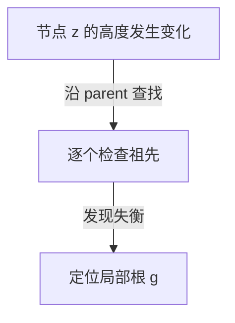
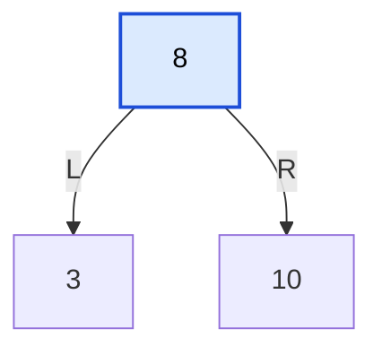
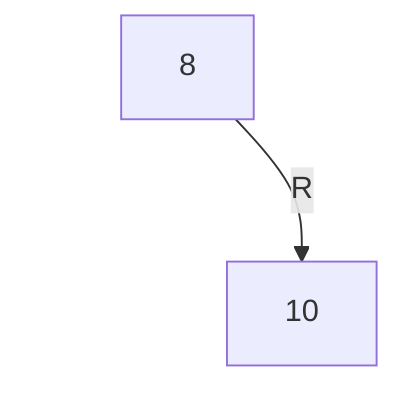

# 第1章\_Mermaid图的语义布局与验证要求

Mermaid 用文本描述节点、连接和过程，再由渲染器排版。本仓库用它帮助读者重建机制：图中的对象与正文相同，箭头说明动作或状态流，图后解释关键转折。图并不替代问题背景，也不能因为成功生成 SVG 就认定技术关系正确。

本文是图形写作规则；编辑器工具选择见 [Mermaid 工作流说明](../../../.github/instructions/mermaid.instructions.md)。正文优先就地使用 `mermaid` 围栏，只有独立素材或工具确实需要时才另建 `.mmd`，避免维护两份手工同步的权威图源。

## 1.1\_先明确图要表达的关系

选择图型之前，先说明箭头是什么。硬件图可以表示连接或请求传递，调用图表示调用关系，阅读地图表示前置依赖；它们不能只因为都画箭头就互相替代。状态转换适合状态图，跨角色交接适合时序图，所有权和布局适合关系图。

涉及多 CPU、任务或组件时，正文与图应共同交代状态放在哪里、谁写谁读、怎样通知和何时完成。时序图默认使用 `autonumber`，正文按步骤号解释重要交接。无法放在同一条时间线上的正常与异常方案，应拆成对象命名一致的两张图，而不是让一个 `alt` 掩盖动作是否发生。

本仓库的修改版 Typora 会适配图片和正文宽度，支持放大、全屏及动图。作者应保证内容完整、连接正确和标签可读，不为了把图压进一个固定宽度删掉必要关系。图过于拥挤时按解释问题拆分，而不是按屏幕像素硬切。

## 1.2\_标签保持原生语法并与正文同名

流程图节点使用有意义的英文 `snake_case` 标识，显示标签用英文双引号包裹；标识供连线引用，标签供读者阅读。角色本来就叫 `x`、`y` 或 `g/p/n` 时，可以保留这些有解释的名称，不必强改成另一套称呼。



这里正文中的 z、parent、g 与图中的对象对应，箭头写出动作。流程图标签过长时用 `<br/>` 换行，不用字面 `\n`。不要把整个 Mermaid 代码块当 HTML 再转义一遍；尤其不要破坏连接语法中的 `-->`。

需要显示引号、比较符或解析器保留符号时，优先改写为清楚的自然语言；确实需要原字符，再按 [Mermaid 官方流程图语法](https://mermaid.js.org/syntax/flowchart.html) 的特殊字符与实体规则处理，并在目标版本实际渲染。原记录把普通 `"`、`<`、`>` 列为“HTML 实体”是不准确的；也不能把“不做整块 HTML 转义”扩张为禁止 Mermaid 自身支持的标签转义。

## 1.3\_树图先保证左右语义再检查几何位置

二叉搜索树（BST）按关键字关系区分左、右子树；AVL 树和红黑树还维护各自的平衡约束。图中左右关系是算法语义，不能仅靠渲染器把节点放在画面左侧还是右侧来猜。因此用真实父子边建立层级，并显式标记 `L`、`R`。



这是三个真实节点的关系，8 是当前根。不要用 `level0`、`level1` 等透明子图伪造层级；`subgraph` 应用于真实业务分组。官方语法说明某些外部连线会影响子图方向，因而仅在一个编辑器中“摆得整齐”并不能保证其他渲染器同样排列。

### 1.3.1\_空孩子何时需要画出来

若省略空孩子会使读者误认单侧子树，应标出空位置。教学上优先显示 `∅` 或 `NULL`，并说明它不是一个已分配的树节点。若图的关注点是旋转前后的空间关系，也可以使用透明占位节点维持空位，但必须在图注说明它只参与排版；它不代表真实节点、线程或额外指针对象。



此图表达 8 没有左孩子、右孩子是 10。第一条边仅把透明空位放在左边，所以隐藏它；`linkStyle 0` 按声明顺序引用第一条边，增删前面的边后必须重新核对。透明占位不是算法状态，不能把它画进遍历步骤或节点计数。渲染后若仍产生左右误导，应改用显式空节点或其他图型。

## 1.4\_颜色标记当前推理中的角色

颜色用于区分局部根、旋转支点、新位置或状态变化；同一章节前后保持含义一致，并用文本或边标签提供第二种识别方式。红黑树中的红黑颜色表示树自身的状态，不应被“关注节点高亮”覆盖而丢失语义。

| 样式名 | 建议用途 | 常用配色 |
| --- | --- | --- |
| `root_node` | 当前局部根 | 浅蓝底、深蓝边 |
| `pivot_node` | 旋转支点或关键孩子 | 浅绿底、深绿边 |
| `focus_node` | 本步骤新上移或重点节点 | 浅黄底、深橙边 |
| `normal_node` | 同图其他真实节点 | 浅青底、深青边 |
| `ghost` | 仅用于空位排版 | 节点与边透明 |

下面给出可放进同一个流程图围栏中的样式语句。它们不是一张独立图，因此用普通文本代码块展示，避免渲染器把 `classDef` 当作图类型：

```text
classDef root_node fill:#dbeafe,stroke:#1d4ed8,stroke-width:2px,color:#000;
classDef pivot_node fill:#dcfce7,stroke:#16a34a,stroke-width:2px,color:#000;
classDef focus_node fill:#fde68a,stroke:#d97706,stroke-width:2px,color:#000;
classDef normal_node fill:#e0f2fe,stroke:#0284c7,stroke-width:2px,color:#000;
classDef ghost fill:transparent,stroke:transparent,color:transparent;
```

单旋可以使用 x、y、T1～T3，失衡和双旋可以使用 g、p、n、T1～T4，但应沿本章实际算法统一，不能图中一套名字、代码又换一套。浅色只是常用方案，不要求所有简单关系图都凑齐五种颜色。

## 1.5\_兼容性需要渲染证据

Typora、VS Code 预览扩展与 GitHub 可能包含不同 Mermaid 版本、布局器及安全设置。使用原生常见语法能减少差异，但不能保证所有环境像素一致。引入新图型或新语法前，查目标运行时版本及官方说明；没有验证的阅读器不得写“完美适配”。

每张图先检查语义和完整代码，再实际渲染并目视：关键标签是否被裁切，箭头是否指向正确对象，树的左右关系是否被颠倒，颜色含义是否仍清楚。记录实际使用的渲染器与版本；截图或 SVG 可作为检查证据，正文保留可编辑图源。导出或发布到另一环境时，再检查该环境的显示。

本页三个示例已在仓库 Mermaid 11.17.0 的浏览器渲染环境中检查；这不等于运行过所有版本的 Typora、VS Code 和 GitHub。图后说明与可访问的文字关系仍然保留，便于读者在图像不可显示时理解当前讨论。
